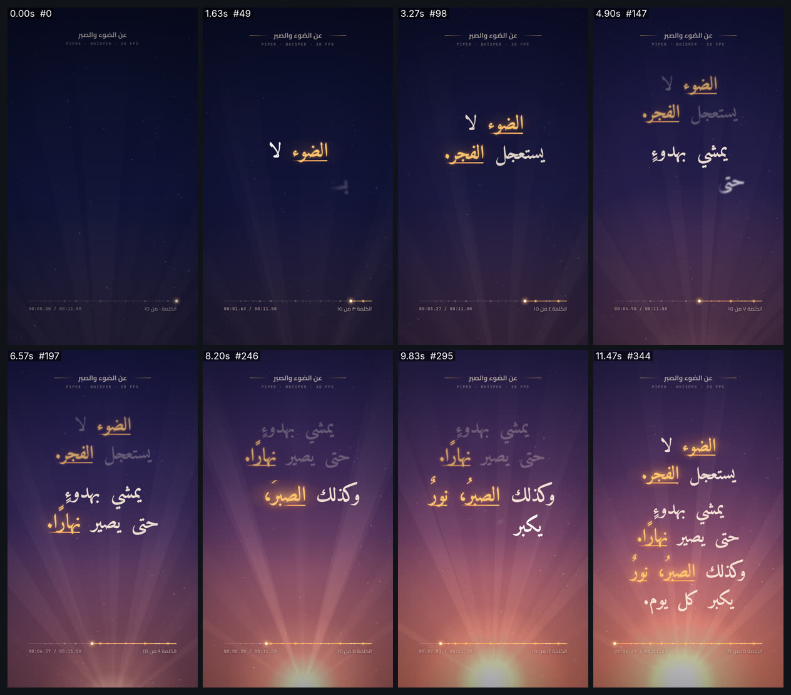

# arabic-voice-kinetic — كلمات عربية تدخل على صوتها



<div dir="rtl">

## بالعربية

**ماذا يثبت:** فيلم 9:16 ‏(1080×1920، ‏30 إطارًا/ث، ‏11.5 ث) لجملة كتبناها بأنفسنا: «الضوء لا يستعجل الفجر. يمشي بهدوءٍ حتى يصير نهارًا. وكذلك الصبرُ، نورٌ يكبر كل يوم.» ينطقها Piper ‏(ar_JO kareem)، ويدخل كل كلمة على بداية نطقها. القياس: أقصى فرق **33 ms** (إطار واحد)، ولم تظهر أي كلمة قبل نطقها، والكلمات 15 من 15. الصوت المرفق بالفيلم مضبوط على −14 LUFS.

**القدرات المستعملة:**
- **صوت وتوقيت:** يعطي Piper مدة كل فونيم، فنعرف منها التوقيت الحقيقي لكل كلمة. يفرّغ faster-whisper ‏(small) النص بنفسه، فطابقت كلماته النص المكتوب 15 من 15. لكن توقيته يسبق النطق بوسيط 135 ms، ويصل الفرق إلى 670 ms بعد الوقفات. لهذا أخذ الفيلم توقيته من Piper، ووضعنا أرقام Whisper في `asr_start` لنقارن بها.
- **دخول الكلمة:** يكشف قناع ناعم الكلمة من اليمين إلى اليسار في 0.42 ث، مع صعود 34px بنابض (k=180، c=19)، وضباب يقل من 9px إلى 0. تبدأ الشفافية من 12% حتى تُرى الكلمة في أول إطار بعد بداية نطقها. القناع يغطي الكلمة كاملة، فلا تنفصل حروفها.
- **إبراز الكلمات المفتاحية:** خمس كلمات (الضوء، الفجر، نهارًا، الصبر، نور) يتحول لونها إلى ذهبي ‎#ffc56e‎ مع توهج بنصف قطر 28 و70px وهالة خلفها، ويُرسم تحتها خط بمنحنى inOutCubic طوال مدة نطقها. عند انتهاء الجملة تخفت كلماتها إلى 30% وتبقى الكلمات المفتاحية على 78%.
- **الكاميرا:** حركات مدتها 0.95 ث بمنحنى inOutCubic تضع الجملة المنطوقة عند y=905، مع اقتراب بطيء من 1.00 إلى 1.03. في الخاتمة تتراجع إلى 0.94 فتظهر القصيدة كاملة.
- **الخلفية:** تدرّج من ليل نيلي (‎#080c22‎) إلى فجر وردي (‎#c76a52‎) على مدى الفيلم. يصعد مصدر الضوء من y=2360 إلى y=1890، وحوله 11 شعاعًا تدور بسرعة 2.2°/ث، و110 ذرات غبار، وحبيبات بنسبة 7% مولّدة بالبذرة نفسها في كل إطار.
- **الخطوط:** Amiri Bold بحجم 112 وارتفاع سطر 1.5 مع `text-wrap: balance`، فتنقسم الأسطر 2+2 ثم 2+3 ثم 3+3. العناوين بخط Cairo 700، والوقت بخط JetBrains Mono. في الأسفل شريط تقدّم فيه علامة لكل كلمة، وعدّاد بالأرقام العربية.

**إعادة الإنتاج** (من جذر kosif-tool؛ ضع في `OUT` أي مجلد مؤقت):
```bash
P=.claude/skills/kosif-superpowers/proofs/arabic-voice-kinetic; OUT=/path/to/scratch/proofs/arabic-voice-kinetic
bash $P/make_voice.sh $OUT <venv> <models>/ar_JO-kareem-medium.onnx <models>/hf   # صوت + words.json + نسخة −14 LUFS
node $P/sync_probe.cjs $P/index.html 30 100                                         # قياس التزامن
node tools/render_html.cjs --in $P/index.html --out $OUT/arabic-voice-kinetic.mp4 --width 1080 --height 1920 --fps 30 --preview
node tools/render_html.cjs --in $P/index.html --out $OUT/arabic-voice-kinetic.mp4 --width 1080 --height 1920 --fps 30 --audio $OUT/voice_delivery.wav
python3 tools/verify_video.py $OUT/arabic-voice-kinetic.mp4 --aspect 9:16 --fps 30 --duration 11.5 --audio $OUT/voice_delivery.wav --lufs -14
```

**نتيجة الفحص:** نجحت الفحوص الـ13 كلها: H.264 ‏yuv420p، ‏1080×1920، ‏30 إطارًا/ث، ‏11.500 ث (345 إطارًا)، صوت AAC بتردد 48 kHz، شدة −14.0 LUFS، ذروة حقيقية −4.6 dBFS، وطول الصوت 11.500 ث يطابق الأصل. فحص التزامن: `SYNC OK words=15 max|delta|=33 ms early=0`.

**حدود صريحة:**
- لا يعطي Piper الصوت نفسه في كل تشغيل، لأن ضوضاء التوليد بلا بذرة. لذلك يعيد `make_voice.sh` إنشاء الصوت و`words.json` معًا دائمًا.
- مع صوت بشري لا يوجد توقيت من Piper. يبقى Whisper مع ضبط الوقفات، وخطؤه نحو ±150 ms (قسناه بوسيط 103 ms وأقصى 258 ms). للوصول إلى 100 ms أو أقل يلزم محاذاة قسرية بنموذج CTC.
- تحققنا بالنظر إلى لوحة المعاينة وستة إطارات منفردة فقط، ولم نستمع إلى الصوت.

</div>

## English

**What it proves:** an 11.5 s vertical film (1080×1920, 30 fps) of an original three-sentence Arabic line, voiced by Piper (ar_JO kareem). Each word appears on its spoken start: the largest measured delta is **33 ms** (one frame), no word appears early, and all 15 words match. The muxed audio is delivered at −14 LUFS.

**Families and techniques:**
- **voice-tts, audio-sync-captions:** Piper ≥1.8 phoneme alignments give the true timing of every word. faster-whisper small transcribes the voice independently, and its words match the script 15/15. Its start times are early, though: median 135 ms, up to 670 ms after a pause. So the film is timed from Piper, and the Whisper times stay in `asr_start` for the audit.
- **typography-arabic, easing-timing-rhythm:** each word enters with a 0.42 s soft right→left mask wipe, a 34 px spring rise (k=180, c=19) and a 9→0 px de-blur. Opacity starts at a 12% floor so the word is visible on the first frame at or after its start. The mask covers the whole word, so Arabic joining is never split.
- **light-glow-bloom:** five key words turn gold (#ffc56e) with 28/70 px glows and a halo. An underline draws in (inOutCubic) over the length of the spoken word.
- **camera-composition-layout:** 0.95 s inOutCubic moves keep the speaking sentence at y=905, with a 1.00→1.03 push-in. Finished sentences dim to 30% (key words stay at 78%). In the outro the camera pulls back to 0.94 to show the whole poem.
- **color-palette-grading:** the sky moves from night (#080c22) to dawn (#c76a52) across the film. The light rises from y 2360 to 1890, with 11 rays at 2.2°/s, 110 dust motes and 7% seeded grain.
- **engines-render-pipeline, qa-verification:** a deterministic `__kosif.seek(t)` page renders with `render_html.cjs`. `sync_probe.cjs` seeks every frame and records when each word first becomes visible. The final file passes `verify_video.py`.
- **Fonts:** Amiri Bold 112/1.5 with `text-wrap: balance`, Cairo 700 and JetBrains Mono 500 (OFL, loaded from `../_shared/fonts`).

**Audio chain:** `synth_voice.py` (length_scale 0.95, 0.30 s between sentences) → 0.6 s lead-in, padded to an 11.5 s / 48 kHz master (the voice itself is untouched) → delivery copy: acompressor 3:1 above −24 dB, alimiter at −9 dBFS, then two-pass `loudnorm` in linear mode (I −14, TP −1, LRA 11).

**Re-render:** see the commands above. Each script prints its own measurements.

**Verify:** `13/13 checks passed` — H.264 yuv420p, 1080x1920, 30.000 fps, 11.500 s, 345 frames, AAC 48 kHz, −14.0 LUFS, true peak −4.6 dBFS, audio 11.500 s vs master 11.500 s. Sync probe: `SYNC OK words=15 max|delta|=33 ms early=0`.

**Limits:**
- Piper's noise is not seeded, so every voice run is a new take. `make_voice.sh` always regenerates the voice and `words.json` together.
- For a human voice there are no Piper timings, so Whisper with pause snapping is the fallback. Its error is about ±150 ms (measured here: median 103 ms, max 258 ms). Getting under 100 ms needs a CTC forced aligner.
- The visual check covered the contact sheet and six single frames only. The audio was not listened to.

Files: `index.html` (film), `words.json` / `words.js` (timing), `line.txt` (the line and its key words), `synth_voice.py`, `transcribe.py`, `align_words.py`, `make_voice.sh`, `sync_probe.cjs`, `sheet.jpg`. The MP4 and WAV files stay in the scratch folder.
