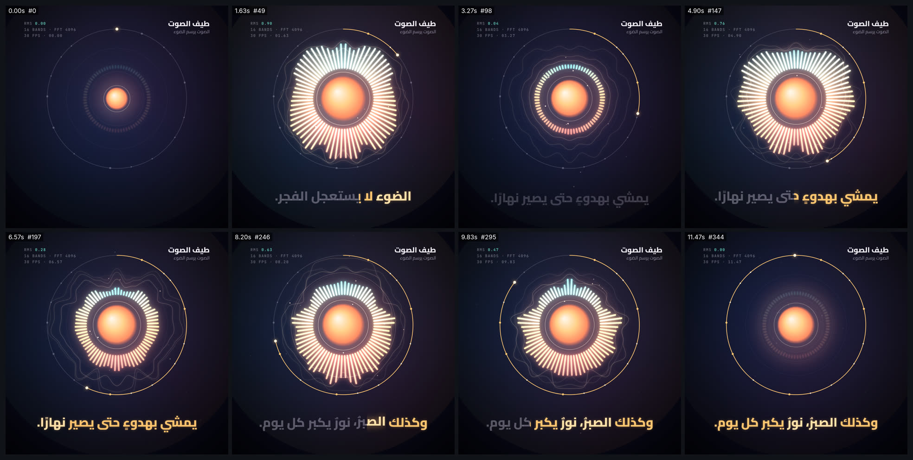

# audio-reactive-spectrum — طيف دائري يتنفس مع الصوت



<div dir="rtl">

## بالعربية

**ماذا يثبت:** فيلم مربع (1080×1080، ‏30 إطارًا/ث، ‏11.5 ث) يتحرك مع الصوت. استخرجنا الخصائص الصوتية مسبقًا بلغة Python لكل إطار: شدة RMS وطاقة 16 نطاقًا ترددية. الصوت هو صوت proof ‏`arabic-voice-kinetic` نفسه (Piper ar_JO kareem). في الفيلم طيف دائري من 72 عمودًا، ونواة يكبر حجمها مع RMS، وترجمة كاريوكي مأخوذة من `words.json`. الصوت المرفق مضبوط على −14 LUFS.

**القدرات المستعملة:**
- **الموسيقى والإيقاع (استخراج الخصائص):** يأخذ `extract_features.py` لكل إطار نافذة Hann بطول 4096 عينة (85 ms عند 48 kHz) يكون الإطار في وسطها. يحسب منها 16 نطاقًا موزعة لوغاريتميًا من 70 Hz إلى 9 kHz، ويطبّع كل نطاق على حدة من p99 إلى p99−42 dB. ويحسب RMS لشريحة طولها 1/30 ث، ويطبّعها من p95 إلى p95−30 dB. ثم يطبّق غلافًا بنسبة صعود 0.65 وهبوط 0.20 لكل إطار، داخل Python لا في الصفحة. لهذا يمكن القفز إلى أي إطار مباشرة دون الرجوع إلى الإطارات السابقة.
- **الأشكال والتوهج:** يتحرك 72 عمودًا متناظرًا: الترددات المنخفضة في الأسفل والعالية في الأعلى، وألوانها تتدرج من المرجاني ‎#ff7a59‎ إلى الذهبي ‎#ffc56e‎ ثم الفيروزي ‎#6fe3d0‎. تُرسم الطبقة ثلاث مرات: بضباب 16px، ثم 4px، ثم بلا ضباب، بمزج `lighter`. خلفها ثلاثة أطياف للإطارات f−4 وf−8 وf−12 تُرسم منحنيات ناعمة، فتترك أثرًا متتابعًا دون أي حالة محفوظة. ومع كل بداية صوت (حين يرتفع RMS بأكثر من 0.32 خلال إطارين) تنطلق موجة دائرية مدتها 0.7 ث. فيه أيضًا 90 جسيمًا مولّدة بالبذرة، وسرعتها تتبع RMS لحظة ولادتها.
- **النواة تتنفس:** مقياسها `1 + 0.24·RMS` مع تنفس هادئ بنسبة 1.5%، فيتراوح فعليًا بين 0.991 و1.245، أي +24.5%، ضمن نطاق الأشكال 10–30%. أما الترجمة فمقياسها `1 + 0.045·RMS`، وأقصاه +4.5%، ضمن نطاق النص 3–6%.
- **الترجمة والتزامن:** خط Cairo 800 بحجم 60px. تمتلئ كل كلمة بالذهبي من اليمين إلى اليسار عبر `clip-path` يغطي الكلمة كاملة، فلا تنفصل الحروف المتصلة. تخرج الجملة السابقة بعد آخر كلماتها بـ0.02 ث، ثم تدخل التالية قبل أول كلماتها بـ0.2 ث، فلا تتراكب جملتان. القياس: يبدأ ملء كل كلمة بعد بداية نطقها بـ**35 ms** على الأكثر، والسطر ظاهر بأكثر من 50%.
- **حلقة التقدّم:** تسير مع عقارب الساعة من الأعلى، وفيها علامة لكل كلمة.

**إعادة الإنتاج** (من جذر kosif-tool):
```bash
P=.claude/skills/kosif-superpowers/proofs/audio-reactive-spectrum; OUT=/path/to/scratch/proofs/audio-reactive-spectrum
V=/path/to/scratch/proofs/arabic-voice-kinetic          # الصوت من proof الصوت
cp $V/voice_delivery.wav $OUT/voice.wav; cp $V/voice_master.wav $OUT/voice_master.wav
<venv>/bin/python -I $P/extract_features.py $OUT/voice_master.wav $P/features.json $P/features.js 30 4096
node tools/render_html.cjs --in $P/index.html --out $OUT/audio-reactive-spectrum.mp4 --width 1080 --height 1080 --fps 30 --preview
node tools/render_html.cjs --in $P/index.html --out $OUT/audio-reactive-spectrum.mp4 --width 1080 --height 1080 --fps 30 --audio $OUT/voice.wav
python3 tools/verify_video.py $OUT/audio-reactive-spectrum.mp4 --aspect 1:1 --fps 30 --duration 11.5 --audio $OUT/voice.wav --lufs -14
```
نستخرج الخصائص من النسخة الأصلية غير المضغوطة لأن مداها الديناميكي أوسع، ونرفق بالفيلم النسخة المضبوطة على −14 LUFS. توقيت النسختين واحد.

**نتيجة الفحص:** نجحت الفحوص الـ13 كلها: H.264 ‏yuv420p، ‏1080×1080، ‏30 إطارًا/ث، ‏11.500 ث (345 إطارًا)، صوت AAC بتردد 48 kHz، شدة −14.0 LUFS، ذروة حقيقية −4.6 dBFS، وطول الصوت 11.500 ث يطابق الأصل.

**حدود صريحة:**
- التحليل مخبوز مسبقًا: إذا تغيّر الصوت يجب تشغيل `extract_features.py` من جديد، فالصفحة لا تحلل الصوت أثناء العرض.
- النطاقات مطبّعة كلٌّ على حدة، فالشكل يعبّر عن توزّع الطيف لا عن مستويات مطلقة.
- الصوت كلام لا موسيقى، فالحركة تتبع المقاطع والوقفات، ولا يوجد إيقاع منتظم.
- عند ملء الكلمة تبقى حروفها متصلة، لكن قد يمر خط الكشف في منتصفها.
- تحققنا بالنظر إلى لوحة المعاينة وستة إطارات منفردة فقط، ولم نستمع إلى الصوت.

</div>

## English

**What it proves:** an 11.5 s square film (1080×1080, 30 fps) driven by audio features that Python extracts for every frame ahead of time. It reuses the Piper Arabic voice from `arabic-voice-kinetic`. On screen: a 72-bar circular spectrum, a breathing core that follows RMS, a glow, and karaoke captions from `words.json`. The muxed audio is at −14 LUFS.

**Families and techniques:**
- **music-beat-sound (feature extraction):** for each frame, a 4096-sample Hann window (85 ms at 48 kHz) centred on t = f/30. It computes 16 log-spaced bands from 70 Hz to 9 kHz, each normalised on its own (p99−42 dB → p99, raised to the power 1.3). RMS uses a 1/30 s slice, mapped from p95−30 dB to p95. An attack/release envelope (0.65 / 0.20 per frame) is applied in Python, not in the page, so `seek(t)` never needs earlier frames.
- **shapes-morph-geometry, light-glow-bloom:** 72 mirrored bars run bass at the bottom to treble at the top, coloured coral → gold → teal. The layer is drawn three times (16 px blur, 4 px blur, sharp) with `lighter` blending. Echo outlines from frames f−4, f−8 and f−12 are drawn as smooth quadratic curves, so they trail behind without any stored state. RMS onsets (a rise above 0.32 within 2 frames) fire 0.7 s shockwave rings. 90 seeded motes launch faster when RMS is high at their birth.
- **Breathing:** the core scale is 1 + 0.24·RMS plus a 1.5% idle breath, measured at 0.991–1.245 (+24.5%, inside the 10–30% shape range). Captions scale by 1 + 0.045·RMS, at most +4.5% (inside the 3–6% text range).
- **audio-sync-captions, typography-arabic:** Cairo 800 at 60 px. Each word fills gold right→left through a whole-word `clip-path`, so Arabic joining stays intact. Lines hand off strictly in sequence: the old line leaves 0.02 s after its last word and the new line arrives 0.2 s before its first word. Measured: every fill starts at most **35 ms** after the spoken start, while its line is more than 50% visible.
- **engines-render-pipeline, qa-verification:** deterministic `__kosif.seek(t)`, `render_html.cjs`, then `verify_video.py`.

**Re-render:** see the commands above. Features come from the uncompressed master, which has more dynamic range; the film carries the −14 LUFS delivery copy. Both have the same timing.

**Verify:** `13/13 checks passed` — H.264 yuv420p, 1080x1080, 30.000 fps, 11.500 s, 345 frames, AAC 48 kHz, −14.0 LUFS, true peak −4.6 dBFS, audio 11.500 s vs master 11.500 s.

**Limits:**
- The analysis is baked in advance: a new voice needs a fresh `extract_features.py` run. The page does no live audio analysis.
- Each band is normalised on its own, so the shape shows spectral balance, not absolute level.
- The audio is speech, not music: the motion follows syllables and pauses, and there is no regular beat.
- The karaoke wipe keeps every word whole and joined, but it can cross the middle of a word.
- The visual check covered the contact sheet and six single frames only. The audio was not listened to.

Files: `index.html`, `features.json` / `features.js` (345 frames × RMS + 16 bands), `words.json` / `words.js`, `extract_features.py`, `sheet.jpg`. The MP4 and WAV files stay in the scratch folder.
