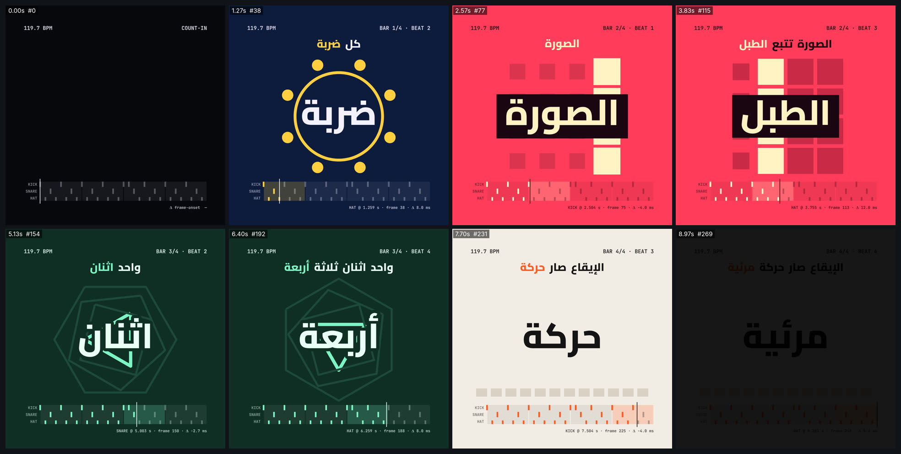

# beat-sync — صورة تضرب على الإيقاع (1:1)



<div dir="rtl">

## بالعربية

**ماذا يثبت:** فيلم مدته 9 ث بمقاس 1080×1080 و30 إطارًا/ث. كل إطار فيه دالة خالصة للزمن `seek(t)`. نولّد في البداية حلقة طبول بسرعة 120 نبضة/دقيقة بالكود وحده (numpy): كيك وسنير وهاي-هات وباص يُخفَض صوته عند كل كيك. بعدها يكتشف librosa النبضات والضربات من الصوت نفسه ويكتبها في `beats.json`، والفيلم يُقاد بهذا الملف لا بالجدول الأصلي. في الفيلم أربعة مشاهد، مشهد لكل مازورة، ويتبدّل المشهد بقطع حاد على أول نبضة من كل مازورة. على كل نبضة تدخل كلمة عربية كاملة وتنبض، وتُبنى الجملة فوقها من اليمين إلى اليسار. الهاي-هات يحرّك أشكالًا صغيرة، والسنير يومض الخلفية، والكيك يقرّب الإطار كله. وفي الأسفل شبكة إيقاع حية (HUD): ثلاثة مسارات للكيك والسنير والهاي-هات، ومؤشر تشغيل، وقراءة الفرق بالمللي ثانية بين كل ضربة والإطار الذي ظهرت فيه.

**الأرقام:**
- النبضة: الحجم يقفز من 1.0 إلى 1.15 على إطار الضربة نفسه، ثم يعود إلى 1.0 خلال 120 مللي ثانية (outQuad). الهاي-هات يعود خلال 100 مللي ثانية. الكيك يقرّب الإطار كله بنسبة 2%، والسنير يضيف وميضًا بشفافية 0.16.
- المزامنة: الضربة تظهر على أقرب إطار لها (`round(t·30)/30`). و120 نبضة/دقيقة تساوي 15 إطارًا بالضبط لكل نبضة.
- الكشف: librosa بتردد 48 kHz وقفزة 128 عينة (دقة 2.7 مللي ثانية)، وأدوات `onset_detect` و`beat_track`. نوع كل ضربة (كيك أو سنير أو هات) يُحدَّد من التدفق الطيفي في ثلاثة نطاقات: أقل من 150 Hz، ومن 150 إلى 4000 Hz، وأكثر من 6000 Hz. النتيجة: 32 ضربة من 32 صُنّفت كلها صحيحة. السرعة المكتشفة 119.68 نبضة/دقيقة، ومتوسط خطأ الكاشف مقارنةً بالحقيقة المولّدة 5.2 مللي ثانية (والأقصى 11.3).
- **القياس على الفيديو النهائي** (`measure_sync.py`): نستخرج الضربات من صوت الـMP4، ونستخرج «أحداث الصورة» من تغيّر البكسلات في وسط الإطار، أي حين يتجاوز متوسط الفرق المطلق بين إطارين عتبة معيّنة. النتيجة: **32/32 ضربة لها حدث بصري. متوسط الفرق +3.2 مللي ثانية، ومتوسط الفرق المطلق 6.5 مللي ثانية، والأقصى 12 مللي ثانية**، وهذا أقل من نصف إطار (16.7 مللي ثانية).
- الألوان، مشهدًا مشهدًا: كحلي `#0d1b3d` مع أصفر `#ffcf3f`، ثم أحمر `#ff3d5a` مع كريمي `#fff3c4` على لوح داكن `#1a0610`، ثم أخضر `#0f2e24` مع نعناعي `#7cf5c4`، ثم ورقي `#f2ede4` مع برتقالي `#ff5a1f`.
- الخطوط: Cairo 800 للعربية (172px للكلمة و54px للجملة)، وJetBrains Mono 700 للأرقام في الشبكة. الكلمات العربية تُرسم كاملة دائمًا ولا تُقسَّم حروفها. حولها حدّ بلون الخلفية بعرض 30px حتى تمرّ خطوط الأشكال خلفها.
- الصوت: الماستر مضبوط على ‎-13.4 LUFS مع محدِّد tanh عند 0.84، فيصل بعد ترميز AAC إلى ‎-14.4 LUFS، وقمته الحقيقية ‎-2.0 dBFS.

**عائلات القدرات:** music-beat-sound, easing-timing-rhythm, typography-arabic, editing-montage (قطع على المازورة), shapes-motion, qa-verification, engines-render-pipeline.

**إعادة الرندر:**

```bash
cd /home/user/kosif-tool
P=.claude/skills/kosif-superpowers/proofs/beat-sync; OUT=/tmp/beat-sync; mkdir -p $OUT   # خارج المستودع
python3 $P/drums.py $OUT/master.wav $P          # numpy soundfile librosa pyloudnorm → master.wav + beats.json + beats.js
node tools/render_html.cjs --in $P/index.html --out $OUT/film.mp4 --width 1080 --height 1080 --fps 30 --preview
node tools/render_html.cjs --in $P/index.html --out $OUT/film.mp4 --width 1080 --height 1080 --fps 30 --audio $OUT/master.wav
python3 tools/verify_video.py $OUT/film.mp4 --aspect 1:1 --fps 30 --duration 9 --audio $OUT/master.wav
python3 $P/measure_sync.py $OUT/film.mp4 $OUT/sync.json
ffmpeg -i $OUT/film_preview.png -q:v 4 $P/sheet.jpg
```

**نتيجة الفحص:** `13/13 checks passed`: H.264 yuv420p بمقاس 1080×1080 و30 إطارًا/ث، 9.000 ث في 270 إطارًا، AAC بتردد 48 kHz، علوّ ‎-14.4 LUFS، قمة ‎-2.0 dBFS، وطول الصوت مطابق للماستر (9.000 = 9.000). القياس: 32/32، ومتوسط الفرق المطلق 6.5 مللي ثانية.

**حدود صريحة:** دقة المزامنة محدودة بإطار واحد (33 مللي ثانية عند 30 إطارًا/ث). الصعود من 1.0 إلى 1.15 يحدث داخل إطار الضربة نفسه، لأن أي صعود أقصر من 33 مللي ثانية لا يُرى أصلًا. الإيقاع مولّد ونظيف، لذلك يسهل كشفه. في موسيقى حقيقية مزدحمة يحتاج الكشف إلى ضبط عتبة `wait` والنطاقات، وقد يخطئ التصنيف. القياس يعتمد على تغيّر البكسلات، فيحتاج إلى مشهد ساكن بين الضربات (لهذا استُبعدت منطقة الشبكة من القياس، لأن مؤشرها يتحرك في كل إطار).

</div>

## English

**What it proves:** a 9 s, 1080×1080, 30 fps film driven by audio analysis rather than a hand-made cue list. `drums.py` synthesizes a 120 BPM loop with numpy: a pitch-swept kick, a noise snare, hats, and a bass that ducks under the kick. librosa then detects onsets and beats in that audio and labels them (kick, snare or hat) by band flux, and the result goes to `beats.json`. The page reads only that file. There are four scenes, one per bar, with a hard cut on each detected downbeat: ring and orbit, RTL tile grid, stepping polygons, and an equaliser. One whole Arabic word punches in on each beat, and the phrase builds RTL above it. Hats, snares and kicks each drive their own elements. A beat-grid HUD shows the detected lanes, a playhead and the per-onset frame Δ.

**Numbers:**
- Punch: 1.0 → 1.15 on the onset frame, then back to 1.0 over 120 ms (outQuad). Hats release over 100 ms, the kick adds a 2 % frame zoom, and the snare adds a flash at α 0.16.
- Onsets are shown on the nearest frame. Detection runs at 48 kHz with hop 128: 32/32 onsets found and labelled correctly, 119.68 BPM detected, and a mean detector error of 5.2 ms against the synthesis ground truth.
- **Measured on the final MP4** (`measure_sync.py`: audio onsets from the muxed AAC versus pixel-change events in the centre band): **32/32 matched, mean offset +3.2 ms, mean |offset| 6.5 ms, max 12 ms** (under half a frame).

**Verify:** `13/13 checks passed` (9.000 s, 270 frames, 1080×1080, AAC 48 kHz, -14.4 LUFS, TP -2.0 dBFS, audio = master).

**Limits:**
- Sync resolution is one frame (33 ms), and the attack happens inside the onset frame.
- The synthetic loop is easy to detect. Dense real music needs tuning of the detector and the band thresholds.
- The pixel-diff measurement assumes the frame is static between hits, which is why the HUD band is excluded from it.
