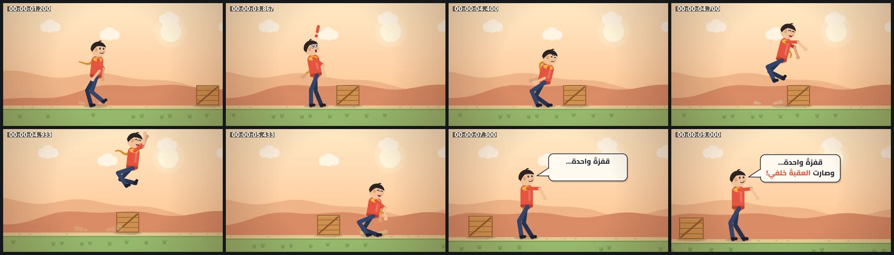

# character-rig — شخصية مسطّحة بهيكل IK وقفزة (16:9)



<div dir="rtl">

## بالعربية

**ماذا يثبت:** فيلم 9.5 ث بمقاس 1920×1080 و30 إطارًا/ث، وكل إطار دالة خالصة للزمن `seek(t)`. شخصية مسطّحة تمشي في منظر صحراوي دافئ، ثم تتوقف وتُفاجأ بصندوق أمامها (تظهر علامة «!»). بعدها تتهيأ بانحناءة وتقفز فوق الصندوق قفزة مقذوفة حقيقية، وتهبط بانضغاط وارتداد. في النهاية تمدّ يدها وتقول في فقاعة كلام عربية: «قفزةٌ واحدة… وصارت العقبةُ خلفي!». الصوت مولّد بالكود ومتزامن مع الأحداث نفسها: خطوات على الحصى، وصوت اندفاع عند القفز، وارتطام عند الهبوط، و«فرقعة» عند ظهور الفقاعة، وصوت بلا كلمات يشبه الكلام.

**التقنيات والأرقام:**
- **IK بعظمتين** (`ik()` بقانون جيب التمام) للساقين والذراعين. الفخذ والساق 116px لكل منهما، والعضد 84px والساعد 80px. الركبة تنثني للأمام والمرفق للخلف. للاطلاع على الهيكل افتح `index.html?bones=1`.
- **مشية إجرائية بلا انزلاق:** طور كل قدم `c = (d/C) mod 1` حيث `d` هي المسافة المقطوعة فعلًا. في النصف الأول من الطور (`stance`) تُثبَّت القدم في إحداثيات العالم، وفي النصف الثاني (`swing`) تتحرك بقوس inOutSine ترتفع فيه 44px. الخطوة 118px، والسرعة 290px/ث، أي 2.46 خطوة في الثانية. تمايل الورك `9·cos(4πd/C)` (أخفض نقطة عند لحظة ملامسة الأرض)، والذراعان تتأرجحان ±26° بعكس الساقين. التوقف ينتهي بـ«خطوة تسوية» للقدم الخلفية.
- **انضغاط وتمدد مع تهيؤ ومتابعة:** انحناءة التهيؤ تُنزل الورك 62px خلال 0.44 ث، وتضغط الجذع إلى `sy = 0.87`. التمدد عند الإقلاع `+16%`. الطيران مقذوف بجاذبية ثابتة، والقمة على ارتفاع 300px. الهبوط: `sy = 1 − 0.24·e^(−6.5τ)·cos(13τ)` مع `sx ≈ 1/sy` للحفاظ على الحجم. الرأس يتأخر قليلًا عن الجسم (`26·e^(−5τ)·sin(13(τ−0.05))`)، والذراعان تتجاوزان وضع الراحة ثم تستقران. أما الوشاح فسلسلة Verlet من 9 حلقات تُحسب من t=0، فتبقى النتيجة نفسها عند أي قفز في الزمن.
- **تعابير وجه قابلة للتبديل:** محايد، ثم متفاجئ، ثم مصمِّم، ثم فرِح، ثم متكلم. عند كل تبديل «نبضة» في حجم الرأس `1 + 0.07·e^(−14τ)·cos(30τ)`، وهناك 3 رمشات، وفتحة الفم تتبع توقيت كل كلمة.
- **كاميرا تتبع بنابض حرِج التخميد** (ω=2.6، وللتكبير ω=3.2) تُحسب من t=0 بخطوة 1/240 ث. تنظر 260px إلى الأمام بحسب السرعة، وتتبع الارتفاع بنسبة 20%، وتقترب من ×1.18 إلى ×1.26 أثناء الكلام. خلفية بثلاث طبقات منظور (parallax): 0.25 و0.5 و1.0.
- **العربية:** خط Cairo بوزن 800 وحجم 50px. كل كلمة تُرسم كاملة ومشكَّلة (لا تُقسَّم الحروف)، وتظهر في موعدها بنبضة outBack من اليمين إلى اليسار. الفقاعة تنبثق بنابض (k=230, ζ≈0.5) من طرف ذيلها.
- **الألوان:** القميص `#e5533f`، والبنطال `#34446b`، والبشرة `#f3c29a`، والوشاح `#f3b33d`، والسماء `#ffe9c6` ثم `#ffc99a`، والأرض `#96b86d`، والصندوق `#cf914f`.

**عائلات القدرات:** characters-rigs, easing-timing-rhythm, camera-composition-layout, typography-arabic, particles-fluids-physics, shapes-morph-geometry, music-beat-sound, engines-render-pipeline, qa-verification.

**إعادة الرندر:**

```bash
cd /home/user/kosif-tool
P=.claude/skills/kosif-superpowers/proofs/character-rig; OUT=/tmp/character-rig; mkdir -p $OUT   # خارج المستودع
node $P/motion.js > $OUT/events.json                       # أحداث الحركة (خطوات، قفز، هبوط، كلمات)
python3 $P/sound.py $OUT/events.json $OUT/master.wav       # يحتاج numpy scipy soundfile pyloudnorm
node tools/render_html.cjs --in $P/index.html --out $OUT/film.mp4 --width 1920 --height 1080 --fps 30 --preview
node tools/render_html.cjs --in $P/index.html --out $OUT/film.mp4 --width 1920 --height 1080 --fps 30 --audio $OUT/master.wav
python3 tools/verify_video.py $OUT/film.mp4 --aspect 16:9 --fps 30 --duration 9.5 --audio $OUT/master.wav
```

للمعاينة الحية: المسافة للتشغيل والإيقاف، والسهمان للتنقّل إطارًا إطارًا، و`?t=4.9` لفتح الفيلم عند لحظة معيّنة، و`?bones=1` لإظهار عظام IK.

**نتيجة الفحص:** `13/13 checks passed`: H.264 yuv420p بمقاس 1920×1080 و30 إطارًا/ث، 9.500 ث في 285 إطارًا، صوت AAC بتردد 48 kHz، علوّ ‎-14.0 LUFS، وقمة حقيقية ‎-2.4 dBFS، وطول الصوت مطابق للماستر (9.500 = 9.500).

**حدود صريحة:**
- الشخصية ثنائية الأبعاد، والمشهد جانبي فقط، ولا يوجد التفاف للجسم.
- الوجه مرسوم بأشكال بسيطة وليس بنظام شفاه (visemes)؛ الفم ينفتح وينغلق مع كل كلمة فقط.
- الصوت «كلام» بلا كلمات (مقاطع صوتية مركّبة)، وليس نطقًا عربيًا.
- الكاميرا والوشاح يُحسبان من t=0 في كل إطار. هذا رخيص هنا (أقل من 3000 خطوة)، لكنه يحتاج تخزينًا مؤقتًا في الأفلام الطويلة.

</div>

## English

**What it proves:** a 9.5 s, 1920×1080, 30 fps character film in which every frame is a pure function of `seek(t)`. A flat character walks, stops, is surprised by a crate («!»), anticipates with a crouch, jumps it on a true ballistic arc, lands with squash and follow-through, then says in an Arabic speech bubble: «قفزةٌ واحدة… وصارت العقبةُ خلفي!». The foley is synthesized from the same motion events: gravel steps, a take-off whoosh, a landing thump, a bubble pop and wordless voice blips.

**Techniques:**
- **2-bone IK** (law of cosines) for the legs (116/116 px) and arms (84/80 px). Knees bend forward and elbows back. Open `?bones=1` to see the skeleton.
- **Procedural walk without foot sliding:** each foot's phase is `c = (d/C) mod 1`, driven by the distance actually travelled. During stance the foot is pinned in world space; during swing it follows an inOutSine arc with a 44 px lift. Stride is 118 px at 290 px/s (2.46 steps/s), the hip bob is `9·cos(4πd/C)` (lowest at contact), the arms swing ±26° against the legs, and a settle step ends the walk.
- **Squash and stretch:**
  - Anticipation lowers the hip 62 px and squashes the body to sy 0.87.
  - Take-off stretches it +16 %, then the jump follows a ballistic arc with a 300 px apex.
  - On landing, sy = 1 − 0.24·e^(−6.5τ)·cos(13τ) and sx ≈ 1/sy, so volume is preserved.
  - The head lags behind the body, the arms overshoot before settling, and a 9-link Verlet scarf is integrated from t = 0 so seeking stays deterministic.
- **Swappable expressions:** neutral, surprised, determined, joy and talk. Each swap gets a head pop, there are 3 blinks, and the mouth opens on each word's timing.
- **Camera:** a critically damped spring follow (ω 2.6, zoom ω 3.2) integrated at 240 Hz. It looks 260 px ahead in proportion to speed, follows 20 % of the height and zooms from ×1.18 to ×1.26 for the dialogue. The parallax layers move at 0.25, 0.5 and 1.0.
- **Arabic:** Cairo 800 at 50 px. Whole shaped words pop in RTL with outBack at their own times, and the bubble springs from its tail.

**Re-render:** see the commands above. The verify result was `13/13 checks passed` (-14.0 LUFS, TP -2.4 dBFS, 285 frames, 9.500 s).

**Limits:**
- The rig is 2D side-view only, with no body turn.
- There are no visemes, just mouth flaps.
- The voice is wordless synthesis, not Arabic speech.
- The camera and scarf are re-integrated from t = 0 every frame. That is cheap here, but a long film would need caching.
