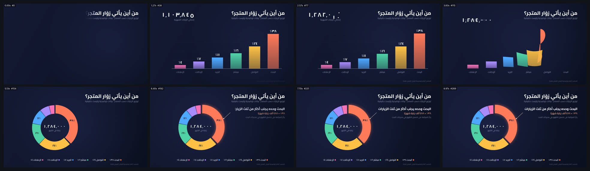

# data-story — قصة بيانات: أعمدة تتحول إلى حلقة (16:9)



<div dir="rtl">

## بالعربية

**ماذا يثبت:** فيلم 9 ث بمقاس 1920×1080 و30 إطارًا/ث، كل إطار دالة خالصة للزمن `seek(t)`. يجيب الفيلم عن سؤال «من أين يأتي زوّار المتجر؟» بأرقام **توضيحية وليست حقيقية**، ومذكور ذلك على الشاشة: إجمالي 1,284,000 زيارة شهريًا، موزّعة بين بحث 38%، وتواصل 24%، ومباشر 16%، وبريد 11%، وإحالات 7%، وإعلانات 4%.

يبدأ برسم المحور من اليمين إلى اليسار. ثم تنمو ستة أعمدة من خط الأساس بنابض مُخمَّد وتتابع 75 ms، وفوق كل عمود قيمته تصعد معه. يدور عدّاد بأسلوب العدّاد الميكانيكي (odometer) حتى يصل إلى ١٬٢٨٤٬٠٠٠. بعدها **يتحوّل كل عمود إلى قوس** في حلقة دائرية (donut)، وتنتقل أسماء الفئات من تحت الأعمدة إلى صف مفتاح ملوّن، وينزلق العدّاد إلى مركز الحلقة. أخيرًا تبرز شريحة «البحث» ويُرسم خط إشارة (leader line) منها إلى تعليق يظهر من اليمين إلى اليسار: «البحث وحده يجلب أكثر من ثلث الزيارات · ٣٨٪ ≈ ٤٨٨ ألف زيارة».

**التقنيات بالأرقام:**
- النابض بصيغة مغلقة في t: k = 170 وc = 15، أي ζ ≈ 0.58 مع تجاوز خفيف. التتابع 75 ms بين الأعمدة.
- التسمية فوق العمود تتبع ارتفاع النابض، وقيمتها لا تتجاوز الهدف. لا تتداخل التسميات لأن لكل عمود عرض 150px، والتسمية لا تتجاوز ثلاثة محارف بحجم 44px.
- العدّاد ميكانيكي: كل خانة تساوي ⌊v/10ᵏ⌋ mod 10، ولا تدور إلا حين تنتقل الخانة الأدنى من ٩ إلى ٠ (آخر 10% من دورتها)، مع outExpo بين 0.7 و2.7 ث. القيمة النهائية دقيقة.
- التحويل من عمود إلى قوس: محيط المستطيل ومحيط القطاع الحلقي يُؤخذان بنفس البنية (44 + 12 + 44 + 12 نقطة). الحافة العليا تقابل القوس الخارجي، والجانب يقابل الحافة الشعاعية، والقاعدة تقابل القوس الداخلي. نقطة بنقطة بـ inOutCubic خلال 1.15 ث، بتتابع 85 ms.
- الحلقة: نصف القطر الخارجي R = 300 والداخلي r = 186، وفجوة 0.014 راديان، والبداية من الساعة 12 مع اتجاه عقارب الساعة (نفس ترتيب القراءة RTL). الشريحة الكبرى تبرز 18px (outBack).
- خط الإشارة يُرسم بطول المسار (inOutCubic خلال 0.8 ث). نص التعليق يظهر بقناع من اليمين، ويُصغَّر الخط تلقائيًا ليبقى داخل الصندوق.
- **نظام أرقام واحد:** كل الأرقام هندية عربية (٠–٩)، مع فاصل الآلاف ٬ وعلامة النسبة ٪.
- الألوان: `#ff7a59`، و`#ffc145`، و`#4fd1a5`، و`#4ea8ff`، و`#a78bfa`، و`#f472b6`، على خلفية من `#141a33` إلى `#0b1020`. الخط Cairo المتغيّر (OFL) بأوزان 500/600/800.

**عائلات القدرات:** charts-data-infographics, typography-arabic, easing-timing-rhythm, shape-morph, hand-drawn-draw-on, color-palette-grading, camera-composition-layout, engines-render-pipeline, qa-verification.

**إعادة الرندر:**

```bash
cd /home/user/kosif-tool
P=.claude/skills/kosif-superpowers/proofs/data-story; OUT=/tmp/data-story; mkdir -p $OUT
node tools/render_html.cjs --in $P/index.html --out $OUT/film.mp4 --width 1920 --height 1080 --fps 30 --preview
node tools/render_html.cjs --in $P/index.html --out $OUT/film.mp4 --width 1920 --height 1080 --fps 30
python3 tools/verify_video.py $OUT/film.mp4 --aspect 16:9 --fps 30 --duration 9 --no-audio
ffmpeg -i $OUT/film_preview.png -q:v 4 $P/sheet.jpg
```

لتغيير البيانات عدّل مصفوفة `DATA` و`TOTAL` في أعلى `index.html`. يجب أن يكون مجموع النسب 100.

**نتيجة الفحص:** `8/8 checks passed`: H.264 yuv420p 1920×1080 16:9, 30 fps, 9.000 s, 270 frames, silent deliverable (`--no-audio`).

**حدود صريحة:**
- الفيلم صامت.
- التحويل خطي نقطة بنقطة، فتمرّ الأشكال في منتصف الحركة (حول 3.8 ث) بأشكال وسيطة مشوّهة قليلًا. التحويل القطبي سيكون أنعم.
- التسميات داخل الشرائح تظهر فقط للنسب ≥ 10%، والصغرى موجودة في المفتاح.
- علامة ٪ تظهر يسار الرقم كما يقتضي اتجاه RTL.
- الأرقام توضيحية فقط.

</div>

## English

**What it proves:** a 9 s, 1920×1080, 30 fps data story built from illustrative numbers, which the film labels as not real.
- Bars grow from the baseline with a closed-form damped spring (k 170, c 15, ζ ≈ 0.58) and a 75 ms stagger, with value labels riding each bar top.
- A mechanical odometer (columns roll only on carry) counts to ١٬٢٨٤٬٠٠٠.
- Each bar morphs into a donut arc by point-wise interpolation of outlines with matching topology (44/12/44/12 samples, 1.15 s inOutCubic, 85 ms stagger).
- Category labels travel into a legend, and the counter glides into the donut hole.
- The largest slice pops out by 18 px, then a leader line draws on to an RTL-revealed callout.
- Every number uses Arabic-Indic digits, a single digit system.

**Power families:** charts-data-infographics, typography-arabic, easing-timing-rhythm, shape-morph, hand-drawn-draw-on, color-palette-grading, camera-composition-layout, engines-render-pipeline, qa-verification.

**Verify:** `8/8 checks passed`: H.264 yuv420p 1920×1080 16:9, 30 fps, 9.000 s, 270 frames, silent deliverable (`--no-audio`).

**Limits:**
- The film is silent.
- The morph is linear in screen space, so the mid-morph shapes are slightly distorted.
- In-slice labels appear only for slices of 10 % or more.
- The data is illustrative only.
