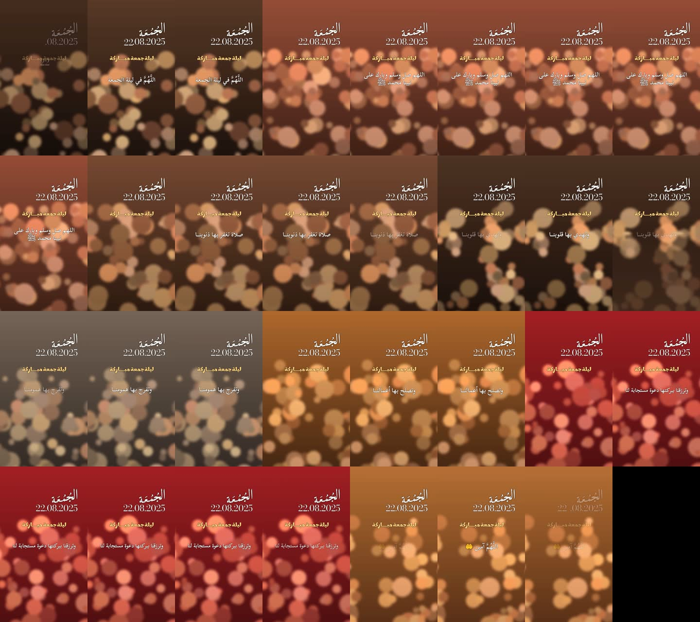

# dua-style — أسلوب «الدعاء» محفوظ كعدة قابلة لإعادة الاستخدام



<div dir="rtl">

## بالعربية

**ماذا يثبت:** أن أسلوب «الدعاء» المقاس من ريل الجمعة محفوظ كعدة تعمل: من ملف `project.json` واحد (لقطات + نص + توقيت + صوت) تبني `styles/dua/kit/build_dua.py` ريلاً 9:16 ‏(1080×1920، 30 إطاراً/ث، 15.4 ث، 8 لقطات، 7 انتقالات) بنفس قواعد المرجع: القطع على بداية العبارة، العنوان والتاريخ والسطر الذهبي ثابتون، رقم اليوم يطير في قوس، سطر الدعاء يظهر ويختفي بالشفافية، والانتقالات (ضبابية، مرآة، زوم، ضبابية دوّارة) على الصورة فقط.

**الصوت:** يُنسخ كما هو (`-c:a copy`). الفحص: الحزم الصوتية الـ665 في الناتج مطابقة بايت ببايت للملف الأصلي وبنفس الترتيب.

**المواد:** كل شيء هنا أصلي: 8 صور بوكيه دافئة مولّدة بالكود ونغمة بديلة هادئة بدل الصوت. لا شيء من المقطع المرجعي ولا صوته ولا حساب صاحبه.

</div>

## English

**What it proves:** the measured «الدعاء» style is saved as a working kit. One `project.json` (clips, lines, timings, voice) goes into `styles/dua/kit/build_dua.py` and comes out as a 9:16 reel (1080×1920, 30 fps, 15.4 s, 8 shots, 7 transitions) that follows the reference rules: cut on the phrase onset, persistent title/date/gold line, the day number's arc flight, opacity-only dua lines, and blur/mirror/zoom/spin transitions on the footage only.

**Audio:** stream-copied. Check: all 665 output audio packets are byte-identical to the input file, in order.

**Material:** all original. 8 procedural warm bokeh stills and a quiet stand-in tone replace footage and voice. Nothing from the reference reel, its audio or its creator handle.

## Reproduce (from the kosif-tool root)

```bash
P=.claude/skills/kosif-superpowers/proofs/dua-style; OUT=/path/to/scratch/dua-proof
python3 $P/make_demo_assets.py $OUT                                  # 8 stills, stand-in tone, project.json
python3 styles/dua/kit/build_dua.py $OUT/project.json --out $OUT/dua_proof.mp4
python3 .claude/skills/kosif-superpowers/scripts/verify_video.py $OUT/dua_proof.mp4 --aspect 9:16 --fps 30 --duration 15.4 --audio $OUT/voice_standin.m4a --lufs -48
diff <(ffmpeg -v error -i $OUT/voice_standin.m4a -map 0:a -c copy -f framemd5 - | grep -v '^#' | awk -F, '{print $NF}') \
     <(ffmpeg -v error -i $OUT/dua_proof.mp4     -map 0:a -c copy -f framemd5 - | grep -v '^#' | awk -F, '{print $NF}') && echo AUDIO_IDENTICAL
```

## Result

`verify_video.py`: 13/13 — H.264 yuv420p, 1080×1920, 9:16, 30 fps, 15.400 s, 462 frames, AAC 44.1 kHz, audio length 15.400 s vs master 15.400 s. The loudness target is the stand-in's own −48 LUFS because the track is copied untouched; with a real voice, pass that voice's loudness, or leave the check failing if the user did not ask for −14 LUFS. `AUDIO_IDENTICAL` with 665 packets. Build time on CPU: about 72 s.
