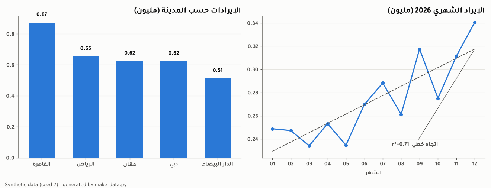
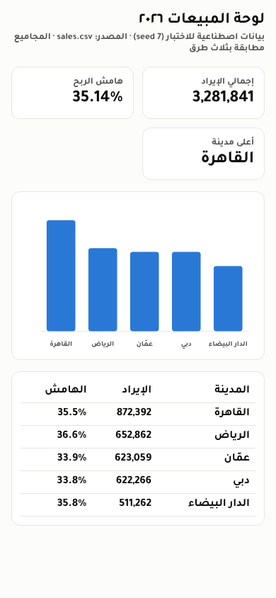
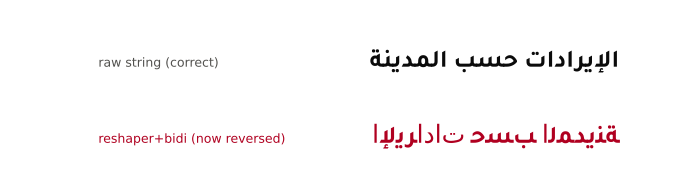

# general-data — تحليل بيانات بأرقام مطابقة / Data analysis with reconciled numbers

Proves the data-analysis (ANLY-*), app/dashboard (APP-*) and strategy-maths (PROD-*) powers. A seeded synthetic CSV is analysed with pandas and with DuckDB SQL, and the control totals are reconciled three ways. The script charts the result with matplotlib using Arabic labels, solves exact maths with sympy, optimises and tests with scipy, runs a Monte Carlo risk check, and writes an RTL HTML dashboard that headless Chromium screenshots and prints. Everything ran in a Claude Code cloud container on 2026-10-16. **All data are synthetic** (seed 7), and every output says so.

| chart.png | dashboard.png (390×844) | mpl_arabic_modes.png |
|---|---|---|
|  |  |  |

## Run

```bash
uv venv $S/venv && VIRTUAL_ENV=$S/venv uv pip install numpy pandas duckdb matplotlib sympy scipy arabic-reshaper python-bidi
cd /home/user/kosif-tool/.claude/skills/kosif-superpowers/proofs/general-data
$S/venv/bin/python -I make_data.py $S/data                       # 17 checks, about 3 s
node snap.cjs $S/data/dashboard.html dashboard.png 390 844 $S/data/dashboard.pdf   # Playwright chromium-1194, 0.4 s
node <dataviz skill>/scripts/validate_palette.js "#2a78d6" --mode light            # series colour; dark: "#3987e5" --mode dark
```

## Result: `17/17 checks passed`, plus the screenshot and the palette validator

| # | What ran | Result |
|---|---|---|
| 1 | csv module writes 12 months × 5 cities × 3 channels with `utf-8-sig` (BOM, so Excel shows Arabic) | 180 rows, as expected |
| 2 | pandas 3.0.6 groupby, pivot_table | top city القاهرة 872,392; pivot 12×3 |
| 3 | duckdb 1.5.6 SQL **directly on the CSV**: named CTE, explicit columns, `LAG` month-over-month, `RANK` per month, `NULLIF` zero guard | 60 rows; first month per city has a NULL change (5 NULLs, as expected); 0.05 s |
| 4 | duckdb `COPY … TO 'sales.parquet' (FORMAT parquet)` and count back | 180 rows, 3,590 B |
| 5 | **Control totals three ways**: plain csv module = pandas = duckdb; city subtotals and SQL subtotals add back to the grand total | 3,281,841 every way |
| 6 | scipy 1.18.1 `linregress` on monthly revenue | slope +8,018/month, r² 0.706 |
| 7 | scipy Welch `ttest_ind(equal_var=False)` القاهرة vs عمّان | t 3.60, p 2.2e-3 |
| 8 | scipy `linprog(method="highs")`: max 40x+30y, x+y≤40, 2x+y≤60 | x=y=20, profit 1,400; sympy solves the same vertex exactly |
| 9 | sympy 1.14: break-even `50Q − 30Q − 120000 = 0`; profit (p−20)(1000−10p) maximised through the derivative; ∫e^(−x²) | Q = 6000; p* = 60 (f'' = −20 < 0), profit 16,000; √π |
| 10 | Monte Carlo, 100k seeded draws (demand N(7000,1200), price triangular 44/50/54, unit cost U(28,33), fixed 120,000) | P(loss) 0.356; P5 −33,252, P50 10,570, P95 61,457 |
| 11 | matplotlib 3.11.2 with Tajawal/Amiri registered through `font_manager.addfont` | **this build bundles libraqm 0.10.5**: raw Arabic strings render correctly; the old `arabic_reshaper` + `get_display` recipe now prints them **reversed** (see `mpl_arabic_modes.png`) |
| 12 | Dashboard HTML: `dir="rtl"`, colour tokens on `:root` with a dark-mode override, stat tiles with `tabular-nums`, inline SVG bars with `<title>` tooltips, a table view, no external libraries | 3,847 B |
| 13 | `snap.cjs` (Playwright `chromium.launch()`, viewport 390×844, `page.pdf`) | screenshot 38 KB; `horizontal_overflow:false`; PDF embeds `Tajawal-Bold` |
| 14 | dataviz validator on the series colour | light `#2a78d6` and dark `#3987e5`: all checks PASS (lightness band, chroma, contrast ≥ 3:1) |

## Lessons

1. **Detect the matplotlib build before shaping Arabic.** Check `matplotlib.ft2font.__libraqm_version__`. When it is present, pass raw strings; only older builds need reshaper + bidi. Shaping twice reverses the text. The Pillow 12 wheels behave the same way (see general-media).
2. **Never quote a number you have not reconciled.** Reconcile it two or three independent ways, freeze the result in `results.json`, and render text and dashboards from that frozen file, never by retyping.
3. **DuckDB reads the CSV in place,** so you do not need to load it into pandas first. Keep columns explicit and check the expected row counts.
4. **`pdftotext` can reorder the lam-alef ligature on Chromium PDFs.** Text from the dashboard PDF read «لالختبار» for «للاختبار». After extracting Arabic, compare it with the source text, not with what you expect to see.
5. **Integer currency units keep totals exact.** Any float aggregation drifts in the last digit.

## Not proven here

Excel opening the CSV; plotly/altair outputs (see the arsenal snapshot); big data beyond RAM; time-series forecasting libraries (prophet is 📦 only).
