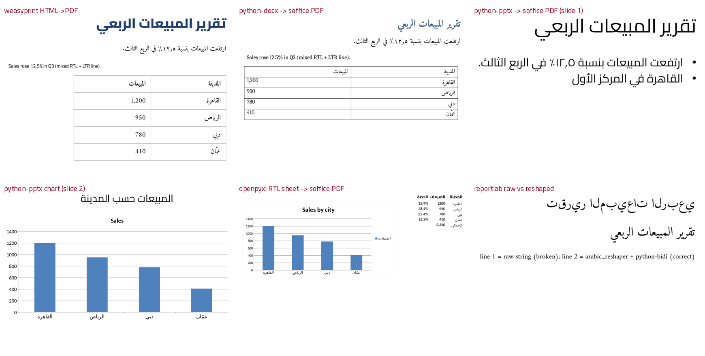

# general-docs — مستندات عربية حقيقية: كتابة وتحويل وقراءة / Arabic office documents, end to end

Proves the documents-office powers (DOC-*) and the web-capture powers (WEB-*): Arabic + English DOCX, XLSX, PPTX and PDF are written, converted with LibreOffice and pandoc, read back, rasterised and OCR'd, all in a Claude Code cloud container on 2026-10-16. Only the scripts, `results.json`, `web_results.json` and `contact.png` are kept here; the generated office files stay in the work dir. Re-run the commands below to regenerate them.



## Environment (2026-10-16; versions change, re-run `scripts/probe_env.py` or the commands)

```bash
S=<scratch dir>                                   # any writable dir
uv venv $S/venv && VIRTUAL_ENV=$S/venv uv pip install python-docx python-pptx openpyxl reportlab weasyprint \
   pypdf pdfplumber pypdfium2 arabic-reshaper python-bidi "markitdown[docx,pdf,xlsx,pptx]" pillow pytesseract \
   httpx trafilatura beautifulsoup4 lxml                     # 6.6 s with a warm uv cache
apt-get install -y tesseract-ocr tesseract-ocr-ara           # 6.1 s, tesseract 5.3.4 (ara, eng, osd)
# already present in the image: soffice (LibreOffice 24.2.7.2), pandoc 3.1.3, pdftotext/pdffonts (poppler)
```

## Run

```bash
cd /home/user/kosif-tool/.claude/skills/kosif-superpowers/proofs/general-docs
$S/venv/bin/python -I make_docs.py   $S/docs      # offline: 24 checks, about 7 s
$S/venv/bin/python -I web_capture.py $S/web       # needs network: 3 checks, about 2 s
```

## Result: `24/24 checks passed` (make_docs.py) and `3/3` (web_capture.py)

| # | What ran | Result |
|---|---|---|
| 1 | python-docx 1.2.0: heading, paragraph, 2-column table in Arabic; RTL set in XML (`w:bidi` on paragraphs, `w:rtl` + `w:rFonts w:cs` + `w:szCs` on runs, `w:bidiVisual` on the table) | written 37,047 B, read back exactly |
| 2 | openpyxl 3.1.5: sheet named «المبيعات», `sheet_view.rightToLeft=True`, `readingOrder=2`, formulas `=B2/SUM($B$2:$B$5)` and `=SUM(B2:B5)`, native BarChart | formulas stored as text; `data_only=True` returns **None** (openpyxl never computes) |
| 3 | `soffice --headless --convert-to xlsx --outdir recalc sales_ar.xlsx` | 1.2 s; cached values now present: total 3340, share 0.35928… |
| 4 | python-pptx 1.0.2: 16:9 deck, Arabic title/body with `a:pPr rtl="1" algn="r"`, `a:rPr lang="ar-SA"`, `a:latin` + `a:cs` typeface Cairo; native clustered column chart | categories read back in order: القاهرة، الرياض، دبي، عمّان |
| 5 | weasyprint 70.0: RTL HTML + `@font-face` Amiri/Cairo from `../_shared/fonts` → A4 PDF | 0.33 s, 17,895 B, fonts embedded as subsets (`ECFSSB+Amiri`, `VZOFRO+Cairo` …) |
| 6 | Read that PDF back | **pypdf 6.21 and pdftotext give logical Arabic** («تقرير المبيعات الربعي»); **pdfplumber/pdfminer give it reversed** («يعبرلا تاعيبملا ريرقت») |
| 7 | reportlab 5.0.1 with a registered TTF | raw Arabic string draws unjoined and reversed; `get_display(arabic_reshaper.reshape(s))` draws correctly (reportlab has no shaper) |
| 8 | `soffice --headless --convert-to pdf` on docx + pptx + xlsx in one call | 1.6 s for all three; Arabic text extractable from each |
| 9 | Fonts: private `fonts.conf` (`FONTCONFIG_FILE`) adding `_shared/fonts` | `pdffonts` shows `Amiri-Regular`/`Amiri-Bold` embedded in the LibreOffice PDF, nothing installed system-wide |
| 10 | markitdown 0.1.8 on docx/xlsx/pptx/pdf | Arabic kept for docx/xlsx/pptx (0.02–0.23 s); PDF comes out reversed (it uses pdfminer) |
| 11 | pandoc 3.1.3: Markdown with `dir: rtl` metadata → docx → GitHub Markdown | Arabic table survives the round trip |
| 12 | pypdf: merge 3 PDFs, rotate page 1 by 90°, AES-256 password, reopen | 4 pages, `/Rotate 90`, password works |
| 13 | "Scanned" page: pypdfium2 renders the PDF at 300 dpi (no text layer) → tesseract `ara+eng --psm 4` | title and English line recovered, 0.78 s |
| 14 | Contact sheet: every PDF page rendered with pypdfium2, cropped to ink, tiled | `contact.png` 50 KB; inspected by eye: all Arabic joined and right-aligned |
| W1 | httpx 0.28 GET `https://www.un.org/ar/about-us/universal-declaration-of-human-rights` through the agent proxy | 200, 132,931 B, 0.49 s |
| W2 | trafilatura → Markdown main text, bs4 title, front matter with source URL + UTC fetch time, pandoc → docx | 1,560 words; docx keeps Arabic and the source line |
| W3 | Same client on `ar.wikipedia.org` | **403** "respect our robot policy" even with a descriptive User-Agent (curl got 200). Recorded, not worked around |

## Built-in web tools (this session, 2026-10-16)

- `WebSearch` (standard mode), query *"tesseract tessdata_best vs tessdata_fast Arabic ara.traineddata accuracy"*: returned 10 result links plus a summary; no Arabic-specific benchmark was found. Sources included [tesseract wiki: tessdata_fast](https://github.com/tesseract-ocr/tesseract/wiki/Data-Files-in-tessdata_fast/361fb801637d6c7ac0cda8244bdd3c791b4e2f82) and [tesseract issue 2132](https://github.com/tesseract-ocr/tesseract/issues/2132).
- `WebFetch` on [tessdoc Data-Files](https://tesseract-ocr.github.io/tessdoc/Data-Files.html): answered that `tessdata_best` holds the slowest and most accurate LSTM models (retrainable), `tessdata_fast` holds integer models (fastest, least accurate), and `tessdata` is the only set that supports the legacy engine.
- Both tools had to be loaded first with `ToolSearch select:WebFetch,WebSearch`, because they are deferred.

## Lessons (each was observed in this run)

1. **Do not extract Arabic PDF text with pdfplumber or markitdown.** They return visual order. Use `pypdf` or `pdftotext`, then NFKC-normalise and strip U+202A–U+202E marks.
2. **openpyxl writes formulas but never calculates them.** Recalculate with a LibreOffice xlsx→xlsx round trip before reading the numbers or quoting them.
3. **Set fit-to-page for xlsx→PDF.** Without `fitToPage`, LibreOffice split the RTL sheet's chart across two pages (seen in the first run).
4. **Point LibreOffice and weasyprint at fonts with a private `FONTCONFIG_FILE`.** This avoids touching `~/.fonts`. Without it, Arabic falls back to DejaVu Sans.
5. **Only reportlab needs arabic-reshaper + python-bidi.** weasyprint (pango), LibreOffice, Word/PowerPoint XML and Chromium shape Arabic themselves.
6. **lxml elements with no children are falsy.** `el.find(...) or new()` silently duplicates XML nodes, so write `if el is None`.
7. **Expect sites to refuse scripted clients.** Respect a 403 robot-policy answer and do not spoof a client. When the proxy resets a tunnel, `$HTTPS_PROXY/__agentproxy/status` shows `recentRelayFailures`. Retry a bounded number of times, then change source. www.gnu.org failed this way and the UN page worked.

## Not proven here

Opening the files in Microsoft Office; tracked changes and comments; docx template filling; PDF forms; tables inside Arabic PDFs; tessdata_best models.
