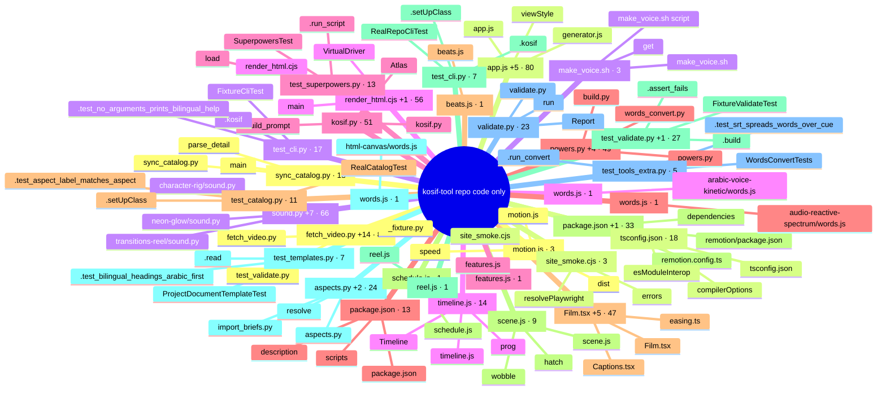

# kosif-tool repo code only: 685 nodes, 1456 edges, 32 communities

- **fetch_video.py +14** (community 0, 81 nodes): `_fixture.py` (20), `fetch_video.py` (19), `test_validate.py` (15)
- **app.js +5** (community 1, 80 nodes): `app.js` (53), `viewStyle` (21), `generator.js` (16)
- **sound.py +7** (community 2, 66 nodes): `character-rig/sound.py` (17), `transitions-reel/sound.py` (17), `neon-glow/sound.py` (15)
- **render_html.cjs +1** (community 3, 56 nodes): `render_html.cjs` (42), `main` (24), `VirtualDriver` (9)
- **kosif.py** (community 4, 51 nodes): `kosif.py` (43), `Atlas` (25), `build_prompt` (16)
- **powers.py +4** (community 5, 49 nodes): `powers.py` (23), `words_convert.py` (15), `build.py` (11)
- **Film.tsx +5** (community 6, 47 nodes): `Film.tsx` (29), `Captions.tsx` (11), `easing.ts` (11)
- **package.json +1** (community 7, 33 nodes): `remotion/package.json` (16), `remotion.config.ts` (6), `dependencies` (5)
- **test_validate.py +1** (community 8, 27 nodes): `FixtureValidateTest` (23), `.build` (19), `.assert_fails` (16)
- **aspects.py +2** (community 9, 24 nodes): `aspects.py` (13), `import_briefs.py` (12), `resolve` (11)
- **validate.py** (community 10, 23 nodes): `validate.py` (18), `run` (14), `Report` (8)
- **sync_catalog.py** (community 11, 18 nodes): `sync_catalog.py` (21), `main` (12), `parse_detail` (5)
- **tsconfig.json** (community 12, 18 nodes): `compilerOptions` (16), `tsconfig.json` (2), `esModuleInterop` (1)
- **test_cli.py** (community 13, 17 nodes): `FixtureCliTest` (18), `.kosif` (16), `.test_no_arguments_prints_bilingual_help` (3)
- **timeline.js** (community 14, 14 nodes): `timeline.js` (8), `Timeline` (6), `prog` (3)
- **test_superpowers.py** (community 16, 13 nodes): `SuperpowersTest` (11), `load` (6), `.run_script` (3)
- **package.json** (community 15, 13 nodes): `package.json` (7), `scripts` (6), `description` (1)
- **test_catalog.py** (community 17, 11 nodes): `RealCatalogTest` (11), `.setUpClass` (2), `.test_aspect_label_matches_aspect` (1)
- **scene.js** (community 18, 9 nodes): `scene.js` (8), `hatch` (3), `wobble` (3)
- **test_cli.py** (community 19, 7 nodes): `RealRepoCliTest` (7), `.kosif` (5), `.setUpClass` (2)
- **test_templates.py** (community 20, 7 nodes): `ProjectDocumentTemplateTest` (7), `.read` (6), `.test_bilingual_headings_arabic_first` (2)
- **test_tools_extra.py** (community 21, 5 nodes): `WordsConvertTests` (5), `.run_convert` (4), `.test_srt_spreads_words_over_cue` (2)
- **motion.js** (community 23, 3 nodes): `motion.js` (2), `dist` (1), `speed` (1)
- **site_smoke.cjs** (community 24, 3 nodes): `site_smoke.cjs` (2), `resolvePlaywright` (1), `errors` (1)
- **make_voice.sh** (community 22, 3 nodes): `make_voice.sh` (2), `get` (1), `make_voice.sh script` (1)
- **words.js** (community 25, 1 nodes): `arabic-voice-kinetic/words.js` (0)
- **features.js** (community 26, 1 nodes): `features.js` (0)
- **words.js** (community 27, 1 nodes): `audio-reactive-spectrum/words.js` (0)
- **beats.js** (community 28, 1 nodes): `beats.js` (0)
- **schedule.js** (community 29, 1 nodes): `schedule.js` (0)
- **reel.js** (community 30, 1 nodes): `reel.js` (0)
- **words.js** (community 31, 1 nodes): `html-canvas/words.js` (0)

## الفهرس / contents
- [Bridges (cross-community edges)](#bridges-cross-community-edges)

## Bridges (cross-community edges)
- fetch_video.py +14 <-> test_validate.py +1: 10 edges
- fetch_video.py +14 <-> aspects.py +2: 6 edges
- fetch_video.py +14 <-> test_cli.py: 4 edges
- kosif.py <-> powers.py +4: 4 edges
- fetch_video.py +14 <-> test_cli.py: 3 edges
