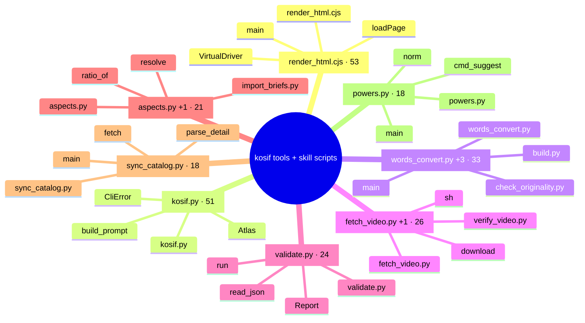

# kosif tools + skill scripts: 244 nodes, 586 edges, 8 communities

- **render_html.cjs** (community 0, 53 nodes): `render_html.cjs` (42), `main` (24), `VirtualDriver` (9), `loadPage` (6)
- **kosif.py** (community 1, 51 nodes): `kosif.py` (43), `Atlas` (25), `build_prompt` (16), `CliError` (12)
- **words_convert.py +3** (community 2, 33 nodes): `words_convert.py` (15), `build.py` (11), `check_originality.py` (10), `main` (8)
- **fetch_video.py +1** (community 3, 26 nodes): `fetch_video.py` (19), `verify_video.py` (14), `download` (8), `sh` (8)
- **validate.py** (community 4, 24 nodes): `validate.py` (17), `run` (14), `Report` (8), `read_json` (5)
- **aspects.py +1** (community 5, 21 nodes): `aspects.py` (12), `import_briefs.py` (12), `resolve` (10), `ratio_of` (5)
- **sync_catalog.py** (community 6, 18 nodes): `sync_catalog.py` (21), `main` (12), `parse_detail` (5), `fetch` (4)
- **powers.py** (community 7, 18 nodes): `powers.py` (23), `main` (10), `cmd_suggest` (8), `norm` (8)

## Bridges (cross-community edges)
- kosif.py <-> words_convert.py +3: 4 edges
- kosif.py <-> aspects.py +1: 3 edges
- fetch_video.py +1 <-> aspects.py +1: 3 edges
- words_convert.py +3 <-> aspects.py +1: 1 edges
