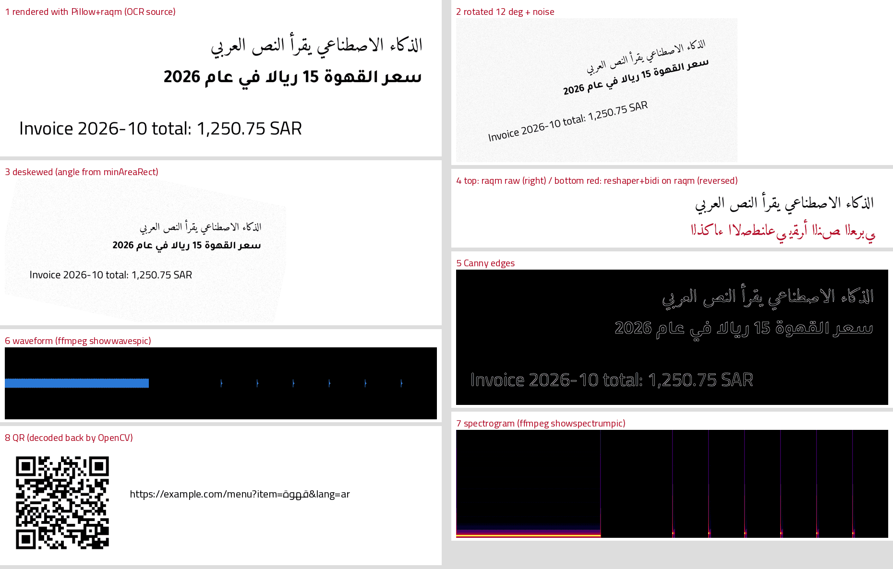

# general-media — صور وصوت ونصوص عربية مقروءة آليًا / Images, OCR and audio

Proves the media-image-audio powers (MEDIA-*). Arabic and English text is rendered with Pillow (raqm), OCR'd with tesseract `ara+eng`, rotated and noised, then deskewed. The script also compresses images and measures their quality, extracts a palette, round-trips a QR code, uses ImageMagick, and analyses, normalises, cuts and transcodes a synthetic audio file. Everything ran in a Claude Code cloud container on 2026-10-16.



## Run

```bash
apt-get install -y tesseract-ocr tesseract-ocr-ara                     # 6.1 s here (root + apt available)
uv venv $S/venv && VIRTUAL_ENV=$S/venv uv pip install pillow opencv-python-headless scikit-image pytesseract qrcode \
   numpy soundfile librosa pyloudnorm pydub audioop-lts arabic-reshaper python-bidi
cd /home/user/kosif-tool/.claude/skills/kosif-superpowers/proofs/general-media
$S/venv/bin/python -I make_media.py $S/media                               # 16 checks + 6 findings, about 8 s
```

## Result: `16/16 checks passed`

| # | What ran | Result |
|---|---|---|
| 1 | Pillow 12.3.0 `features.check("raqm")` | True (raqm 0.10.5, bundled with FriBiDi + HarfBuzz) |
| 2 | Three lines (Amiri Arabic, Tajawal Arabic with Western digits, Cairo English) drawn from **raw logical strings** with `direction="rtl", language="ar", anchor="ra"`; tesseract 5.3.4 `-l ara+eng --oem 1 --psm 6` | similarity 0.99 (lines 1.0 / 1.0 / 0.972), mean word confidence 90.6, 0.41 s |
| 3 | Rotate 12° + Gaussian noise σ 18 → OCR | 0.598 |
| 4 | Deskew: median 3, Otsu, opening, dilate words into line blobs, `cv2.minAreaRect` median angle, rotate back | angle −12.07° (true 12°); OCR **0.912** |
| 5 | Pillow saves PNG / WebP q80 / AVIF q50 / JPEG q85 of a 640×480 synthetic image; PSNR (OpenCV) and SSIM (scikit-image 0.26) | 12,008 / 5,452 / 3,305 / 15,796 B; WebP PSNR 39.7 dB, SSIM 0.982 |
| 6 | `cv2.kmeans` k=4 on a flat background with three discs and noise | disc colours recovered within 0.9–2.3 RGB units |
| 7 | ImageMagick 6 `convert -resize 50% -colorspace Gray -unsharp 0x1` then `identify` | `750 235 Gray` |
| 8 | `qrcode` encodes `https://example.com/menu?item=قهوة&lang=ar`; `cv2.QRCodeDetector().detectAndDecode` | identical string back |
| 9 | numpy synth → soundfile WAV 48 kHz: 2 s 440 Hz, 1 s silence, 3 s clicks at 120 BPM; librosa 1.0 `yin` | 440.6 Hz |
| 10 | librosa `onset_detect` on the click part | 6 onsets, median spacing 0.501 s (119.7 BPM) |
| 11 | pyloudnorm in; ffmpeg 6.1.1 two-pass `loudnorm=I=-14:TP=-1` with `linear=true`; pyloudnorm + `ebur128` out | −18.05 → −13.96 LUFS (pyloudnorm) / −13.9 (ebur128); pass-2 mode **linear** |
| 12 | `silencedetect=noise=-50dB:d=0.5` | silence 2.0 → 3.0 s found |
| 13 | `showwavespic` waveform and `showspectrumpic` spectrogram PNGs | both drawn (contact panels 6–7) |
| 14 | pydub 0.25.1: slice 0–2 s, fade in 200 ms / out 400 ms, export MP3 128k; ffprobe | 2.040 s |
| 15 | ffmpeg → Opus 64k; ffprobe | 6.006 s, 45 KB |
| 16 | Contact sheet | 242 KB, inspected by eye |

## Findings (measured, recorded in `results.json → findings`)

| Input (single line, 56 px, `--psm 7`) | OCR similarity | What tesseract returned |
|---|---|---|
| Amiri, **Arabic-Indic digits** «١٥ … ٢٠٢٦», `-l ara` | 0.839 | the digits became «ه١» and «اير» |
| Amiri, Western digits, `-l ara` | 1.000 | exact |
| Tajawal, phone number «٠١٢٣٤٥٦٧٨٩», `-l ara` | 0.512 | garbage for every digit |
| Cairo, Western digits, `-l ara+eng` | 1.000 | exact (in an exploratory run at 72 px the same line fell to 0.30, with Latin junk words) |
| Reem Kufi (display), `-l ara` | 0.968 | «ريالا في» merged into «ريالافجي» |
| Deskewed scan + adaptive threshold (31, C=15) | 0.814 | worse than the grayscale deskew alone (0.912) |

## Lessons

1. **Pillow 12 and matplotlib 3.11 shape Arabic themselves (raqm).** Pass raw strings to both. The `arabic_reshaper` + `python-bidi` recipe is now only for engines without a shaper (reportlab, older builds); applying it on top of raqm reverses the text (contact panel 4, red line).
2. **Tesseract's stock `ara` model is weak on Arabic-Indic digits and on display or Kufi fonts.** Validate every number it returns: check its range and checksum, and ask for a re-read. Use `-l ara` for purely Arabic lines (`ara+eng` can emit Latin junk), and strip U+200E/U+200F marks from the output. tessdata_best is untested here.
3. **Measure preprocessing before you trust it.** Deskew helped (+0.31), but binarising the image on top of it hurt (−0.10).
4. **ffmpeg's loudnorm silently switches to dynamic compression** when the measured LRA exceeds the target LRA or the true peak has no headroom. Read `normalization_type` from the pass-2 JSON, and set `LRA` above the measured value to keep pure gain. The first run measured −10.9 LUFS in dynamic mode instead of −14.
5. **The waveform filter is `showwavespic`.** There is no `showwavespng`; the first run failed on that name.
6. **pydub on Python 3.13+ needs `pip install audioop-lts`.** The stdlib `audioop` module was removed; without the package the import fails with `No module named 'pyaudioop'`.
7. **librosa misses an onset at sample 0.** Start the analysis window about 0.1 s early.

## Not proven here

Real camera photos or scans; tessdata_best; easyocr; rembg; super-resolution; STT (faster-whisper); stem separation; EXIF tools. Each of these is marked 📦 or 🔑 in the catalog.
