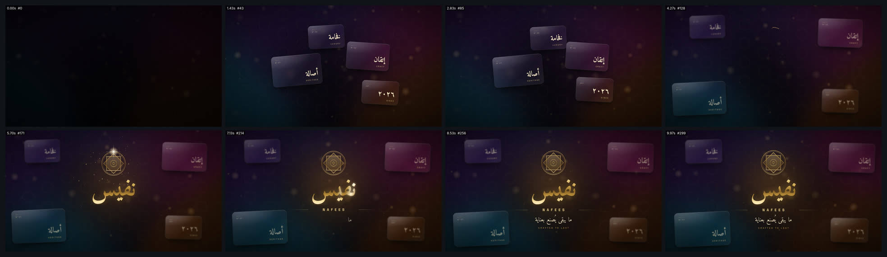

# glass-luxury-logo — كشف شعار فاخر بالزجاج والذهب (16:9)



<div dir="rtl">

## بالعربية

**ماذا يثبت:** فيلم كشف هوية فاخرة مدته 10 ث، بمقاس 1920×1080 و30 إطارًا/ث، وكل إطار دالة للزمن `seek(t)`. يبدأ بخلفية «شبكة تدرّج» حية. تنزلق فوقها أربع بطاقات زجاجية (أصالة، إتقان، فخامة، ٢٠٢٦) بعمق وبارالاكس، ثم تتفرّق إلى أطراف الكادر وتفقد تركيزها لتؤطّر الشعار. بعد ذلك يُرسم شعار هندسي (خاتم ثماني) بخط ذهبي يُرسم أمام العين، وتنكشف كلمة «نفيس» بخط Amiri Bold ذهبي من اليمين إلى اليسار. يعبر الكلمة لمعان معدني (قناع تدرّج متحرك)، ثم تظهر العلامة اللاتينية NAFEES والشعار النصي كلمةً كلمة. الموسيقى التصويرية مولّدة بالكود ومتزامنة مع نقاط التوقيت نفسها.

**رموز الحركة (easing tokens)**، وهي نفس منحنيات `cubic-bezier` في CSS، يحلّها كود JS حتى يكون السحب (scrub) دقيقًا:
- `luxe` = `cubic-bezier(0.16, 1, 0.3, 1)`: للدخول بتباطؤ طويل ناعم.
- `glide` = `cubic-bezier(0.65, 0, 0.35, 1)`: للتنقل والرسم واللمعان.
- `settle` = `cubic-bezier(0.22, 1.2, 0.36, 1)`: لاستقرار الشعار، مع تجاوز بسيط 2–3٪.

**لوحة الذهب:**
- الدرجات: ‎`#4a3110` (900)، ‎`#8a6424` (700)، ‎`#c9a24a` (500)، ‎`#e8cf8a` (300)، ‎`#fff4d6` (100)، والشمبانيا ‎`#f3e6c4`.
- تدرّج المعدن بزاوية 180°: ‎`#fff4d6` عند 0٪، ‎`#f0d793` عند 16٪، ‎`#c9a24a` عند 40٪، ‎`#8a6424` عند 56٪، ‎`#b88d3a` عند 68٪، ‎`#f2dc9c` عند 86٪، ‎`#fff4d6` عند 100٪.
- الكلمة مبنية من أربع نسخ فوق بعضها:
  1. توهّج `#c9a24a` بتمويه 26px وشفافية 0.42.
  2. حافة محفورة `#4a3110` مزاحة 4px للأسفل.
  3. الذهب نفسه عبر `background-clip:text`.
  4. نسخة لمعان `#fffaf0` ثم `#ffe9b8`، يظهر منها شريطان بقناع 105°: شريط رئيسي ±9٪ وشريط تابع أرفع بشفافية 0.55. ولهذه النسخة توهّج `drop-shadow` بـ 10px.

**وصفة الزجاج:** خلفية من `rgba(255,255,255,.16)` إلى `.035`. ‏`backdrop-filter: blur(22px) saturate(150%)`. زوايا 30px. خط إبراز داخلي علوي بسماكة 1px وشفافية 0.45، وحافة داخلية 1px بشفافية 0.13. ظلال ناعمة `0 40px 80px -30px` بشفافية 0.7 و`0 12px 24px -8px` بشفافية 0.35. تحت البطاقات نقش نجوم ذهبية خفيفة (كل 170px، شفافية 0.10) وكرات «بوكيه»، حتى يظهر أثر التجميد عليها فعلًا.

**التوقيت والحركة:**
- الخلفية: شبكة من 6 نقاط تحكّم بأوزان غاوسية (σ²=0.11)، تُحسب كل إطار بدقة 192×108 ثم تُكبَّر.
- البطاقات: أعماقها 1.0 و0.7 و0.45. تدخل خلال 1.5 ث بمنحنى `luxe`، بفارق 0.18 ث بين كل بطاقة وأخرى ابتداءً من 0.30 ث، ودورانها `rotateY` يعود من ±24° إلى 0. تتفرّق بين 3.25 و4.55 ث بمنحنى `glide`، مع تأخير يزيد مع العمق. يصل فقدان تركيزها إلى 1.6 + 3.2×(1−العمق) بكسل.
- الشعار الهندسي: يُرسم بين 4.0 و5.6 ث (`pathLength=1` و`dashoffset`).
- كلمة «نفيس»: تنكشف بين 4.9 و6.25 ث بقناع ناعم من اليمين إلى اليسار، مع تمويه يقلّ من 10px إلى 0.
- اللمعان: بين 6.45 و7.65 ث بالشدة الكاملة، ثم بين 8.85 و9.75 ث بشدة 55٪.
- NAFEES: يضيق تباعد حروفها من 1.1em إلى 0.55em.
- الشعار النصي: يبدأ عند 7.0 ث، كلمة كل 0.17 ث، بارتفاع 16px وتمويه من 6px إلى 0.
- غبار ذهبي من 70 جزيئًا وبريق رباعي يظهران عند 5.45 ث.
- الكاميرا: انجراف بارالاكس، ثم اقتراب من 1.0 إلى 1.035.
- الصورة النهائية: حبيبات بشفافية 0.09، وتظليل أطراف، ودخول من سطوع 0.35.

**العربية:** لا تباعد بين الحروف أبدًا. الكشف يتم بقناع على الكلمة كاملة، والشعار النصي يتحرك كلمةً كلمة. كل النصوص داخل هامش 90px أو أكثر.

**عائلات القدرات:** brand-logo-identity, texture-material, color-palette-grading, typography-arabic, typography-latin, easing-timing-rhythm, hand-drawn-draw-on, light-glow-bloom, camera-composition-layout, particles-fluids-physics, music-beat-sound, qa-verification.

**إعادة الرندر:**

```bash
cd /home/user/kosif-tool
P=.claude/skills/kosif-superpowers/proofs/glass-luxury-logo; OUT=/tmp/glass-luxury-logo; mkdir -p $OUT   # خارج المستودع
python3 $P/sound.py $OUT/master.wav            # يحتاج numpy scipy soundfile pyloudnorm
node tools/render_html.cjs --in $P/index.html --out $OUT/film.mp4 --width 1920 --height 1080 --fps 30 --preview
node tools/render_html.cjs --in $P/index.html --out $OUT/film.mp4 --width 1920 --height 1080 --fps 30 --audio $OUT/master.wav
python3 tools/verify_video.py $OUT/film.mp4 --aspect 16:9 --fps 30 --duration 10 --audio $OUT/master.wav
ffmpeg -i $OUT/film_preview.png -q:v 4 $P/sheet.jpg
```

**نتيجة الفحص:** `13/13 checks passed`: H.264 yuv420p بمقاس 1920×1080 (16:9) و30 إطارًا/ث، 10.000 ث في 300 إطار، صوت AAC بتردد 48 kHz، علوّ ‎-14.0 LUFS، وقمة حقيقية ‎-2.1 dBFS، وطول الصوت مطابق للماستر (10.000 = 10.000).

**حدود صريحة:** الذهب تدرّج ثنائي الأبعاد مع لمعان، وليس انعكاس بيئة حقيقيًا (env-map). تجميد الزجاج يعتمد على `backdrop-filter`، فلا يعمل إلا في Chromium وما شابهه. كلمات البطاقات تخفت إلى 55٪ وتفقد تركيزها في الكادر الأخير، لأنها زخرفة. العلامة «نفيس / NAFEES» متخيَّلة. الرندر يستغرق نحو 7 دقائق لـ300 إطار على 4 أنوية مشتركة.

</div>

## English

**What it proves:** a 10 s, 1920×1080, 30 fps luxury reveal that is fully seekable.
- An animated gradient mesh (6 gaussian-weighted control points, 192×108 per frame, upscaled) sits under a gold 8-point-star lattice and bokeh orbs.
- Four glassmorphism cards (backdrop blur 22 px with saturate 150%, a 1 px inner highlight and soft two-layer shadow) slide in on three parallax depths, then part and defocus to frame the logo.
- A gold khatam emblem draws on via stroke-dashoffset.
- The Amiri Bold «نفيس» logotype is built from four stacked copies: glow, engraved edge, metal gradient and shine. It reveals right-to-left through a soft moving mask, then a two-streak metallic shimmer crosses it (a 105° gradient mask moving from −30 % to 130 %).
- The NAFEES wordmark tightens its tracking, and the tagline enters word by word.
- A synthesized score is cued to the same times.

**Easing tokens:** luxe `cubic-bezier(.16,1,.3,1)`, glide `(.65,0,.35,1)`, settle `(.22,1.2,.36,1)`, solved in JS.

**Gold:** `#4a3110 #8a6424 #c9a24a #e8cf8a #fff4d6`, champagne `#f3e6c4`.

**Power families:** brand-logo-identity, texture-material, color-palette-grading, typography-arabic/latin, easing-timing-rhythm, hand-drawn-draw-on, light-glow-bloom, camera-composition-layout, particles-fluids-physics, music-beat-sound, qa-verification.

**Re-render:** see the commands above.

**Verify:** `13/13 checks passed` (1920x1080, 30 fps, 300 frames, 10.000 s, AAC 48 kHz, -14.0 LUFS, TP -2.1 dBFS, audio = master).

**Limits:**
- The gold is a gradient fake, not an environment map.
- The glass frosting needs Chromium's `backdrop-filter`.
- The brand is fictional.
- Rendering takes about 7 min on 4 shared cores.
