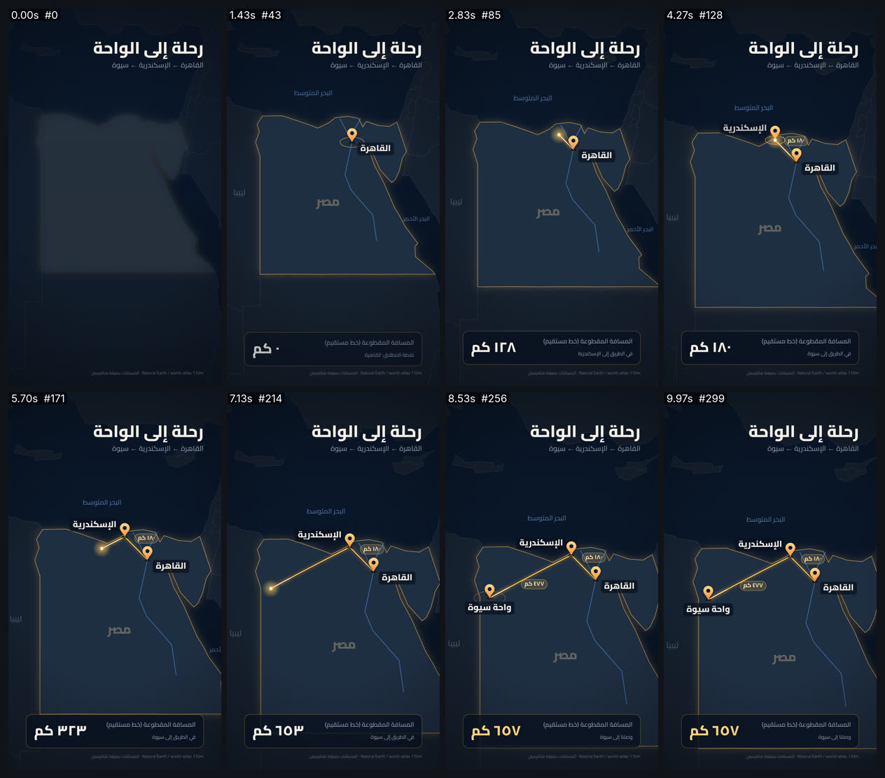

# map-route — رحلة على الخريطة: القاهرة ← الإسكندرية ← سيوة (9:16)



<div dir="rtl">

## بالعربية

**ماذا يثبت:** فيلم 10 ث بمقاس 1080×1920 و30 إطارًا/ث، كل إطار دالة خالصة للزمن `seek(t)`. الخريطة مرسومة من بيانات حقيقية: TopoJSON من `world-atlas@2.0.2/countries-110m.json` (Natural Earth)، عبر d3-geo ‏(`d3@7.9.0`، ‏`topojson-client@3.1.0`) وإسقاط ميركاتور مضبوط على حدود مصر بـ `fitExtent`.

تُرسم حدود مصر بخط ذهبي، ويظهر النيل وفرعاه (مسار تقريبي زخرفي). ثم يُرسم المسار بطول القوس، ورأسه متوهج وله ذيل مضيء. تسقط الدبابيس بارتداد (outBounce) وتصنع موجة عند الهبوط. يعدّ العداد الكيلومترات بصيغة هافرسين، وتقترب الكاميرا ببطء نحو المسار. أسماء الأماكن عربية: القاهرة، الإسكندرية، واحة سيوة، البحر المتوسط، البحر الأحمر، مصر، ليبيا.

**الأرقام:**
- الإحداثيات الحقيقية (خط الطول، خط العرض): القاهرة (31.2357، 30.0444)، والإسكندرية (29.9187، 31.2001)، وسيوة (25.5195، 29.2032).
- هافرسين (R = 6371 كم): القاهرة إلى الإسكندرية ≈ **١٨٠ كم**، والإسكندرية إلى سيوة ≈ **٤٧٧ كم**، والمجموع ≈ **٦٥٧ كم**. هذه مسافة خط مستقيم (دائرة عظمى)، وليست مسافة الطريق.
- المسار: كل رحلة مقسّمة إلى 120 نقطة بـ `d3.geoInterpolate` (دائرة عظمى) ثم مُسقطة. الرسم بـ `setLineDash([s, L])`، والطول المقطوع s يتبع inOutCubic بطول القوس. الرحلة الأولى بين 1.55 و3.75 ث، والثانية بين 4.35 و7.55 ث. الذيل المضيء آخر 110px. والعدّاد يتبع نفس التقدم، فيتطابق الرقم مع موضع الرأس.
- الدبابيس: سقوط من 220px خلال 0.7 ث (outBounce)، ثم ظل بيضاوي، وموجة بنصف قطر من 14 إلى 84px خلال 1.2 ث.
- الكاميرا: تكبير من 1.0 إلى 1.28 (inOutSine بين 0.2 و9.4 ث)، والتأطير النهائي محسوب ليتّسع للمسار مع أعرض تسميتين ضمن هامش الأمان. تتبع الكاميرا الرأس بنسبة 5% أفقيًا و12% عموديًا. سماكة الخطوط مقسومة على التكبير فتبقى ثابتة، والدبابيس والنصوص في فضاء الشاشة.
- وسوم المسافة لكل رحلة توضع على العمود (normal) من منتصفها، في الجهة البعيدة عن الرحلة الأخرى، حتى لا تتداخل مع الأسماء.
- الألوان: البحر من `#0b1a2e` إلى `#06101d`، واليابسة `#16212f`، ومصر `#1f2f42` بحدود `#c9a35a`، والمسار `#ffc857`. الخط Cairo المتغيّر (OFL)، وكل الأرقام هندية عربية.

**عائلات القدرات:** maps-geo, hand-drawn-draw-on, camera-composition-layout, typography-arabic, easing-timing-rhythm, charts-data-infographics, light-glow-bloom, engines-render-pipeline, qa-verification.

**إعادة الرندر:**

```bash
cd /home/user/kosif-tool
P=.claude/skills/kosif-superpowers/proofs/map-route; OUT=/tmp/map-route; mkdir -p $OUT
node tools/render_html.cjs --in $P/index.html --out $OUT/film.mp4 --width 1080 --height 1920 --fps 30 --preview
node tools/render_html.cjs --in $P/index.html --out $OUT/film.mp4 --width 1080 --height 1920 --fps 30
python3 tools/verify_video.py $OUT/film.mp4 --aspect 9:16 --fps 30 --duration 10 --no-audio
ffmpeg -i $OUT/film_preview.png -q:v 4 $P/sheet.jpg
```

**نتيجة الفحص:** `8/8 checks passed`: H.264 yuv420p 1080×1920 9:16, 30 fps, 10.000 s, 300 frames, silent deliverable (`--no-audio`). The real world-atlas loaded (no fallback).

**حدود صريحة:**
- الفيلم صامت.
- الخريطة بدقة 110m، فالسواحل مبسّطة.
- النيل مسار تقريبي مرسوم من إحداثيات مدن، وهو زخرفي.
- المسافات خط مستقيم، أما طريق السيارات الفعلي إلى سيوة عبر مرسى مطروح فأطول.
- الصفحة تحتاج الشبكة لتحميل d3 والأطلس. إن فشل تحميل الأطلس وحده تُستخدم حدود مصر المبسّطة المضمّنة ويُكتب ذلك على الشاشة، لكن هذا البديل يحتاج d3 نفسه. في هذا الرندر حُمّل الأطلس الحقيقي.

</div>

## English

**What it proves:** a 10 s, 1080×1920, 30 fps map journey drawn from real world-atlas 110m TopoJSON with d3-geo (Mercator fitted to Egypt).
- The Egypt border draws on, along with an approximate Nile.
- The route Cairo → Alexandria → Siwa uses real lon/lat and great-circle legs sampled with `geoInterpolate`. It is drawn by arc length with a glowing head and a comet tail.
- Pins drop with outBounce and a landing ripple.
- A haversine km counter is locked to the same progress (legs of 180 km and 477 km, 657 km in total, straight-line).
- The camera pushes in from 1.0 to 1.28 and the final framing is computed to fit the route plus its labels inside the safe margins.
- Place names are in Arabic, and all digits are Arabic-Indic.

**Power families:** maps-geo, hand-drawn-draw-on, camera-composition-layout, typography-arabic, easing-timing-rhythm, charts-data-infographics, light-glow-bloom, engines-render-pipeline, qa-verification.

**Verify:** `8/8 checks passed`: H.264 yuv420p 1080×1920 9:16, 30 fps, 10.000 s, 300 frames, silent deliverable (`--no-audio`). The real world-atlas loaded (no fallback).

**Limits:**
- The film is silent.
- The 110m coastlines are coarse, and the Nile is approximate.
- Distances are straight-line, not road distance.
- The page needs the CDN. Only the atlas has an embedded fallback outline; it was not needed in this render.
