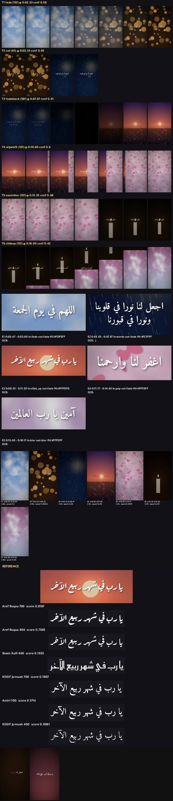

# mimic-synthetic — محاكاة فيديو مرجعي بحقيقة أرضية معروفة (9:16)



<div dir="rtl">

## بالعربية

**ماذا يثبت:** خط أنابيب «KOSIF Mimic» المدمج في المهارة (`scripts/mimic/`) يحلّل فيديو مرجعيًا عموديًا ويعيد بناءه: نفس الصوت الأصلي منسوخًا بلا إعادة ترميز، ونفس الخط والحجم والموضع والظل، ونفس توقيت الحركة النصية، ونفس إيقاع اللقطات والانتقالات والمزاج اللوني. الدليل هنا مرجع اصطناعي يولّده `synthetic/make_reference.py` بحقيقة أرضية مكتوبة في `truth.json`: 7 لقطات، 6 انتقالات (fade، cut، fadeblack، wipeleft، zoomblur، slideup) و5 أحداث نصية بالعربية (fade، كلمة كلمة، slide_up، pop، blur) بخطّين (Amiri Bold وAref Ruqaa Bold).

**بطاقة النتائج** (`synthetic/run_synthetic.py` على هذه الآلة، 2026-10-18):

| القياس | النتيجة |
|---|---|
| نوع الانتقال | 6/6 صحيح |
| مدى الانتقال (±1 فريم) | 6/6 |
| نوع حركة النص | 5/5 |
| الخط المطابَق | 5/5 (من 18 وجهًا في المكتبة) |
| توقيت النص (±2 فريم) | 3/5 — الانحرافات 4 فريمات في بداية slide_up و7 في خروج blur منخفض التباين |
| إعادة البناء (معاينة، بديل مكاني للقطات) | 570/570 فريم، 270×480، الصوت الأصلي منسوخ |

**كيف يعمل:** تحليل اللقطات بفرق إطارات قوي (مع إخفاء النص)، وتصنيف الانتقال بإعادة التركيب (كل نوع يُرسم من الإطارين النقيين قبل وبعد عند 25 قيمة تقدّم ثم مسار برمجة ديناميكية رتيب)، وطبقة النص بألفا حقيقية مقاسة حول الوضع المتتبَّع، وظل مقدَّر بالمربعات الصغرى، ومطابقة الخط بمقارنة الأقنعة (IoU متسامح، نسبة الأبعاد، عرض الضربة، المنحنى الرأسي). التفاصيل في [references/mimic.md](../../references/mimic.md).

**الخطوط:** من `proofs/_shared/fonts` (OFL) و`fonts/kosif-jumuah` فقط؛ لا خطوط تجارية.

**إعادة التشغيل:**

```bash
cd /home/user/kosif-tool/.claude/skills/kosif-superpowers/scripts/mimic
OUT=/tmp/mimic-synth    # خارج المستودع
python3 synthetic/make_reference.py $OUT/ref            # يحتاج numpy Pillow(raqm) ffmpeg؛ OpenCV اختياري
python3 synthetic/run_synthetic.py $OUT/ref $OUT/work   # بطاقة النتائج أعلاه
python3 -c "import mm_build; mm_build.build('$OUT/work', preview=True, placeholder=True)"
```

**حدود صريحة:**
- المرجع اصطناعي؛ على فيديو حقيقي تنخفض ثقة الانتقالات وتوقيت النص منخفض التباين.
- لا تحميل من Pinterest أو أي منصة؛ اللقطات البديلة يوفّرها المستخدم أو `scripts/media_sources.py` بترخيص مثبت.
- لا OCR (tesseract غير مثبت)؛ النص يُكتب يدويًا في `spec.json`.
- لا ملفات فيديو في المستودع؛ الصورة أعلاه مركّبة من لوحات المراجعة وإطارين من المعاينة.

</div>

## English

**What it proves:** the KOSIF Mimic pipeline ported into the skill (`scripts/mimic/`) analyses a vertical reference video and rebuilds it with new footage while copying the original audio stream (never re-encoded), the text style (font, size, position, colour, shadow), the text animation timing, the shot rhythm, the transitions and the colour mood. The proof is a synthetic reference generated by `synthetic/make_reference.py` with ground truth in `truth.json`: 7 shots, 6 transitions (fade, cut, fadeblack, wipeleft, zoomblur, slideup) and 5 Arabic text events (fade, word-by-word, slide_up, pop, blur) in two fonts (Amiri Bold, Aref Ruqaa Bold).

**Scorecard** (`synthetic/run_synthetic.py` on this machine, 2026-10-18): transitions 6/6 type and 6/6 span (±1 frame); text animation kind 5/5; font match 5/5 out of an 18-face library; text timing within ±2 frames 3/5 (one slide_up start 4 frames late, one low-contrast blur exit 7 frames short); placeholder preview rebuild 570/570 frames at 270×480 with the original audio copied.

**Method:** robust block-median frame difference with text masked for cuts; transition classification by re-synthesis (every kind rendered from the pure frames before and after at 25 progress values, a monotone dynamic-programming path picks the progress per frame); text layer with true per-frame alpha sampled at the tracked pose, least-squares shadow fit and word onsets; font matching by mask comparison (tolerant IoU, aspect, stroke width, vertical ink profile). See [references/mimic.md](../../references/mimic.md).

**Limits:** synthetic reference only (real footage lowers transition confidence and low-contrast timing); no Pinterest or platform scraping, replacement clips come from the user or licensed sources via `scripts/media_sources.py`; no OCR here (tesseract absent); no video is committed, the sheet is assembled from the review sheets and two preview frames.
