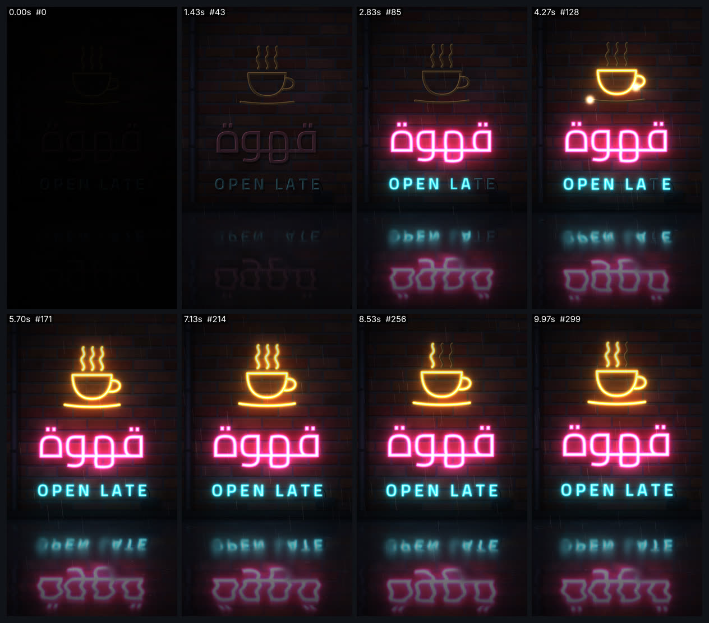

# neon-glow — لافتة نيون حيّة (9:16)



<div dir="rtl">

## بالعربية

**ماذا يثبت:** فيلم 10 ث بمقاس 1080×1920 و30 إطارًا/ث، كل إطار دالة خالصة للزمن `seek(t)`. لافتة مقهى نيون على جدار طوب مبلل بالمطر: كلمة «قهوة» الوردية تشتعل بنمط اشتعال واقعي (توهج مسبق ثم ومضات متقطعة ثم ثبات مع تسخين)، ثم «OPEN LATE» السماوية حرفًا حرفًا وفيها حرف T معطوب يطنّ ثم ينطفئ لحظة في الثانية 7.8. بعدها يُرسم فنجان كهرماني بضوء يسري في الأنبوب، ثم يعمل بخاره كسلسلة مصابيح متتابعة. يمرّ ضوء سيارة على الجدار ويلمع على الزجاج، والأرض المبللة تعكس كل ذلك. والصوت مولّد بالكود ومتزامن مع جدول الاشتعال نفسه.

**وصفة التوهج (الأرقام الفعلية):**
- طبقة الانبعاث = لون الأنبوب الصافي × شدته. تُضاف فوق المشهد بـ `globalCompositeOperation="lighter"` في خمس طبقات تمويه: 3px بشفافية 0.95، و10px بـ 0.75، و26px بـ 0.55 (تُحسب بنصف الدقة)، و64px بـ 0.42 و140px بـ 0.30 (تُحسبان بربع الدقة).
- إضاءة الجدار: خريطة ضوء بربع الدقة = محيط ليلي `#1b1f30` + انبعاث مموّه 40px ×1.0 + انبعاث مموّه 140px ×1.95. تُضرب بعدها (`multiply`) في طوب إجرائي مولَّد ببذرة ثابتة 20261016، فيتلوّن الطوب بلون اللافتة وتبقى فواصل الملاط معتمة.
- قلب الأنبوب الأبيض يُحسب من «حقل مسافة» لقناع الحرف: اللون الصافي على الحافة، ثم `mid` عند d1، ثم `core` عند d2 (للعربية 5 و12px، وللاتينية 4 و9px). لا نستخدم `strokeText` لأن حدود الخط المتغيّر متداخلة، فتظهر خطوطها كندوب داخل الحروف العربية المتصلة.
- الألوان: الوردي `#ff2d95` ثم `#ff8fc8` ثم `#fff1f8`، والسماوي `#17d9ff` ثم `#93f0ff` ثم `#f0fdff`، والكهرماني `#ff9a1a` ثم `#ffc77a` ثم `#fff7e8`. الزجاج المطفأ `#2a1820` وحافته `#6a3a52`.
- الخط: Cairo المتغيّر (OFL) بقطر أنبوب واحد تقريبًا 20px. العربية بوزن 420 وحجم 270px كلمةً كاملة مشكَّلة (لا تُقسَّم الحروف أبدًا). اللاتينية بوزن 640 وحجم 100px وتباعد 22px، وكل حرف أنبوب مستقل.

**التوقيت والحركة:** الجدول كله في `schedule.js`. وميض العربية بين 0.50 و1.50 ث، ثم تسخين من 0.78 إلى 1.0 خلال 0.5 ث (outCubic). الحروف اللاتينية تبدأ عند 2.3 + 0.1×i. رسم الفنجان بين 3.40 و4.65 ث (inOutCubic). البخار يتبدّل كل 0.3 ث من 4.8 ث. ضوء السيارة بين 5.6 و7.4 ث (inOutSine). الطنين = 1 − 0.035·جيب(4.7 هرتز) − 0.03·ضوضاء. الكاميرا تقترب من 1.0 إلى 1.075 مع اهتزاز يدوي ±2px. الانعكاس شرائح مقلوبة بارتفاع 3px فيها تموّج، طبقة حادة في البرك وطبقة ضبابية 16px على الإسفلت، مع خفوت فرينل من 0.9 إلى 0.25. يتساقط مطر من 90 خطًا مع حلقات في البرك، ثم حبيبات فيلم وتظليل أطراف (vignette).

**عائلات القدرات:** light-glow-bloom, texture-material, typography-arabic, typography-latin, easing-timing-rhythm, hand-drawn-draw-on, camera-composition-layout, particles-fluids-physics, music-beat-sound, engines-render-pipeline, qa-verification.

**إعادة الرندر:**

```bash
cd /home/user/kosif-tool
P=.claude/skills/kosif-superpowers/proofs/neon-glow; OUT=/tmp/neon-glow; mkdir -p $OUT   # خارج المستودع
python3 $P/sound.py $OUT/master.wav            # يحتاج numpy scipy soundfile pyloudnorm
node tools/render_html.cjs --in $P/index.html --out $OUT/film.mp4 --width 1080 --height 1920 --fps 30 --preview
node tools/render_html.cjs --in $P/index.html --out $OUT/film.mp4 --width 1080 --height 1920 --fps 30 --audio $OUT/master.wav
python3 tools/verify_video.py $OUT/film.mp4 --aspect 9:16 --fps 30 --duration 10 --audio $OUT/master.wav
ffmpeg -i $OUT/film_preview.png -q:v 4 $P/sheet.jpg
```

للمعاينة الحية افتح `index.html` في المتصفح: المسافة للتشغيل والإيقاف، والسهمان للتنقّل إطارًا إطارًا، و`?t=4.5` لفتح الفيلم عند لحظة معيّنة.

**نتيجة الفحص:** `13/13 checks passed`: H.264 yuv420p بمقاس 1080×1920 و30 إطارًا/ث، 10.000 ث في 300 إطار، صوت AAC بتردد 48 kHz، علوّ ‎-14.1 LUFS، وقمة حقيقية ‎-1.4 dBFS، وطول الصوت مطابق للماستر (10.000 = 10.000).

**حدود صريحة:** الرندر بطيء، نحو 13 دقيقة لـ300 إطار على 4 أنوية، لأن الإطار الواحد يمرّ بعدة تمويهات كاملة. الانعكاس مرآة في فضاء الشاشة حول خط التقاء الجدار بالأرض، وليس نموذج خشونة فيزيائيًا. الإضاءة ثنائية الأبعاد بلا خريطة نتوءات (normal map). رسم الفنجان بضوء يسري أسلوب فني، لأن النيون الحقيقي يضيء الأنبوب كله دفعة واحدة. الصوت مولّد كله بلا تسجيلات حقيقية، وطنين 120 هرتز يفترض شبكة كهرباء 60 هرتز. انعكاس «قهوة» على الأرض مقلوب كما يحدث فعلًا في الطبيعة.

</div>

## English

**What it proves:** a 10 s, 1080×1920, 30 fps neon-sign film in which every frame is a pure function of `seek(t)`. The pink Arabic «قهوة» ignites with a realistic pattern: a 0.12 pre-glow, one-frame strikes, dropouts, then a warm-up ramp. «OPEN LATE» follows letter by letter in cyan, with a faulty buzzing T that drops out at 7.8 s. An amber cup draws on with a travelling hot spot, then its steam runs as a 4-state chaser. A car headlight sweeps the bricks and glints across the glass. The wet floor reflects everything, and the sound is synthesized from the same schedule.

**Glow recipe:**
- The emission layer (pure tube colour × intensity) is added five times with `lighter`, each copy blurred: 3 px α .95, 10 px α .75, 26 px α .55 (½ res), 64 px α .42 and 140 px α .30 (¼ res).
- Wall light: ¼-res light map = ambient `#1b1f30` + 40 px blur ×1.0 + 140 px blur ×1.95. It is multiplied onto a procedural brick albedo (seed 20261016).
- The white-hot core comes from a distance field of the glyph mask (edge colour → mid at d1 → core at d2), not from `strokeText`.
- Palette and fonts are listed in the Arabic section above (Cairo variable, wght 420 at 270 px for Arabic and wght 640 at 100 px for Latin, one tube diameter of about 20 px).

**Power families:** light-glow-bloom, texture-material, typography-arabic/latin, easing-timing-rhythm, hand-drawn-draw-on, camera-composition-layout, particles-fluids-physics, music-beat-sound, engines-render-pipeline, qa-verification.

**Re-render:** see the commands above. The verify result was `13/13 checks passed` (-14.1 LUFS, TP -1.4 dBFS, 300 frames, 10.000 s).

**Limits:**
- Slow: about 13 min for 300 frames on 4 cores.
- The reflection is a screen-space mirror, not a physical roughness model.
- The lighting is 2D, with no normal map.
- The cup draw-on is stylised, since real neon lights a whole tube at once.
- The sound is fully synthesized.
