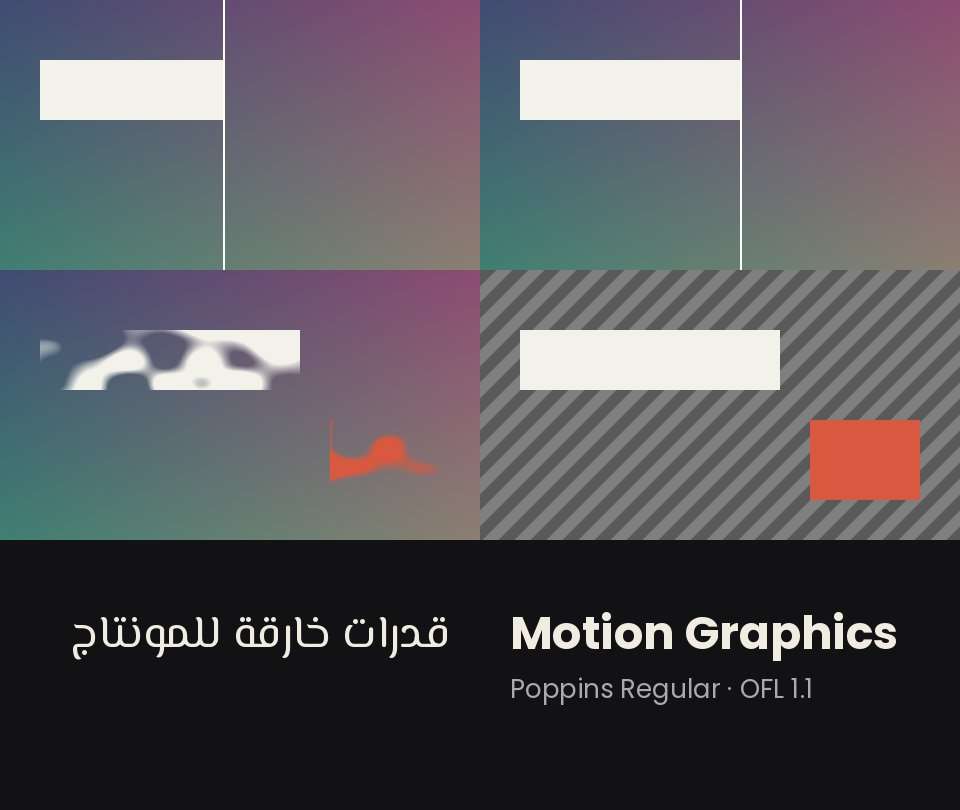

# owner-uploads-20261023 — وصفات حركة من مرفقات المالك وخطان OFL



**ماذا يثبت:** ثلاث وصفات رقمية استخلصناها من مهارة «Claude AI Motion Graphics» (Tao Prompts؛ الأفكار والأرقام فقط، الكود مكتوب من جديد هنا) تعمل كما وُصفت، وخطا El Messiri وPoppins المضافان إلى `proofs/_shared/fonts/` يُرسمان بتشكيل عربي صحيح. التفاصيل في [owner-uploads-review-20261023.md](../../references/owner-uploads-review-20261023.md).

| الفحص | النتيجة (`receipt.json`) | القوة |
|---|---|---|
| منحنى منزلق قبل/بعد | رتيب؛ 0.466 عند 0.8 ث؛ زحف لا يتوقف 0.47 → 0.55 بين 0.9 و2.2 ث؛ ينتهي عند 1.0 | TRANS-U01 |
| حقل الكشف بالضجيج | التغطية 0 → 0.06 → 0.53 → 0.95 → 1 عند p = 0, 0.25, 0.5, 0.75, 1 | PART-U01 |
| طبقة الرسوم من رندرين | IoU = 1.0 مقابل الحقيقة الأرضية الاصطناعية | QA-U01 |
| الخطوط | raqm متاح؛ El Messiri يرسم العنوان العربي متصلًا من اليمين | ARAB-U01 · TYPE-U01 |

**الصف الأول:** المنزلق عند 0.8 ث و2.0 ث. **الثاني:** الكشف عند p = 0.45 والطبقة المستخرجة فوق رقعة شطرنج. **الثالث:** عينتا الخطين.

**أعد التشغيل** (من مجلد المهارة؛ يحتاج numpy وPillow مع raqm):

```bash
python3 proofs/owner-uploads-20261023/proof_uploads.py
```

**What it proves (English):** the slider curve, the reveal field and the graphics-only layer recipe behave as described, and both added OFL fonts render (Arabic shaped via raqm). Synthetic plates only; no footage, no third-party code.
