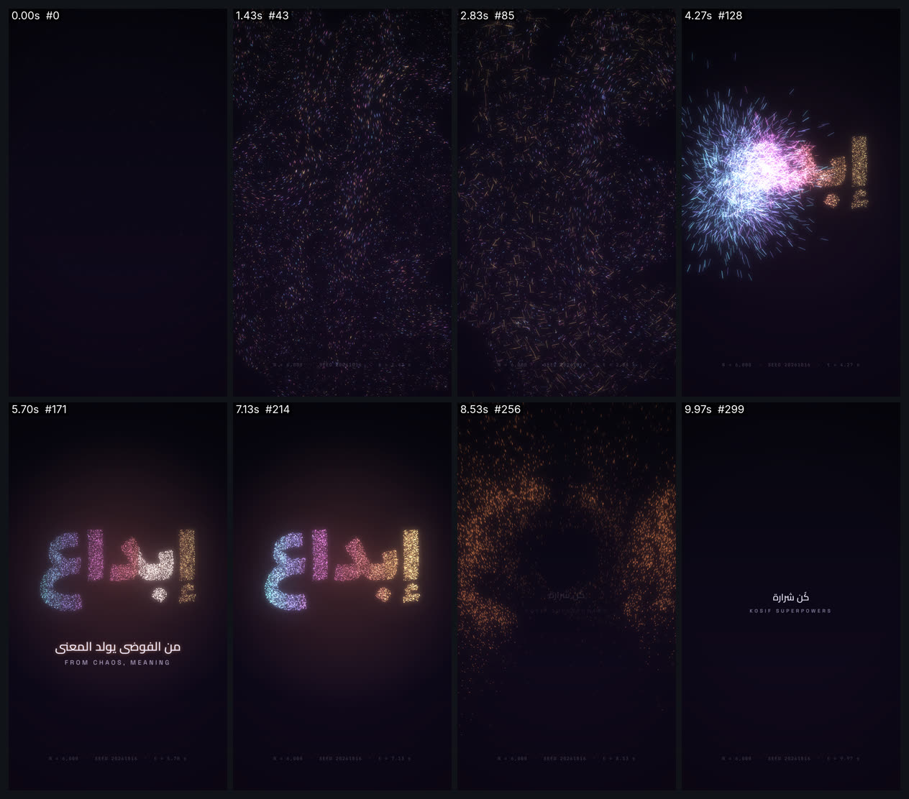

# particles-to-arabic — جسيمات تتجمّع كلمة عربية (9:16)



<div dir="rtl">

## بالعربية

**ماذا يثبت:** فيلم 10 ث بمقاس 1080×1920 و30 إطارًا/ث، كل إطار دالة خالصة للزمن `seek(t)`. ستة آلاف جسيم (N = 6,000، بذرة 20261016) تسبح في حقل «curl noise» خالٍ من التباعد، ثم تنجذب من اليمين إلى اليسار إلى نقاط مأخوذة من صورة كلمة «إبداع» المشكَّلة كاملة (Lalezar)، فتبقى الحروف متصلة. تثبت الكلمة وتتنفس، ويمرّ عليها ضوء من اليمين، ويظهر سطر «من الفوضى يولد المعنى» بقناع ناعم RTL. ثم تنقبض الكلمة 6 % تمهيدًا وتنفجر جمرات بسحب (drag) وطفو، وتنتهي ببطاقة «كُن شرارة».

**التقنيات بالأرقام:**
- الحقل: دالة تيار ψ من 7 موجات جيبية (أطوال 260–1020px وسرعات 38–84px/ث) مع تيار صاعد 18px/ث. السرعة = (∂ψ/∂y, −∂ψ/∂x) بمشتقات تحليلية.
- التكامل: RK2 (نقطة المنتصف) بتردد 60 هرتز حتى 5.4 ث، تُخزَّن كل الخطوات مسبقًا، فيكون `seek(t)` بحثًا وخطيًا دقيقًا لأي t وبأي ترتيب.
- أخذ العينات: الكلمة تُرسم مرة واحدة بالمشكِّل (HarfBuzz) على لوح خفي، ثم تُؤخذ بكسلات ألفا > 150 بخطوة 2px، ثم خلط Fisher–Yates بالبذرة.
- الانجذاب: بداية كل جسيم = 2.2 + 1.1 × (0.72·(1−u) + 0.28·عشوائي) ث، والمدة 1.75 ث (inOutCubic)، ومسار منحنٍ بانحناء جيبي ±0.18–0.50.
- الانفجار عند 7.3 ث: موجة صدمة 3200px/ث، وسرعات 380–2080px/ث. الإزاحة بصيغة مغلقة `(1−e^{−kτ})/k` حيث k = 2.4/ث، مع طفو −46τ²، وعمر 2.5 ث.
- التوهج: رسم إضافي `lighter` مع ذيل حركة 55 ms (أقصاه 34px)، وتوهج بنصف الدقة (blur 6px ×0.95) وبربعها (blur 14px ×0.85). الكاميرا تقترب 1.0→1.075 مع اهتزاز 12px يخمد بمعدل e^{−7t}.
- الألوان: تدرّج على الكلمة من اليمين `#ffd27a` ثم `#ffb067` ثم `#ff7d8e` ثم `#e86bd6` ثم `#8f8cff` ثم `#6fe3ff`، والجمرات `#ff8a3d`، والخلفية `#07060f` إلى `#120a1f`.
- الخطوط (OFL): Lalezar للكلمة، وCairo 600 للسطر العربي، وSpace Grotesk 500 وJetBrains Mono 500 للاتيني.
- الصوت: `sound.py` يولّد خلفية بنفس جدول التوقيت (وسادة، همس انجذاب، جرس تكوّن، انتفاخ عكسي، ضربة 70→38 هرتز، طقطقة جمرات)، ويطبّعها إلى ‎-14 LUFS.

**عائلات القدرات:** particles-fluids-physics, typography-arabic, light-glow-bloom, easing-timing-rhythm, camera-composition-layout, color-palette-grading, music-beat-sound, engines-render-pipeline, qa-verification.

**إعادة الرندر:**

```bash
cd /home/user/kosif-tool
P=.claude/skills/kosif-superpowers/proofs/particles-to-arabic; OUT=/tmp/particles-to-arabic; mkdir -p $OUT   # خارج المستودع
python3 $P/sound.py $OUT/master.wav            # يحتاج numpy scipy soundfile pyloudnorm
node tools/render_html.cjs --in $P/index.html --out $OUT/film.mp4 --width 1080 --height 1920 --fps 30 --preview
node tools/render_html.cjs --in $P/index.html --out $OUT/film.mp4 --width 1080 --height 1920 --fps 30 --audio $OUT/master.wav
python3 tools/verify_video.py $OUT/film.mp4 --aspect 9:16 --fps 30 --duration 10 --audio $OUT/master.wav
ffmpeg -i $OUT/film_preview.png -q:v 4 $P/sheet.jpg
```

**نتيجة الفحص:** `13/13 checks passed`: H.264 yuv420p بمقاس 1080×1920 و30 إطارًا/ث، 10.000 ث في 300 إطار، صوت AAC بتردد 48 kHz، علوّ ‎-14.4 LUFS، وقمة حقيقية ‎-3.0 dBFS، وطول الصوت مطابق للماستر.

**حدود صريحة:** الرندر استغرق نحو 6 دقائق لـ300 إطار، لأن كل إطار يحسب موضعين لكل جسيم من أجل ذيل الحركة. التحضير يحتاج نحو 25 MB لتخزين المسار، وهذا يناسب 6,000 جسيم لكنه لا يصلح لمليون. الحقل ثنائي الأبعاد بلا تصادم بين الجسيمات. الإطار الأول خافت عن قصد (fade-in يبدأ من 0.35). وكثافة النقاط تتبع مساحة الحروف، فتبدو النقاط الصغيرة مثل همزة «إ» ونقطة «ب» أقل كثافة.

</div>

## English

**What it proves:** a 10 s, 1080×1920, 30 fps film in which every frame is a pure function of `seek(t)`. Six thousand seeded particles (seed 20261016) drift in a divergence-free curl-noise field. They are then attracted, right to left, to points sampled from a bitmap of the fully shaped word «إبداع» (Lalezar), so the letters stay joined. The word holds, breathes and gets an RTL light sweep, and a soft-masked line appears. It then contracts 6 % in anticipation and explodes into embers with closed-form drag `(1−e^{−kτ})/k` (k = 2.4 /s) and buoyancy.

**Determinism:** the flow phase is RK2-integrated at 60 Hz and stored up front, so `seek(t)` is an exact lookup plus a lerp. Attraction and explosion are closed-form in t, which means frames can be rendered in any order.

**Glow:** additive `lighter` strokes with 55 ms motion trails (capped at 34 px), plus bloom from a ½-res 6 px blur (×0.95) and a ¼-res 14 px blur (×0.85). The camera pushes in from 1.0 to 1.075, with a 12 px shake that decays as e^{−7t}.

**Power families:** particles-fluids-physics, typography-arabic, light-glow-bloom, easing-timing-rhythm, camera-composition-layout, color-palette-grading, music-beat-sound, engines-render-pipeline, qa-verification.

**Re-render:** see the commands above. The verify result was `13/13 checks passed` (-14.4 LUFS, TP -3.0 dBFS, 300 frames, 10.000 s).

**Limits:**
- About 6 min to render 300 frames on 4 shared cores.
- The trajectory buffer is about 25 MB.
- The field is 2D, with no inter-particle collisions.
- The first frame is intentionally dim.
- Small marks such as the hamza and dots receive fewer particles.
