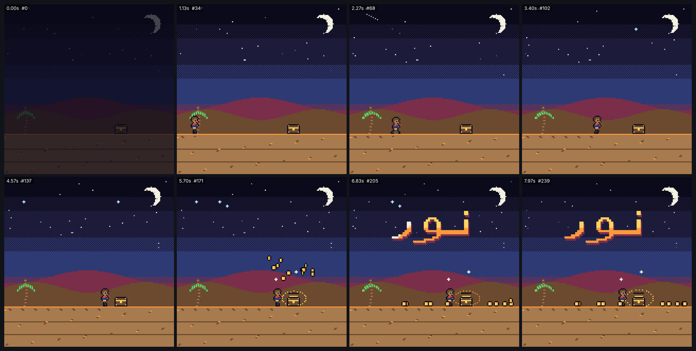

# pixel-art — مشهد بكسل: «نور» في الصحراء (1:1)



<div dir="rtl">

## بالعربية

**ماذا يثبت:** فيلم مدته 8 ث بمقاس 1080×1080 و30 إطارًا/ث، مرسوم على **شبكة منطقية 160×160** تُكبَّر ×6.75 بالبكسل الأقرب (`image-rendering: pixelated`)، و**بلوحة من 16 لونًا** لا غير. الحركة كلها **متدرجة بسرعة 8 إطارات/ث**: الزمن يُقرَّب أولًا `t = floor(t·8)/8`، فلا توجد أي حركة انتقالية ناعمة (tweening)، وكل إطار رسوم يتكرر نحو 3.75 مرة في الفيديو. في المشهد:
- ليل صحراوي بسماء من أشرطة متدرجة بنقش رقعة شطرنج (dither)، وهلال، و34 نجمة مبذورة تتلألأ بدورة من 8 حالات، ولكل نجمة طور مختلف، مع شهاب في الثانية 2.
- كثبان ونخلة يتمايل سعفها بكسلًا واحدًا كل خطوتين.
- **شخصية تمشي بدورة من 4 إطارات** (تلامس، عبور، تلامس، عبور) يرتفع فيها الجسم بكسلًا في إطارات العبور، وتترك آثار أقدام على الرمل.
- تتوقف الشخصية عند صندوق كنز، فتقفز قفزة صغيرة (0، −3، −5، −3، 0) ويُفتح الصندوق، وتنطلق **دفعة من 12 عملة** تدور بـ4 إطارات (العرض 5 ثم 4 ثم 3 ثم 4)، في مسارات مقذوفة (الجاذبية 140 px/ث²)، ثم تستقر العملات على الأرض. حول الصندوق حلقة ضوء تنبض، وبريق على شكل علامة +.
- أخيرًا تظهر كلمة **«نور» كصورة نقطية مرسومة باليد** (40×17، تُعرض مضاعفة ×2) بقناع أعمدة يكشفها من اليمين إلى اليسار (5 أعمدة لكل خطوة)، ويعبرها شريط لمعان.

**الحروف العربية في الصورة النقطية:** رُسمت الكلمة بكسلًا بكسلًا وفق قواعد الوصل الصحيحة: «ن» في صورتها الابتدائية (سنّ ونقطة) **متصلة بـ«و»** عبر خط القاعدة، و«و» في صورتها الأخيرة (حلقة وذيل نازل يلتف يسارًا)، و«ر» منفصلة لأن الواو لا تتصل بما بعدها. القناع يكشف أعمدة كاملة ولا يحرّك الحروف منفردة، فتبقى الكلمة متصلة.

**اللوحة (16 لونًا أصليًا):** `#0b0a1a #1d1b3a #2e3a73 #4f6bd8 #9bd4ff #f4f1e1 #ffd45e #ff9a3c #d9483b #7a2e4a #3f8f4c #7fd36a #6b4a2f #a87b4f #5a5a74 #b9b9cf`.

**التوقيت:** المشي من 0 إلى 4.375 ث بخطوة 3px لكل إطار رسوم، أي 24 px/ث. فتح الصندوق عند 5.0 ث، وظهور الكلمة من 5.75 إلى 6.75 ث، وفي البداية خروج من الظلام خلال 0.5 ث.

**عائلات القدرات:** pixel-art-retro, characters-rigs (دورة مشي بالإطارات), typography-arabic (bitmap), particles-fluids-physics (مسارات العملات), easing-timing-rhythm (stepped 8 fps), engines-render-pipeline, qa-verification.

**إعادة الرندر:**

```bash
cd /home/user/kosif-tool
P=.claude/skills/kosif-superpowers/proofs/pixel-art; OUT=/tmp/pixel-art; mkdir -p $OUT
node tools/render_html.cjs --in $P/index.html --out $OUT/film.mp4 --width 1080 --height 1080 --fps 30 --preview
node tools/render_html.cjs --in $P/index.html --out $OUT/film.mp4 --width 1080 --height 1080 --fps 30
python3 tools/verify_video.py $OUT/film.mp4 --aspect 1:1 --fps 30 --duration 8 --no-audio
ffmpeg -i $OUT/film_preview.png -q:v 4 $P/sheet.jpg
```

**نتيجة الفحص:** `8/8 checks passed`: H.264 yuv420p بمقاس 1080×1080 و30 إطارًا/ث، 8.000 ث في 240 إطارًا، بلا صوت عن قصد. استغرق الرندر نحو دقيقتين.

**حدود صريحة:** نسبة التكبير ×6.75 ليست عددًا صحيحًا، لذلك يظهر بكسل الشبكة بعرض 6 أو 7 بكسلات بالتناوب. يُرى ذلك فقط عند التكبير الشديد، وللحصول على بكسلات متساوية تمامًا استخدم ×6 (960) أو ×7 (1120). هيئة «نور» تقريبية بأسلوب البكسل، لا خطًّا عربيًا مضبوطًا. الفيلم صامت. والشخصية ترسم في اتجاه واحد فقط (تمشي يمينًا).

</div>

## English

**What it proves:** an 8 s, 1080×1080, 30 fps pixel-art film on a 160×160 logical grid, scaled ×6.75 with nearest-neighbour, using a 16-colour palette. All motion is stepped at 8 fps (`t = floor(t·8)/8`) with no tweening. It contains:
- a dithered night sky, a crescent, 34 seeded stars twinkling on an 8-state cycle, and a shooting star;
- a palm with fronds swaying 1 px;
- a 4-frame walk cycle (contact/passing, 1 px bob, footprints);
- a hop, a chest that opens, and a 12-coin burst with 4-frame spins on ballistic arcs (g = 140 px/s²) that land and stay, plus blinking sparkles;
- a hand-made bitmap of «نور» (40×17, drawn ×2) revealed right-to-left by a stepped column mask, with a shimmer band.

The bitmap follows Arabic joining: initial nūn joins wāw on the baseline, final wāw has its descending tail, and rāʼ stands apart. The mask reveals whole columns, so letters are never animated separately.

**Verify:** `8/8 checks passed` (1080×1080, 30 fps, 8.000 s, 240 frames, intentionally silent).

**Limits:**
- ×6.75 is not an integer scale, so logical pixels alternate between 6 and 7 device pixels. Use ×6 or ×7 for perfectly even pixels.
- The letterforms are a pixel approximation, not calligraphy.
- The film is silent.
- The walker only faces right.
