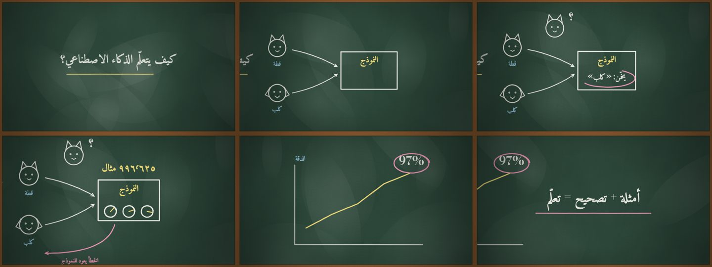
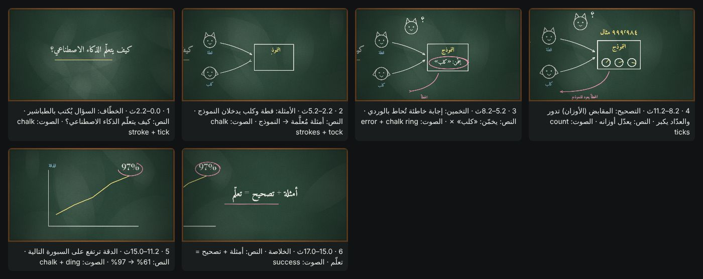

# style-atlas-86 — A15 explainer engine proof

> **What this proves:** the 86-method Style Atlas (A15 v2) is wired to a real, original render engine: a storyboard-first Arabic explainer in the FA-23 *Chalkboard Lesson* method rendered frame by frame to an H.264 + AAC MP4 with a synthesized, frame-synced score.





| check | result (2026-10-23, Claude cloud container) |
|---|---|
| `atlas_render.py check` | duration 17.0 s · deterministic true (same t → same PNG hash) · 29.3 ms/frame · 6 beats |
| `atlas_render.py render --fps 30` | 510 frames · 1280×720 h264 · aac stereo 48 kHz · 17.000 s · mean −23.4 dB · max −7.0 dB |
| tests | `evals/test_style_atlas_bridge.py` + `evals/test_atlas_render.py` (18 tests, OK) |

## Re-run (from the skill folder)

```bash
python3 scripts/atlas_render.py check
python3 scripts/atlas_render.py storyboard --out out/atlas/storyboard.png
python3 scripts/atlas_render.py render --fps 30 --out out/atlas/fa23-chalkboard.mp4
```

MP4s are not committed (repo `.gitignore`). Receipt: [RECEIPT.json](RECEIPT.json).

**Limits:** one style (FA-23) has a hand-built demo renderer; the other 85 are method cards + scaffolds that must be drawn per project. Arabic text uses KOSIFJumuah (OFL, `fonts/kosif-jumuah`).
