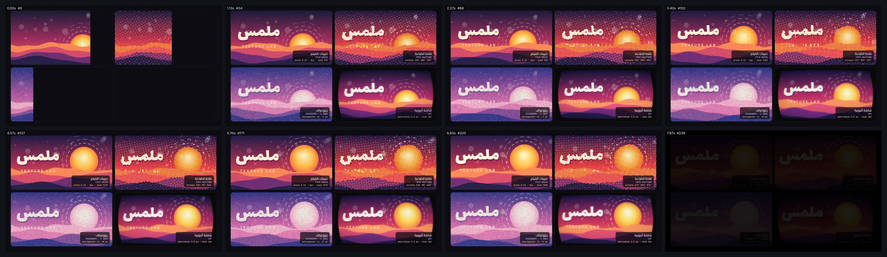

# texture-lab — مختبر الملمس: أربع خامات لتكوين واحد (16:9)



<div dir="rtl">

## بالعربية

**ماذا يثبت:** فيلم مدته 8 ث بمقاس 1920×1080 و30 إطارًا/ث. تكوين متحرك واحد يُرسم مرة واحدة في كل إطار على لوحة 900×480: شمس تشرق، وحلقات منقّطة تدور، ودوائر تطفو، وأربع طبقات أمواج، وكلمة «ملمس» بخط Lalezar، وتقريب بطيء للكاميرا من 1.00 إلى 1.08. ثم يمرّ التكوين نفسه على **أربعة مؤثرات لاحقة (post effects) كتبناها بأنفسنا** في Canvas 2D، فنرى أربع خامات جنبًا إلى جنب. كل مؤثر حتمي ومبذور بالبذرة نفسها، ولا مكتبات. تدخل اللوحات بمسح متدرّج بفارق 120 مللي ثانية بين كل لوحة والتالية، وعلى كل لوحة شارة تعرض قيم المعاملات الحية.

**المعاملات (من `index.html`):**
1. **حبيبات الفيلم (Film grain):** ضجيج مُجزّأ (hash) لكل بكسل ولكل رقم إطار، فلا يتكرر النمط ولا يتغير بين رندرين. يتكوّن من كتل 2px مع ضجيج ناعم فوقها، وشدّته 0.13. الحبيبات أقوى في الدرجات المتوسطة: الشدة × (1 − 0.6·|2L−1|). يُضاف رفع للسواد بمقدار 10، ووميض ±2.5% في كل إطار، واهتزاز للإطار (gate weave) ±1px.
2. **نقاط الطباعة (CMYK halftone):** أربع شاشات بزوايا C 15° وM 75° وY 0° وK 45°، **وكلها تدور 4° في الثانية**. حجم الخلية 11px، ونصف قطر النقطة = الخلية × √(الكثافة/π)، فتساوي مساحة النقطة نسبة الحبر. يُطبع اللون الأسود فقط حين تتجاوز كثافته 0.25 (under-colour removal)، والأحبار تُركَّب بـ `multiply` على ورق `#f7f2e8`.
3. **ريزوغراف بحبرين:** وردي `#ff48b0` يمتص الأخضر، وأزرق `#0078bf` يمتص الأحمر. الشبكة Bayer 4×4 بخلايا 2px، وفوقها تشويش مبذور ±0.09، ومنحنى كثافة بأس 1.35. **انزياح تسجيل** بين الحبرين يصل إلى ±5px، ويتغيّر كل 0.5 ث كأن كل نصف ثانية نسخة مطبوعة جديدة. وعلى الورق `#f3eee3` حبيبات بنسبة 5%.
4. **شاشة أنبوبية (CRT):** تحدّب برميلي k = 0.08، وانحراف لوني لقناتي R وB قدره 3px × (1 ± 0.4·sin) يزداد نحو الأطراف. خطوط مسح كل 3px بعمق 0.42، وقناع RGB عمودي 12%، وتظليل للأطراف 0.55، وشريط ضوء يتدحرج، ووميض 3%. وأخيرًا توهّج الفسفور: نسخة بنصف الدقة ممَوّهة 5px تُضاف بشفافية 0.35.

**عائلات القدرات:** texture-material, color-grading-look, light-glow-bloom (CRT glow), typography-arabic, camera-composition-layout, engines-render-pipeline, qa-verification.

**إعادة الرندر:**

```bash
cd /home/user/kosif-tool
P=.claude/skills/kosif-superpowers/proofs/texture-lab; OUT=/tmp/texture-lab; mkdir -p $OUT
node tools/render_html.cjs --in $P/index.html --out $OUT/film.mp4 --width 1920 --height 1080 --fps 30 --preview
node tools/render_html.cjs --in $P/index.html --out $OUT/film.mp4 --width 1920 --height 1080 --fps 30
python3 tools/verify_video.py $OUT/film.mp4 --aspect 16:9 --fps 30 --duration 8 --no-audio
ffmpeg -i $OUT/film_preview.png -q:v 4 $P/sheet.jpg
```

**نتيجة الفحص:** `8/8 checks passed`: H.264 yuv420p بمقاس 1920×1080 و30 إطارًا/ث، 8.000 ث في 240 إطارًا، بلا صوت عن قصد. استغرق الرندر 7 دقائق و21 ثانية على أنوية مشتركة مع رندرات أخرى.

**حدود صريحة:** كل المؤثرات حلقات بكسل على المعالج (CPU) في JavaScript، لا shaders. هذا مقصود حتى يكون الكود قصيرًا ومقروءًا ويسهل تعديله، لكنه أبطأ من WebGL. نقاط الطباعة تأخذ عيّنة لون واحدة من مركز كل خلية، بلا متوسط للمساحة، فتختفي التفاصيل الأصغر من 11px (مثل «TEXTURE LAB»). فصل ألوان الريزو تقريب بسيط بقناتين، لا فصل طيفي حقيقي. وتحدّب الـCRT يأخذ عيّنة أقرب بكسل، بلا استيفاء ثنائي الخط (bilinear).

</div>

## English

**What it proves:** one animated composition (rising sun, rotating dashed rings, floaters, four wave layers, the Arabic word «ملمس» in Lalezar, a 1.00→1.08 push-in) is drawn once per frame. It is then passed through four post effects written from scratch in Canvas 2D. They are deterministic and seeded, with no libraries, and each panel carries a live parameter readout.

1. **Film grain:** per-pixel hash noise keyed by frame, 2 px clumps plus fine grain, amount 0.13, midtone-weighted, black lift 10, ±2.5 % flicker, ±1 px gate weave.
2. **CMYK halftone:** screens C15° M75° Y0° K45° that all rotate 4°/s. Cell 11 px, with dot radius = cell·√(coverage/π) so dot area matches ink coverage. Black only above 0.25 (UCR). Inks are multiplied on `#f7f2e8` paper.
3. **Risograph, 2 inks:** pink `#ff48b0` absorbs green and blue `#0078bf` absorbs red. Bayer 4×4 screen in 2 px cells with ±0.09 seeded jitter and density gamma 1.35. Misregistration of up to ±5 px is re-rolled every 0.5 s ("a new print"). Paper `#f3eee3` with 5 % paper grain.
4. **CRT:** barrel distortion 0.08, radial R/B chromatic aberration 3 px·(1±0.4 sin), 3 px scanlines at depth 0.42, 12 % RGB aperture mask, vignette 0.55, rolling bright band, 3 % flicker, and a half-res 5 px blurred phosphor glow added at α 0.35.

**Verify:** `8/8 checks passed` (1920×1080, 30 fps, 8.000 s, 240 frames, intentionally silent; render 7m21s on shared cores).

**Limits:**
- CPU pixel loops, slower than WebGL.
- The halftone samples cell centres, so detail under 11 px is lost.
- The riso separation is a two-channel approximation.
- The CRT remap is nearest-neighbour.
