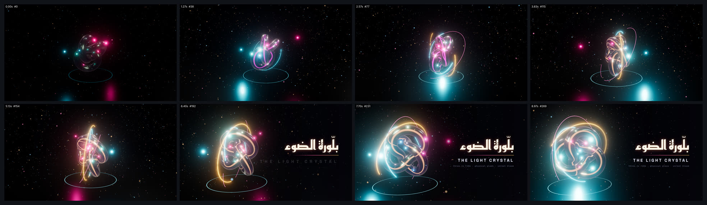

# three-bloom-scene — بلّورة ضوء ثلاثية الأبعاد (16:9)



<div dir="rtl">

## بالعربية

**ماذا يثبت:** فيلم Three.js مدته 9 ث بمقاس 1920×1080 و30 إطارًا/ث، يعمل بعقد `seek(t)`: كل إطار يُحسب من t ثم يُرسم بـ `composer.render()`. في المشهد عقدة طارة (torus knot ‏(2,3)) من زجاج فيزيائي، يُرسم فيها خيط مضيء وردي يتحوّل إلى ذهبي. حولها ثلاث حلقات مدارية متوهجة، ومصباحان ملوّنان يدوران، و2,600 جسيم يطفو ويصعد، وضباب أُسّي. الكاميرا تقترب وتدور ببطء، ثم تنزاح يسارًا لتفسح المكان لبطاقة عنوان HTML تقول «بلّورة الضوء / THE LIGHT CRYSTAL».

**الأرقام:**
- three@0.186.1 من CDN، مع EffectComposer وRenderPass وUnrealBloomPass (القوة 0.72، ونصف القطر 0.5، والعتبة 0.9، مع نبضة +0.35 عند انغلاق الخيط في 2.6 ث) ثم OutputPass. نستخدم ACES Filmic وsRGB، وهدف رندر HalfFloat بأربع عينات MSAA.
- الزجاج MeshPhysicalMaterial بقيم transmission 1 وthickness 1.4 وior 1.62 وdispersion 0.35، مع iridescence 0.9 (180–620nm) وclearcoat 1. الانبعاث `#2a0f45` بشدة 0.35، والتوهين `#8a6cff` على مسافة 2.6.
- الإضاءات اللونية: الوردي `#ff3d9a`، والسماوي `#3de1ff`، والذهبي `#ffb347`. المواد الباعثة تُضرب ×3.2–6 مع `toneMapped:false` حتى تتجاوز عتبة الـbloom.
- الكاميرا: البعد من 14.5 إلى 11.2، والمدار من −38° إلى +34°، والارتفاع من 2.8 إلى 0.9 (inOutSine طوال الفيلم). إزاحة الهدف 2.7 وحدة بين 5.2 و7.0 ث (inOutCubic)، والضباب FogExp2 بكثافة 0.05.
- الخيط يُرسم بين 0.4 و2.6 ث (outCubic) عبر `setDrawRange`. الحلقات تظهر متتابعة بفارق 0.35 ث (outExpo). الجسيمات دالة خالصة في t: دوّامة وصعود مع التفاف بالـmodulo.
- العنوان: Reem Kufi 700 بحجم 148px، يظهر بقناع `clip-path` من اليمين إلى اليسار مع blur من 8 إلى 0. السطر الإنجليزي Space Grotesk 700 بتباعد من 30 إلى 12px، والخط الفاصل يمتد بـ scaleX (outExpo).
- الرندر بلا واجهة: `preserveDrawingBuffer:true`، وانتظار الخطوط، وتسخين المظللات بـ seek(0) ثم seek(4.5) ثم seek(0)، و`gl.finish()` بعد كل إطار، و`__kosifReady` لا يتحقق إلا بعد أول إطار حقيقي.

**عائلات القدرات:** three-d-scenes, light-glow-bloom, camera-composition-layout, particles-fluids-physics, texture-material, typography-arabic, typography-latin, easing-timing-rhythm, engines-render-pipeline, qa-verification.

**إعادة الرندر:**

```bash
cd /home/user/kosif-tool
P=.claude/skills/kosif-superpowers/proofs/three-bloom-scene; OUT=/tmp/three-bloom-scene; mkdir -p $OUT
node tools/render_html.cjs --in $P/index.html --out $OUT/film.mp4 --width 1920 --height 1080 --fps 30 --preview
node tools/render_html.cjs --in $P/index.html --out $OUT/film.mp4 --width 1920 --height 1080 --fps 30
python3 tools/verify_video.py $OUT/film.mp4 --aspect 16:9 --fps 30 --duration 9 --no-audio
ffmpeg -i $OUT/film_preview.png -q:v 4 $P/sheet.jpg
```

**نتيجة الفحص:** لم يُرندَر ولم يُفحص بعد (المصدر موجود فقط) — not rendered or verified yet; treat as source only

**حدود صريحة:** الفيلم صامت. الرندر يمرّ عبر WebGL برمجي (SwiftShader) في الحاوية، فاستغرق RENDER_TIME. الصفحة تحتاج الشبكة لتحميل three من CDN. الأرضية مظلمة عمدًا: ظهرت في المعاينة الأولى رمادية لأن `scene.environmentIntensity` يتجاوز `envMapIntensity`، فأعطيناها envMap خاصًا بشدة 0.06. الانكسار والتشتت (dispersion) تقريبيان، فهما من نموذج three.js وليسا تتبّع أشعة.

</div>

## English

**What it proves:** a 9 s, 1920×1080, 30 fps Three.js film driven by the seek contract. The scene has a physical-glass (2,3) torus knot with an emissive filament that draws on, three bloomed orbit rings, two orbiting coloured lights and 2,600 seeded floating particles. It uses FogExp2 and UnrealBloomPass (0.72 / 0.5 / 0.9). The camera dollies from 14.5 to 11.2, orbits from −38° to +34° and shifts its aim so that an HTML title card (Reem Kufi Arabic with an RTL clip-path reveal, plus Space Grotesk English) can land on the right.

**Headless reliability:**
- `preserveDrawingBuffer`.
- Fonts are awaited before rendering.
- Shaders are pre-warmed with seek(0), seek(4.5) and seek(0).
- `gl.finish()` runs after each frame.
- The ready promise resolves only after the first real frame.

**Power families:** three-d-scenes, light-glow-bloom, camera-composition-layout, particles-fluids-physics, texture-material, typography-arabic/latin, easing-timing-rhythm, engines-render-pipeline, qa-verification.

**Verify:** لم يُرندَر ولم يُفحص بعد (المصدر موجود فقط) — not rendered or verified yet; treat as source only

**Limits:**
- The film is silent.
- Rendering uses software WebGL, which took RENDER_TIME.
- The page needs network access for the CDN.
- The floor is intentionally near-black.
- Refraction and dispersion are three.js approximations, not ray tracing.
