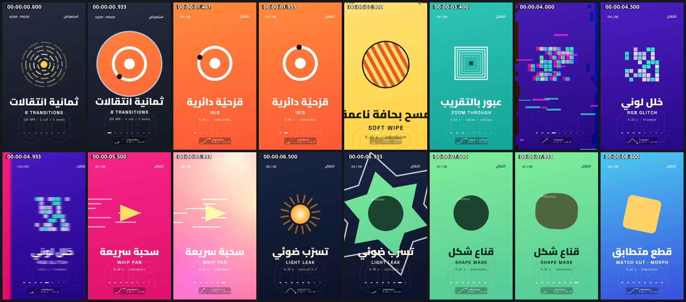

# transitions-reel — ثمانية انتقالات على الإيقاع (9:16)



<div dir="rtl">

## بالعربية

**ماذا يثبت:** ريل مدته 9.5 ث بمقاس 1080×1920 و30 إطارًا/ث، وكل إطار دالة خالصة للزمن `seek(t)`. فيه تسع بطاقات بألوان صريحة، تفصل بينها ثمانية انتقالات مختلفة، كلها مكتوبة بالكود على Canvas 2D. على كل بطاقة اسم الانتقال بالعربية والإنجليزية، ومدته ومنحنى تسارعه. أسفل الشاشة شريط تقدّم ولوحة صغيرة ترسم منحنى التسارع حيًّا وعليه نقطة تتحرك. كل قطع يقع على نبضة من شبكة 120 BPM (قطع كل ثانية)، والانتقال متمركز حول لحظة القطع. البطاقات نفسها تبقى متحركة أثناء الثبات (رموز تدور، ونصوص تدخل)، فالفيلم ليس شرائح ثابتة. والصوت (موسيقى ومؤثرات) مولّد من التوقيت نفسه.

| # | الانتقال | المدة | التسارع | الوصفة |
|---|---|---|---|---|
| 1 | قزحيّة دائرية IRIS | 0.50 ث | inOutCubic | قص دائري نصف قطره من 0 إلى 2100px من مركز الرمز، وحلقة بيضاء 16px تتلاشى، والبطاقة الخارجة تصغر 5% |
| 2 | مسح بحافة ناعمة SOFT WIPE | 0.45 ث | inOutQuint | قناع تدرّج مائل 15° بحافة ناعمة عرضها 220px، يتحرك من اليمين إلى اليسار (اتجاه القراءة العربية) |
| 3 | عبور بالتقريب ZOOM THROUGH | 0.50 ث | inExpo ثم outExpo | الخارجة تكبر من ×1 إلى ×6 مع تمويه من 0 إلى 18px، والداخلة تكبر من ×0.6 إلى ×1، وومضة بيضاء عند القطع (σ = 0.07) |
| 4 | خلل لوني RGB GLITCH | 0.32 ث | مثلثي | فصل القنوات الثلاث بإزاحة ±42px (multiply ثم lighter)، و9 شرائح أفقية تنزاح ±140px، وخطوط مسح، ومصدر يتقافز بين البطاقتين بقيمة عشوائية ثابتة لكل إطار |
| 5 | سحبة سريعة WHIP PAN | 0.40 ث | inOutQuart | تمويه حركة يطابق السرعة: متوسط 12 عيّنة على غالق 180° (1/60 ث)، فيبلغ التمويه أقصاه عند القطع حيث السرعة أعلى ما تكون |
| 6 | تسرّب ضوئي LIGHT LEAK | 0.70 ث | `sin(πu)^1.2` | أربع بقع دافئة مضافة (`lighter`) بالألوان `#ff7800` و`#ffc828` و`#ff006e` و`#ffaa5a`، وتبييض كامل `#fff6e4` عند u=0.5 يُخفي القطع، وحبيبات احتراق فيلم |
| 7 | قناع شكل SHAPE MASK | 0.55 ث | inOutCubic (والدوران outCubic) | نجمة سداسية تدور من 0 إلى 100° ويكبر قطرها من 0 إلى 2600px، وحدّ أبيض 18px يسبقها بنسبة 12% |
| 8 | قطع متطابق MATCH CUT · MORPH | 0.60 ث | inOutCubic | دائرة نصف قطرها 230 تتحوّل إلى مربع مستدير ضلعه 440 وانحناؤه 60 ومائل 12°، مع انضغاط وتمدد ±12% ومزج لوني. الخلفية تُقطع عند منتصف التحوّل |

**الخطوط والألوان:** العربية بخط Cairo (بوزن 900 للعناوين و800 للتسميات)، ويُرسم كل سطر كاملًا ومشكَّلًا، ويظهر بقناع قص من اليمين خلال 0.45 ث (outExpo). اللاتينية بخط Space Grotesk 700 بتباعد 7px، والمواصفات بخط JetBrains Mono 500. خلفيات البطاقات تدرّجات: `#141824` و`#ff5a36` و`#ffd23f` و`#16a69a` و`#2a0a8a` و`#e0136f` و`#0b132b` و`#57cc99` و`#3a56e0`.

**الصوت (`sound.py`):** إيقاع 120 BPM فيه طبلة (كيك) على كل نبضة، وصنج مغلق بين النبضات، وجهير بتسلسل Am ثم F ثم C ثم G مع انخفاض يشبه الضغط الجانبي، ووسادة صوتية من موجات منشارية. لكل انتقال مؤثر خاص به: هسيس صاعد للقزحية، واكتساح مُرشَّح ينتقل بين القناتين للمسح، و«رايزر» ينتهي بضربة للتقريب، وطنين مشوَّه للخلل، وصوت اندفاع للسحبة، ولمعان للتسرب، وفرقعة للقناع، ونغمتان للقطع المتطابق. كلها مضبوطة على ‎-14 LUFS بمحدِّد قمة حقيقية ‎-2.5 dBTP.

**عائلات القدرات:** transitions-cuts, easing-timing-rhythm, typography-arabic, typography-latin, shapes-morph-geometry, light-glow-bloom, color-palette-grading, music-beat-sound, engines-render-pipeline, qa-verification.

**إعادة الرندر:**

```bash
cd /home/user/kosif-tool
P=.claude/skills/kosif-superpowers/proofs/transitions-reel; OUT=/tmp/transitions-reel; mkdir -p $OUT   # خارج المستودع
node $P/reel.js > $OUT/reel.json                          # التوقيت (القطع على النبضات)
python3 $P/sound.py $OUT/reel.json $OUT/master.wav        # يحتاج numpy scipy soundfile pyloudnorm
node tools/render_html.cjs --in $P/index.html --out $OUT/film.mp4 --width 1080 --height 1920 --fps 30 --preview
node tools/render_html.cjs --in $P/index.html --out $OUT/film.mp4 --width 1080 --height 1920 --fps 30 --audio $OUT/master.wav
python3 tools/verify_video.py $OUT/film.mp4 --aspect 9:16 --fps 30 --duration 9.5 --audio $OUT/master.wav
```

للمعاينة الحية: المسافة للتشغيل والإيقاف، والسهمان للتنقّل إطارًا إطارًا، و`?t=5.0` لفتح الفيلم عند منتصف السحبة السريعة.

**نتيجة الفحص:** `13/13 checks passed`: H.264 yuv420p بمقاس 1080×1920 و30 إطارًا/ث، 9.500 ث في 285 إطارًا، صوت AAC بتردد 48 kHz، علوّ ‎-14.0 LUFS، وقمة حقيقية ‎-2.3 dBFS، وطول الصوت مطابق للماستر (9.500 = 9.500).

**حدود صريحة:**
- كل الانتقالات بـCanvas 2D وليست تظليلًا على المعالج الرسومي (GLSL).
- تمويه التقريب يستخدم `ctx.filter = blur()` في Chromium، وقد لا يعمل في متصفحات أخرى.
- تمويه السحبة متوسط 12 عيّنة وليس تمويهًا اتجاهيًا مستمرًا.
- «القطع المتطابق» مرسوم بالكود بين رمزين صُمِّما ليتطابقا، وليس مطابقة تلقائية بين لقطتين حقيقيتين.

</div>

## English

**What it proves:** a 9.5 s, 1080×1920, 30 fps reel in which every frame is a pure function of `seek(t)`. Nine bold cards are joined by eight different transitions, all hand-written in Canvas 2D. Each card is labelled in Arabic and English with its duration and easing, and a HUD plots the easing curve live with a moving dot. Every cut lands on a beat of a 120 BPM grid (one cut per second), with the transition centred on the cut. The cards keep moving during holds, and the music and SFX are synthesized from the same timing.

**The eight transitions:**
1. **Iris:** a circle clip from 0 to 2100 px, 0.50 s, inOutCubic.
2. **Soft wipe:** right → left with a 15° edge and 220 px feather, 0.45 s, inOutQuint.
3. **Zoom through:** the outgoing card scales ×1 → ×6 with a 0 → 18 px blur and the incoming card scales ×0.6 → ×1, 0.50 s, inExpo then outExpo, with a white flash at the cut.
4. **RGB glitch:** ±42 px channel split, 9 slices shifted ±140 px, seeded per frame, 0.32 s, triangle intensity.
5. **Whip pan:** velocity-matched 12-sample shutter blur over 1/60 s, 0.40 s, inOutQuart.
6. **Light leak:** additive warm blobs with a whiteout cut at u = 0.5, 0.70 s, sin(πu)^1.2.
7. **Shape mask:** a 6-point star rotating 0 → 100° and growing 0 → 2600 px, 0.55 s, inOutCubic.
8. **Match cut / morph:** a circle (r 230) becomes a rounded square (440 px, r 60, 12°), with the cut at the morph midpoint, 0.60 s, inOutCubic.

**Type:** Cairo 900/800 Arabic, revealed by a right-anchored clip; Space Grotesk 700 Latin; JetBrains Mono 500 for the specs.

**Re-render:** see the commands above. The verify result was `13/13 checks passed` (-14.0 LUFS, TP -2.3 dBFS, 285 frames, 9.500 s).

**Limits:**
- Everything is Canvas 2D, with no GLSL.
- The zoom blur relies on Chromium's `ctx.filter`.
- The whip blur is 12-sample accumulation, not a continuous directional blur.
- The match cut is between two designed motifs, not detected in real footage.
