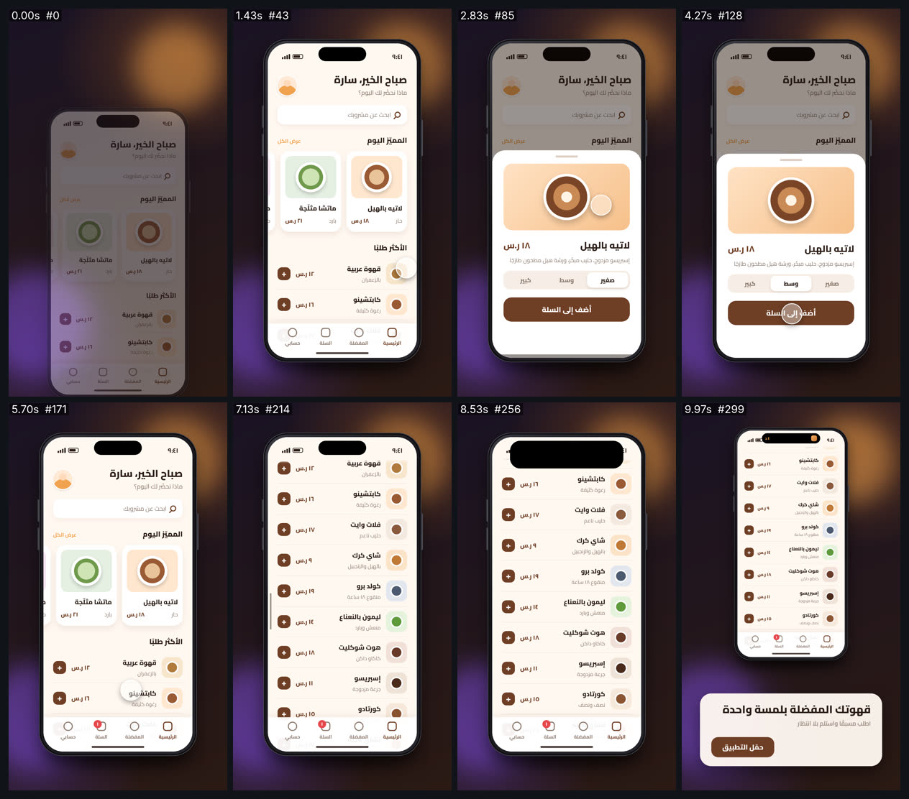

# ui-phone-demo — عرض تطبيق عربي على هاتف (9:16)



<div dir="rtl">

## بالعربية

**ماذا يثبت:** فيلم عرض منتج مدته 10 ث بمقاس 1080×1920 و30 إطارًا/ث. الهاتف وواجهة التطبيق كلها DOM وCSS حقيقيان، والدالة `seek(t)` تضبط كل خاصية لكل إطار، فالنتيجة حتمية ولا يُستخدم فيها أي انتقال CSS حر. التطبيق اسمه «قهوتي»، ولا يمثّل أي علامة تجارية حقيقية. تسلسل الأحداث:
- يدخل الهاتف بنابض.
- إصبع (مؤشر لمس) ينقر بطاقة «لاتيه بالهيل»، فتنضغط البطاقة وتنتشر منها موجة لمس (ripple).
- تصعد لوحة سفلية (bottom sheet) بنابض.
- يختار الإصبع الحجم «وسط»، فينزلق المؤشر من اليمين إلى اليسار.
- ينقر «أضف إلى السلة»، فتظهر حالة النجاح بقناع دائري يكبر من نقطة اللمس، وتقفز شارة السلة.
- تنزل اللوحة، ثم يسحب الإصبع القائمة فتنزلق بقصور ذاتي (inertia) مع شريط تمرير.
- تتمدد «الجزيرة الديناميكية» إلى إشعار طلب فيه حلقة تقدّم، ثم تنكمش إلى نشاط مضغوط.
- يصغر الهاتف ويصعد، وتظهر بطاقة الدعوة إلى الإجراء (CTA).

**قاعدة RTL:** الواجهة معكوسة كلها: الوقت في الشريط العلوي على اليمين، والتحية على اليمين والصورة الشخصية على اليسار، والبطاقات تبدأ من اليمين وتُقصّ من اليسار، و«الرئيسية» أقصى يمين شريط التبويب، ومؤشر الحجم يتحرك من اليمين، وشريط التمرير على اليسار. **أما العتاد فلا يُعكس:** الجزيرة في المنتصف، وأزرار الصوت على اليسار، وزر التشغيل على اليمين، وشريط الرجوع للرئيسية في المنتصف (`#phone` يأخذ `direction: ltr`، و`#app` يأخذ `direction: rtl`). الأرقام كلها هندية-عربية ومتسقة: ٩:٤١ و١٨ ر.س و٤ د.

**الأرقام:**
- النوابض: استجابة نابض مخمَّد `1 − e^(−ζωt)(cos ω_d t + ζω/ω_d sin ω_d t)`. ثوابتها (صلابة، تخميد): الهاتف (120، 16)، واللوحة (190، 22)، والجزيرة (260، 22)، ومؤشر الحجم (300، 26)، والشارة (320، 14) وفيها ارتداد مقصود.
- اللمس: ضغط خلال 80 مللي ثانية ورفع خلال 160، ويصغر الإصبع بنسبة 18% ويصغر العنصر المضغوط بنسبة 4%. موجة اللمس نصف قطرها من 0 إلى 220px وشفافيتها من 0.55 إلى 0، خلال 450 مللي ثانية (outCubic)، وهي مقصوصة داخل العنصر نفسه. قناع النجاح `clip-path: circle()` من 0 إلى 360px خلال 340 مللي ثانية.
- التمرير: أثناء السحب يتبع المحتوى الإصبع (380px خلال 0.4 ث بتسارع). بعد الإفلات `y = y₀ + v₀·τ·(1 − e^(−t/τ))`، حيث τ = 0.45 ث وv₀ = 1520 px/ث، وهي سرعة الإصبع لحظة الإفلات، فلا قفزة في السرعة.
- الجزيرة: من 236×70 إلى 700×196 (نصف قطر الزوايا من 35 إلى 64)، ثم إلى 400×70.
- الألوان: بنّي `#6f3f25`، وكراميل `#f0a24e`، وكريمي `#fff8f1`، وحبر `#2a1c15`، ورمادي `#8b786c`، ونجاح `#2fa86a`. الخط: Cairo المتغيّر (500 و700 و800).

**عائلات القدرات:** ui-product-demo, typography-arabic, easing-timing-rhythm (spring/inertia), camera-composition-layout, shapes-motion, engines-render-pipeline, qa-verification.

**إعادة الرندر:**

```bash
cd /home/user/kosif-tool
P=.claude/skills/kosif-superpowers/proofs/ui-phone-demo; OUT=/tmp/ui-phone-demo; mkdir -p $OUT
node tools/render_html.cjs --in $P/index.html --out $OUT/film.mp4 --width 1080 --height 1920 --fps 30 --preview
node tools/render_html.cjs --in $P/index.html --out $OUT/film.mp4 --width 1080 --height 1920 --fps 30
python3 tools/verify_video.py $OUT/film.mp4 --aspect 9:16 --fps 30 --duration 10 --no-audio
ffmpeg -i $OUT/film_preview.png -q:v 4 $P/sheet.jpg
```

**نتيجة الفحص:** `8/8 checks passed`: H.264 yuv420p بمقاس 1080×1920 و30 إطارًا/ث، 10.000 ث في 300 إطار، بلا صوت عن قصد. استغرق الرندر نحو 3 دقائق و50 ثانية.

**حدود صريحة:**
- الفيلم صامت، بلا أصوات نقر أو موسيقى.
- الإصبع دائرة لمس كما في تسجيلات الشاشة، لا يد حقيقية.
- الهاتف رسم مسطّح بتدرجات CSS، بلا انعكاسات ثلاثية الأبعاد.
- صور المشروبات أشكال CSS مجرّدة.
- إحداثيات النقر تُقاس من DOM عند التحميل (`getBoundingClientRect`)، فتغيير التخطيط ينقل الإصبع تلقائيًا. لكن ذلك يفترض أن الهاتف ساكن في لحظات النقر.

</div>

## English

**What it proves:** a 10 s, 1080×1920, 30 fps product demo built from real DOM/CSS, every property set by `seek(t)`. The app is a fictional Arabic coffee app. The film shows:
- a spring entrance;
- a touch tap with a ripple clipped to the control;
- a bottom sheet springing up;
- a segmented control sliding RTL;
- a success state revealed by a circular `clip-path` from the touch point, with a badge pop;
- a drag-and-fling list with exponential inertia (τ 0.45 s, v₀ continuous with the finger);
- a Dynamic-Island notification that expands and collapses to a compact activity;
- a final CTA card.

**RTL rule:** the whole UI is mirrored (status time, header, carousel origin, tab order, segmented control, scrollbar). The hardware is not (island, side buttons, home bar), via `direction: ltr` on `#phone` and `rtl` on `#app`. Digits are Arabic-Indic throughout.

**Numbers:** springs (k, c) are phone 120/16, sheet 190/22, island 260/22, knob 300/26 and badge 320/14. Press is 80 ms down and 160 ms up. The ripple grows 0→220 px over 450 ms. The island goes 236×70 → 700×196 → 400×70. The palette and fonts are listed above.

**Verify:** `8/8 checks passed` (1080×1920, 30 fps, 10.000 s, 300 frames, intentionally silent).

**Limits:**
- No UI sound.
- The touch indicator is a dot, not a hand.
- The device is a flat CSS mock.
- Tap targets are measured from the DOM at load time, which assumes the phone is at rest during taps.
