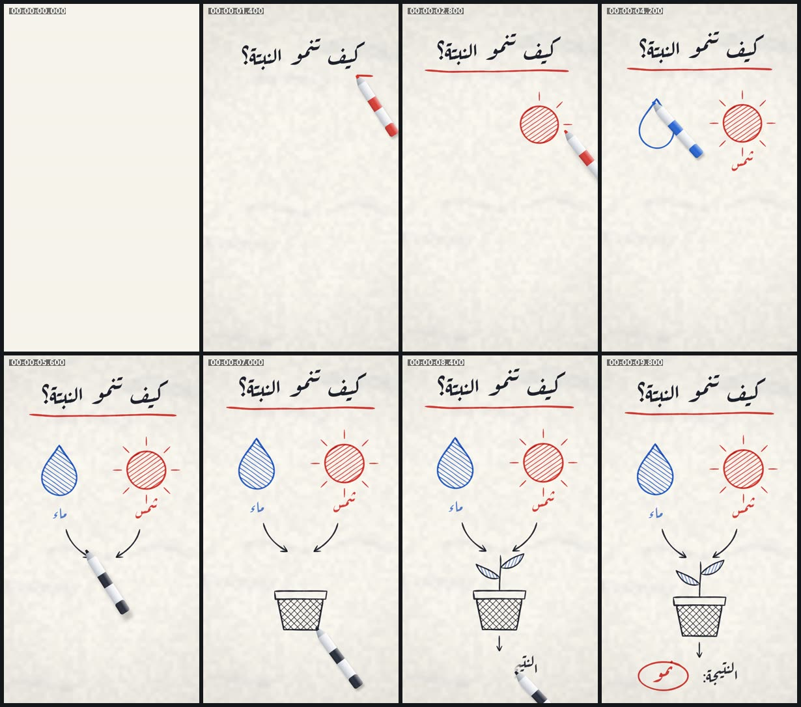

# whiteboard-draw — شرح على السبورة بقلم ماركر (9:16)



<div dir="rtl">

## بالعربية

**ماذا يثبت:** فيلم 10 ث بمقاس 1080×1920 و30 إطارًا/ث، وكل إطار دالة خالصة للزمن `seek(t)`. قلم ماركر يرسم شرحًا «سبب ← نتيجة» على سبورة بيضاء مائلة إلى العاجي، بالترتيب الذي يرسم به إنسان: العنوان «كيف تنمو النبتة؟» يُكتب من اليمين إلى اليسار بقناع ناعم، ثم خط أحمر تحته يُرسم من اليمين أيضًا، ثم شمس حمراء (دائرة تتجاوز نقطة البداية قليلًا كاليد، ثم تظليل، ثم 8 أشعة)، ثم قطرة ماء زرقاء، ثم سهمان سببيان، ثم أصيص بتظليل متقاطع ونبتة بورقتين مظللتين بالأزرق، ثم «النتيجة: نمو» ودائرة حمراء حول «نمو». يتنقّل القلم بين الضربات مرفوعًا (ظله يبتعد)، ويتغيّر لونه عند تبديل القلم، والكاميرا تتبعه بلطف. الصوت صرير ماركر مولَّد من جدول الضربات نفسه.

**التقنيات والأرقام:**
- **باني ضربات خاص (بأسلوب perfect-freehand):** المسار يُعاد أخذ عيّناته كل 2.5px، ويُحسب العرض عند كل نقطة: `العرض = الحجم × الضغط × تدبيب البداية × تدبيب النهاية`. الضغط `1.10 − 0.32·(v/vmax)`، أي أن الحركة الأسرع تعطي خطًا أنحف. تدبيب البداية `0.42 + 0.58·min(1, s/16)` وتدبيب النهاية `0.30 + 0.70·min(1, (L−s)/22)`، مع حبيبات طرف اللباد. الشكل الخارجي يتكوّن من إزاحات يسار ويمين وغطاءين دائريين، ويُملأ بـ `multiply` فتغمق التقاطعات كحبر حقيقي.
- **توقيت بطول القوس:** الضربة بسرعة 3000px/ث، والتظليل 5600px/ث. التقدّم `e(u) = 0.55·inOutSine + 0.45·u`، ومشتقته هي سرعة القلم، فهي تحدّد العرض والصوت معًا. الفاصل بين الضربات 55ms، وبين الضربات القصيرة 30ms، وبين المجموعات 170ms. تعديل أي شكل في `scene.js` يعيد توقيت الفيلم كله تلقائيًا.
- **تظليل مقصوص على الشكل:** خطوط متوازية متموّجة تمتد عبر حدود الشكل، تُرسم متعرّجة دون رفع القلم، ثم تُقص بـ `ctx.clip()` على مسار الشكل نفسه. زاوية الشمس ‎−35° بتباعد 19px، والقطرة 35°، والأصيص ±45° (تظليل متقاطع) بتباعد 24px، والورقتان 70° و110° بتباعد 15px.
- **العربية:** خط Aref Ruqaa (OFL). كل سطر يُرسم كاملًا ومشكَّلًا ولا تُقسَّم حروفه أبدًا. يظهر من اليمين إلى اليسار بقناع تدرّج عرضه 46px (`destination-in`)، وطرف القلم يمشي على «مركز الحبر» لكل عمود من بكسلات النص، مع اهتزاز كتابة بتردد 7 هرتز.
- **الألوان:** أسود `#1e2330`، وأزرق `#1f5fd1`، وأحمر `#d6332b`، والسبورة `#f6f3ec` بملمس ضوضاء قيمية ±2.5%، وألياف، وآثار مسح قديمة باهتة، وتظليل أطراف.
- **القلم والكاميرا:** القلم مرسوم بالكود (رأس لبادي، وطوق، وجسم أسطواني بتدرّج، وشريط وغطاء بلون الحبر). الرفع بين الضربات `sin(πu)` بتنقّل inOutCubic. الكاميرا تقترب من 1.02 إلى 1.06، وتتبع القلم بنسبة 7% من متوسط موضعه خلال آخر 0.9 ث.

**عائلات القدرات:** hand-drawn-draw-on, typography-arabic, diagrams-explainers-code, texture-material, easing-timing-rhythm, camera-composition-layout, music-beat-sound, engines-render-pipeline, qa-verification.

**إعادة الرندر:**

```bash
cd /home/user/kosif-tool
P=.claude/skills/kosif-superpowers/proofs/whiteboard-draw; OUT=/tmp/whiteboard-draw; mkdir -p $OUT   # خارج المستودع
node $P/scene.js > $OUT/schedule.json                       # جدول الضربات (JSON)
python3 $P/sound.py $OUT/schedule.json $OUT/master.wav      # يحتاج numpy scipy soundfile pyloudnorm
node tools/render_html.cjs --in $P/index.html --out $OUT/film.mp4 --width 1080 --height 1920 --fps 30 --preview
node tools/render_html.cjs --in $P/index.html --out $OUT/film.mp4 --width 1080 --height 1920 --fps 30 --audio $OUT/master.wav
python3 tools/verify_video.py $OUT/film.mp4 --aspect 9:16 --fps 30 --duration 10 --audio $OUT/master.wav
```

للمعاينة الحية افتح `index.html`: المسافة للتشغيل والإيقاف، والسهمان للتنقّل إطارًا إطارًا، و`?t=4.5` لفتح الفيلم عند لحظة معيّنة.

**نتيجة الفحص:** `13/13 checks passed`: H.264 yuv420p بمقاس 1080×1920 و30 إطارًا/ث، 10.000 ث في 300 إطار، صوت AAC بتردد 48 kHz، علوّ ‎-14.1 LUFS، وقمة حقيقية ‎-2.2 dBFS، وطول الصوت مطابق للماستر (10.000 = 10.000).

**حدود صريحة:**
- النص العربي لا يُرسم ضربةً ضربة، بل يُكشف بقناع ناعم من اليمين، لأن تقسيم الحروف المتصلة يكسر التشكيل. والقلم يتبع حافة القناع.
- القلم رسم ثنائي الأبعاد وليس يدًا.
- الرندر بطيء نسبيًا: نحو 10 دقائق لـ300 إطار على 4 أنوية مشتركة مع رندرات أخرى.
- أول نسخة صوت تجاوزت القمة الحقيقية (‎-0.2 dBFS بعد ترميز AAC)، فأضفنا محدِّد قمة حقيقية بأخذ عيّنات ×4 وأعدنا دمج الصوت دون إعادة رندر الصورة.

</div>

## English

**What it proves:** a 10 s, 1080×1920, 30 fps whiteboard explainer in which every frame is a pure function of `seek(t)`. A marker draws in human order: the Arabic title «كيف تنمو النبتة؟» revealed right-to-left under a soft mask, a red underline (also drawn RTL), a red sun (an overshooting circle, clipped hatching, 8 rays), a blue drop, two cause→effect arrows, a cross-hatched pot and a plant with blue-hatched leaves, then «النتيجة: نمو» with a red loop. The pen lifts between strokes (its shadow separates), swaps colour and is followed by a gentle camera. The sound is marker foley synthesized from the same stroke schedule.

**Techniques:**
- **Own stroke builder:** resample every 2.5 px; width = size × pressure × tapers, with pressure = 1.10 − 0.32·v/vmax (faster is thinner), start taper 0.42 → 1 over 16 px and end taper 0.30 → 1 over 22 px. The outline is built from left and right offsets with round caps and filled with `multiply`, so crossings darken.
- **Arc-length timing:** strokes travel at 3000 px/s and hatching at 5600 px/s. Progress follows e(u) = 0.55·inOutSine + 0.45·u, whose derivative (the pen speed) drives both width and sound. Gaps are 55, 30 and 170 ms.
- **Clipped hatching:** each hatch is one zig-zag gesture, clipped with `ctx.clip()` to the shape path (sun −35°, drop 35°, pot ±45° cross-hatch, leaves 70° and 110°).
- **Arabic:** Aref Ruqaa (OFL). Whole shaped lines are never split into glyphs. They are revealed RTL with a 46 px gradient mask, and the pen rides each column's ink centroid with a 7 Hz writing wiggle.
- **Look:** inks `#1e2330`, `#1f5fd1` and `#d6332b` on board `#f6f3ec`, with seeded value noise, fibres, erased-ink ghosts and a vignette.
- **Pen and camera:** the marker sprite has a felt nib, collar, cylinder-shaded barrel, and ink-coloured band and cap. The lift is sin(πu) along an inOutCubic travel path. The camera pushes from 1.02 to 1.06 and follows 7 % of the pen's 0.9 s average position.

**Re-render:** see the commands above. The verify result was `13/13 checks passed` (-14.1 LUFS, TP -2.2 dBFS, 300 frames, 10.000 s).

**Limits:**
- Arabic is mask-revealed, not stroke-traced, so joined letters keep their shaping.
- The pen is a 2D sprite, not a hand.
- Rendering took about 10 min on shared cores.
- The first mix exceeded the true peak after AAC encoding. It was fixed with a 4× oversampled limiter and remuxed (`-c:v copy`), so the picture was not re-rendered.
