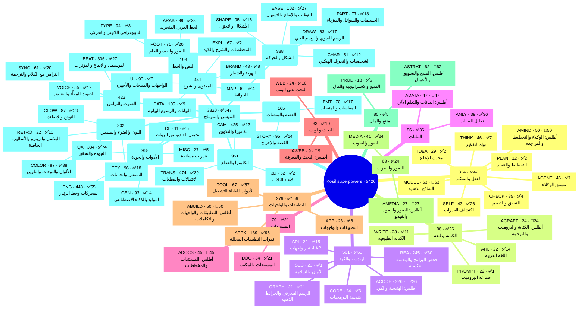
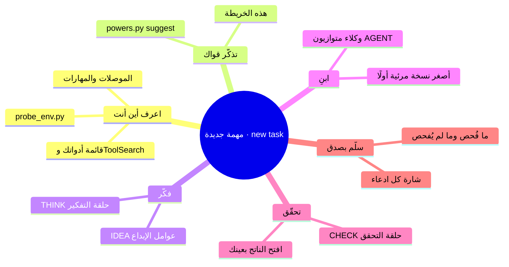

# خريطة القدرات الذهنية — Capability mind map

> **ما هذه؟** خريطة ذهنية لكل قواك: 10 مجالات → 62 عائلة → 5,426 قدرة، مع أقوى شارة دليل في كل فرع. افتحها حين تبدأ مهمة كبيرة أو حين يسألك المستخدم «تقدر تعمل إيه؟»، ثم انزل من المجال إلى العائلة إلى القدرة.
> **What it gives you:** one picture of everything you can do, so you combine powers across domains instead of reaching for the first tool you remember. Regenerate after any catalog change: `python3 scripts/powers.py mindmap` (Mermaid text) or `--html references/capability-map.html` (standalone page). Drill into one domain with `--domain mind`.

> **الخريطة المترابطة / connected graph:** [capability-graph.html](capability-graph.html) تربط كل عائلة بمستلزماتها والسكربتات التي تنفذها والاختبارات التي تثبتها (طبقة الكود من Graphify + تحليل محلي). `python3 scripts/capability_graph.py build`

## الفهرس / contents
- [1. الخريطة / the map](#1-الخريطة--the-map)
- [2. كيف تقرأها / how to read it](#2-كيف-تقرأها--how-to-read-it)
- [3. خريطة طريقة العمل / the power-up flow](#3-خريطة-طريقة-العمل--the-power-up-flow)
- [4. جسور بين المجالات / cross-domain bridges](#4-جسور-بين-المجالات--cross-domain-bridges)
- [5. اصنع خريطة ذهنية لأي شيء / mind-map anything](#5-اصنع-خريطة-ذهنية-لأي-شيء--mind-map-anything)

## 1. الخريطة / the map
كل عقدة: البادئة · عدد القدرات · أقوى شارة متاحة فيها. Each node: prefix · count · strongest badge present.

نسخة تُفتح في المتصفح: [capability-map.html](capability-map.html) (تحمّل Mermaid 11.4.1 من jsdelivr، وتعرض قائمة نصية إن لم يتوفر الإنترنت).

## 2. كيف تقرأها / how to read it
- **المجال** (العقل، الكتابة، الكود، البيانات، المستندات، البحث، التطبيقات، الصور والصوت، المنتج والمال، الموشن) يجيب عن «في أي عالم أعمل؟».
- **العائلة** (SELF, THINK, ANLY, DOC…) تجيب عن «أي صندوق أدوات أفتح؟». فصلها في `references/powers/<family>.md`.
- **القدرة** (مثل `DOC-07`) هي الوصفة: ماذا، متى، كيف، الأرقام، أمر التثبيت، الرخصة والدليل. `python3 scripts/powers.py show DOC-07`.
- **الشارات:** ✅ شُغّل فعلًا في حاوية Claude ومعه دليل · 🟢 كود جاهز · 📦 أمر تثبيت واحد · 🔑 مفتاح أو موصل · 👁 شوهد في فيديو مرجعي · 📄 طريقة موصوفة · 💡 فكرة. ✅ دليل بتاريخ، لا وعد دائم: أعد الفحص بـ`scripts/probe_env.py` قبل الادعاء.
- A branch with only 📄/💡 means "method or idea, not yet proven here"; a branch rich in ✅ means "done before in a Claude container, re-check and go".

## 3. خريطة طريقة العمل / the power-up flow

## 4. جسور بين المجالات / cross-domain bridges
The most creative results come from crossing branches. Proven or ready combinations (details in [creativity.md](creativity.md)):

| الجسر / bridge | ماذا يصنع / what it makes |
|---|---|
| ANLY → DATA/motion | تحليل CSV حقيقي ثم قصة بيانات متحركة بالعربية / a real analysis turned into an animated data story |
| WEB → DOC | بحث بمصادر موثّقة ثم تقرير Word أو PDF عربي / cited research delivered as an Arabic docx or PDF |
| WRITE → VOICE → SYNC | نص بلا علامات آلية، ثم صوت، ثم كلمات متزامنة / a clean script, then a voice, then synced words |
| REA → APPX | حلّل مثبّت تطبيق بلا تشغيله، ثم حوّل مزاياه إلى وصفات مفتوحة مثبتة / analyse an app's installer without running it, then turn its features into proven open recipes |
| GRAPH → mind map | رسم معرفي لمستودع أو مجموعة مهارات ثم خريطة ذهنية / a code or skills graph turned into a mind map |
| PROD + ANLY | تسعير ونقطة تعادل محسوبة بالكود لا بالتخمين / pricing and break-even computed in code |
| APP + MEDIA | لوحة تفاعلية أو صفحة Artifact بصور معالَجة / an interactive dashboard or artifact with processed media |
| SELF → any | قبل قول «لا أستطيع»: افحص، ثبّت، جرّب / before saying "I can't": probe, install, verify |

## 5. اصنع خريطة ذهنية لأي شيء / mind-map anything
- **لمهارة أو مستودع:** ابنِ رسمًا معرفيًا بـgraphify محليًا أو عبر Graphify MCP، ثم حوّل المجتمعات إلى فروع (الطريقة في [graphify.md](graphify.md) و`proofs/general-graphify/graph_mindmap.py`).
- **لفكرة أو مشروع:** جذر = الهدف، فروع = المجالات العشرة أعلاه، أوراق = القدرات المختارة. اكتبها Mermaid `mindmap` واعرضها في Artifact أو HTML.
- **For any topic:** root = goal; first ring = the questions (who, what, constraints, risks); second ring = the powers that answer each. Render with Mermaid; keep labels short and in the user's language.
