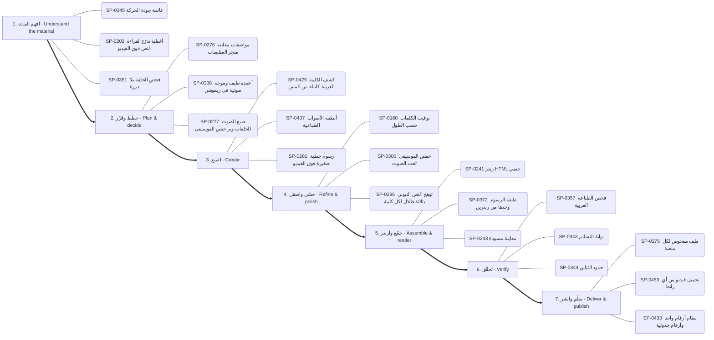
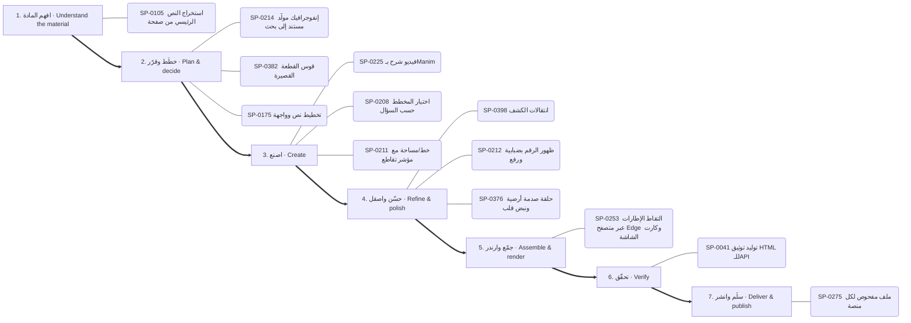
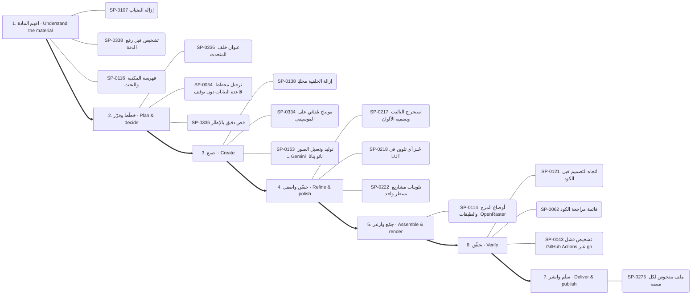
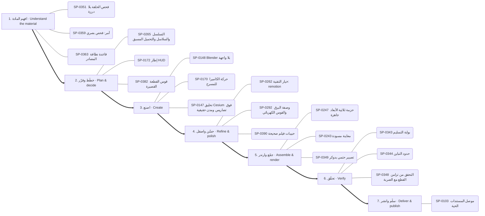
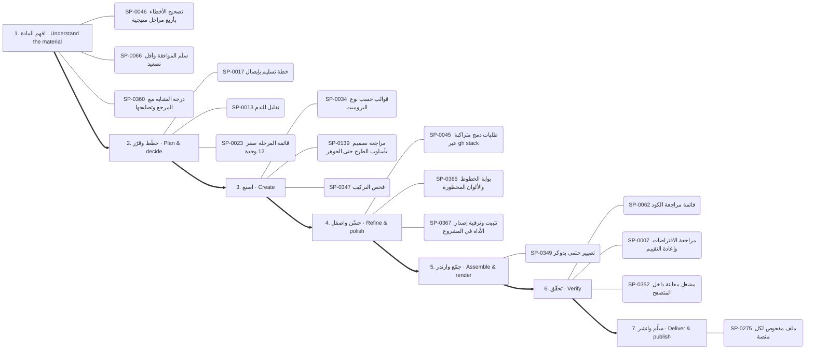
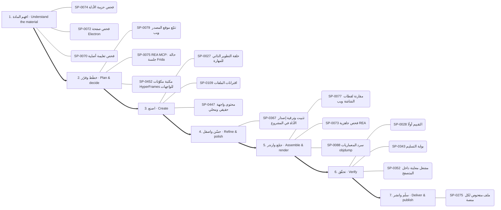

# الخريطة الذهنية للقدرات — Capability mind map

<!-- generated by scripts/capability_mindmap.py build -->

كل قدرة مرتبة بحسب **مرحلة المهمة** التي تخدمها، ثم كل بوابة مقسمة بالمراحل، ثم خرائط جاهزة لمهام شائعة. اتبع المراحل بالترتيب: افهم ← خطّط ← اصنع ← حسّن ← جمّع وارندر ← تحقّق ← سلّم.

    python3 scripts/capability_mindmap.py task "<المهمة>"     # خريطة مرحلية لأي مهمة
    python3 scripts/capability_mindmap.py task reels-edit      # خريطة جاهزة

## الفهرس / contents

- المراحل السبع / the seven stages
- الخريطة الكبرى / the big map
- خرائط المهام الجاهزة / ready task maps
- البوابات مرتبة بالمراحل / hubs by stage

## المراحل السبع / the seven stages

1. **افهم المادة — Understand the material** · 766 قدرة ذرية
2. **خطّط وقرّر — Plan & decide** · 902 قدرة ذرية
3. **اصنع — Create** · 1867 قدرة ذرية
4. **حسّن واصقل — Refine & polish** · 880 قدرة ذرية
5. **جمّع وارندر — Assemble & render** · 468 قدرة ذرية
6. **تحقّق — Verify** · 459 قدرة ذرية
7. **سلّم وانشر — Deliver & publish** · 179 قدرة ذرية

## الخريطة الكبرى / the big map

## خرائط المهام الجاهزة / ready task maps

### فيديو موشن جرافيك بصوت — Motion-graphics film with voice (`motion-film`)

البوابات: `thinking` ← `audio` ← `type` ← `motion` ← `drawing` ← `3d` ← `quality`

1. **افهم المادة:** SP-0345 ✅ قائمة جودة الحركة · SP-0202 🟢 أغطية تدرّج لقراءة النص فوق الفيديو · SP-0351 ✅ فحص الحلقة بلا درزة
2. **خطّط وقرّر:** SP-0276 ✅ مواصفات معاينة متجر التطبيقات · SP-0308 🟢 أعمدة طيف وموجة صوتية في ريموشن · SP-0277 ✅ صيغ الصوت للحلقات وتراخيص الموسيقى
3. **اصنع:** SP-0429 ✅ كشف الكلمة العربية كاملة من اليمين · SP-0437 ✅ أنظمة الأصوات الطباعية · SP-0281 ✅ رسوم خطية صغيرة فوق الفيديو
4. **حسّن واصقل:** SP-0160 ✅ توقيت الكلمات حسب الطول · SP-0300 ✅ خفض الموسيقى تحت الصوت · SP-0286 ✅ توهج النص النيوني بثلاثة ظلال لكل كلمة
5. **جمّع وارندر:** SP-0241 ✅ رندر HTML حتمي · SP-0372 ✅ طبقة الرسوم وحدها من رندرين · SP-0243 ✅ معاينة مسودة
6. **تحقّق:** SP-0357 ✅ فحص الطباعة العربية · SP-0343 ✅ بوابة التسليم · SP-0344 ✅ حدود التباين
7. **سلّم وانشر:** SP-0275 ✅ ملف مفحوص لكل منصة · SP-0453 ✅ تحميل فيديو من أي رابط · SP-0433 ✅ نظام أرقام واحد وأرقام جدولية

### مونتاج ريلز على الإيقاع — Beat-synced reels edit (`reels-edit`)

البوابات: `motion` ← `audio` ← `images` ← `quality`

1. **افهم المادة:** SP-0135 ✅ صوت PipeWire داخل الحاويات · SP-0309 ✅ كشف الإيقاع · SP-0164 ✅ كشف الصمت الثابت والتكيفي
2. **خطّط وقرّر:** SP-0303 🟢 مونتاج إيقاعي · SP-0311 ✅ موجز الأغنية ومدد الإيقاع · SP-0232 ✅ تمويه السرعة الاتجاهي
3. **اصنع:** SP-0419 ✅ مونتاج على الإيقاع · SP-0334 ✅ مونتاج تلقائي على الموسيقى · SP-0234 ✅ بوسترة طبقة واحدة
4. **حسّن واصقل:** SP-0418 🟢 حركة إيقاعية: staggered-exit · SP-0398 ✅ انتقالات الكشف · SP-0400 ✅ انتقال عبر التكبير
5. **جمّع وارندر:** SP-0372 ✅ طبقة الرسوم وحدها من رندرين · SP-0178 🟢 تكوين: Frame-within-frame · SP-0339 🟢 تايملاين زمني متعدد الكاميرات
6. **تحقّق:** SP-0348 ✅ التحقق من تزامن القطع مع الضربة · SP-0346 ✅ ورقة المراجعة · SP-0307 ✅ تطبيع الجهارة -14 LUFS
7. **سلّم وانشر:** SP-0275 ✅ ملف مفحوص لكل منصة · SP-0453 ✅ تحميل فيديو من أي رابط

### رسم شخصية وتحريكها — Draw and animate a character (`character`)

البوابات: `drawing` ← `motion` ← `audio` ← `3d`

1. **افهم المادة:** SP-0267 📦 أمر: الكتالوج والإضافة
2. **خطّط وقرّر:** SP-0304 ✅ موسيقى أصلية · SP-0276 ✅ مواصفات معاينة متجر التطبيقات · SP-0150 ✅ حقول المكعبات المتموجة
3. **اصنع:** SP-0203 ✅ شخصيات حية ببصمات حركة · SP-0396 ✅ ست خلفيات نقشية متحركة · SP-0149 🟢 منصة العمق 2.5D
4. **حسّن واصقل:** SP-0161 ✅ دمج المشاهد مع الصوت الأصلي بلا تعديل · SP-0376 ✅ حلقة صدمة أرضية ونبض قلب · SP-0399 🟢 قطع بقلب الألوان
5. **جمّع وارندر:** SP-0248 ✅ تصدير MP4 دقيق · SP-0253 🟢 التقاط الإطارات عبر متصفح Edge وكارت الشاشة · SP-0256 ✅ تجميع اللقطات بنوافذ إطارات
6. **تحقّق:** SP-0314 🟢 كثافة المؤثرات · SP-0307 ✅ تطبيع الجهارة -14 LUFS
7. **سلّم وانشر:** SP-0275 ✅ ملف مفحوص لكل منصة · SP-0453 ✅ تحميل فيديو من أي رابط

### فيديو شرح بالمخططات والبيانات — Data/diagram explainer (`explainer`)

البوابات: `data` ← `drawing` ← `motion` ← `thinking`

1. **افهم المادة:** SP-0105 ✅ استخراج النص الرئيسي من صفحة
2. **خطّط وقرّر:** SP-0214 🟢 إنفوجرافيك مولَّد مستند إلى بحث · SP-0382 ✅ قوس القطعة القصيرة · SP-0175 ✅ تخطيط نص وواجهة
3. **اصنع:** SP-0225 ✅ فيديو شرح بـManim · SP-0208 ✅ اختيار المخطط حسب السؤال · SP-0211 ✅ خط/مساحة مع مؤشر تقاطع
4. **حسّن واصقل:** SP-0398 ✅ انتقالات الكشف · SP-0212 ✅ ظهور الرقم بضبابية ورفع · SP-0376 ✅ حلقة صدمة أرضية ونبض قلب
5. **جمّع وارندر:** SP-0253 🟢 التقاط الإطارات عبر متصفح Edge وكارت الشاشة
6. **تحقّق:** SP-0041 ✅ توليد توثيق HTML للـAPI
7. **سلّم وانشر:** SP-0275 ✅ ملف مفحوص لكل منصة

### هوية وشعار وإعلان — Brand, logo & ad (`brand`)

البوابات: `drawing` ← `type` ← `motion` ← `thinking`

1. **افهم المادة:** SP-0230 🟢 تسميات بخطوط قائدة · SP-0143 📄 سلم توجيه النماذج حسب التكلفة · SP-0202 🟢 أغطية تدرّج لقراءة النص فوق الفيديو
2. **خطّط وقرّر:** SP-0382 ✅ قوس القطعة القصيرة · SP-0173 🟢 جدار بطاقات · SP-0022 ✅ سلّم مستويات التفكير L0–L6
3. **اصنع:** SP-0340 ✅ مؤثرات بكسل بخطوات اللوحة · SP-0166 ✅ قواعد بناء الشعار SVG · SP-0429 ✅ كشف الكلمة العربية كاملة من اليمين
4. **حسّن واصقل:** SP-0398 ✅ انتقالات الكشف · SP-0342 ✅ الإضاءة والتلاشي بدثر Bayer · SP-0168 🟢 كتاب العلامة وصوتها
5. **جمّع وارندر:** SP-0444 ✅ قواعد قراءة الترجمة فوق اللقطات · SP-0178 🟢 تكوين: Frame-within-frame
6. **تحقّق:** SP-0007 📄 مراجعة الافتراضات وإعادة التقييم · SP-0037 📄 اختبارات التفعيل والتصادم
7. **سلّم وانشر:** SP-0453 ✅ تحميل فيديو من أي رابط · SP-0275 ✅ ملف مفحوص لكل منصة · SP-0433 ✅ نظام أرقام واحد وأرقام جدولية

### تحرير صور وتصميم — Photo editing & design (`photo`)

البوابات: `images` ← `software` ← `drawing`

1. **افهم المادة:** SP-0107 ✅ إزالة الضباب · SP-0338 ✅ تشخيص قبل رفع الدقة · SP-0116 ✅ فهرسة المكتبة والبحث
2. **خطّط وقرّر:** SP-0336 ✅ عنوان خلف المتحدث · SP-0054 📄 ترحيل مخطط قاعدة البيانات دون توقف · SP-0335 ✅ قص دقيق بالإطار
3. **اصنع:** SP-0138 🟢 إزالة الخلفية محليًا · SP-0334 ✅ مونتاج تلقائي على الموسيقى · SP-0153 ✅ توليد وتعديل الصور بـ Gemini (نانو بنانا)
4. **حسّن واصقل:** SP-0217 ✅ استخراج الباليت وتسمية الألوان · SP-0218 ✅ خَبز أي تلوين في LUT · SP-0222 ✅ تلوينات مشاريع بسطر واحد
5. **جمّع وارندر:** SP-0114 ✅ أوضاع المزج والطبقات (OpenRaster)
6. **تحقّق:** SP-0121 📄 اتجاه التصميم قبل الكود · SP-0062 ✅ قائمة مراجعة الكود · SP-0043 📄 تشخيص فشل GitHub Actions عبر gh
7. **سلّم وانشر:** SP-0275 ✅ ملف مفحوص لكل منصة

### مشهد ثلاثي الأبعاد — 3D scene (`3d-scene`)

البوابات: `3d` ← `motion` ← `quality`

1. **افهم المادة:** SP-0351 ✅ فحص الحلقة بلا درزة · SP-0359 ✅ أمر: فحص بصري · SP-0363 ✅ قاعدة نظافة المصادر
2. **خطّط وقرّر:** SP-0265 ✅ التسلسل والسلاسل والتحميل المسبق · SP-0172 📦 إطار HUD · SP-0382 ✅ قوس القطعة القصيرة
3. **اصنع:** SP-0148 ✅ Blender بلا واجهة · SP-0170 ✅ حركة الكاميرا للمسرح · SP-0147 🟢 تحليق Cesium فوق تضاريس ومدن حقيقية
4. **حسّن واصقل:** SP-0262 ✅ خيار التقنية: remotion · SP-0292 ✅ وصفة البرق والقوس الكهربائي · SP-0390 ✅ حبيبات فيلم صحيحة
5. **جمّع وارندر:** SP-0247 ✅ حزمة ثلاثية الأبعاد جاهزة · SP-0243 ✅ معاينة مسودة · SP-0349 ✅ تصيير حتمي بدوكر
6. **تحقّق:** SP-0343 ✅ بوابة التسليم · SP-0344 ✅ حدود التباين · SP-0348 ✅ التحقق من تزامن القطع مع الضربة
7. **سلّم وانشر:** SP-0103 🔑 موصل المستندات الحية

### بناء تطبيق أو موقع — Build an app or site (`app`)

البوابات: `thinking` ← `software` ← `documents` ← `quality`

1. **افهم المادة:** SP-0122 📄 من Figma إلى كود مطابق · SP-0066 ✅ سلّم الموافقة وأقل تصعيد · SP-0024 📄 اعرف قبل أن تقول «لا»
2. **خطّط وقرّر:** SP-0140 📄 تدقيق خفض التكلفة المبني على الاستخدام · SP-0452 📦 مكتبة مكوّنات HyperFrames للواجهات · SP-0350 ✅ اختيار إطار الغلاف
3. **اصنع:** SP-0120 ✅ بناء خادم MCP (الإصدار 2) · SP-0063 ✅ ابحث قبل أن تبني · SP-0447 🟢 محتوى واجهة حقيقي ومحلي
4. **حسّن واصقل:** SP-0045 📄 طلبات دمج متراكبة عبر gh stack
5. **جمّع وارندر:** SP-0349 ✅ تصيير حتمي بدوكر · SP-0114 ✅ أوضاع المزج والطبقات (OpenRaster)
6. **تحقّق:** SP-0058 📄 اختبار العقود الذكية بهاردهات وفاوندري · SP-0041 ✅ توليد توثيق HTML للـAPI · SP-0352 ✅ مشغل معاينة داخل المتصفح
7. **سلّم وانشر:** SP-0275 ✅ ملف مفحوص لكل منصة

### تعديل كود وإصلاح — Change or fix code (`code-change`)

البوابات: `thinking` ← `software` ← `quality`

1. **افهم المادة:** SP-0046 📄 تصحيح الأخطاء بأربع مراحل منهجية · SP-0066 ✅ سلّم الموافقة وأقل تصعيد · SP-0360 🟢 درجة التشابه مع المرجع وتصليحها
2. **خطّط وقرّر:** SP-0017 ✅ خطة تسليم بإيصال · SP-0013 📄 تقليل الندم · SP-0023 📄 قائمة المرحلة صفر (12 وحدة)
3. **اصنع:** SP-0034 ✅ قوالب حسب نوع البرومبت · SP-0139 📄 مراجعة تصميم بأسلوب الطرح حتى الجوهر · SP-0347 ✅ فحص التركيب
4. **حسّن واصقل:** SP-0045 📄 طلبات دمج متراكبة عبر gh stack · SP-0365 ✅ بوابة الخطوط والألوان المحظورة · SP-0367 ✅ تثبيت وترقية إصدار الأداة في المشروع
5. **جمّع وارندر:** SP-0349 ✅ تصيير حتمي بدوكر
6. **تحقّق:** SP-0062 ✅ قائمة مراجعة الكود · SP-0007 📄 مراجعة الافتراضات وإعادة التقييم · SP-0352 ✅ مشغل معاينة داخل المتصفح
7. **سلّم وانشر:** SP-0275 ✅ ملف مفحوص لكل منصة

### فحص تطبيق ونقل ميزة — Investigate an app and transfer a feature (`reverse`)

البوابات: `reverse` ← `software` ← `quality`

1. **افهم المادة:** SP-0074 ✅ فحص حزمة الأدلة · SP-0072 ✅ فحص صفحة Electron · SP-0070 ✅ فحص تعليمة أصلية
2. **خطّط وقرّر:** SP-0079 📦 تتبّع موقع المصدر ويب · SP-0075 📄 REA MCP: حالة جلسة Frida · SP-0452 📦 مكتبة مكوّنات HyperFrames للواجهات
3. **اصنع:** SP-0027 ✅ حلقة التطوير الذاتي للمهارة · SP-0109 ✅ اقترانات الملفات · SP-0447 🟢 محتوى واجهة حقيقي ومحلي
4. **حسّن واصقل:** SP-0367 ✅ تثبيت وترقية إصدار الأداة في المشروع
5. **جمّع وارندر:** SP-0077 📦 مقارنة لقطات الشاشة ويب · SP-0073 ✅ فحص جاهزية REA · SP-0088 ✅ سرد المعماريات objdump
6. **تحقّق:** SP-0028 📄 التقييم أولًا · SP-0343 ✅ بوابة التسليم · SP-0352 ✅ مشغل معاينة داخل المتصفح
7. **سلّم وانشر:** SP-0275 ✅ ملف مفحوص لكل منصة

### تحليل بيانات وتقرير — Data analysis report (`data-report`)

البوابات: `data` ← `documents` ← `quality`

1. **افهم المادة:** SP-0089 📄 استكشاف البيانات المنضبط قبل النمذجة · SP-0351 ✅ فحص الحلقة بلا درزة · SP-0363 ✅ قاعدة نظافة المصادر
2. **خطّط وقرّر:** SP-0350 ✅ اختيار إطار الغلاف · SP-0214 🟢 إنفوجرافيك مولَّد مستند إلى بحث
3. **اصنع:** SP-0093 ✅ SQL مباشرة على ملفات CSV بـ DuckDB · SP-0208 ✅ اختيار المخطط حسب السؤال · SP-0096 ✅ رسم بياني بعناوين عربية في matplotlib
4. **حسّن واصقل:** SP-0213 🟢 نبضة التمييز وهرمية التركيز · SP-0212 ✅ ظهور الرقم بضبابية ورفع · SP-0094 ✅ تعزيز متدرّج XGBoost وLightGBM
5. **جمّع وارندر:** SP-0269 🟢 تشغيل دفعات
6. **تحقّق:** SP-0041 ✅ توليد توثيق HTML للـAPI · SP-0343 ✅ بوابة التسليم · SP-0344 ✅ حدود التباين
7. **سلّم وانشر:** SP-0275 ✅ ملف مفحوص لكل منصة

### بحث وكتابة مقال — Research and write (`research-write`)

البوابات: `research` ← `thinking` ← `documents`

1. **افهم المادة:** SP-0106 ✅ بحث معمّق بوكلاء متوازيين · SP-0105 ✅ استخراج النص الرئيسي من صفحة · SP-0039 ✅ فحص علامات الكتابة الآلية في الفصحى والمصرية
2. **خطّط وقرّر:** SP-0022 ✅ سلّم مستويات التفكير L0–L6
3. **اصنع:** SP-0038 ✅ مطابقة صوت الكاتب من عينة · SP-0010 📄 توليفة: تحليل بيانات + قصة موشن · SP-0098 📄 تقرير اختبار فهم بعد التغيير
4. **جمّع وارندر:** SP-0257 ✅ عشوائية ببذرة
5. **تحقّق:** SP-0357 ✅ فحص الطباعة العربية
6. **سلّم وانشر:** SP-0275 ✅ ملف مفحوص لكل منصة

## البوابات مرتبة بالمراحل / hubs by stage

### البحث والمعرفة — Research & knowledge

- **افهم المادة** (3): SP-0105 استخراج النص الرئيسي من صفحة · SP-0106 بحث معمّق بوكلاء متوازيين · SP-0104 استخراج وإثراء بيانات الأطباء
- **اصنع** (2): SP-0064 ربط Graphify المستضاف · SP-0065 فهم أي مستودع أو مجموعة مهارات بسرعة

### التفكير والتخطيط والاستراتيجية — Reasoning & strategy

- **افهم المادة** (6): SP-0035 اطلب أي أسلوب بصري بالاسم من مكتبة 586 أسلوبًا · SP-0005 استرجاع الذاكرة قبل التنفيذ وتسجيلها بعده · SP-0024 اعرف قبل أن تقول «لا» · SP-0143 سلم توجيه النماذج حسب التكلفة · SP-0144 فرز الحادث مقابل المشكلة وتحديد الخطورة · SP-0016 شجرة المشكلة
- **خطّط وقرّر** (9): SP-0022 سلّم مستويات التفكير L0–L6 · SP-0009 سكامبر (SCAMPER) · SP-0017 خطة تسليم بإيصال · SP-0146 ثلاثة خيارات حقيقية وعدم الفعل · SP-0023 قائمة المرحلة صفر (12 وحدة) · SP-0140 تدقيق خفض التكلفة المبني على الاستخدام …
- **اصنع** (9): SP-0034 قوالب حسب نوع البرومبت · SP-0145 السعر الأمثل ونقطة التعادل · SP-0012 خريطة أصحاب المصلحة · SP-0139 مراجعة تصميم بأسلوب الطرح حتى الجوهر · SP-0141 حلقة مستقلة لتصريف قائمة المهام · SP-0142 بطاقات أنكي عبر AnkiConnect …
- **جمّع وارندر** (1): SP-0008 تصدير خريطة ذهنية تفاعلية
- **تحقّق** (4): SP-0006 زرع العيب لإثبات أن الفحص يستطيع أن يفشل · SP-0007 مراجعة الافتراضات وإعادة التقييم · SP-0037 اختبارات التفعيل والتصادم · SP-0011 اعرض ولا تسأل: ثلاث معاينات

### الوكلاء والتوجيه الذكي — Agents & routing

- **افهم المادة** (5): SP-0127 أطلس القدرات للبحث والتخطيط · SP-0019 خطوط عربية قبل الرندر · SP-0129 فاحص توقيت الفيديو المرجعي · SP-0131 تحليل REA لمستودعات المالك دفعةً واحدة · SP-0020 اقرأ قائمة أدواتك
- **خطّط وقرّر** (2): SP-0130 مقدّر سعة الأنظمة · SP-0021 بطاقة القدرة والإيصال
- **اصنع** (5): SP-0128 مُصرِّف حركة SVG المتزامنة مع الصوت · SP-0018 اعرف قبل أن تقول لا · SP-0001 ضغط السياق بملخص تسليم · SP-0002 قرار التفويض للوكلاء أو التنفيذ المباشر · SP-0003 أشجار عمل للكتّاب المتوازيين
- **جمّع وارندر** (1): SP-0132 تحزيم المهارة للرفع إلى claude.ai
- **تحقّق** (1): SP-0004 مراجعة سانتا المزدوجة

### البرمجة وبناء التطبيقات — Software & applications

- **افهم المادة** (7): SP-0107 إزالة الضباب · SP-0116 فهرسة المكتبة والبحث · SP-0119 نشر صفحة تفاعلية خاصة · SP-0122 من Figma إلى كود مطابق · SP-0046 تصحيح الأخطاء بأربع مراحل منهجية · SP-0048 قياس صحة تكامل خارجي ونتائجه بمقامات صريحة …
- **خطّط وقرّر** (4): SP-0054 ترحيل مخطط قاعدة البيانات دون توقف · SP-0055 أنماط معمارية لـ GDScript في Godot 4 · SP-0126 تفكيك المواصفة إلى مهام صغيرة لوكلاء البرمجة · SP-0452 مكتبة مكوّنات HyperFrames للواجهات
- **اصنع** (28): SP-0110 علامات الإيقاع · SP-0112 نمو نباتي وزخرفي · SP-0111 رمز QR بشعار · SP-0445 المؤشر بطلًا · SP-0113 رسم زيتي وحبر ورصاص · SP-0109 اقترانات الملفات …
- **حسّن واصقل** (1): SP-0045 طلبات دمج متراكبة عبر gh stack
- **جمّع وارندر** (3): SP-0114 أوضاع المزج والطبقات (OpenRaster) · SP-0117 جرد قدرات Blender الحي · SP-0118 مشغل فيديو عمودي بالسحب
- **تحقّق** (6): SP-0062 قائمة مراجعة الكود · SP-0451 من التحميل إلى علامة صح · SP-0043 تشخيص فشل GitHub Actions عبر gh · SP-0124 حلقة مراجع شجرة الوصولية لتحكم المتصفح · SP-0058 اختبار العقود الذكية بهاردهات وفاوندري · SP-0121 اتجاه التصميم قبل الكود
- **سلّم وانشر** (1): SP-0125 ضبط مجمع الاتصالات وموثوقية قاعدة البيانات

### الرسم والأشكال والتصميم — Drawing & visual composition

- **افهم المادة** (1): SP-0230 تسميات بخطوط قائدة
- **خطّط وقرّر** (1): SP-0228 شبكة مفاهيم بقوة الجذب
- **اصنع** (19): SP-0280 فيلم يد مرسومة حتمي بـmake_frame(t) · SP-0166 قواعد بناء الشعار SVG · SP-0374 تحويل SVG بإضافة MorphSVG · SP-0340 مؤثرات بكسل بخطوات اللوحة · SP-0375 انفجار خطوط شعاعي · SP-0226 خريطة الكيان في المنتصف …
- **حسّن واصقل** (6): SP-0376 حلقة صدمة أرضية ونبض قلب · SP-0378 دمج ونحت وتقاطع ناعم · SP-0342 الإضاءة والتلاشي بدثر Bayer · SP-0168 كتاب العلامة وصوتها · SP-0169 تشريح بطاقة الختام · SP-0380 تجمع الصلصال بالكرات

### الصور والتحرير والتوليد — Images & photo editing

- **افهم المادة** (4): SP-0135 صوت PipeWire داخل الحاويات · SP-0338 تشخيص قبل رفع الدقة · SP-0337 مجمع لقطات بأسئلة بحث ثنائية اللغة · SP-0158 مقدمات الأسلوب المتطابقة بايتًا
- **خطّط وقرّر** (2): SP-0335 قص دقيق بالإطار · SP-0336 عنوان خلف المتحدث
- **اصنع** (13): SP-0334 مونتاج تلقائي على الموسيقى · SP-0152 معادلة برومبت لقطة الفيديو · SP-0137 ضغط الصور ومقارنة الجودة · SP-0136 التعرف على العربية والإنجليزية بـ tesseract · SP-0153 توليد وتعديل الصور بـ Gemini (نانو بنانا) · SP-0138 إزالة الخلفية محليًا …
- **حسّن واصقل** (8): SP-0217 استخراج الباليت وتسمية الألوان · SP-0218 خَبز أي تلوين في LUT · SP-0219 التعريض حسب وقت اليوم · SP-0220 خلفية بقع ضبابية متحركة · SP-0221 توازن الأبيض بالبكسلات المحايدة · SP-0222 تلوينات مشاريع بسطر واحد …
- **جمّع وارندر** (1): SP-0339 تايملاين زمني متعدد الكاميرات

### الثري دي والمحاكاة والرندر — 3D & rendering

- **افهم المادة** (1): SP-0267 أمر: الكتالوج والإضافة
- **خطّط وقرّر** (7): SP-0264 محول إطارات CSS · SP-0150 حقول المكعبات المتموجة · SP-0260 تكامل: Lottie Creator MCP · SP-0265 التسلسل والسلاسل والتحميل المسبق · SP-0251 قائمة قواعد Remotion · SP-0266 اصطلاح المسارات والعلامات في المونتاج …
- **اصنع** (25): SP-0147 تحليق Cesium فوق تضاريس ومدن حقيقية · SP-0244 مشروع أنيميشن جديد · SP-0246 استوديو KOSIF Motion Web المحلي · SP-0148 Blender بلا واجهة · SP-0329 مطر وضباب ومطر الغيمة · SP-0330 حقل curl تحليلي خالٍ من التباعد …
- **حسّن واصقل** (15): SP-0286 توهج النص النيوني بثلاثة ظلال لكل كلمة · SP-0287 قراءة إضاءة صورة مرجعية · SP-0390 حبيبات فيلم صحيحة · SP-0328 انفجار ببذرة وجاذبية · SP-0391 تظليل كرة بالهالفتون · SP-0288 مرور العدسة «مصوَّر لا مرسوم» …
- **جمّع وارندر** (14): SP-0243 معاينة مسودة · SP-0252 تجميع الإطارات إلى فيديو MP4 · SP-0241 رندر HTML حتمي · SP-0248 تصدير MP4 دقيق · SP-0245 مواصفة الخط الزمني · SP-0257 عشوائية ببذرة …

### الموشن والمونتاج والسينما — Motion & video editing

- **افهم المادة** (1): SP-0202 أغطية تدرّج لقراءة النص فوق الفيديو
- **خطّط وقرّر** (21): SP-0382 قوس القطعة القصيرة · SP-0232 تمويه السرعة الاتجاهي · SP-0277 صيغ الصوت للحلقات وتراخيص الموسيقى · SP-0278 بريف الصورة المصغرة: 3 أفكار واختبار A/B · SP-0175 تخطيط نص وواجهة · SP-0236 أربع تسارعات مسماة فقط …
- **اصنع** (41): SP-0203 شخصيات حية ببصمات حركة · SP-0170 حركة الكاميرا للمسرح · SP-0233 ميزانيات التتابع · SP-0383 مولّد طلب Claude من الأسلوب · SP-0204 ورقة تصميم الشخصية واختبار الظل · SP-0171 دفع الكاميرا …
- **حسّن واصقل** (26): SP-0398 انتقالات الكشف · SP-0231 منحنى النابض المحسوب مسبقًا · SP-0235 رموز حركة CSS مختبرة · SP-0176 عمق الميدان وسحب التركيز · SP-0417 اختيار الانتقال حسب الطاقة · SP-0401 انتقال CSS: حرق الفيلم …
- **جمّع وارندر** (1): SP-0178 تكوين: Frame-within-frame
- **سلّم وانشر** (2): SP-0275 ملف مفحوص لكل منصة · SP-0453 تحميل فيديو من أي رابط

### الصوت والموسيقى والتعليق — Audio & voice

- **افهم المادة** (3): SP-0309 كشف الإيقاع · SP-0162 تفريغ HyperFrames · SP-0164 كشف الصمت الثابت والتكيفي
- **خطّط وقرّر** (8): SP-0304 موسيقى أصلية · SP-0303 مونتاج إيقاعي · SP-0306 شبكة الإيقاع · SP-0308 أعمدة طيف وموجة صوتية في ريموشن · SP-0311 موجز الأغنية ومدد الإيقاع · SP-0316 أرض من طيف الصوت …
- **اصنع** (17): SP-0302 قنوات الصوت كمحرك للحركة · SP-0301 مكتبة المؤثرات · SP-0454 أزياء صوتية للشخصيات · SP-0305 مقام lydian · SP-0317 أجواء صوتية مولدة · SP-0312 عزل الصوت وتنظيفه …
- **حسّن واصقل** (6): SP-0160 توقيت الكلمات حسب الطول · SP-0300 خفض الموسيقى تحت الصوت · SP-0161 دمج المشاهد مع الصوت الأصلي بلا تعديل · SP-0313 قناة المزج · SP-0165 الأشرطة السفلية · SP-0324 أصوات مولدة
- **تحقّق** (2): SP-0307 تطبيع الجهارة -14 LUFS · SP-0314 كثافة المؤثرات

### الخطوط والنصوص العربية واللاتينية — Typography & localization

- **خطّط وقرّر** (1): SP-0434 علامة استفهام عملاقة مفرّغة
- **اصنع** (13): SP-0429 كشف الكلمة العربية كاملة من اليمين · SP-0030 CAMeL Tools: تقطيع النص العربي واستخراج الجذور والتشكيل وتحديد · SP-0430 مطابقة الخط بالحبر · SP-0431 طبقات نص الخط الزمني JSON · SP-0437 أنظمة الأصوات الطباعية · SP-0432 سطور تتكدس وتخفت …
- **حسّن واصقل** (1): SP-0440 عنوان بلونين وكلمة لون
- **جمّع وارندر** (1): SP-0444 قواعد قراءة الترجمة فوق اللقطات
- **تحقّق** (1): SP-0031 تحقق من أرقام OCR ببوابة المراسي
- **سلّم وانشر** (1): SP-0433 نظام أرقام واحد وأرقام جدولية

### البيانات والرسوم والمواقع — Data & visual analytics

- **افهم المادة** (2): SP-0089 استكشاف البيانات المنضبط قبل النمذجة · SP-0092 مراجعة مخطط واستعلامات ClickHouse
- **خطّط وقرّر** (1): SP-0214 إنفوجرافيك مولَّد مستند إلى بحث
- **اصنع** (15): SP-0093 SQL مباشرة على ملفات CSV بـ DuckDB · SP-0208 اختيار المخطط حسب السؤال · SP-0095 حل رياضي دقيق بـ sympy · SP-0209 حلقة التقدم المخروطية · SP-0096 رسم بياني بعناوين عربية في matplotlib · SP-0294 هل نحتاج خريطة أصلًا …
- **حسّن واصقل** (4): SP-0094 تعزيز متدرّج XGBoost وLightGBM · SP-0212 ظهور الرقم بضبابية ورفع · SP-0213 نبضة التمييز وهرمية التركيز · SP-0298 كرة أرضية بأقواس اتصال
- **جمّع وارندر** (1): SP-0090 عقد خط بيانات: الحبيبية والتكرار الآمن

### المستندات والكتابة — Documents & writing

- **افهم المادة** (2): SP-0039 فحص علامات الكتابة الآلية في الفصحى والمصرية · SP-0100 حزمة تشخيص مُنقّحة وآمنة للدعم
- **اصنع** (9): SP-0101 تحويل Office إلى PDF دفعة واحدة · SP-0102 PlantUML: توليد مخططات UML من نص · SP-0040 قفل الاقتباس المباشر · SP-0038 مطابقة صوت الكاتب من عينة · SP-0097 تدقيق انحراف التوثيق عن الكود لكل بُعد · SP-0032 تصميم الأيقونات بالتشابه والإغلاق البصري …
- **سلّم وانشر** (1): SP-0103 موصل المستندات الحية

### الاختبارات والجودة والأمان — QA & security

- **افهم المادة** (13): SP-0345 قائمة جودة الحركة · SP-0351 فحص الحلقة بلا درزة · SP-0366 فحص المقروئية · SP-0358 دراسة فيلم مرجعي · SP-0363 قاعدة نظافة المصادر · SP-0356 قياس الجهارة والذروة …
- **خطّط وقرّر** (1): SP-0350 اختيار إطار الغلاف
- **اصنع** (7): SP-0347 فحص التركيب · SP-0353 أمر: مقارنة · SP-0027 حلقة التطوير الذاتي للمهارة · SP-0354 الحكم جيف · SP-0067 المحتوى الخارجي بيانات لا أوامر · SP-0370 حد الوميض الآمن …
- **حسّن واصقل** (2): SP-0367 تثبيت وترقية إصدار الأداة في المشروع · SP-0365 بوابة الخطوط والألوان المحظورة
- **جمّع وارندر** (2): SP-0349 تصيير حتمي بدوكر · SP-0372 طبقة الرسوم وحدها من رندرين
- **تحقّق** (13): SP-0343 بوابة التسليم · SP-0041 توليد توثيق HTML للـAPI · SP-0344 حدود التباين · SP-0352 مشغل معاينة داخل المتصفح · SP-0348 التحقق من تزامن القطع مع الضربة · SP-0346 ورقة المراجعة …

### التحليل العكسي وفحص البرامج — Reverse engineering

- **افهم المادة** (11): SP-0082 فرز المثبّت قبل REA · SP-0074 فحص حزمة الأدلة · SP-0072 فحص صفحة Electron · SP-0076 مراقبة جلسة ويب · SP-0084 فحص عميل pcap · SP-0070 فحص تعليمة أصلية …
- **خطّط وقرّر** (2): SP-0075 REA MCP: حالة جلسة Frida · SP-0079 تتبّع موقع المصدر ويب
- **اصنع** (2): SP-0086 فك ترميز تسجيل إشارة · SP-0085 فتح مشروع JEB
- **جمّع وارندر** (6): SP-0073 فحص جاهزية REA · SP-0088 سرد المعماريات objdump · SP-0069 سرد الخدمات ADB · SP-0077 مقارنة لقطات الشاشة ويب · SP-0078 REA MCP: أمر تصحيح Rizin · SP-0083 REA MCP: حالة جلسة GDB

### قدرات مساندة غير مصنفة — Other supporting capabilities

- **افهم المادة** (1): SP-0325 مكتبة KOSIF Atlas
- **خطّط وقرّر** (1): SP-0327 ملف المشروع المحمول وإعادة الربط
- **اصنع** (1): SP-0326 خادم MCP للاستوديو (22 أداة)

---
_مولَّد آليًا من data/superpowers.json وdata/hubs_index.json وdata/task_maps.json._
