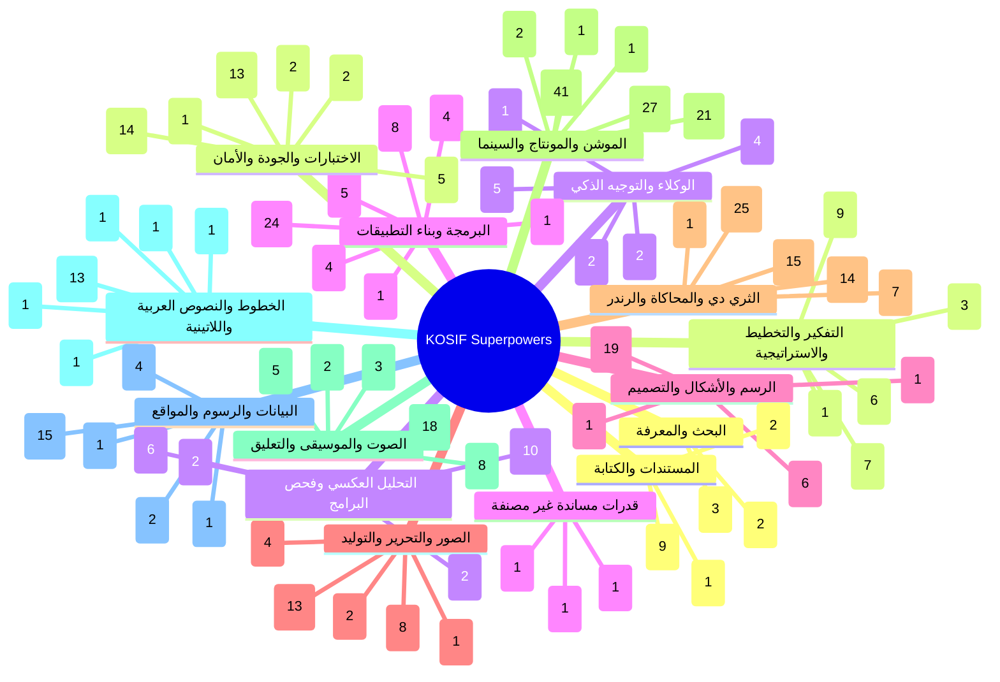
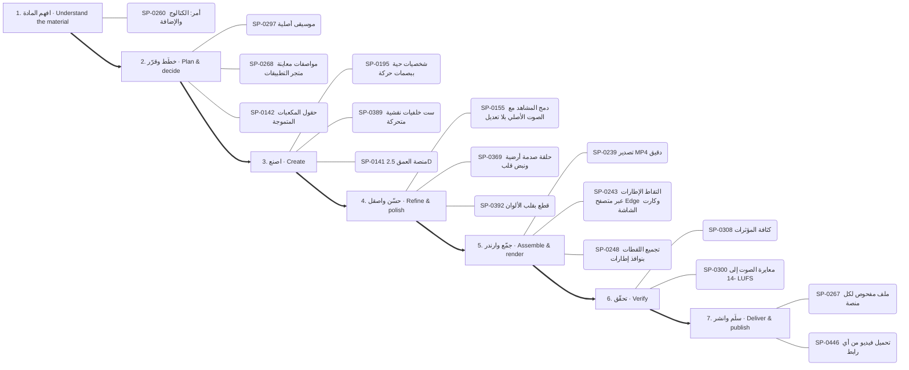
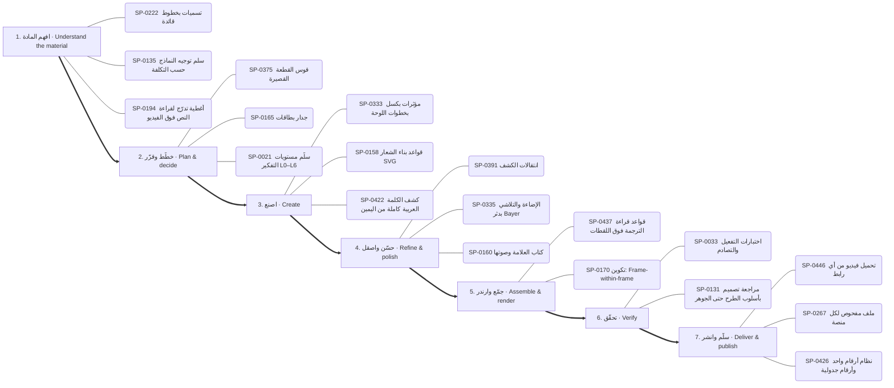
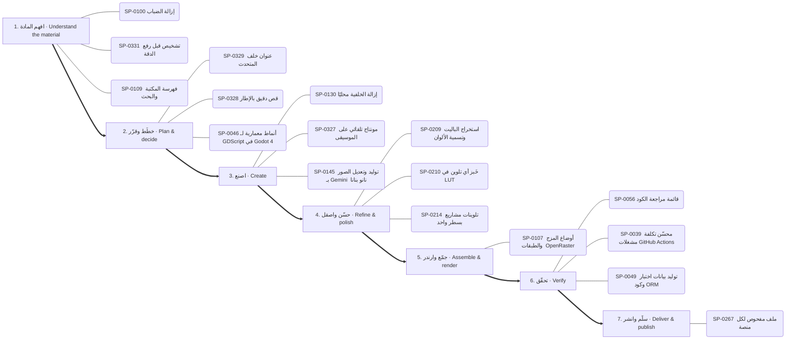
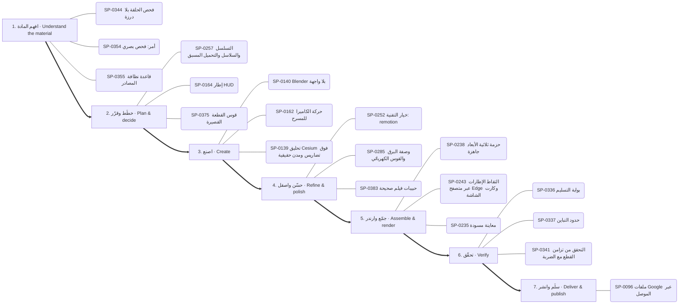
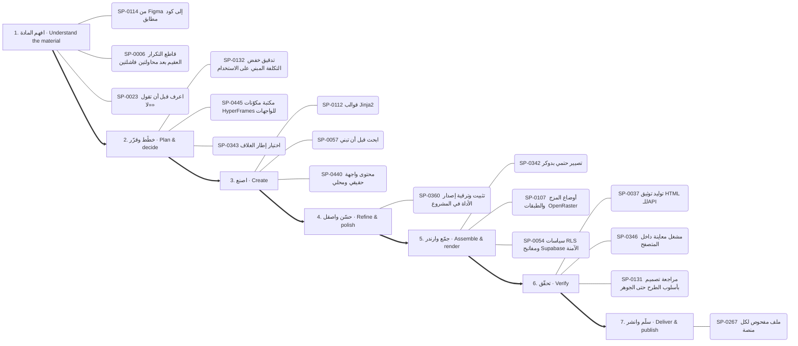
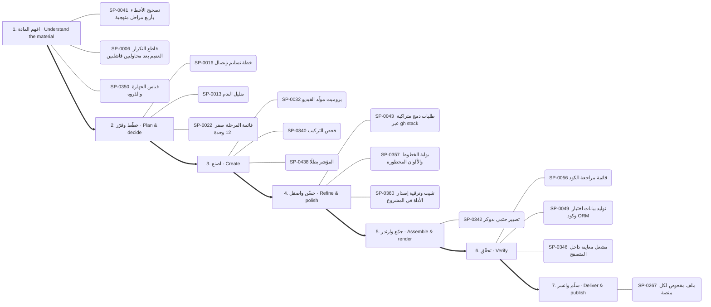
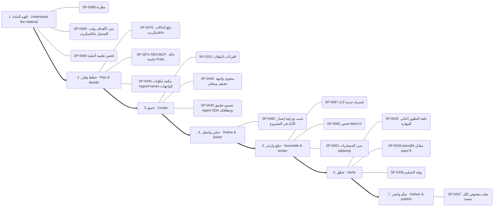
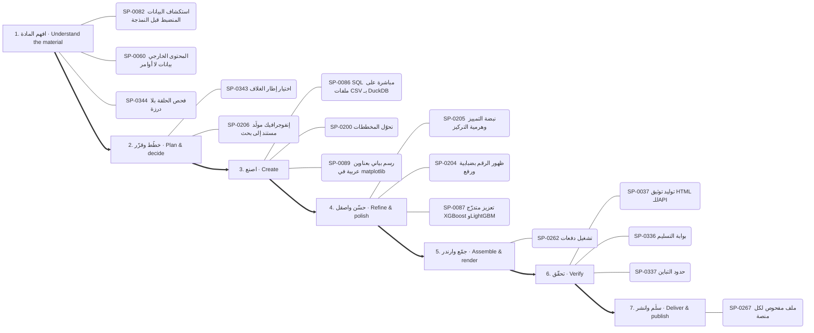

# الخريطة الذهنية للقدرات — Capability mind map

<!-- generated by scripts/capability_mindmap.py build -->

كل قدرة مرتبة بحسب **مرحلة المهمة** التي تخدمها، ثم كل بوابة مقسمة بالمراحل، ثم خرائط جاهزة لمهام شائعة. اتبع المراحل بالترتيب: افهم ← خطّط ← اصنع ← حسّن ← جمّع وارندر ← تحقّق ← سلّم.

    python3 scripts/capability_mindmap.py task "<المهمة>"     # خريطة مرحلية لأي مهمة
    python3 scripts/capability_mindmap.py task reels-edit      # خريطة جاهزة

## الفهرس / contents

- المراحل السبع / the seven stages
- الخريطة الكبرى / the big map
- خرائط المهام الجاهزة / ready task maps
- البوابات مرتبة بالمراحل / hubs by stage

## المراحل السبع / the seven stages

1. **افهم المادة — Understand the material** · 739 قدرة ذرية
2. **خطّط وقرّر — Plan & decide** · 890 قدرة ذرية
3. **اصنع — Create** · 1831 قدرة ذرية
4. **حسّن واصقل — Refine & polish** · 877 قدرة ذرية
5. **جمّع وارندر — Assemble & render** · 463 قدرة ذرية
6. **تحقّق — Verify** · 436 قدرة ذرية
7. **سلّم وانشر — Deliver & publish** · 172 قدرة ذرية

## الخريطة الكبرى / the big map

## خرائط المهام الجاهزة / ready task maps

### فيديو موشن جرافيك بصوت — Motion-graphics film with voice (`motion-film`)

البوابات: `thinking` ← `audio` ← `type` ← `motion` ← `drawing` ← `3d` ← `quality`

1. **افهم المادة:** SP-0339 ✅ قائمة جودة الحركة · SP-0153 ✅ تفريغ HyperFrames · SP-0194 🟢 أغطية تدرّج لقراءة النص فوق الفيديو
2. **خطّط وقرّر:** SP-0268 ✅ مواصفات معاينة متجر التطبيقات · SP-0301 🟢 أعمدة طيف وموجة صوتية في ريموشن · SP-0269 ✅ صيغ الصوت للحلقات وتراخيص الموسيقى
3. **اصنع:** SP-0422 ✅ كشف الكلمة العربية كاملة من اليمين · SP-0430 ✅ أنظمة الأصوات الطباعية · SP-0274 ✅ رسوم خطية صغيرة فوق الفيديو
4. **حسّن واصقل:** SP-0293 ✅ خفض الموسيقى تحت الصوت · SP-0279 ✅ توهج النص النيوني بثلاثة ظلال لكل كلمة · SP-0321 ✅ انفجار ببذرة وجاذبية
5. **جمّع وارندر:** SP-0233 ✅ رندر HTML حتمي · SP-0244 ✅ تجميع الإطارات إلى فيديو MP4 · SP-0240 ✅ خط زمني JSON
6. **تحقّق:** SP-0351 ✅ فحص الطباعة العربية · SP-0025 ✅ حلقة التطوير الذاتي للمهارة · SP-0336 ✅ بوابة التسليم
7. **سلّم وانشر:** SP-0267 ✅ ملف مفحوص لكل منصة · SP-0446 ✅ تحميل فيديو من أي رابط · SP-0426 ✅ نظام أرقام واحد وأرقام جدولية

### مونتاج ريلز على الإيقاع — Beat-synced reels edit (`reels-edit`)

البوابات: `motion` ← `audio` ← `images` ← `quality`

1. **افهم المادة:** SP-0127 ✅ صوت PipeWire داخل الحاويات · SP-0302 ✅ كشف الإيقاع · SP-0156 ✅ كشف الصمت الثابت والتكيفي
2. **خطّط وقرّر:** SP-0296 🟢 مونتاج إيقاعي · SP-0304 ✅ موجز الأغنية ومدد الإيقاع · SP-0224 ✅ تمويه السرعة الاتجاهي
3. **اصنع:** SP-0411 ✅ مونتاج على الإيقاع · SP-0327 ✅ مونتاج تلقائي على الموسيقى · SP-0227 ✅ بوسترة طبقة واحدة
4. **حسّن واصقل:** SP-0410 🟢 حركة إيقاعية: staggered-exit · SP-0391 ✅ انتقالات الكشف · SP-0393 ✅ انتقال عبر التكبير
5. **جمّع وارندر:** SP-0365 ✅ طبقة الرسوم وحدها من رندرين · SP-0170 🟢 تكوين: Frame-within-frame · SP-0332 🟢 تايملاين زمني متعدد الكاميرات
6. **تحقّق:** SP-0341 ✅ التحقق من تزامن القطع مع الضربة · SP-0338 ✅ ورقة المراجعة · SP-0345 ✅ فحص الإطارات الآلي
7. **سلّم وانشر:** SP-0267 ✅ ملف مفحوص لكل منصة · SP-0446 ✅ تحميل فيديو من أي رابط

### رسم شخصية وتحريكها — Draw and animate a character (`character`)

البوابات: `drawing` ← `motion` ← `audio` ← `3d`

1. **افهم المادة:** SP-0260 📦 أمر: الكتالوج والإضافة
2. **خطّط وقرّر:** SP-0297 ✅ موسيقى أصلية · SP-0268 ✅ مواصفات معاينة متجر التطبيقات · SP-0142 ✅ حقول المكعبات المتموجة
3. **اصنع:** SP-0195 ✅ شخصيات حية ببصمات حركة · SP-0389 ✅ ست خلفيات نقشية متحركة · SP-0141 🟢 منصة العمق 2.5D
4. **حسّن واصقل:** SP-0155 ✅ دمج المشاهد مع الصوت الأصلي بلا تعديل · SP-0369 ✅ حلقة صدمة أرضية ونبض قلب · SP-0392 🟢 قطع بقلب الألوان
5. **جمّع وارندر:** SP-0239 ✅ تصدير MP4 دقيق · SP-0243 ✅ التقاط الإطارات عبر متصفح Edge وكارت الشاشة · SP-0248 ✅ تجميع اللقطات بنوافذ إطارات
6. **تحقّق:** SP-0308 🟢 كثافة المؤثرات · SP-0300 ✅ معايرة الصوت إلى -14 LUFS
7. **سلّم وانشر:** SP-0267 ✅ ملف مفحوص لكل منصة · SP-0446 ✅ تحميل فيديو من أي رابط

### فيديو شرح بالمخططات والبيانات — Data/diagram explainer (`explainer`)

البوابات: `data` ← `drawing` ← `motion` ← `thinking`

1. **افهم المادة:** SP-0098 ✅ استخراج النص الرئيسي من صفحة
2. **خطّط وقرّر:** SP-0206 🟢 إنفوجرافيك مولَّد مستند إلى بحث · SP-0375 ✅ قوس القطعة القصيرة · SP-0167 ✅ تخطيط نص وواجهة
3. **اصنع:** SP-0217 ✅ فيديو شرح بـManim · SP-0200 ✅ تحوّل المخططات · SP-0203 ✅ خط/مساحة مع مؤشر تقاطع
4. **حسّن واصقل:** SP-0391 ✅ انتقالات الكشف · SP-0204 ✅ ظهور الرقم بضبابية ورفع · SP-0369 ✅ حلقة صدمة أرضية ونبض قلب
5. **جمّع وارندر:** SP-0243 ✅ التقاط الإطارات عبر متصفح Edge وكارت الشاشة
6. **تحقّق:** SP-0037 ✅ توليد توثيق HTML للـAPI
7. **سلّم وانشر:** SP-0267 ✅ ملف مفحوص لكل منصة

### هوية وشعار وإعلان — Brand, logo & ad (`brand`)

البوابات: `drawing` ← `type` ← `motion` ← `thinking`

1. **افهم المادة:** SP-0222 🟢 تسميات بخطوط قائدة · SP-0135 📄 سلم توجيه النماذج حسب التكلفة · SP-0194 🟢 أغطية تدرّج لقراءة النص فوق الفيديو
2. **خطّط وقرّر:** SP-0375 ✅ قوس القطعة القصيرة · SP-0165 🟢 جدار بطاقات · SP-0021 ✅ سلّم مستويات التفكير L0–L6
3. **اصنع:** SP-0333 ✅ مؤثرات بكسل بخطوات اللوحة · SP-0158 ✅ قواعد بناء الشعار SVG · SP-0422 ✅ كشف الكلمة العربية كاملة من اليمين
4. **حسّن واصقل:** SP-0391 ✅ انتقالات الكشف · SP-0335 ✅ الإضاءة والتلاشي بدثر Bayer · SP-0160 🟢 كتاب العلامة وصوتها
5. **جمّع وارندر:** SP-0437 ✅ قواعد قراءة الترجمة فوق اللقطات · SP-0170 🟢 تكوين: Frame-within-frame
6. **تحقّق:** SP-0033 📄 اختبارات التفعيل والتصادم · SP-0131 📄 مراجعة تصميم بأسلوب الطرح حتى الجوهر
7. **سلّم وانشر:** SP-0446 ✅ تحميل فيديو من أي رابط · SP-0267 ✅ ملف مفحوص لكل منصة · SP-0426 ✅ نظام أرقام واحد وأرقام جدولية

### تحرير صور وتصميم — Photo editing & design (`photo`)

البوابات: `images` ← `software` ← `drawing`

1. **افهم المادة:** SP-0100 ✅ إزالة الضباب · SP-0331 ✅ تشخيص قبل رفع الدقة · SP-0109 ✅ فهرسة المكتبة والبحث
2. **خطّط وقرّر:** SP-0329 ✅ عنوان خلف المتحدث · SP-0328 ✅ قص دقيق بالإطار · SP-0046 📄 أنماط معمارية لـ GDScript في Godot 4
3. **اصنع:** SP-0130 🟢 إزالة الخلفية محليًا · SP-0327 ✅ مونتاج تلقائي على الموسيقى · SP-0145 ✅ توليد وتعديل الصور بـ Gemini (نانو بنانا)
4. **حسّن واصقل:** SP-0209 ✅ استخراج الباليت وتسمية الألوان · SP-0210 ✅ خَبز أي تلوين في LUT · SP-0214 ✅ تلوينات مشاريع بسطر واحد
5. **جمّع وارندر:** SP-0107 ✅ أوضاع المزج والطبقات (OpenRaster)
6. **تحقّق:** SP-0056 ✅ قائمة مراجعة الكود · SP-0039 📄 محسّن تكلفة مشغلات GitHub Actions · SP-0049 📄 توليد بيانات اختبار وكود ORM
7. **سلّم وانشر:** SP-0267 ✅ ملف مفحوص لكل منصة

### مشهد ثلاثي الأبعاد — 3D scene (`3d-scene`)

البوابات: `3d` ← `motion` ← `quality`

1. **افهم المادة:** SP-0344 ✅ فحص الحلقة بلا درزة · SP-0354 ✅ أمر: فحص بصري · SP-0355 ✅ قاعدة نظافة المصادر
2. **خطّط وقرّر:** SP-0257 ✅ التسلسل والسلاسل والتحميل المسبق · SP-0164 📦 إطار HUD · SP-0375 ✅ قوس القطعة القصيرة
3. **اصنع:** SP-0140 ✅ Blender بلا واجهة · SP-0162 ✅ حركة الكاميرا للمسرح · SP-0139 🟢 تحليق Cesium فوق تضاريس ومدن حقيقية
4. **حسّن واصقل:** SP-0252 ✅ خيار التقنية: remotion · SP-0285 ✅ وصفة البرق والقوس الكهربائي · SP-0383 ✅ حبيبات فيلم صحيحة
5. **جمّع وارندر:** SP-0238 ✅ حزمة ثلاثية الأبعاد جاهزة · SP-0243 ✅ التقاط الإطارات عبر متصفح Edge وكارت الشاشة · SP-0235 ✅ معاينة مسودة
6. **تحقّق:** SP-0336 ✅ بوابة التسليم · SP-0337 ✅ حدود التباين · SP-0341 ✅ التحقق من تزامن القطع مع الضربة
7. **سلّم وانشر:** SP-0096 🔑 ملفات Google عبر الموصل

### بناء تطبيق أو موقع — Build an app or site (`app`)

البوابات: `thinking` ← `software` ← `documents` ← `quality`

1. **افهم المادة:** SP-0114 📄 من Figma إلى كود مطابق · SP-0006 📄 قاطع التكرار العقيم بعد محاولتين فاشلتين · SP-0023 📄 اعرف قبل أن تقول «لا»
2. **خطّط وقرّر:** SP-0132 📄 تدقيق خفض التكلفة المبني على الاستخدام · SP-0445 📦 مكتبة مكوّنات HyperFrames للواجهات · SP-0343 ✅ اختيار إطار الغلاف
3. **اصنع:** SP-0112 ✅ قوالب Jinja2 · SP-0057 ✅ ابحث قبل أن تبني · SP-0440 🟢 محتوى واجهة حقيقي ومحلي
4. **حسّن واصقل:** SP-0360 ✅ تثبيت وترقية إصدار الأداة في المشروع
5. **جمّع وارندر:** SP-0342 ✅ تصيير حتمي بدوكر · SP-0107 ✅ أوضاع المزج والطبقات (OpenRaster) · SP-0054 📄 سياسات RLS ومفاتيح Supabase الآمنة
6. **تحقّق:** SP-0037 ✅ توليد توثيق HTML للـAPI · SP-0346 ✅ مشغل معاينة داخل المتصفح · SP-0131 📄 مراجعة تصميم بأسلوب الطرح حتى الجوهر
7. **سلّم وانشر:** SP-0267 ✅ ملف مفحوص لكل منصة

### تعديل كود وإصلاح — Change or fix code (`code-change`)

البوابات: `thinking` ← `software` ← `quality`

1. **افهم المادة:** SP-0041 📄 تصحيح الأخطاء بأربع مراحل منهجية · SP-0006 📄 قاطع التكرار العقيم بعد محاولتين فاشلتين · SP-0350 ✅ قياس الجهارة والذروة
2. **خطّط وقرّر:** SP-0016 ✅ خطة تسليم بإيصال · SP-0013 📄 تقليل الندم · SP-0022 📄 قائمة المرحلة صفر (12 وحدة)
3. **اصنع:** SP-0032 ✅ برومبت مولّد الفيديو · SP-0340 ✅ فحص التركيب · SP-0438 ✅ المؤشر بطلًا
4. **حسّن واصقل:** SP-0043 📄 طلبات دمج متراكبة عبر gh stack · SP-0357 ✅ بوابة الخطوط والألوان المحظورة · SP-0360 ✅ تثبيت وترقية إصدار الأداة في المشروع
5. **جمّع وارندر:** SP-0342 ✅ تصيير حتمي بدوكر
6. **تحقّق:** SP-0056 ✅ قائمة مراجعة الكود · SP-0049 📄 توليد بيانات اختبار وكود ORM · SP-0346 ✅ مشغل معاينة داخل المتصفح
7. **سلّم وانشر:** SP-0267 ✅ ملف مفحوص لكل منصة

### فحص تطبيق ونقل ميزة — Investigate an app and transfer a feature (`reverse`)

البوابات: `reverse` ← `software` ← `quality`

1. **افهم المادة:** SP-0068 ✅ مقارنة · SP-0069 ✅ سرد الأهداف وقت التشغيل جافاسكربت · SP-0064 ✅ فحص تعليمة أصلية
2. **خطّط وقرّر:** SP-0070 ✅ تتبّع الدلالات جافاسكربت · SP-0071 📄 REA MCP: حالة جلسة Frida · SP-0445 📦 مكتبة مكوّنات HyperFrames للواجهات
3. **اصنع:** SP-0102 ✅ اقترانات الملفات · SP-0440 🟢 محتوى واجهة حقيقي ومحلي · SP-0040 📄 تصميم تطبيق Agent SDK وخطافاته
4. **حسّن واصقل:** SP-0360 ✅ تثبيت وترقية إصدار الأداة في المشروع
5. **جمّع وارندر:** SP-0067 ✅ استيراد حزمة أدلة · SP-0065 📦 فحص Mach-O · SP-0081 ✅ سرد المعماريات objdump
6. **تحقّق:** SP-0025 ✅ حلقة التطوير الذاتي للمهارة · SP-0026 📄 pass@k مقابل pass^k · SP-0336 ✅ بوابة التسليم
7. **سلّم وانشر:** SP-0267 ✅ ملف مفحوص لكل منصة

### تحليل بيانات وتقرير — Data analysis report (`data-report`)

البوابات: `data` ← `documents` ← `quality`

1. **افهم المادة:** SP-0082 📄 استكشاف البيانات المنضبط قبل النمذجة · SP-0060 ✅ المحتوى الخارجي بيانات لا أوامر · SP-0344 ✅ فحص الحلقة بلا درزة
2. **خطّط وقرّر:** SP-0343 ✅ اختيار إطار الغلاف · SP-0206 🟢 إنفوجرافيك مولَّد مستند إلى بحث
3. **اصنع:** SP-0086 ✅ SQL مباشرة على ملفات CSV بـ DuckDB · SP-0200 ✅ تحوّل المخططات · SP-0089 ✅ رسم بياني بعناوين عربية في matplotlib
4. **حسّن واصقل:** SP-0205 🟢 نبضة التمييز وهرمية التركيز · SP-0204 ✅ ظهور الرقم بضبابية ورفع · SP-0087 ✅ تعزيز متدرّج XGBoost وLightGBM
5. **جمّع وارندر:** SP-0262 🟢 تشغيل دفعات
6. **تحقّق:** SP-0037 ✅ توليد توثيق HTML للـAPI · SP-0336 ✅ بوابة التسليم · SP-0337 ✅ حدود التباين
7. **سلّم وانشر:** SP-0267 ✅ ملف مفحوص لكل منصة

### بحث وكتابة مقال — Research and write (`research-write`)

البوابات: `research` ← `thinking` ← `documents`

1. **افهم المادة:** SP-0099 ✅ بحث معمّق بوكلاء متوازيين · SP-0098 ✅ استخراج النص الرئيسي من صفحة · SP-0035 ✅ فحص علامات الكتابة الآلية في الفصحى والمصرية
2. **خطّط وقرّر:** SP-0021 ✅ سلّم مستويات التفكير L0–L6
3. **اصنع:** SP-0094 ✅ PDF عربي من HTML وCSS · SP-0034 ✅ مطابقة صوت الكاتب من عينة · SP-0010 📄 توليفة: تحليل بيانات + قصة موشن
4. **جمّع وارندر:** SP-0249 ✅ عشوائية ببذرة ثابتة
5. **تحقّق:** SP-0351 ✅ فحص الطباعة العربية
6. **سلّم وانشر:** SP-0267 ✅ ملف مفحوص لكل منصة

## البوابات مرتبة بالمراحل / hubs by stage

### البحث والمعرفة — Research & knowledge

- **افهم المادة** (3): SP-0098 استخراج النص الرئيسي من صفحة · SP-0099 بحث معمّق بوكلاء متوازيين · SP-0097 استخراج وإثراء بيانات الأطباء
- **اصنع** (2): SP-0058 ربط Graphify المستضاف · SP-0059 الخريطة مادةً لفيلم موشن

### التفكير والتخطيط والاستراتيجية — Reasoning & strategy

- **افهم المادة** (6): SP-0005 تصميم ذاكرة الوكيل وتقييمها وتدقيق التسميم · SP-0023 اعرف قبل أن تقول «لا» · SP-0135 سلم توجيه النماذج حسب التكلفة · SP-0136 فرز الحادث مقابل المشكلة وتحديد الخطورة · SP-0015 شجرة المشكلة · SP-0006 قاطع التكرار العقيم بعد محاولتين فاشلتين
- **خطّط وقرّر** (9): SP-0021 سلّم مستويات التفكير L0–L6 · SP-0009 سكامبر (SCAMPER) · SP-0016 خطة تسليم بإيصال · SP-0138 ثلاثة خيارات حقيقية وعدم الفعل · SP-0022 قائمة المرحلة صفر (12 وحدة) · SP-0132 تدقيق خفض التكلفة المبني على الاستخدام …
- **اصنع** (7): SP-0137 السعر الأمثل ونقطة التعادل · SP-0032 برومبت مولّد الفيديو · SP-0012 خريطة أصحاب المصلحة · SP-0133 حلقة مستقلة لتصريف قائمة المهام · SP-0010 توليفة: تحليل بيانات + قصة موشن · SP-0134 بطاقات أنكي عبر AnkiConnect …
- **جمّع وارندر** (1): SP-0008 تصدير خريطة ذهنية تفاعلية
- **تحقّق** (3): SP-0131 مراجعة تصميم بأسلوب الطرح حتى الجوهر · SP-0033 اختبارات التفعيل والتصادم · SP-0011 اعرض ولا تسأل: ثلاث معاينات

### الوكلاء والتوجيه الذكي — Agents & routing

- **افهم المادة** (5): SP-0119 أطلس القدرات للبحث والتخطيط · SP-0018 بطاقة القدرات بسكربت واحد · SP-0121 فاحص توقيت الفيديو المرجعي · SP-0122 تحليل REA لمستودعات المالك دفعةً واحدة · SP-0019 اقرأ قائمة أدواتك
- **خطّط وقرّر** (2): SP-0123 مختبر الابتكار الهندسي · SP-0020 بطاقة القدرة والإيصال
- **اصنع** (4): SP-0120 مُصرِّف حركة SVG المتزامنة مع الصوت · SP-0002 خوادم MCP: إضافة وتدقيق وميزانية · SP-0001 ملف تسليم الجلسة مع عتبات ضغط السياق · SP-0003 أشجار عمل للكتّاب المتوازيين
- **جمّع وارندر** (1): SP-0124 تحزيم المهارة للرفع إلى claude.ai
- **تحقّق** (2): SP-0017 اعرف قبل أن تقول لا · SP-0004 مراجعة سانتا المزدوجة

### البرمجة وبناء التطبيقات — Software & applications

- **افهم المادة** (4): SP-0100 إزالة الضباب · SP-0109 فهرسة المكتبة والبحث · SP-0041 تصحيح الأخطاء بأربع مراحل منهجية · SP-0114 من Figma إلى كود مطابق
- **خطّط وقرّر** (5): SP-0046 أنماط معمارية لـ GDScript في Godot 4 · SP-0051 ورشة SLO وسياسة ميزانية الخطأ · SP-0053 ترحيل مخطط قاعدة البيانات دون توقف · SP-0118 تفكيك المواصفة إلى مهام صغيرة لوكلاء البرمجة · SP-0445 مكتبة مكوّنات HyperFrames للواجهات
- **اصنع** (24): SP-0103 علامات الإيقاع · SP-0105 نمو نباتي وزخرفي · SP-0104 رمز QR بشعار · SP-0438 المؤشر بطلًا · SP-0106 رسم زيتي وحبر ورصاص · SP-0112 قوالب Jinja2 …
- **حسّن واصقل** (1): SP-0043 طلبات دمج متراكبة عبر gh stack
- **جمّع وارندر** (4): SP-0107 أوضاع المزج والطبقات (OpenRaster) · SP-0110 جرد قدرات Blender الحي · SP-0054 سياسات RLS ومفاتيح Supabase الآمنة · SP-0111 كاميرا افتراضية من فيديو
- **تحقّق** (8): SP-0056 قائمة مراجعة الكود · SP-0113 نشر صفحة تفاعلية خاصة · SP-0444 من التحميل إلى علامة صح · SP-0039 محسّن تكلفة مشغلات GitHub Actions · SP-0044 فحص الكود الميت وتنظيف الاستيراد · SP-0115 حلقة مراجع شجرة الوصولية لتحكم المتصفح …
- **سلّم وانشر** (1): SP-0117 ضبط مجمع الاتصالات وموثوقية قاعدة البيانات

### الرسم والأشكال والتصميم — Drawing & visual composition

- **افهم المادة** (1): SP-0222 تسميات بخطوط قائدة
- **خطّط وقرّر** (1): SP-0220 شبكة مفاهيم بقوة الجذب
- **اصنع** (19): SP-0273 فيلم يد مرسومة حتمي بـmake_frame(t) · SP-0158 قواعد بناء الشعار SVG · SP-0367 تحويل SVG بإضافة MorphSVG · SP-0333 مؤثرات بكسل بخطوات اللوحة · SP-0368 انفجار خطوط شعاعي · SP-0218 خريطة الكيان في المنتصف …
- **حسّن واصقل** (6): SP-0369 حلقة صدمة أرضية ونبض قلب · SP-0370 دمج ونحت وتقاطع ناعم · SP-0335 الإضاءة والتلاشي بدثر Bayer · SP-0160 كتاب العلامة وصوتها · SP-0161 تشريح بطاقة الختام · SP-0373 تجمع الصلصال بالكرات

### الصور والتحرير والتوليد — Images & photo editing

- **افهم المادة** (4): SP-0127 صوت PipeWire داخل الحاويات · SP-0331 تشخيص قبل رفع الدقة · SP-0330 مجمع لقطات بأسئلة بحث ثنائية اللغة · SP-0150 مقدمات الأسلوب المتطابقة بايتًا
- **خطّط وقرّر** (2): SP-0328 قص دقيق بالإطار · SP-0329 عنوان خلف المتحدث
- **اصنع** (13): SP-0327 مونتاج تلقائي على الموسيقى · SP-0144 معادلة برومبت لقطة الفيديو · SP-0129 ضغط الصور ومقارنة الجودة · SP-0128 التعرف على العربية والإنجليزية بـ tesseract · SP-0145 توليد وتعديل الصور بـ Gemini (نانو بنانا) · SP-0130 إزالة الخلفية محليًا …
- **حسّن واصقل** (8): SP-0209 استخراج الباليت وتسمية الألوان · SP-0210 خَبز أي تلوين في LUT · SP-0211 التعريض حسب وقت اليوم · SP-0212 خلفية بقع ضبابية متحركة · SP-0213 توازن الأبيض بالبكسلات المحايدة · SP-0214 تلوينات مشاريع بسطر واحد …
- **جمّع وارندر** (1): SP-0332 تايملاين زمني متعدد الكاميرات

### الثري دي والمحاكاة والرندر — 3D & rendering

- **افهم المادة** (1): SP-0260 أمر: الكتالوج والإضافة
- **خطّط وقرّر** (7): SP-0256 محول إطارات CSS · SP-0142 حقول المكعبات المتموجة · SP-0250 تكامل: Lottie Creator MCP · SP-0257 التسلسل والسلاسل والتحميل المسبق · SP-0258 كود Python إنتاجي · SP-0245 قائمة قواعد Remotion …
- **اصنع** (25): SP-0139 تحليق Cesium فوق تضاريس ومدن حقيقية · SP-0236 مشروع أنيميشن جديد · SP-0237 استوديو KOSIF Motion Web المحلي · SP-0140 Blender بلا واجهة · SP-0322 مطر وضباب ومطر الغيمة · SP-0324 حقل curl تحليلي خالٍ من التباعد …
- **حسّن واصقل** (15): SP-0279 توهج النص النيوني بثلاثة ظلال لكل كلمة · SP-0280 قراءة إضاءة صورة مرجعية · SP-0383 حبيبات فيلم صحيحة · SP-0321 انفجار ببذرة وجاذبية · SP-0384 تظليل كرة بالهالفتون · SP-0281 مرور العدسة «مصوَّر لا مرسوم» …
- **جمّع وارندر** (14): SP-0240 خط زمني JSON · SP-0235 معاينة مسودة · SP-0233 رندر HTML حتمي · SP-0239 تصدير MP4 دقيق · SP-0249 عشوائية ببذرة ثابتة · SP-0238 حزمة ثلاثية الأبعاد جاهزة …

### الموشن والمونتاج والسينما — Motion & video editing

- **افهم المادة** (1): SP-0194 أغطية تدرّج لقراءة النص فوق الفيديو
- **خطّط وقرّر** (21): SP-0375 قوس القطعة القصيرة · SP-0224 تمويه السرعة الاتجاهي · SP-0269 صيغ الصوت للحلقات وتراخيص الموسيقى · SP-0270 بريف الصورة المصغرة: 3 أفكار واختبار A/B · SP-0167 تخطيط نص وواجهة · SP-0228 أربع تسارعات مسماة فقط …
- **اصنع** (41): SP-0195 شخصيات حية ببصمات حركة · SP-0162 حركة الكاميرا للمسرح · SP-0376 مولّد طلب Claude من الأسلوب · SP-0225 ميزانيات التتابع · SP-0196 ورقة تصميم الشخصية واختبار الظل · SP-0163 دفع الكاميرا …
- **حسّن واصقل** (27): SP-0391 انتقالات الكشف · SP-0223 منحنى النابض المحسوب مسبقًا · SP-0226 رموز التسارع حسب الدور (17 منحنى) · SP-0168 عمق الميدان وسحب التركيز · SP-0412 اختيار الانتقال حسب الطاقة · SP-0394 انتقال CSS: حرق الفيلم …
- **جمّع وارندر** (1): SP-0170 تكوين: Frame-within-frame
- **سلّم وانشر** (2): SP-0267 ملف مفحوص لكل منصة · SP-0446 تحميل فيديو من أي رابط

### الصوت والموسيقى والتعليق — Audio & voice

- **افهم المادة** (3): SP-0302 كشف الإيقاع · SP-0153 تفريغ HyperFrames · SP-0156 كشف الصمت الثابت والتكيفي
- **خطّط وقرّر** (8): SP-0297 موسيقى أصلية · SP-0296 مونتاج إيقاعي · SP-0298 شبكة الإيقاع · SP-0301 أعمدة طيف وموجة صوتية في ريموشن · SP-0304 موجز الأغنية ومدد الإيقاع · SP-0310 أرض من طيف الصوت …
- **اصنع** (18): SP-0295 قنوات الصوت لكل إطار · SP-0294 مكتبة المؤثرات · SP-0447 أزياء صوتية للشخصيات · SP-0299 مقام lydian · SP-0311 أجواء صوتية مولدة · SP-0154 فيلم كلمات من صوت (أغنية، شعر، دعاء) …
- **حسّن واصقل** (5): SP-0152 توقيت الكلمات حسب الطول · SP-0293 خفض الموسيقى تحت الصوت · SP-0155 دمج المشاهد مع الصوت الأصلي بلا تعديل · SP-0306 قناة المزج · SP-0157 الأشرطة السفلية
- **تحقّق** (2): SP-0300 معايرة الصوت إلى -14 LUFS · SP-0308 كثافة المؤثرات

### الخطوط والنصوص العربية واللاتينية — Typography & localization

- **خطّط وقرّر** (1): SP-0427 علامة استفهام عملاقة مفرّغة
- **اصنع** (13): SP-0422 كشف الكلمة العربية كاملة من اليمين · SP-0028 CAMeL Tools: تقطيع النص العربي واستخراج الجذور والتشكيل وتحديد · SP-0424 مطابقة الخط بالحبر · SP-0423 سلّم أحجام الفيديو · SP-0430 أنظمة الأصوات الطباعية · SP-0425 سطور تتكدس وتخفت …
- **حسّن واصقل** (1): SP-0433 عنوان بلونين وكلمة لون
- **جمّع وارندر** (1): SP-0437 قواعد قراءة الترجمة فوق اللقطات
- **تحقّق** (1): SP-0029 تحقق من أرقام OCR ببوابة المراسي
- **سلّم وانشر** (1): SP-0426 نظام أرقام واحد وأرقام جدولية

### البيانات والرسوم والمواقع — Data & visual analytics

- **افهم المادة** (2): SP-0082 استكشاف البيانات المنضبط قبل النمذجة · SP-0084 من اللغة الطبيعية إلى استعلام MongoDB
- **خطّط وقرّر** (1): SP-0206 إنفوجرافيك مولَّد مستند إلى بحث
- **اصنع** (15): SP-0086 SQL مباشرة على ملفات CSV بـ DuckDB · SP-0200 تحوّل المخططات · SP-0088 حل رياضي دقيق بـ sympy · SP-0201 حلقة التقدم المخروطية · SP-0089 رسم بياني بعناوين عربية في matplotlib · SP-0287 هل نحتاج خريطة أصلًا …
- **حسّن واصقل** (4): SP-0087 تعزيز متدرّج XGBoost وLightGBM · SP-0204 ظهور الرقم بضبابية ورفع · SP-0205 نبضة التمييز وهرمية التركيز · SP-0291 كرة أرضية بأقواس اتصال
- **جمّع وارندر** (1): SP-0083 عقد خط بيانات: الحبيبية والتكرار الآمن

### المستندات والكتابة — Documents & writing

- **افهم المادة** (2): SP-0035 فحص علامات الكتابة الآلية في الفصحى والمصرية · SP-0093 حزمة تشخيص مُنقّحة وآمنة للدعم
- **اصنع** (9): SP-0094 PDF عربي من HTML وCSS · SP-0095 Docling: تحويل PDF وDOCX وPPTX إلى Markdown أو · SP-0036 قفل الاقتباس المباشر · SP-0034 مطابقة صوت الكاتب من عينة · SP-0090 تدقيق انحراف التوثيق عن الكود لكل بُعد · SP-0030 تصميم الأيقونات بالتشابه والإغلاق البصري …
- **سلّم وانشر** (1): SP-0096 ملفات Google عبر الموصل

### الاختبارات والجودة والأمان — QA & security

- **افهم المادة** (13): SP-0339 قائمة جودة الحركة · SP-0344 فحص الحلقة بلا درزة · SP-0359 فحص المقروئية · SP-0353 دراسة فيلم مرجعي · SP-0355 قاعدة نظافة المصادر · SP-0349 قياس مستوى الكلام والضوضاء …
- **خطّط وقرّر** (1): SP-0343 اختيار إطار الغلاف
- **اصنع** (5): SP-0340 فحص التركيب · SP-0347 أمر: مقارنة · SP-0061 نظافة الأسرار · SP-0364 حد الوميض الآمن · SP-0366 فخ إعادة الإسناد في TSL
- **حسّن واصقل** (2): SP-0360 تثبيت وترقية إصدار الأداة في المشروع · SP-0357 بوابة الخطوط والألوان المحظورة
- **جمّع وارندر** (2): SP-0342 تصيير حتمي بدوكر · SP-0365 طبقة الرسوم وحدها من رندرين
- **تحقّق** (14): SP-0336 بوابة التسليم · SP-0037 توليد توثيق HTML للـAPI · SP-0337 حدود التباين · SP-0346 مشغل معاينة داخل المتصفح · SP-0341 التحقق من تزامن القطع مع الضربة · SP-0345 فحص الإطارات الآلي …

### التحليل العكسي وفحص البرامج — Reverse engineering

- **افهم المادة** (10): SP-0075 فرز المثبّت قبل REA · SP-0074 فحص صفحة ويب · SP-0066 فحص قطعة مُدار (.NET) · SP-0068 مقارنة · SP-0069 سرد الأهداف وقت التشغيل جافاسكربت · SP-0077 فحص عميل pcap …
- **خطّط وقرّر** (2): SP-0070 تتبّع الدلالات جافاسكربت · SP-0071 REA MCP: حالة جلسة Frida
- **اصنع** (2): SP-0080 فك ترميز تسجيل إشارة · SP-0078 فتح مشروع JEB
- **جمّع وارندر** (6): SP-0067 استيراد حزمة أدلة · SP-0081 سرد المعماريات objdump · SP-0063 إيقاف تطبيق ADB · SP-0065 فحص Mach-O · SP-0072 REA MCP: أمر تصحيح Rizin · SP-0076 REA MCP: حالة جلسة GDB

### قدرات مساندة غير مصنفة — Other supporting capabilities

- **افهم المادة** (1): SP-0318 مكتبة KOSIF Atlas
- **خطّط وقرّر** (1): SP-0320 ملف المشروع المحمول وإعادة الربط
- **اصنع** (1): SP-0319 خادم MCP للاستوديو (22 أداة)

---
_مولَّد آليًا من data/superpowers.json وdata/hubs_index.json وdata/task_maps.json._
