# الخريطة الذهنية للقدرات — Capability mind map

<!-- generated by scripts/capability_mindmap.py build -->

كل قدرة مرتبة بحسب **مرحلة المهمة** التي تخدمها، ثم كل بوابة مقسمة بالمراحل، ثم خرائط جاهزة لمهام شائعة. اتبع المراحل بالترتيب: افهم ← خطّط ← اصنع ← حسّن ← جمّع وارندر ← تحقّق ← سلّم.

    python3 scripts/capability_mindmap.py task "<المهمة>"     # خريطة مرحلية لأي مهمة
    python3 scripts/capability_mindmap.py task reels-edit      # خريطة جاهزة

## الفهرس / contents

- المراحل السبع / the seven stages
- الخريطة الكبرى / the big map
- خرائط المهام الجاهزة / ready task maps
- البوابات مرتبة بالمراحل / hubs by stage

## المراحل السبع / the seven stages

1. **افهم المادة — Understand the material** · 806 قدرة ذرية
2. **خطّط وقرّر — Plan & decide** · 920 قدرة ذرية
3. **اصنع — Create** · 1920 قدرة ذرية
4. **حسّن واصقل — Refine & polish** · 891 قدرة ذرية
5. **جمّع وارندر — Assemble & render** · 482 قدرة ذرية
6. **تحقّق — Verify** · 524 قدرة ذرية
7. **سلّم وانشر — Deliver & publish** · 185 قدرة ذرية

## الخريطة الكبرى / the big map

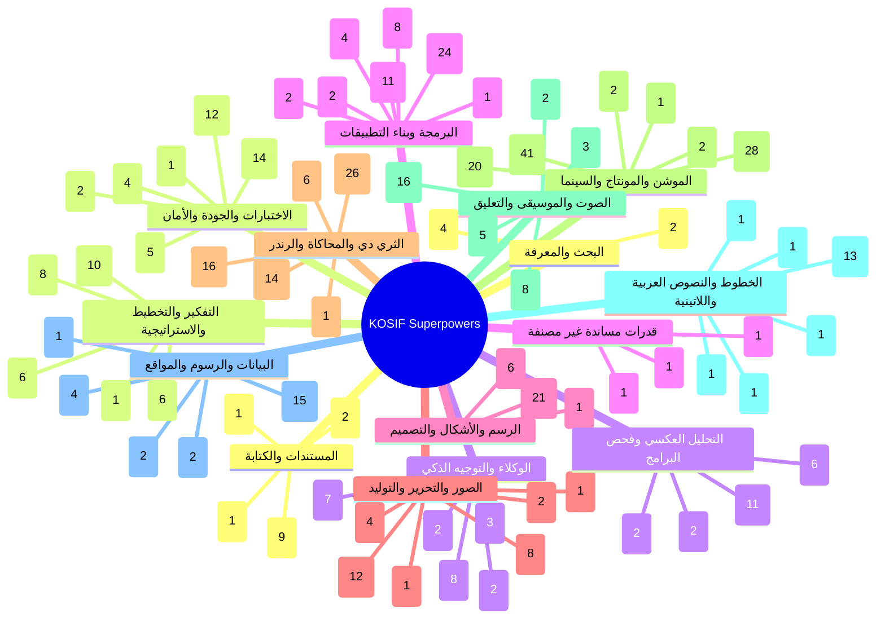

## خرائط المهام الجاهزة / ready task maps

### فيديو موشن جرافيك بصوت — Motion-graphics film with voice (`motion-film`)

البوابات: `thinking` ← `audio` ← `type` ← `motion` ← `drawing` ← `3d` ← `quality`

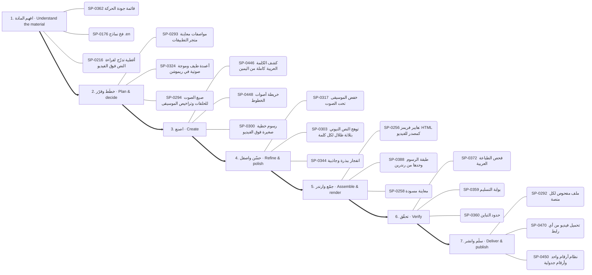

1. **افهم المادة:** SP-0362 ✅ قائمة جودة الحركة · SP-0176 ✅ فخ نماذج .en · SP-0216 🟢 أغطية تدرّج لقراءة النص فوق الفيديو
2. **خطّط وقرّر:** SP-0293 ✅ مواصفات معاينة متجر التطبيقات · SP-0324 🟢 أعمدة طيف وموجة صوتية في ريموشن · SP-0294 ✅ صيغ الصوت للحلقات وتراخيص الموسيقى
3. **اصنع:** SP-0446 ✅ كشف الكلمة العربية كاملة من اليمين · SP-0448 ✅ خريطة أصوات الخطوط · SP-0300 ✅ رسوم خطية صغيرة فوق الفيديو
4. **حسّن واصقل:** SP-0317 ✅ خفض الموسيقى تحت الصوت · SP-0303 ✅ توهج النص النيوني بثلاثة ظلال لكل كلمة · SP-0344 ✅ انفجار ببذرة وجاذبية
5. **جمّع وارندر:** SP-0256 ✅ هايبر فريمز: HTML كمصدر للفيديو · SP-0388 ✅ طبقة الرسوم وحدها من رندرين · SP-0258 ✅ معاينة مسودة
6. **تحقّق:** SP-0372 ✅ فحص الطباعة العربية · SP-0359 ✅ بوابة التسليم · SP-0360 ✅ حدود التباين
7. **سلّم وانشر:** SP-0292 ✅ ملف مفحوص لكل منصة · SP-0470 ✅ تحميل فيديو من أي رابط · SP-0450 ✅ نظام أرقام واحد وأرقام جدولية

### مونتاج ريلز على الإيقاع — Beat-synced reels edit (`reels-edit`)

البوابات: `motion` ← `audio` ← `images` ← `quality`

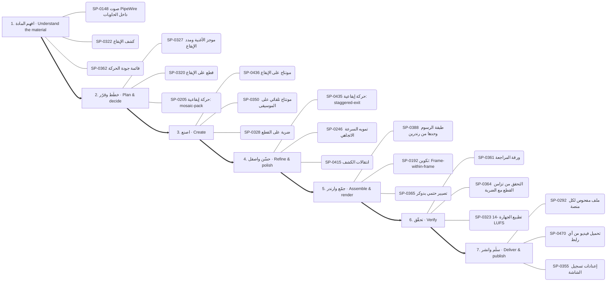

1. **افهم المادة:** SP-0148 ✅ صوت PipeWire داخل الحاويات · SP-0322 ✅ كشف الإيقاع · SP-0362 ✅ قائمة جودة الحركة
2. **خطّط وقرّر:** SP-0327 ✅ موجز الأغنية ومدد الإيقاع · SP-0320 🟢 قطع على الإيقاع · SP-0205 🟢 حركة إيقاعية: mosaic-pack
3. **اصنع:** SP-0436 ✅ مونتاج على الإيقاع · SP-0350 ✅ مونتاج تلقائي على الموسيقى · SP-0328 📦 ضربة على القطع
4. **حسّن واصقل:** SP-0435 🟢 حركة إيقاعية: staggered-exit · SP-0246 ✅ تمويه السرعة الاتجاهي · SP-0415 ✅ انتقالات الكشف
5. **جمّع وارندر:** SP-0388 ✅ طبقة الرسوم وحدها من رندرين · SP-0192 🟢 تكوين: Frame-within-frame · SP-0365 ✅ تصيير حتمي بدوكر
6. **تحقّق:** SP-0361 ✅ ورقة المراجعة · SP-0364 ✅ التحقق من تزامن القطع مع الضربة · SP-0323 ✅ تطبيع الجهارة -14 LUFS
7. **سلّم وانشر:** SP-0292 ✅ ملف مفحوص لكل منصة · SP-0470 ✅ تحميل فيديو من أي رابط · SP-0355 ✅ إعدادات تسجيل الشاشة

### رسم شخصية وتحريكها — Draw and animate a character (`character`)

البوابات: `drawing` ← `motion` ← `audio` ← `3d`

1. **افهم المادة:** SP-0322 ✅ كشف الإيقاع · SP-0283 📦 أمر: الكتالوج والإضافة
2. **خطّط وقرّر:** SP-0163 🟢 منصة العمق 2.5D · SP-0391 ✅ شبكة بلاطات باوهاوس · SP-0293 ✅ مواصفات معاينة متجر التطبيقات
3. **اصنع:** SP-0218 ✅ شخصيات حية ببصمات حركة · SP-0413 ✅ ست خلفيات نقشية متحركة · SP-0471 ✅ أزياء صوتية للشخصيات
4. **حسّن واصقل:** SP-0178 ✅ دمج المشاهد مع الصوت الأصلي بلا تعديل · SP-0394 ✅ حلقة صدمة أرضية ونبض قلب · SP-0416 🟢 قطع بقلب الألوان
5. **جمّع وارندر:** SP-0262 ✅ تصدير MP4 من محرر المتصفح · SP-0266 ✅ التقاط الإطارات عبر متصفح Edge وكارت الشاشة · SP-0272 ✅ تجميع اللقطات بنوافذ إطارات
6. **تحقّق:** SP-0329 🟢 كثافة المؤثرات · SP-0323 ✅ تطبيع الجهارة -14 LUFS
7. **سلّم وانشر:** SP-0292 ✅ ملف مفحوص لكل منصة · SP-0470 ✅ تحميل فيديو من أي رابط

### فيديو شرح بالمخططات والبيانات — Data/diagram explainer (`explainer`)

البوابات: `data` ← `drawing` ← `motion` ← `thinking`

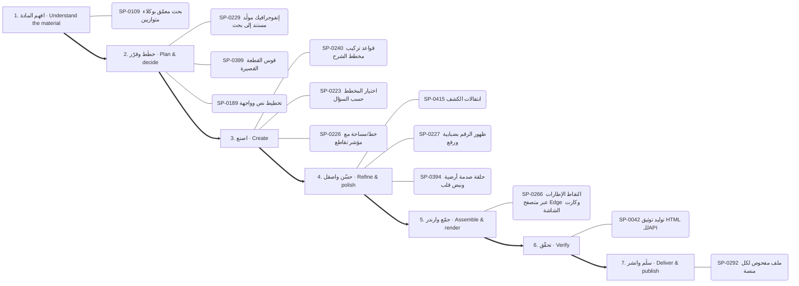

1. **افهم المادة:** SP-0109 ✅ بحث معمّق بوكلاء متوازيين
2. **خطّط وقرّر:** SP-0229 🟢 إنفوجرافيك مولَّد مستند إلى بحث · SP-0399 ✅ قوس القطعة القصيرة · SP-0189 ✅ تخطيط نص وواجهة
3. **اصنع:** SP-0240 ✅ قواعد تركيب مخطط الشرح · SP-0223 ✅ اختيار المخطط حسب السؤال · SP-0226 ✅ خط/مساحة مع مؤشر تقاطع
4. **حسّن واصقل:** SP-0415 ✅ انتقالات الكشف · SP-0227 ✅ ظهور الرقم بضبابية ورفع · SP-0394 ✅ حلقة صدمة أرضية ونبض قلب
5. **جمّع وارندر:** SP-0266 ✅ التقاط الإطارات عبر متصفح Edge وكارت الشاشة
6. **تحقّق:** SP-0042 ✅ توليد توثيق HTML للـAPI
7. **سلّم وانشر:** SP-0292 ✅ ملف مفحوص لكل منصة

### هوية وشعار وإعلان — Brand, logo & ad (`brand`)

البوابات: `drawing` ← `type` ← `motion` ← `thinking`

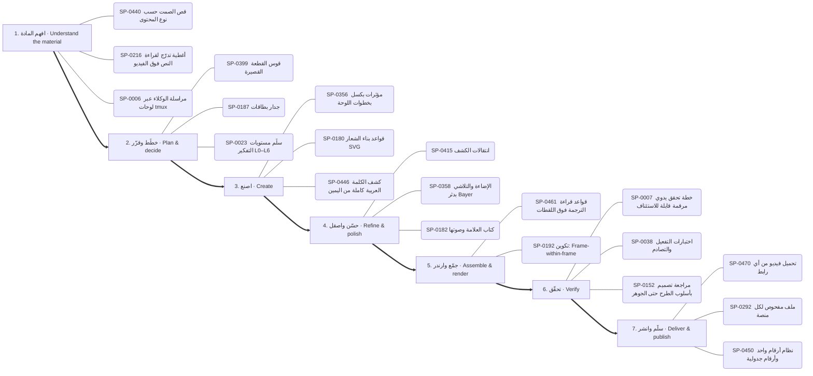

1. **افهم المادة:** SP-0440 ✅ قص الصمت حسب نوع المحتوى · SP-0216 🟢 أغطية تدرّج لقراءة النص فوق الفيديو · SP-0006 📄 مراسلة الوكلاء عبر لوحات tmux
2. **خطّط وقرّر:** SP-0399 ✅ قوس القطعة القصيرة · SP-0187 🟢 جدار بطاقات · SP-0023 ✅ سلّم مستويات التفكير L0–L6
3. **اصنع:** SP-0356 ✅ مؤثرات بكسل بخطوات اللوحة · SP-0180 ✅ قواعد بناء الشعار SVG · SP-0446 ✅ كشف الكلمة العربية كاملة من اليمين
4. **حسّن واصقل:** SP-0415 ✅ انتقالات الكشف · SP-0358 ✅ الإضاءة والتلاشي بدثر Bayer · SP-0182 🟢 كتاب العلامة وصوتها
5. **جمّع وارندر:** SP-0461 ✅ قواعد قراءة الترجمة فوق اللقطات · SP-0192 🟢 تكوين: Frame-within-frame
6. **تحقّق:** SP-0007 📄 خطة تحقق يدوي مرقمة قابلة للاستئناف · SP-0038 📄 اختبارات التفعيل والتصادم · SP-0152 📄 مراجعة تصميم بأسلوب الطرح حتى الجوهر
7. **سلّم وانشر:** SP-0470 ✅ تحميل فيديو من أي رابط · SP-0292 ✅ ملف مفحوص لكل منصة · SP-0450 ✅ نظام أرقام واحد وأرقام جدولية

### تحرير صور وتصميم — Photo editing & design (`photo`)

البوابات: `images` ← `software` ← `drawing`

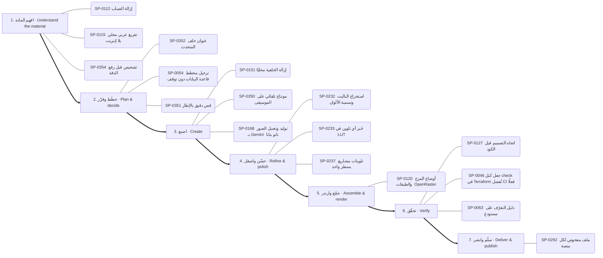

1. **افهم المادة:** SP-0112 ✅ إزالة الضباب · SP-0115 ✅ تفريغ عربي محلي بلا إنترنت · SP-0354 ✅ تشخيص قبل رفع الدقة
2. **خطّط وقرّر:** SP-0352 ✅ عنوان خلف المتحدث · SP-0054 📄 ترحيل مخطط قاعدة البيانات دون توقف · SP-0351 ✅ قص دقيق بالإطار
3. **اصنع:** SP-0151 🟢 إزالة الخلفية محليًا · SP-0350 ✅ مونتاج تلقائي على الموسيقى · SP-0168 ✅ توليد وتعديل الصور بـ Gemini (نانو بنانا)
4. **حسّن واصقل:** SP-0232 ✅ استخراج الباليت وتسمية الألوان · SP-0233 ✅ خَبز أي تلوين في LUT · SP-0237 ✅ تلوينات مشاريع بسطر واحد
5. **جمّع وارندر:** SP-0120 ✅ أوضاع المزج والطبقات (OpenRaster)
6. **تحقّق:** SP-0127 📄 اتجاه التصميم قبل الكود · SP-0046 📄 جعل كتل check في Terraform تُفشل CI فعلًا · SP-0063 ✅ دليل التعرّف على مستودع
7. **سلّم وانشر:** SP-0292 ✅ ملف مفحوص لكل منصة

### مشهد ثلاثي الأبعاد — 3D scene (`3d-scene`)

البوابات: `3d` ← `motion` ← `quality`

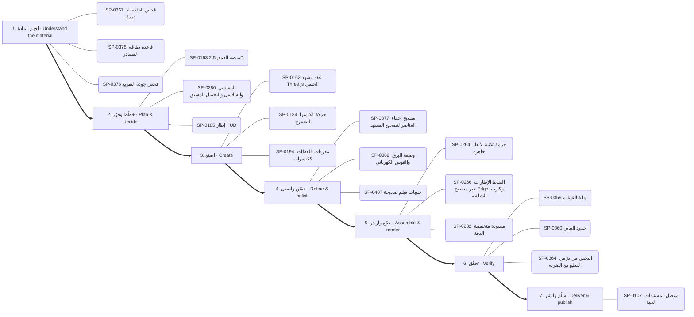

1. **افهم المادة:** SP-0367 ✅ فحص الحلقة بلا درزة · SP-0378 ✅ قاعدة نظافة المصادر · SP-0376 ✅ فحص جودة التفريغ
2. **خطّط وقرّر:** SP-0163 🟢 منصة العمق 2.5D · SP-0280 ✅ التسلسل والسلاسل والتحميل المسبق · SP-0185 📦 إطار HUD
3. **اصنع:** SP-0162 ✅ عقد مشهد Three.js الحتمي · SP-0184 ✅ حركة الكاميرا للمسرح · SP-0194 ✅ مفردات اللقطات ككاميرات
4. **حسّن واصقل:** SP-0377 ✅ مفاتيح إخفاء العناصر لتصحيح المشهد · SP-0309 ✅ وصفة البرق والقوس الكهربائي · SP-0407 ✅ حبيبات فيلم صحيحة
5. **جمّع وارندر:** SP-0264 ✅ حزمة ثلاثية الأبعاد جاهزة · SP-0266 ✅ التقاط الإطارات عبر متصفح Edge وكارت الشاشة · SP-0282 🟢 مسودة منخفضة الدقة
6. **تحقّق:** SP-0359 ✅ بوابة التسليم · SP-0360 ✅ حدود التباين · SP-0364 ✅ التحقق من تزامن القطع مع الضربة
7. **سلّم وانشر:** SP-0107 🔑 موصل المستندات الحية

### بناء تطبيق أو موقع — Build an app or site (`app`)

البوابات: `thinking` ← `software` ← `documents` ← `quality`

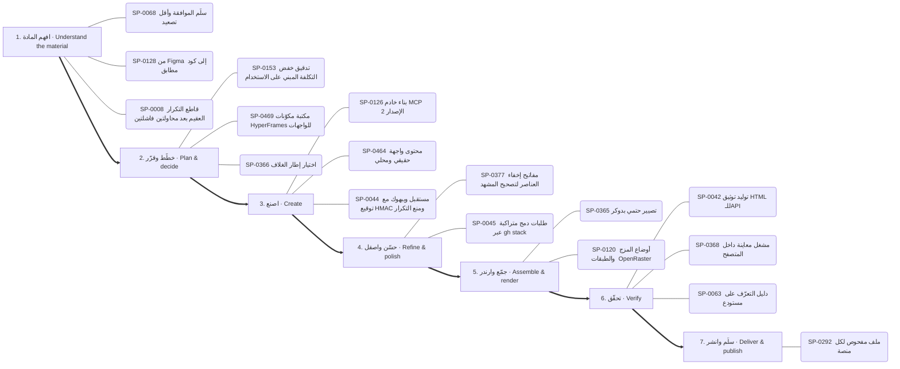

1. **افهم المادة:** SP-0068 ✅ سلّم الموافقة وأقل تصعيد · SP-0128 📄 من Figma إلى كود مطابق · SP-0008 📄 قاطع التكرار العقيم بعد محاولتين فاشلتين
2. **خطّط وقرّر:** SP-0153 📄 تدقيق خفض التكلفة المبني على الاستخدام · SP-0469 📦 مكتبة مكوّنات HyperFrames للواجهات · SP-0366 ✅ اختيار إطار الغلاف
3. **اصنع:** SP-0126 ✅ بناء خادم MCP (الإصدار 2) · SP-0464 🟢 محتوى واجهة حقيقي ومحلي · SP-0044 📄 مستقبل ويبهوك مع توقيع HMAC ومنع التكرار
4. **حسّن واصقل:** SP-0377 ✅ مفاتيح إخفاء العناصر لتصحيح المشهد · SP-0045 📄 طلبات دمج متراكبة عبر gh stack
5. **جمّع وارندر:** SP-0365 ✅ تصيير حتمي بدوكر · SP-0120 ✅ أوضاع المزج والطبقات (OpenRaster)
6. **تحقّق:** SP-0042 ✅ توليد توثيق HTML للـAPI · SP-0368 ✅ مشغل معاينة داخل المتصفح · SP-0063 ✅ دليل التعرّف على مستودع
7. **سلّم وانشر:** SP-0292 ✅ ملف مفحوص لكل منصة

### تعديل كود وإصلاح — Change or fix code (`code-change`)

البوابات: `thinking` ← `software` ← `quality`

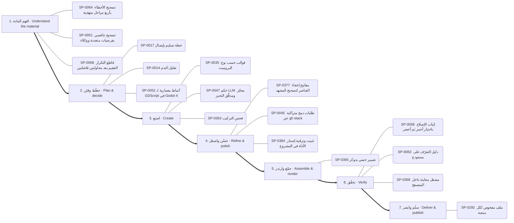

1. **افهم المادة:** SP-0064 📄 تصحيح الأخطاء بأربع مراحل منهجية · SP-0051 📄 تصحيح تنافسي بفرضيات متعددة ووكلاء · SP-0008 📄 قاطع التكرار العقيم بعد محاولتين فاشلتين
2. **خطّط وقرّر:** SP-0017 ✅ خطة تسليم بإيصال · SP-0014 📄 تقليل الندم · SP-0052 📄 أنماط معمارية لـ GDScript في Godot 4
3. **اصنع:** SP-0035 ✅ قوالب حسب نوع البرومبت · SP-0047 📄 حكم LLM معايَر ومدقَّق التحيز · SP-0363 ✅ فحص التركيب
4. **حسّن واصقل:** SP-0377 ✅ مفاتيح إخفاء العناصر لتصحيح المشهد · SP-0045 📄 طلبات دمج متراكبة عبر gh stack · SP-0384 ✅ تثبيت وترقية إصدار الأداة في المشروع
5. **جمّع وارندر:** SP-0365 ✅ تصيير حتمي بدوكر
6. **تحقّق:** SP-0058 📄 إثبات الإصلاح باختبار أحمر ثم أخضر · SP-0063 ✅ دليل التعرّف على مستودع · SP-0368 ✅ مشغل معاينة داخل المتصفح
7. **سلّم وانشر:** SP-0292 ✅ ملف مفحوص لكل منصة

### فحص تطبيق ونقل ميزة — Investigate an app and transfer a feature (`reverse`)

البوابات: `reverse` ← `software` ← `quality`

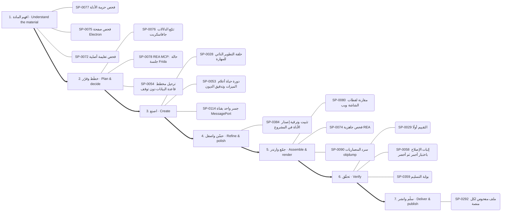

1. **افهم المادة:** SP-0077 ✅ فحص حزمة الأدلة · SP-0075 ✅ فحص صفحة Electron · SP-0072 ✅ فحص تعليمة أصلية
2. **خطّط وقرّر:** SP-0076 ✅ تتبّع الدلالات جافاسكربت · SP-0078 📄 REA MCP: حالة جلسة Frida · SP-0054 📄 ترحيل مخطط قاعدة البيانات دون توقف
3. **اصنع:** SP-0028 ✅ حلقة التطوير الذاتي للمهارة · SP-0053 📄 دورة حياة أعلام الميزات وتدقيق الديون · SP-0114 ✅ جسر واحد بقناة MessagePort
4. **حسّن واصقل:** SP-0384 ✅ تثبيت وترقية إصدار الأداة في المشروع
5. **جمّع وارندر:** SP-0080 📦 مقارنة لقطات الشاشة ويب · SP-0074 ✅ فحص جاهزية REA · SP-0090 ✅ سرد المعماريات objdump
6. **تحقّق:** SP-0029 📄 التقييم أولًا · SP-0058 📄 إثبات الإصلاح باختبار أحمر ثم أخضر · SP-0359 ✅ بوابة التسليم
7. **سلّم وانشر:** SP-0292 ✅ ملف مفحوص لكل منصة

### تحليل بيانات وتقرير — Data analysis report (`data-report`)

البوابات: `data` ← `documents` ← `quality`

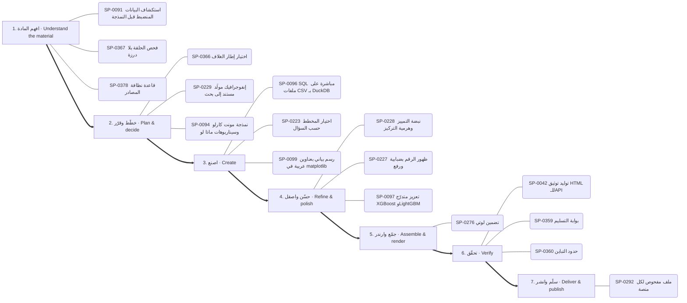

1. **افهم المادة:** SP-0091 📄 استكشاف البيانات المنضبط قبل النمذجة · SP-0367 ✅ فحص الحلقة بلا درزة · SP-0378 ✅ قاعدة نظافة المصادر
2. **خطّط وقرّر:** SP-0366 ✅ اختيار إطار الغلاف · SP-0229 🟢 إنفوجرافيك مولَّد مستند إلى بحث · SP-0094 📄 نمذجة مونت كارلو وسيناريوهات ماذا لو
3. **اصنع:** SP-0096 ✅ SQL مباشرة على ملفات CSV بـ DuckDB · SP-0223 ✅ اختيار المخطط حسب السؤال · SP-0099 ✅ رسم بياني بعناوين عربية في matplotlib
4. **حسّن واصقل:** SP-0228 🟢 نبضة التمييز وهرمية التركيز · SP-0227 ✅ ظهور الرقم بضبابية ورفع · SP-0097 ✅ تعزيز متدرّج XGBoost وLightGBM
5. **جمّع وارندر:** SP-0276 🟢 تضمين لوتي
6. **تحقّق:** SP-0042 ✅ توليد توثيق HTML للـAPI · SP-0359 ✅ بوابة التسليم · SP-0360 ✅ حدود التباين
7. **سلّم وانشر:** SP-0292 ✅ ملف مفحوص لكل منصة

### بحث وكتابة مقال — Research and write (`research-write`)

البوابات: `research` ← `thinking` ← `documents`

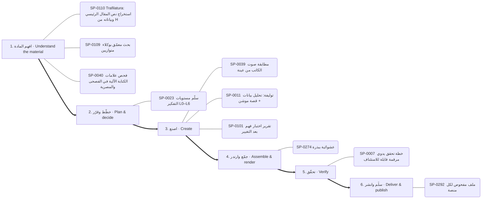

1. **افهم المادة:** SP-0110 ✅ Trafilatura: استخراج نص المقال الرئيسي وبياناته من HTML · SP-0109 ✅ بحث معمّق بوكلاء متوازيين · SP-0040 ✅ فحص علامات الكتابة الآلية في الفصحى والمصرية
2. **خطّط وقرّر:** SP-0023 ✅ سلّم مستويات التفكير L0–L6
3. **اصنع:** SP-0039 ✅ مطابقة صوت الكاتب من عينة · SP-0011 📄 توليفة: تحليل بيانات + قصة موشن · SP-0101 📄 تقرير اختبار فهم بعد التغيير
4. **جمّع وارندر:** SP-0274 ✅ عشوائية ببذرة
5. **تحقّق:** SP-0007 📄 خطة تحقق يدوي مرقمة قابلة للاستئناف
6. **سلّم وانشر:** SP-0292 ✅ ملف مفحوص لكل منصة

## البوابات مرتبة بالمراحل / hubs by stage

### البحث والمعرفة — Research & knowledge

- **افهم المادة** (4): SP-0109 بحث معمّق بوكلاء متوازيين · SP-0110 Trafilatura: استخراج نص المقال الرئيسي وبياناته من HTML · SP-0111 محتوى الويب بيانات لا أوامر · SP-0108 استخراج وإثراء بيانات الأطباء
- **اصنع** (2): SP-0066 ربط Graphify المستضاف · SP-0067 الخريطة مادةً لفيلم موشن

### التفكير والتخطيط والاستراتيجية — Reasoning & strategy

- **افهم المادة** (6): SP-0036 اطلب أي أسلوب بصري بالاسم من مكتبة 586 أسلوبًا · SP-0006 مراسلة الوكلاء عبر لوحات tmux · SP-0025 اعرف قبل أن تقول «لا» · SP-0156 تدقيق تكلفة LLM والتوجيه · SP-0008 قاطع التكرار العقيم بعد محاولتين فاشلتين · SP-0159 تشخيص هامش الربح ومزيج الخدمات
- **خطّط وقرّر** (10): SP-0023 سلّم مستويات التفكير L0–L6 · SP-0010 سكامبر (SCAMPER) · SP-0017 خطة تسليم بإيصال · SP-0161 ثلاثة خيارات حقيقية وعدم الفعل · SP-0024 قائمة المرحلة صفر (12 وحدة) · SP-0153 تدقيق خفض التكلفة المبني على الاستخدام …
- **اصنع** (8): SP-0035 قوالب حسب نوع البرومبت · SP-0160 السعر الأمثل ونقطة التعادل · SP-0013 خريطة أصحاب المصلحة · SP-0154 حلقة مستقلة لتصريف قائمة المهام · SP-0157 مدرب تعلم متعدد الجلسات بحالة محفوظة · SP-0011 توليفة: تحليل بيانات + قصة موشن …
- **جمّع وارندر** (1): SP-0009 تصدير خريطة ذهنية تفاعلية
- **تحقّق** (6): SP-0152 مراجعة تصميم بأسلوب الطرح حتى الجوهر · SP-0007 خطة تحقق يدوي مرقمة قابلة للاستئناف · SP-0155 فرز الحادث مقابل المشكلة وتحديد الخطورة · SP-0018 تطوير يقوده المواصفات · SP-0038 اختبارات التفعيل والتصادم · SP-0012 مسح الكليشيهات

### الوكلاء والتوجيه الذكي — Agents & routing

- **افهم المادة** (7): SP-0133 منقّب قدرات الأطلس من البيانات الوصفية · SP-0020 بطاقة القدرات بسكربت واحد · SP-0139 تدقيق أدلة الكتالوج · SP-0142 جسر أوامر REA · SP-0144 تنزيل الفيديو من الروابط للمونتاج · SP-0021 اقرأ قائمة أدواتك …
- **خطّط وقرّر** (2): SP-0137 مختبر البرومبت · SP-0022 بطاقة القدرة والإيصال
- **اصنع** (8): SP-0134 أكاديمية الرسم والدروس المبنية على مصادر · SP-0138 خريطة ترتيب المهارة · SP-0141 محوّل الترجمات إلى توقيت الكلمات · SP-0143 مختبر مطابقة الخطوط العربية · SP-0001 نقطة حفظ وتسليم بين الجلسات عبر مجلد .context · SP-0002 قرار التفويض للوكلاء أو التنفيذ المباشر …
- **جمّع وارندر** (3): SP-0135 محرك إعادة بناء المونتاج المرجعي · SP-0136 مُصرِّف حركة SVG المتزامنة مع الصوت · SP-0140 جسر Blender الآمن
- **تحقّق** (2): SP-0019 اعرف قبل أن تقول لا · SP-0003 تأليف مهارة

### البرمجة وبناء التطبيقات — Software & applications

- **افهم المادة** (11): SP-0112 إزالة الضباب · SP-0115 تفريغ عربي محلي بلا إنترنت · SP-0122 فهرسة المكتبة والبحث · SP-0125 نشر صفحة تفاعلية خاصة · SP-0043 كتابة workflows لـ GitHub Actions مع تحقق · SP-0128 من Figma إلى كود مطابق …
- **خطّط وقرّر** (4): SP-0052 أنماط معمارية لـ GDScript في Godot 4 · SP-0054 ترحيل مخطط قاعدة البيانات دون توقف · SP-0132 تفكيك المواصفة إلى مهام صغيرة لوكلاء البرمجة · SP-0469 مكتبة مكوّنات HyperFrames للواجهات
- **اصنع** (24): SP-0116 علامات الإيقاع · SP-0118 نمو نباتي وزخرفي · SP-0117 رمز QR بشعار · SP-0462 المؤشر بطلًا · SP-0119 رسم زيتي وحبر ورصاص · SP-0114 جسر واحد بقناة MessagePort …
- **حسّن واصقل** (1): SP-0045 طلبات دمج متراكبة عبر gh stack
- **جمّع وارندر** (2): SP-0120 أوضاع المزج والطبقات (OpenRaster) · SP-0123 جرد قدرات Blender الحي
- **تحقّق** (8): SP-0063 دليل التعرّف على مستودع · SP-0468 من التحميل إلى علامة صح · SP-0046 جعل كتل check في Terraform تُفشل CI فعلًا · SP-0130 حلقة مراجع شجرة الوصولية لتحكم المتصفح · SP-0056 تدقيق الامتثال لـ GDPR انطلاقًا من جرد البيانات الشخصية · SP-0058 إثبات الإصلاح باختبار أحمر ثم أخضر …
- **سلّم وانشر** (2): SP-0131 ضبط مجمع الاتصالات وموثوقية قاعدة البيانات · SP-0124 مشغل فيديو عمودي بالسحب

### الرسم والأشكال والتصميم — Drawing & visual composition

- **خطّط وقرّر** (1): SP-0391 شبكة بلاطات باوهاوس
- **اصنع** (21): SP-0297 فيلم يد مرسومة حتمي بـmake_frame(t) · SP-0180 قواعد بناء الشعار SVG · SP-0390 تحويل SVG بإضافة MorphSVG · SP-0240 قواعد تركيب مخطط الشرح · SP-0356 مؤثرات بكسل بخطوات اللوحة · SP-0392 انفجار خطوط شعاعي …
- **حسّن واصقل** (6): SP-0393 دمج ونحت وتقاطع ناعم · SP-0358 الإضاءة والتلاشي بدثر Bayer · SP-0394 حلقة صدمة أرضية ونبض قلب · SP-0182 كتاب العلامة وصوتها · SP-0183 تشريح بطاقة الختام · SP-0397 تجمع الصلصال بالكرات

### الصور والتحرير والتوليد — Images & photo editing

- **افهم المادة** (4): SP-0148 صوت PipeWire داخل الحاويات · SP-0354 تشخيص قبل رفع الدقة · SP-0353 مجمع لقطات بأسئلة بحث ثنائية اللغة · SP-0172 مقدمات الأسلوب المتطابقة بايتًا
- **خطّط وقرّر** (2): SP-0351 قص دقيق بالإطار · SP-0352 عنوان خلف المتحدث
- **اصنع** (12): SP-0167 مصنع البرومبت: مواصفة واحدة ← تسع منصات · SP-0350 مونتاج تلقائي على الموسيقى · SP-0150 ضغط الصور ومقارنة الجودة · SP-0149 التعرف على العربية والإنجليزية بـ tesseract · SP-0168 توليد وتعديل الصور بـ Gemini (نانو بنانا) · SP-0151 إزالة الخلفية محليًا …
- **حسّن واصقل** (8): SP-0232 استخراج الباليت وتسمية الألوان · SP-0233 خَبز أي تلوين في LUT · SP-0234 التعريض حسب وقت اليوم · SP-0235 خلفية بقع ضبابية متحركة · SP-0236 توازن الأبيض بالبكسلات المحايدة · SP-0237 تلوينات مشاريع بسطر واحد …
- **جمّع وارندر** (1): SP-0174 خط إنتاج من موضوع إلى فيديو قصير
- **سلّم وانشر** (1): SP-0355 إعدادات تسجيل الشاشة

### الثري دي والمحاكاة والرندر — 3D & rendering

- **افهم المادة** (1): SP-0283 أمر: الكتالوج والإضافة
- **خطّط وقرّر** (6): SP-0163 منصة العمق 2.5D · SP-0279 محول إطارات CSS · SP-0280 التسلسل والسلاسل والتحميل المسبق · SP-0284 كود Python إنتاجي · SP-0268 قائمة قواعد Remotion · SP-0281 اصطلاح المسارات والعلامات في المونتاج
- **اصنع** (26): SP-0162 عقد مشهد Three.js الحتمي · SP-0260 استوديو KOSIF Motion Web المحلي · SP-0261 مشروع أنيميشن جديد · SP-0270 خيار التقنية: canvas · SP-0345 مطر وضباب ومطر الغيمة · SP-0346 حقل curl تحليلي خالٍ من التباعد …
- **حسّن واصقل** (14): SP-0303 توهج النص النيوني بثلاثة ظلال لكل كلمة · SP-0304 قراءة إضاءة صورة مرجعية · SP-0407 حبيبات فيلم صحيحة · SP-0344 انفجار ببذرة وجاذبية · SP-0408 تظليل كرة بالهالفتون · SP-0305 مرور العدسة «مصوَّر لا مرسوم» …
- **جمّع وارندر** (16): SP-0256 هايبر فريمز: HTML كمصدر للفيديو · SP-0258 معاينة مسودة · SP-0262 تصدير MP4 من محرر المتصفح · SP-0259 مواصفة الخط الزمني · SP-0263 ترميز GPU بـ NVENC · SP-0274 عشوائية ببذرة …

### الموشن والمونتاج والسينما — Motion & video editing

- **افهم المادة** (2): SP-0440 قص الصمت حسب نوع المحتوى · SP-0216 أغطية تدرّج لقراءة النص فوق الفيديو
- **خطّط وقرّر** (20): SP-0399 قوس القطعة القصيرة · SP-0247 إعادة الاستهداف بالنابض · SP-0294 صيغ الصوت للحلقات وتراخيص الموسيقى · SP-0295 بريف الصورة المصغرة: 3 أفكار واختبار A/B · SP-0189 تخطيط نص وواجهة · SP-0251 أربع تسارعات مسماة فقط …
- **اصنع** (41): SP-0218 شخصيات حية ببصمات حركة · SP-0184 حركة الكاميرا للمسرح · SP-0248 ميزانيات التتابع · SP-0401 مولّد طلب Claude من الأسلوب · SP-0219 ورقة تصميم الشخصية واختبار الظل · SP-0191 اختلاف المنظر …
- **حسّن واصقل** (28): SP-0415 انتقالات الكشف · SP-0246 تمويه السرعة الاتجاهي · SP-0249 رموز التسارع حسب الدور (17 منحنى) · SP-0190 عمق الميدان وسحب التركيز · SP-0434 اختيار الانتقال حسب الطاقة · SP-0418 انتقال CSS: حرق الفيلم …
- **جمّع وارندر** (1): SP-0192 تكوين: Frame-within-frame
- **سلّم وانشر** (2): SP-0292 ملف مفحوص لكل منصة · SP-0470 تحميل فيديو من أي رابط

### الصوت والموسيقى والتعليق — Audio & voice

- **افهم المادة** (3): SP-0322 كشف الإيقاع · SP-0176 فخ نماذج .en · SP-0332 توقف الشريط ووقت الرصاصة ولمسات الخلل
- **خطّط وقرّر** (8): SP-0321 شبكة الإيقاع · SP-0320 قطع على الإيقاع · SP-0324 أعمدة طيف وموجة صوتية في ريموشن · SP-0327 موجز الأغنية ومدد الإيقاع · SP-0338 وادٍ من المخطط الطيفي · SP-0336 واجهة عداد البارات الإيقاعية …
- **اصنع** (16): SP-0319 قنوات الصوت كمحرك للحركة · SP-0318 مكتبة المؤثرات · SP-0471 أزياء صوتية للشخصيات · SP-0334 أجواء صوتية مولدة · SP-0335 مقام lydian · SP-0177 فيلم كلمات من صوت (أغنية، شعر، دعاء) …
- **حسّن واصقل** (5): SP-0317 خفض الموسيقى تحت الصوت · SP-0175 توقيت الكلمات حسب الطول · SP-0178 دمج المشاهد مع الصوت الأصلي بلا تعديل · SP-0330 قناة المزج · SP-0179 الأشرطة السفلية
- **تحقّق** (2): SP-0323 تطبيع الجهارة -14 LUFS · SP-0329 كثافة المؤثرات

### الخطوط والنصوص العربية واللاتينية — Typography & localization

- **خطّط وقرّر** (1): SP-0451 علامة استفهام عملاقة مفرّغة
- **اصنع** (13): SP-0446 كشف الكلمة العربية كاملة من اليمين · SP-0031 CAMeL Tools: تقطيع النص العربي واستخراج الجذور والتشكيل وتحديد · SP-0448 خريطة أصوات الخطوط · SP-0447 سلّم أحجام الفيديو · SP-0454 أنظمة الأصوات الطباعية · SP-0449 سطور تتكدس وتخفت …
- **حسّن واصقل** (1): SP-0457 عنوان بلونين وكلمة لون
- **جمّع وارندر** (1): SP-0461 قواعد قراءة الترجمة فوق اللقطات
- **تحقّق** (1): SP-0032 تحقق من أرقام OCR ببوابة المراسي
- **سلّم وانشر** (1): SP-0450 نظام أرقام واحد وأرقام جدولية

### البيانات والرسوم والمواقع — Data & visual analytics

- **افهم المادة** (2): SP-0091 استكشاف البيانات المنضبط قبل النمذجة · SP-0093 مراجعة مخطط واستعلامات ClickHouse
- **خطّط وقرّر** (2): SP-0229 إنفوجرافيك مولَّد مستند إلى بحث · SP-0094 نمذجة مونت كارلو وسيناريوهات ماذا لو
- **اصنع** (15): SP-0096 SQL مباشرة على ملفات CSV بـ DuckDB · SP-0223 اختيار المخطط حسب السؤال · SP-0098 حل رياضي دقيق بـ sympy · SP-0224 حلقة التقدم المخروطية · SP-0099 رسم بياني بعناوين عربية في matplotlib · SP-0311 هل نحتاج خريطة أصلًا …
- **حسّن واصقل** (4): SP-0097 تعزيز متدرّج XGBoost وLightGBM · SP-0227 ظهور الرقم بضبابية ورفع · SP-0228 نبضة التمييز وهرمية التركيز · SP-0315 كرة أرضية بأقواس اتصال
- **جمّع وارندر** (1): SP-0092 عقد خط بيانات: الحبيبية والتكرار الآمن

### المستندات والكتابة — Documents & writing

- **افهم المادة** (2): SP-0040 فحص علامات الكتابة الآلية في الفصحى والمصرية · SP-0104 جاهزية الموقع لـ llms.txt وزواحف AI
- **اصنع** (9): SP-0105 تحويل Office إلى PDF دفعة واحدة · SP-0106 PlantUML: توليد مخططات UML من نص · SP-0041 قفل الاقتباس المباشر · SP-0039 مطابقة صوت الكاتب من عينة · SP-0100 تدقيق انحراف التوثيق عن الكود لكل بُعد · SP-0033 تصميم الأيقونات بالتشابه والإغلاق البصري …
- **تحقّق** (1): SP-0103 حزمة تشخيص مُنقّحة وآمنة للدعم
- **سلّم وانشر** (1): SP-0107 موصل المستندات الحية

### الاختبارات والجودة والأمان — QA & security

- **افهم المادة** (12): SP-0362 قائمة جودة الحركة · SP-0367 فحص الحلقة بلا درزة · SP-0382 فحص المقروئية · SP-0373 دراسة فيلم مرجعي · SP-0378 قاعدة نظافة المصادر · SP-0371 قياس الجهارة والذروة …
- **خطّط وقرّر** (1): SP-0366 اختيار إطار الغلاف
- **اصنع** (5): SP-0363 فحص التركيب · SP-0028 حلقة التطوير الذاتي للمهارة · SP-0069 نظافة الأسرار · SP-0386 حد الوميض الآمن · SP-0389 فخ إعادة الإسناد في TSL
- **حسّن واصقل** (4): SP-0384 تثبيت وترقية إصدار الأداة في المشروع · SP-0377 مفاتيح إخفاء العناصر لتصحيح المشهد · SP-0379 مقارنة النسخ ودرجات اللون · SP-0381 بوابة الخطوط والألوان المحظورة
- **جمّع وارندر** (2): SP-0365 تصيير حتمي بدوكر · SP-0388 طبقة الرسوم وحدها من رندرين
- **تحقّق** (14): SP-0359 بوابة التسليم · SP-0042 توليد توثيق HTML للـAPI · SP-0360 حدود التباين · SP-0368 مشغل معاينة داخل المتصفح · SP-0361 ورقة المراجعة · SP-0364 التحقق من تزامن القطع مع الضربة …

### التحليل العكسي وفحص البرامج — Reverse engineering

- **افهم المادة** (11): SP-0084 فرز المثبّت قبل REA · SP-0077 فحص حزمة الأدلة · SP-0079 مراقبة جلسة ويب · SP-0075 فحص صفحة Electron · SP-0086 فحص عميل pcap · SP-0072 فحص تعليمة أصلية …
- **خطّط وقرّر** (2): SP-0076 تتبّع الدلالات جافاسكربت · SP-0078 REA MCP: حالة جلسة Frida
- **اصنع** (2): SP-0088 فك ترميز تسجيل إشارة · SP-0087 فتح مشروع JEB
- **جمّع وارندر** (6): SP-0074 فحص جاهزية REA · SP-0090 سرد المعماريات objdump · SP-0071 فحص عميل ADB · SP-0080 مقارنة لقطات الشاشة ويب · SP-0081 REA MCP: أمر تصحيح Rizin · SP-0085 REA MCP: حالة جلسة GDB

### قدرات مساندة غير مصنفة — Other supporting capabilities

- **افهم المادة** (1): SP-0341 مكتبة KOSIF Atlas
- **خطّط وقرّر** (1): SP-0343 ملف المشروع المحمول وإعادة الربط
- **اصنع** (1): SP-0342 خادم MCP للاستوديو (22 أداة)

---
_مولَّد آليًا من data/superpowers.json وdata/hubs_index.json وdata/task_maps.json._
