# الخريطة الذهنية للقدرات — Capability mind map

<!-- generated by scripts/capability_mindmap.py build -->

كل قدرة مرتبة بحسب **مرحلة المهمة** التي تخدمها، ثم كل بوابة مقسمة بالمراحل، ثم خرائط جاهزة لمهام شائعة. اتبع المراحل بالترتيب: افهم ← خطّط ← اصنع ← حسّن ← جمّع وارندر ← تحقّق ← سلّم.

    python3 scripts/capability_mindmap.py task "<المهمة>"     # خريطة مرحلية لأي مهمة
    python3 scripts/capability_mindmap.py task reels-edit      # خريطة جاهزة

## الفهرس / contents

- المراحل السبع / the seven stages
- الخريطة الكبرى / the big map
- خرائط المهام الجاهزة / ready task maps
- البوابات مرتبة بالمراحل / hubs by stage

## المراحل السبع / the seven stages

1. **افهم المادة — Understand the material** · 770 قدرة ذرية
2. **خطّط وقرّر — Plan & decide** · 904 قدرة ذرية
3. **اصنع — Create** · 1868 قدرة ذرية
4. **حسّن واصقل — Refine & polish** · 880 قدرة ذرية
5. **جمّع وارندر — Assemble & render** · 468 قدرة ذرية
6. **تحقّق — Verify** · 505 قدرة ذرية
7. **سلّم وانشر — Deliver & publish** · 177 قدرة ذرية

## الخريطة الكبرى / the big map

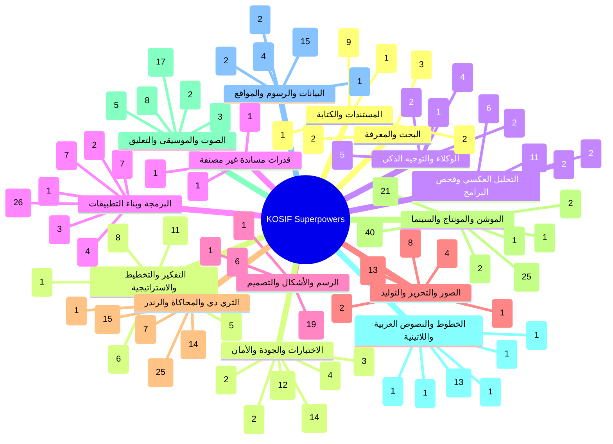

## خرائط المهام الجاهزة / ready task maps

### فيديو موشن جرافيك بصوت — Motion-graphics film with voice (`motion-film`)

البوابات: `thinking` ← `audio` ← `type` ← `motion` ← `drawing` ← `3d` ← `quality`

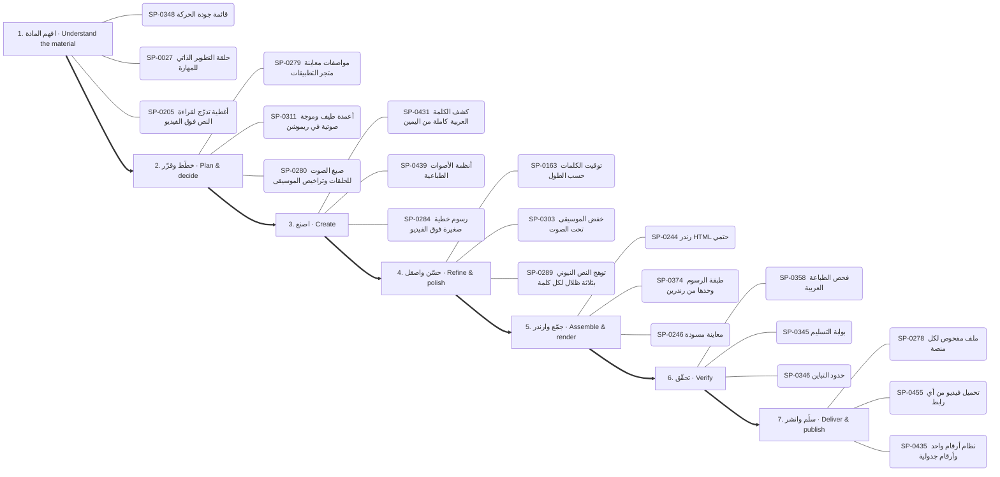

1. **افهم المادة:** SP-0348 ✅ قائمة جودة الحركة · SP-0027 ✅ حلقة التطوير الذاتي للمهارة · SP-0205 🟢 أغطية تدرّج لقراءة النص فوق الفيديو
2. **خطّط وقرّر:** SP-0279 ✅ مواصفات معاينة متجر التطبيقات · SP-0311 🟢 أعمدة طيف وموجة صوتية في ريموشن · SP-0280 ✅ صيغ الصوت للحلقات وتراخيص الموسيقى
3. **اصنع:** SP-0431 ✅ كشف الكلمة العربية كاملة من اليمين · SP-0439 ✅ أنظمة الأصوات الطباعية · SP-0284 ✅ رسوم خطية صغيرة فوق الفيديو
4. **حسّن واصقل:** SP-0163 ✅ توقيت الكلمات حسب الطول · SP-0303 ✅ خفض الموسيقى تحت الصوت · SP-0289 ✅ توهج النص النيوني بثلاثة ظلال لكل كلمة
5. **جمّع وارندر:** SP-0244 ✅ رندر HTML حتمي · SP-0374 ✅ طبقة الرسوم وحدها من رندرين · SP-0246 ✅ معاينة مسودة
6. **تحقّق:** SP-0358 ✅ فحص الطباعة العربية · SP-0345 ✅ بوابة التسليم · SP-0346 ✅ حدود التباين
7. **سلّم وانشر:** SP-0278 ✅ ملف مفحوص لكل منصة · SP-0455 ✅ تحميل فيديو من أي رابط · SP-0435 ✅ نظام أرقام واحد وأرقام جدولية

### مونتاج ريلز على الإيقاع — Beat-synced reels edit (`reels-edit`)

البوابات: `motion` ← `audio` ← `images` ← `quality`

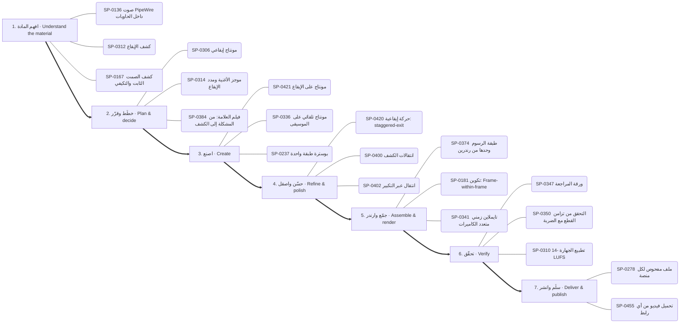

1. **افهم المادة:** SP-0136 ✅ صوت PipeWire داخل الحاويات · SP-0312 ✅ كشف الإيقاع · SP-0167 ✅ كشف الصمت الثابت والتكيفي
2. **خطّط وقرّر:** SP-0306 🟢 مونتاج إيقاعي · SP-0314 ✅ موجز الأغنية ومدد الإيقاع · SP-0384 ✅ فيلم العلامة: من المشكلة إلى الكشف
3. **اصنع:** SP-0421 ✅ مونتاج على الإيقاع · SP-0336 ✅ مونتاج تلقائي على الموسيقى · SP-0237 ✅ بوسترة طبقة واحدة
4. **حسّن واصقل:** SP-0420 🟢 حركة إيقاعية: staggered-exit · SP-0400 ✅ انتقالات الكشف · SP-0402 ✅ انتقال عبر التكبير
5. **جمّع وارندر:** SP-0374 ✅ طبقة الرسوم وحدها من رندرين · SP-0181 🟢 تكوين: Frame-within-frame · SP-0341 🟢 تايملاين زمني متعدد الكاميرات
6. **تحقّق:** SP-0347 ✅ ورقة المراجعة · SP-0350 ✅ التحقق من تزامن القطع مع الضربة · SP-0310 ✅ تطبيع الجهارة -14 LUFS
7. **سلّم وانشر:** SP-0278 ✅ ملف مفحوص لكل منصة · SP-0455 ✅ تحميل فيديو من أي رابط

### رسم شخصية وتحريكها — Draw and animate a character (`character`)

البوابات: `drawing` ← `motion` ← `audio` ← `3d`

1. **افهم المادة:** SP-0270 📦 أمر: الكتالوج والإضافة
2. **خطّط وقرّر:** SP-0307 ✅ موسيقى أصلية · SP-0279 ✅ مواصفات معاينة متجر التطبيقات · SP-0153 ✅ حقول المكعبات المتموجة
3. **اصنع:** SP-0206 ✅ شخصيات حية ببصمات حركة · SP-0398 ✅ ست خلفيات نقشية متحركة · SP-0152 🟢 منصة العمق 2.5D
4. **حسّن واصقل:** SP-0164 ✅ دمج المشاهد مع الصوت الأصلي بلا تعديل · SP-0378 ✅ حلقة صدمة أرضية ونبض قلب · SP-0401 🟢 قطع بقلب الألوان
5. **جمّع وارندر:** SP-0251 ✅ تصدير MP4 دقيق · SP-0256 🟢 التقاط الإطارات عبر متصفح Edge وكارت الشاشة · SP-0385 ✅ مولّد طلب Claude من الأسلوب
6. **تحقّق:** SP-0317 🟢 كثافة المؤثرات · SP-0310 ✅ تطبيع الجهارة -14 LUFS
7. **سلّم وانشر:** SP-0278 ✅ ملف مفحوص لكل منصة · SP-0455 ✅ تحميل فيديو من أي رابط

### فيديو شرح بالمخططات والبيانات — Data/diagram explainer (`explainer`)

البوابات: `data` ← `drawing` ← `motion` ← `thinking`

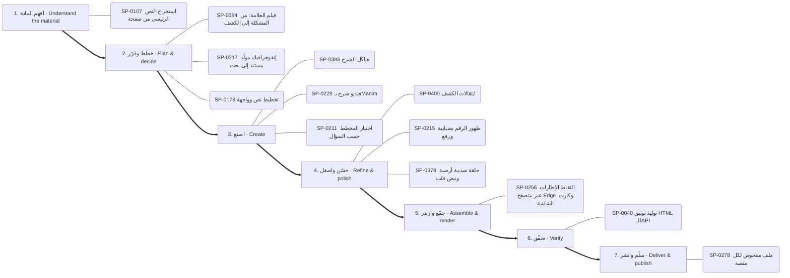

1. **افهم المادة:** SP-0107 ✅ استخراج النص الرئيسي من صفحة
2. **خطّط وقرّر:** SP-0384 ✅ فيلم العلامة: من المشكلة إلى الكشف · SP-0217 🟢 إنفوجرافيك مولَّد مستند إلى بحث · SP-0178 ✅ تخطيط نص وواجهة
3. **اصنع:** SP-0386 ✅ هياكل الشرح · SP-0228 ✅ فيديو شرح بـManim · SP-0211 ✅ اختيار المخطط حسب السؤال
4. **حسّن واصقل:** SP-0400 ✅ انتقالات الكشف · SP-0215 ✅ ظهور الرقم بضبابية ورفع · SP-0378 ✅ حلقة صدمة أرضية ونبض قلب
5. **جمّع وارندر:** SP-0256 🟢 التقاط الإطارات عبر متصفح Edge وكارت الشاشة
6. **تحقّق:** SP-0040 ✅ توليد توثيق HTML للـAPI
7. **سلّم وانشر:** SP-0278 ✅ ملف مفحوص لكل منصة

### هوية وشعار وإعلان — Brand, logo & ad (`brand`)

البوابات: `drawing` ← `type` ← `motion` ← `thinking`

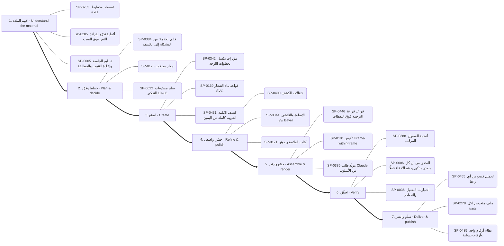

1. **افهم المادة:** SP-0233 🟢 تسميات بخطوط قائدة · SP-0205 🟢 أغطية تدرّج لقراءة النص فوق الفيديو · SP-0005 📄 تسليم الجلسة وإعادة التثبيت والمطابقة
2. **خطّط وقرّر:** SP-0384 ✅ فيلم العلامة: من المشكلة إلى الكشف · SP-0176 🟢 جدار بطاقات · SP-0022 ✅ سلّم مستويات التفكير L0–L6
3. **اصنع:** SP-0342 ✅ مؤثرات بكسل بخطوات اللوحة · SP-0169 ✅ قواعد بناء الشعار SVG · SP-0431 ✅ كشف الكلمة العربية كاملة من اليمين
4. **حسّن واصقل:** SP-0400 ✅ انتقالات الكشف · SP-0344 ✅ الإضاءة والتلاشي بدثر Bayer · SP-0171 🟢 كتاب العلامة وصوتها
5. **جمّع وارندر:** SP-0446 ✅ قواعد قراءة الترجمة فوق اللقطات · SP-0181 🟢 تكوين: Frame-within-frame · SP-0385 ✅ مولّد طلب Claude من الأسلوب
6. **تحقّق:** SP-0388 ✅ أنظمة الفصول المرقّمة · SP-0006 📄 التحقق من أن كل مصدر مذكور يدعم الادعاء فعلًا · SP-0036 📄 اختبارات التفعيل والتصادم
7. **سلّم وانشر:** SP-0455 ✅ تحميل فيديو من أي رابط · SP-0278 ✅ ملف مفحوص لكل منصة · SP-0435 ✅ نظام أرقام واحد وأرقام جدولية

### تحرير صور وتصميم — Photo editing & design (`photo`)

البوابات: `images` ← `software` ← `drawing`

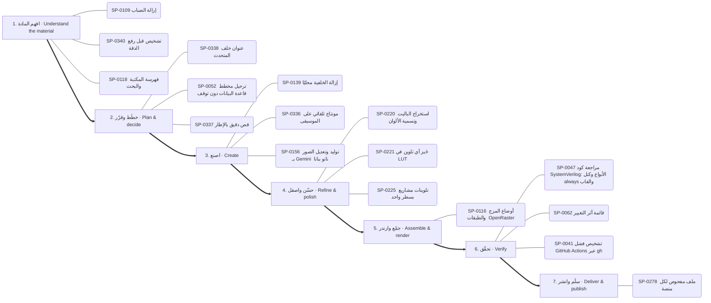

1. **افهم المادة:** SP-0109 ✅ إزالة الضباب · SP-0340 ✅ تشخيص قبل رفع الدقة · SP-0118 ✅ فهرسة المكتبة والبحث
2. **خطّط وقرّر:** SP-0338 ✅ عنوان خلف المتحدث · SP-0052 📄 ترحيل مخطط قاعدة البيانات دون توقف · SP-0337 ✅ قص دقيق بالإطار
3. **اصنع:** SP-0139 🟢 إزالة الخلفية محليًا · SP-0336 ✅ مونتاج تلقائي على الموسيقى · SP-0156 ✅ توليد وتعديل الصور بـ Gemini (نانو بنانا)
4. **حسّن واصقل:** SP-0220 ✅ استخراج الباليت وتسمية الألوان · SP-0221 ✅ خَبز أي تلوين في LUT · SP-0225 ✅ تلوينات مشاريع بسطر واحد
5. **جمّع وارندر:** SP-0116 ✅ أوضاع المزج والطبقات (OpenRaster)
6. **تحقّق:** SP-0047 📄 مراجعة كود SystemVerilog: الأنواع وكتل always والقابلية للتوليف · SP-0062 ✅ قائمة أثر التغيير · SP-0041 📄 تشخيص فشل GitHub Actions عبر gh
7. **سلّم وانشر:** SP-0278 ✅ ملف مفحوص لكل منصة

### مشهد ثلاثي الأبعاد — 3D scene (`3d-scene`)

البوابات: `3d` ← `motion` ← `quality`

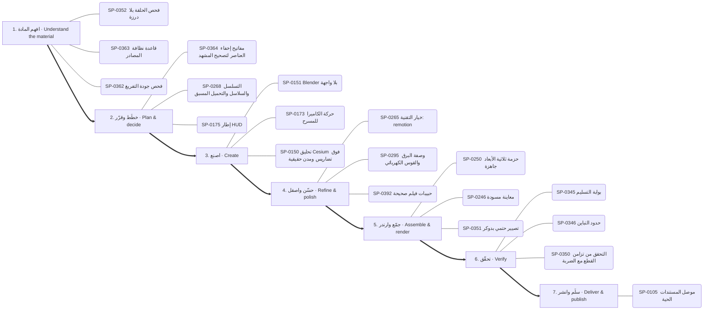

1. **افهم المادة:** SP-0352 ✅ فحص الحلقة بلا درزة · SP-0363 ✅ قاعدة نظافة المصادر · SP-0362 ✅ فحص جودة التفريغ
2. **خطّط وقرّر:** SP-0364 ✅ مفاتيح إخفاء العناصر لتصحيح المشهد · SP-0268 ✅ التسلسل والسلاسل والتحميل المسبق · SP-0175 📦 إطار HUD
3. **اصنع:** SP-0151 ✅ Blender بلا واجهة · SP-0173 ✅ حركة الكاميرا للمسرح · SP-0150 🟢 تحليق Cesium فوق تضاريس ومدن حقيقية
4. **حسّن واصقل:** SP-0265 ✅ خيار التقنية: remotion · SP-0295 ✅ وصفة البرق والقوس الكهربائي · SP-0392 ✅ حبيبات فيلم صحيحة
5. **جمّع وارندر:** SP-0250 ✅ حزمة ثلاثية الأبعاد جاهزة · SP-0246 ✅ معاينة مسودة · SP-0351 ✅ تصيير حتمي بدوكر
6. **تحقّق:** SP-0345 ✅ بوابة التسليم · SP-0346 ✅ حدود التباين · SP-0350 ✅ التحقق من تزامن القطع مع الضربة
7. **سلّم وانشر:** SP-0105 🔑 موصل المستندات الحية

### بناء تطبيق أو موقع — Build an app or site (`app`)

البوابات: `thinking` ← `software` ← `documents` ← `quality`

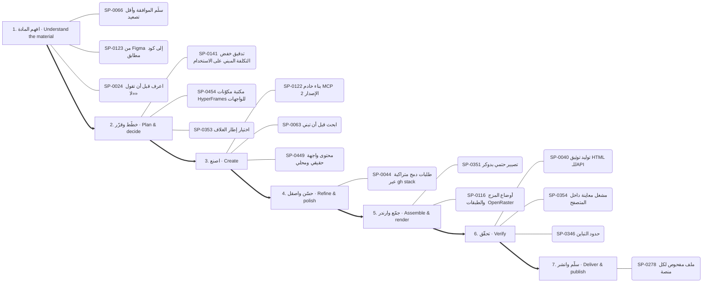

1. **افهم المادة:** SP-0066 ✅ سلّم الموافقة وأقل تصعيد · SP-0123 📄 من Figma إلى كود مطابق · SP-0024 📄 اعرف قبل أن تقول «لا»
2. **خطّط وقرّر:** SP-0141 📄 تدقيق خفض التكلفة المبني على الاستخدام · SP-0454 📦 مكتبة مكوّنات HyperFrames للواجهات · SP-0353 ✅ اختيار إطار الغلاف
3. **اصنع:** SP-0122 ✅ بناء خادم MCP (الإصدار 2) · SP-0063 ✅ ابحث قبل أن تبني · SP-0449 🟢 محتوى واجهة حقيقي ومحلي
4. **حسّن واصقل:** SP-0044 📄 طلبات دمج متراكبة عبر gh stack
5. **جمّع وارندر:** SP-0351 ✅ تصيير حتمي بدوكر · SP-0116 ✅ أوضاع المزج والطبقات (OpenRaster)
6. **تحقّق:** SP-0040 ✅ توليد توثيق HTML للـAPI · SP-0354 ✅ مشغل معاينة داخل المتصفح · SP-0346 ✅ حدود التباين
7. **سلّم وانشر:** SP-0278 ✅ ملف مفحوص لكل منصة

### تعديل كود وإصلاح — Change or fix code (`code-change`)

البوابات: `thinking` ← `software` ← `quality`

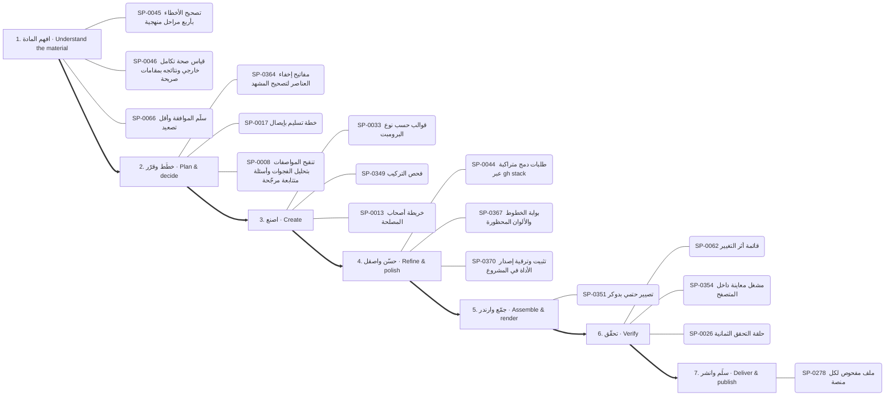

1. **افهم المادة:** SP-0045 📄 تصحيح الأخطاء بأربع مراحل منهجية · SP-0046 📄 قياس صحة تكامل خارجي ونتائجه بمقامات صريحة · SP-0066 ✅ سلّم الموافقة وأقل تصعيد
2. **خطّط وقرّر:** SP-0364 ✅ مفاتيح إخفاء العناصر لتصحيح المشهد · SP-0017 ✅ خطة تسليم بإيصال · SP-0008 📄 تنقيح المواصفات بتحليل الفجوات وأسئلة متتابعة مرجّحة
3. **اصنع:** SP-0033 ✅ قوالب حسب نوع البرومبت · SP-0349 ✅ فحص التركيب · SP-0013 📄 خريطة أصحاب المصلحة
4. **حسّن واصقل:** SP-0044 📄 طلبات دمج متراكبة عبر gh stack · SP-0367 ✅ بوابة الخطوط والألوان المحظورة · SP-0370 ✅ تثبيت وترقية إصدار الأداة في المشروع
5. **جمّع وارندر:** SP-0351 ✅ تصيير حتمي بدوكر
6. **تحقّق:** SP-0062 ✅ قائمة أثر التغيير · SP-0354 ✅ مشغل معاينة داخل المتصفح · SP-0026 ✅ حلقة التحقق الثمانية
7. **سلّم وانشر:** SP-0278 ✅ ملف مفحوص لكل منصة

### فحص تطبيق ونقل ميزة — Investigate an app and transfer a feature (`reverse`)

البوابات: `reverse` ← `software` ← `quality`

1. **افهم المادة:** SP-0075 ✅ فحص حزمة الأدلة · SP-0073 ✅ فحص صفحة Electron · SP-0070 ✅ فحص تعليمة أصلية
2. **خطّط وقرّر:** SP-0074 ✅ تتبّع الدلالات جافاسكربت · SP-0076 📄 REA MCP: حالة جلسة Frida · SP-0454 📦 مكتبة مكوّنات HyperFrames للواجهات
3. **اصنع:** SP-0111 ✅ اقترانات الملفات · SP-0083 ✅ فك ترميز تسجيل إشارة · SP-0449 🟢 محتوى واجهة حقيقي ومحلي
4. **حسّن واصقل:** SP-0370 ✅ تثبيت وترقية إصدار الأداة في المشروع
5. **جمّع وارندر:** SP-0087 ✅ سرد المعماريات objdump · SP-0078 📦 مقارنة لقطات الشاشة ويب · SP-0072 ✅ فحص جاهزية REA
6. **تحقّق:** SP-0028 📄 التقييم أولًا · SP-0345 ✅ بوابة التسليم · SP-0347 ✅ ورقة المراجعة
7. **سلّم وانشر:** SP-0278 ✅ ملف مفحوص لكل منصة

### تحليل بيانات وتقرير — Data analysis report (`data-report`)

البوابات: `data` ← `documents` ← `quality`

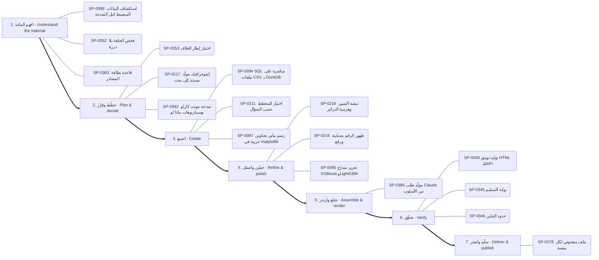

1. **افهم المادة:** SP-0089 📄 استكشاف البيانات المنضبط قبل النمذجة · SP-0352 ✅ فحص الحلقة بلا درزة · SP-0363 ✅ قاعدة نظافة المصادر
2. **خطّط وقرّر:** SP-0353 ✅ اختيار إطار الغلاف · SP-0217 🟢 إنفوجرافيك مولَّد مستند إلى بحث · SP-0092 📄 نمذجة مونت كارلو وسيناريوهات ماذا لو
3. **اصنع:** SP-0094 ✅ SQL مباشرة على ملفات CSV بـ DuckDB · SP-0211 ✅ اختيار المخطط حسب السؤال · SP-0097 ✅ رسم بياني بعناوين عربية في matplotlib
4. **حسّن واصقل:** SP-0216 🟢 نبضة التمييز وهرمية التركيز · SP-0215 ✅ ظهور الرقم بضبابية ورفع · SP-0095 ✅ تعزيز متدرّج XGBoost وLightGBM
5. **جمّع وارندر:** SP-0385 ✅ مولّد طلب Claude من الأسلوب
6. **تحقّق:** SP-0040 ✅ توليد توثيق HTML للـAPI · SP-0345 ✅ بوابة التسليم · SP-0346 ✅ حدود التباين
7. **سلّم وانشر:** SP-0278 ✅ ملف مفحوص لكل منصة

### بحث وكتابة مقال — Research and write (`research-write`)

البوابات: `research` ← `thinking` ← `documents`

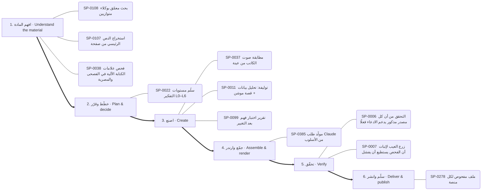

1. **افهم المادة:** SP-0108 ✅ بحث معمّق بوكلاء متوازيين · SP-0107 ✅ استخراج النص الرئيسي من صفحة · SP-0038 ✅ فحص علامات الكتابة الآلية في الفصحى والمصرية
2. **خطّط وقرّر:** SP-0022 ✅ سلّم مستويات التفكير L0–L6
3. **اصنع:** SP-0037 ✅ مطابقة صوت الكاتب من عينة · SP-0011 📄 توليفة: تحليل بيانات + قصة موشن · SP-0099 📄 تقرير اختبار فهم بعد التغيير
4. **جمّع وارندر:** SP-0385 ✅ مولّد طلب Claude من الأسلوب
5. **تحقّق:** SP-0006 📄 التحقق من أن كل مصدر مذكور يدعم الادعاء فعلًا · SP-0007 📄 زرع العيب لإثبات أن الفحص يستطيع أن يفشل
6. **سلّم وانشر:** SP-0278 ✅ ملف مفحوص لكل منصة

## البوابات مرتبة بالمراحل / hubs by stage

### البحث والمعرفة — Research & knowledge

- **افهم المادة** (3): SP-0107 استخراج النص الرئيسي من صفحة · SP-0108 بحث معمّق بوكلاء متوازيين · SP-0106 استخراج وإثراء بيانات الأطباء
- **اصنع** (2): SP-0064 ربط Graphify المستضاف · SP-0065 فهم أي مستودع أو مجموعة مهارات بسرعة

### التفكير والتخطيط والاستراتيجية — Reasoning & strategy

- **افهم المادة** (5): SP-0034 اطلب أي أسلوب بصري بالاسم من مكتبة 586 أسلوبًا · SP-0005 تسليم الجلسة وإعادة التثبيت والمطابقة · SP-0024 اعرف قبل أن تقول «لا» · SP-0144 تدقيق تكلفة LLM والتوجيه · SP-0147 تشخيص هامش الربح ومزيج الخدمات
- **خطّط وقرّر** (11): SP-0022 سلّم مستويات التفكير L0–L6 · SP-0010 سكامبر (SCAMPER) · SP-0017 خطة تسليم بإيصال · SP-0149 ثلاثة خيارات حقيقية وعدم الفعل · SP-0023 قائمة المرحلة صفر (12 وحدة) · SP-0141 تدقيق خفض التكلفة المبني على الاستخدام …
- **اصنع** (8): SP-0033 قوالب حسب نوع البرومبت · SP-0148 السعر الأمثل ونقطة التعادل · SP-0013 خريطة أصحاب المصلحة · SP-0142 حلقة مستقلة لتصريف قائمة المهام · SP-0145 مدرب تعلم متعدد الجلسات بحالة محفوظة · SP-0011 توليفة: تحليل بيانات + قصة موشن …
- **جمّع وارندر** (1): SP-0009 تصدير خريطة ذهنية تفاعلية
- **تحقّق** (6): SP-0140 مراجعة تصميم بأسلوب الطرح حتى الجوهر · SP-0143 فرز الحادث مقابل المشكلة وتحديد الخطورة · SP-0006 التحقق من أن كل مصدر مذكور يدعم الادعاء فعلًا · SP-0007 زرع العيب لإثبات أن الفحص يستطيع أن يفشل · SP-0036 اختبارات التفعيل والتصادم · SP-0012 مسح الكليشيهات

### الوكلاء والتوجيه الذكي — Agents & routing

- **افهم المادة** (5): SP-0128 أطلس القدرات للبحث والتخطيط · SP-0019 خطوط عربية قبل الرندر · SP-0130 فاحص توقيت الفيديو المرجعي · SP-0132 تحليل REA لمستودعات المالك دفعةً واحدة · SP-0020 اقرأ قائمة أدواتك
- **خطّط وقرّر** (2): SP-0131 مقدّر سعة الأنظمة · SP-0021 بطاقة القدرة والإيصال
- **اصنع** (4): SP-0129 مُصرِّف حركة SVG المتزامنة مع الصوت · SP-0001 ضغط السياق بملخص تسليم · SP-0002 الاسترجاع التكراري · SP-0003 أشجار عمل للكتّاب المتوازيين
- **جمّع وارندر** (1): SP-0133 تحزيم المهارة للرفع إلى claude.ai
- **تحقّق** (2): SP-0018 اعرف قبل أن تقول لا · SP-0004 مراجعة سانتا المزدوجة

### البرمجة وبناء التطبيقات — Software & applications

- **افهم المادة** (7): SP-0109 إزالة الضباب · SP-0118 فهرسة المكتبة والبحث · SP-0121 نشر صفحة تفاعلية خاصة · SP-0123 من Figma إلى كود مطابق · SP-0045 تصحيح الأخطاء بأربع مراحل منهجية · SP-0046 قياس صحة تكامل خارجي ونتائجه بمقامات صريحة …
- **خطّط وقرّر** (4): SP-0052 ترحيل مخطط قاعدة البيانات دون توقف · SP-0055 أنماط معمارية لـ GDScript في Godot 4 · SP-0127 تفكيك المواصفة إلى مهام صغيرة لوكلاء البرمجة · SP-0454 مكتبة مكوّنات HyperFrames للواجهات
- **اصنع** (26): SP-0112 علامات الإيقاع · SP-0114 نمو نباتي وزخرفي · SP-0113 رمز QR بشعار · SP-0447 المؤشر بطلًا · SP-0115 رسم زيتي وحبر ورصاص · SP-0111 اقترانات الملفات …
- **حسّن واصقل** (1): SP-0044 طلبات دمج متراكبة عبر gh stack
- **جمّع وارندر** (3): SP-0116 أوضاع المزج والطبقات (OpenRaster) · SP-0119 جرد قدرات Blender الحي · SP-0061 بيفي: ECS وتدفق الحالات وخط الأصول
- **تحقّق** (7): SP-0062 قائمة أثر التغيير · SP-0453 من التحميل إلى علامة صح · SP-0041 تشخيص فشل GitHub Actions عبر gh · SP-0047 مراجعة كود SystemVerilog: الأنواع وكتل always والقابلية للتوليف · SP-0125 حلقة مراجع شجرة الوصولية لتحكم المتصفح · SP-0056 كشف الاختبارات الخضراء الكاذبة …
- **سلّم وانشر** (2): SP-0126 ضبط مجمع الاتصالات وموثوقية قاعدة البيانات · SP-0120 مشغل فيديو عمودي بالسحب

### الرسم والأشكال والتصميم — Drawing & visual composition

- **افهم المادة** (1): SP-0233 تسميات بخطوط قائدة
- **خطّط وقرّر** (1): SP-0231 نموذج مجرة الأدلة
- **اصنع** (19): SP-0283 فيلم يد مرسومة حتمي بـmake_frame(t) · SP-0169 قواعد بناء الشعار SVG · SP-0376 تحويل SVG بإضافة MorphSVG · SP-0342 مؤثرات بكسل بخطوات اللوحة · SP-0377 انفجار خطوط شعاعي · SP-0229 خريطة الكيان في المنتصف …
- **حسّن واصقل** (6): SP-0378 حلقة صدمة أرضية ونبض قلب · SP-0380 دمج ونحت وتقاطع ناعم · SP-0344 الإضاءة والتلاشي بدثر Bayer · SP-0171 كتاب العلامة وصوتها · SP-0172 تشريح بطاقة الختام · SP-0382 تجمع الصلصال بالكرات

### الصور والتحرير والتوليد — Images & photo editing

- **افهم المادة** (4): SP-0136 صوت PipeWire داخل الحاويات · SP-0340 تشخيص قبل رفع الدقة · SP-0339 مجمع لقطات بأسئلة بحث ثنائية اللغة · SP-0161 مقدمات الأسلوب المتطابقة بايتًا
- **خطّط وقرّر** (2): SP-0337 قص دقيق بالإطار · SP-0338 عنوان خلف المتحدث
- **اصنع** (13): SP-0336 مونتاج تلقائي على الموسيقى · SP-0155 معادلة برومبت لقطة الفيديو · SP-0138 ضغط الصور ومقارنة الجودة · SP-0137 التعرف على العربية والإنجليزية بـ tesseract · SP-0156 توليد وتعديل الصور بـ Gemini (نانو بنانا) · SP-0139 إزالة الخلفية محليًا …
- **حسّن واصقل** (8): SP-0220 استخراج الباليت وتسمية الألوان · SP-0221 خَبز أي تلوين في LUT · SP-0222 التعريض حسب وقت اليوم · SP-0223 خلفية بقع ضبابية متحركة · SP-0224 توازن الأبيض بالبكسلات المحايدة · SP-0225 تلوينات مشاريع بسطر واحد …
- **جمّع وارندر** (1): SP-0341 تايملاين زمني متعدد الكاميرات

### الثري دي والمحاكاة والرندر — 3D & rendering

- **افهم المادة** (1): SP-0270 أمر: الكتالوج والإضافة
- **خطّط وقرّر** (7): SP-0267 محول إطارات CSS · SP-0153 حقول المكعبات المتموجة · SP-0263 تكامل: Lottie Creator MCP · SP-0268 التسلسل والسلاسل والتحميل المسبق · SP-0254 قائمة قواعد Remotion · SP-0269 اصطلاح المسارات والعلامات في المونتاج …
- **اصنع** (25): SP-0150 تحليق Cesium فوق تضاريس ومدن حقيقية · SP-0247 مشروع أنيميشن جديد · SP-0249 استوديو KOSIF Motion Web المحلي · SP-0151 Blender بلا واجهة · SP-0331 مطر وضباب ومطر الغيمة · SP-0332 حقل curl تحليلي خالٍ من التباعد …
- **حسّن واصقل** (15): SP-0289 توهج النص النيوني بثلاثة ظلال لكل كلمة · SP-0290 قراءة إضاءة صورة مرجعية · SP-0392 حبيبات فيلم صحيحة · SP-0330 انفجار ببذرة وجاذبية · SP-0393 تظليل كرة بالهالفتون · SP-0291 مرور العدسة «مصوَّر لا مرسوم» …
- **جمّع وارندر** (14): SP-0246 معاينة مسودة · SP-0255 تجميع الإطارات إلى فيديو MP4 · SP-0244 رندر HTML حتمي · SP-0251 تصدير MP4 دقيق · SP-0248 مواصفة الخط الزمني · SP-0261 عشوائية ببذرة ثابتة …

### الموشن والمونتاج والسينما — Motion & video editing

- **افهم المادة** (1): SP-0205 أغطية تدرّج لقراءة النص فوق الفيديو
- **خطّط وقرّر** (21): SP-0384 فيلم العلامة: من المشكلة إلى الكشف · SP-0235 تمويه السرعة الاتجاهي · SP-0280 صيغ الصوت للحلقات وتراخيص الموسيقى · SP-0281 بريف الصورة المصغرة: 3 أفكار واختبار A/B · SP-0178 تخطيط نص وواجهة · SP-0239 أربع تسارعات مسماة فقط …
- **اصنع** (40): SP-0206 شخصيات حية ببصمات حركة · SP-0173 حركة الكاميرا للمسرح · SP-0236 ميزانيات التتابع · SP-0207 ورقة تصميم الشخصية واختبار الظل · SP-0386 هياكل الشرح · SP-0174 دفع الكاميرا …
- **حسّن واصقل** (25): SP-0400 انتقالات الكشف · SP-0234 منحنى النابض المحسوب مسبقًا · SP-0238 رموز حركة CSS مختبرة · SP-0179 عمق الميدان وسحب التركيز · SP-0419 اختيار الانتقال حسب الطاقة · SP-0403 انتقال CSS: حرق الفيلم …
- **جمّع وارندر** (2): SP-0385 مولّد طلب Claude من الأسلوب · SP-0181 تكوين: Frame-within-frame
- **تحقّق** (1): SP-0388 أنظمة الفصول المرقّمة
- **سلّم وانشر** (2): SP-0278 ملف مفحوص لكل منصة · SP-0455 تحميل فيديو من أي رابط

### الصوت والموسيقى والتعليق — Audio & voice

- **افهم المادة** (3): SP-0312 كشف الإيقاع · SP-0165 تفريغ HyperFrames · SP-0167 كشف الصمت الثابت والتكيفي
- **خطّط وقرّر** (8): SP-0307 موسيقى أصلية · SP-0306 مونتاج إيقاعي · SP-0309 شبكة الإيقاع · SP-0311 أعمدة طيف وموجة صوتية في ريموشن · SP-0314 موجز الأغنية ومدد الإيقاع · SP-0319 أرض من طيف الصوت …
- **اصنع** (17): SP-0305 قنوات الصوت كمحرك للحركة · SP-0304 مكتبة المؤثرات · SP-0456 أزياء صوتية للشخصيات · SP-0308 مقام lydian · SP-0320 أجواء صوتية مولدة · SP-0166 تحليل أغنية لفيلم كلمات …
- **حسّن واصقل** (5): SP-0163 توقيت الكلمات حسب الطول · SP-0303 خفض الموسيقى تحت الصوت · SP-0164 دمج المشاهد مع الصوت الأصلي بلا تعديل · SP-0316 قناة المزج · SP-0168 الأشرطة السفلية
- **تحقّق** (2): SP-0310 تطبيع الجهارة -14 LUFS · SP-0317 كثافة المؤثرات

### الخطوط والنصوص العربية واللاتينية — Typography & localization

- **خطّط وقرّر** (1): SP-0436 علامة استفهام عملاقة مفرّغة
- **اصنع** (13): SP-0431 كشف الكلمة العربية كاملة من اليمين · SP-0029 CAMeL Tools: تقطيع النص العربي واستخراج الجذور والتشكيل وتحديد · SP-0432 مطابقة الخط بالحبر · SP-0433 طبقات نص الخط الزمني JSON · SP-0439 أنظمة الأصوات الطباعية · SP-0434 سطور تتكدس وتخفت …
- **حسّن واصقل** (1): SP-0442 عنوان بلونين وكلمة لون
- **جمّع وارندر** (1): SP-0446 قواعد قراءة الترجمة فوق اللقطات
- **تحقّق** (1): SP-0030 تحقق من أرقام OCR ببوابة المراسي
- **سلّم وانشر** (1): SP-0435 نظام أرقام واحد وأرقام جدولية

### البيانات والرسوم والمواقع — Data & visual analytics

- **افهم المادة** (2): SP-0089 استكشاف البيانات المنضبط قبل النمذجة · SP-0091 مراجعة مخطط واستعلامات ClickHouse
- **خطّط وقرّر** (2): SP-0217 إنفوجرافيك مولَّد مستند إلى بحث · SP-0092 نمذجة مونت كارلو وسيناريوهات ماذا لو
- **اصنع** (15): SP-0094 SQL مباشرة على ملفات CSV بـ DuckDB · SP-0211 اختيار المخطط حسب السؤال · SP-0096 حل رياضي دقيق بـ sympy · SP-0212 حلقة التقدم المخروطية · SP-0097 رسم بياني بعناوين عربية في matplotlib · SP-0297 هل نحتاج خريطة أصلًا …
- **حسّن واصقل** (4): SP-0095 تعزيز متدرّج XGBoost وLightGBM · SP-0215 ظهور الرقم بضبابية ورفع · SP-0216 نبضة التمييز وهرمية التركيز · SP-0301 كرة أرضية بأقواس اتصال
- **جمّع وارندر** (1): SP-0090 عقد خط بيانات: الحبيبية والتكرار الآمن

### المستندات والكتابة — Documents & writing

- **افهم المادة** (2): SP-0038 فحص علامات الكتابة الآلية في الفصحى والمصرية · SP-0102 جاهزية الموقع لـ llms.txt وزواحف AI
- **اصنع** (9): SP-0103 تحويل Office إلى PDF دفعة واحدة · SP-0104 PlantUML: توليد مخططات UML من نص · SP-0039 قفل الاقتباس المباشر · SP-0037 مطابقة صوت الكاتب من عينة · SP-0098 تدقيق انحراف التوثيق عن الكود لكل بُعد · SP-0031 تصميم الأيقونات بالتشابه والإغلاق البصري …
- **تحقّق** (1): SP-0101 حزمة تشخيص مُنقّحة وآمنة للدعم
- **سلّم وانشر** (1): SP-0105 موصل المستندات الحية

### الاختبارات والجودة والأمان — QA & security

- **افهم المادة** (12): SP-0348 قائمة جودة الحركة · SP-0352 فحص الحلقة بلا درزة · SP-0368 فحص المقروئية · SP-0359 دراسة فيلم مرجعي · SP-0363 قاعدة نظافة المصادر · SP-0357 قياس الجهارة والذروة …
- **خطّط وقرّر** (2): SP-0353 اختيار إطار الغلاف · SP-0364 مفاتيح إخفاء العناصر لتصحيح المشهد
- **اصنع** (4): SP-0349 فحص التركيب · SP-0067 نظافة الأسرار · SP-0372 حد الوميض الآمن · SP-0375 فخ إعادة الإسناد في TSL
- **حسّن واصقل** (3): SP-0370 تثبيت وترقية إصدار الأداة في المشروع · SP-0365 مقارنة النسخ ودرجات اللون · SP-0367 بوابة الخطوط والألوان المحظورة
- **جمّع وارندر** (2): SP-0351 تصيير حتمي بدوكر · SP-0374 طبقة الرسوم وحدها من رندرين
- **تحقّق** (14): SP-0345 بوابة التسليم · SP-0040 توليد توثيق HTML للـAPI · SP-0346 حدود التباين · SP-0354 مشغل معاينة داخل المتصفح · SP-0347 ورقة المراجعة · SP-0350 التحقق من تزامن القطع مع الضربة …

### التحليل العكسي وفحص البرامج — Reverse engineering

- **افهم المادة** (11): SP-0082 فرز المثبّت قبل REA · SP-0075 فحص حزمة الأدلة · SP-0077 مراقبة جلسة ويب · SP-0073 فحص صفحة Electron · SP-0085 فحص عميل pcap · SP-0070 فحص تعليمة أصلية …
- **خطّط وقرّر** (2): SP-0074 تتبّع الدلالات جافاسكربت · SP-0076 REA MCP: حالة جلسة Frida
- **اصنع** (2): SP-0083 فك ترميز تسجيل إشارة · SP-0086 فتح مشروع JEB
- **جمّع وارندر** (6): SP-0072 فحص جاهزية REA · SP-0087 سرد المعماريات objdump · SP-0069 سرد الخدمات ADB · SP-0078 مقارنة لقطات الشاشة ويب · SP-0079 REA MCP: أمر تصحيح Rizin · SP-0084 REA MCP: حالة جلسة GDB

### قدرات مساندة غير مصنفة — Other supporting capabilities

- **افهم المادة** (1): SP-0327 مكتبة KOSIF Atlas
- **خطّط وقرّر** (1): SP-0329 ملف المشروع المحمول وإعادة الربط
- **اصنع** (1): SP-0328 خادم MCP للاستوديو (22 أداة)

---
_مولَّد آليًا من data/superpowers.json وdata/hubs_index.json وdata/task_maps.json._
