# الخريطة الذهنية للقدرات — Capability mind map

<!-- generated by scripts/capability_mindmap.py build -->

كل قدرة مرتبة بحسب **مرحلة المهمة** التي تخدمها، ثم كل بوابة مقسمة بالمراحل، ثم خرائط جاهزة لمهام شائعة. اتبع المراحل بالترتيب: افهم ← خطّط ← اصنع ← حسّن ← جمّع وارندر ← تحقّق ← سلّم.

    python3 scripts/capability_mindmap.py task "<المهمة>"     # خريطة مرحلية لأي مهمة
    python3 scripts/capability_mindmap.py task reels-edit      # خريطة جاهزة

## الفهرس / contents

- المراحل السبع / the seven stages
- الخريطة الكبرى / the big map
- خرائط المهام الجاهزة / ready task maps
- البوابات مرتبة بالمراحل / hubs by stage

## المراحل السبع / the seven stages

1. **افهم المادة — Understand the material** · 723 قدرة ذرية
2. **خطّط وقرّر — Plan & decide** · 874 قدرة ذرية
3. **اصنع — Create** · 1785 قدرة ذرية
4. **حسّن واصقل — Refine & polish** · 871 قدرة ذرية
5. **جمّع وارندر — Assemble & render** · 455 قدرة ذرية
6. **تحقّق — Verify** · 426 قدرة ذرية
7. **سلّم وانشر — Deliver & publish** · 162 قدرة ذرية

## الخريطة الكبرى / the big map

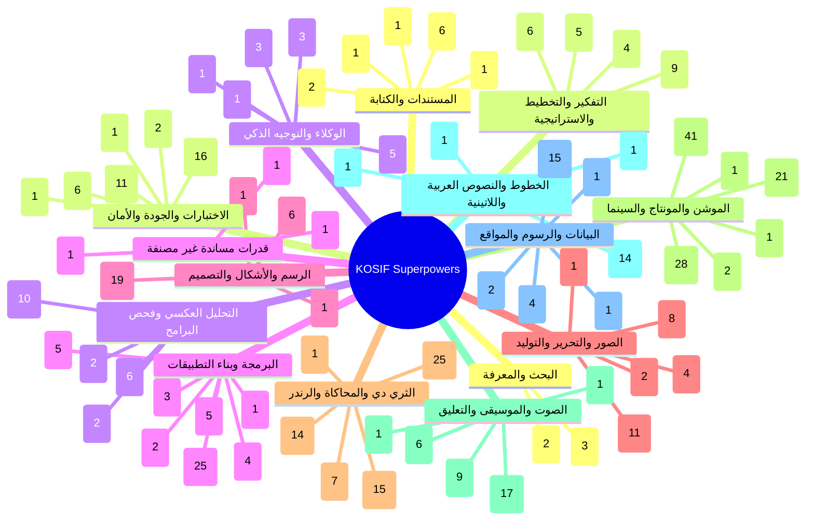

## خرائط المهام الجاهزة / ready task maps

### فيديو موشن جرافيك بصوت — Motion-graphics film with voice (`motion-film`)

البوابات: `thinking` ← `audio` ← `type` ← `motion` ← `drawing` ← `3d` ← `quality`

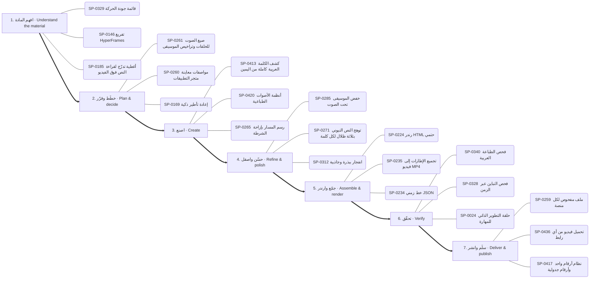

1. **افهم المادة:** SP-0329 ✅ قائمة جودة الحركة · SP-0146 ✅ تفريغ HyperFrames · SP-0185 🟢 أغطية تدرّج لقراءة النص فوق الفيديو
2. **خطّط وقرّر:** SP-0261 ✅ صيغ الصوت للحلقات وتراخيص الموسيقى · SP-0260 ✅ مواصفات معاينة متجر التطبيقات · SP-0169 🟢 إعادة تأطير ذكية
3. **اصنع:** SP-0413 ✅ كشف الكلمة العربية كاملة من اليمين · SP-0420 ✅ أنظمة الأصوات الطباعية · SP-0265 ✅ رسم المسار بإزاحة الشرطة
4. **حسّن واصقل:** SP-0285 ✅ خفض الموسيقى تحت الصوت · SP-0271 ✅ توهج النص النيوني بثلاثة ظلال لكل كلمة · SP-0312 ✅ انفجار ببذرة وجاذبية
5. **جمّع وارندر:** SP-0224 ✅ رندر HTML حتمي · SP-0235 ✅ تجميع الإطارات إلى فيديو MP4 · SP-0234 ✅ خط زمني JSON
6. **تحقّق:** SP-0340 ✅ فحص الطباعة العربية · SP-0328 ✅ فحص التباين عبر الزمن · SP-0024 ✅ حلقة التطوير الذاتي للمهارة
7. **سلّم وانشر:** SP-0259 ✅ ملف مفحوص لكل منصة · SP-0436 ✅ تحميل فيديو من أي رابط · SP-0417 ✅ نظام أرقام واحد وأرقام جدولية

### مونتاج ريلز على الإيقاع — Beat-synced reels edit (`reels-edit`)

البوابات: `motion` ← `audio` ← `images` ← `quality`

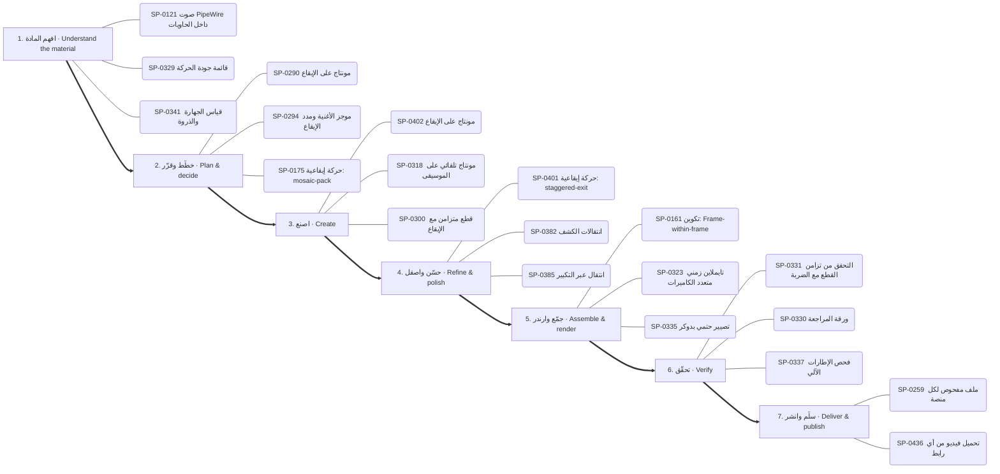

1. **افهم المادة:** SP-0121 ✅ صوت PipeWire داخل الحاويات · SP-0329 ✅ قائمة جودة الحركة · SP-0341 ✅ قياس الجهارة والذروة
2. **خطّط وقرّر:** SP-0290 🟢 مونتاج على الإيقاع · SP-0294 ✅ موجز الأغنية ومدد الإيقاع · SP-0175 🟢 حركة إيقاعية: mosaic-pack
3. **اصنع:** SP-0402 ✅ مونتاج على الإيقاع · SP-0318 ✅ مونتاج تلقائي على الموسيقى · SP-0300 📦 قطع متزامن مع الإيقاع
4. **حسّن واصقل:** SP-0401 🟢 حركة إيقاعية: staggered-exit · SP-0382 ✅ انتقالات الكشف · SP-0385 ✅ انتقال عبر التكبير
5. **جمّع وارندر:** SP-0161 🟢 تكوين: Frame-within-frame · SP-0323 🟢 تايملاين زمني متعدد الكاميرات · SP-0335 ✅ تصيير حتمي بدوكر
6. **تحقّق:** SP-0331 ✅ التحقق من تزامن القطع مع الضربة · SP-0330 ✅ ورقة المراجعة · SP-0337 ✅ فحص الإطارات الآلي
7. **سلّم وانشر:** SP-0259 ✅ ملف مفحوص لكل منصة · SP-0436 ✅ تحميل فيديو من أي رابط

### رسم شخصية وتحريكها — Draw and animate a character (`character`)

البوابات: `drawing` ← `motion` ← `audio` ← `3d`

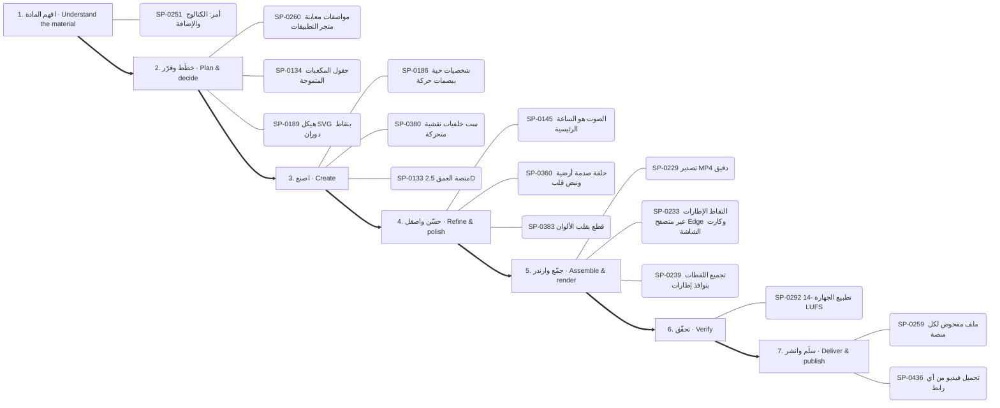

1. **افهم المادة:** SP-0251 📦 أمر: الكتالوج والإضافة
2. **خطّط وقرّر:** SP-0260 ✅ مواصفات معاينة متجر التطبيقات · SP-0134 ✅ حقول المكعبات المتموجة · SP-0189 🟢 هيكل SVG بنقاط دوران
3. **اصنع:** SP-0186 ✅ شخصيات حية ببصمات حركة · SP-0380 ✅ ست خلفيات نقشية متحركة · SP-0133 🟢 منصة العمق 2.5D
4. **حسّن واصقل:** SP-0145 ✅ الصوت هو الساعة الرئيسية · SP-0360 ✅ حلقة صدمة أرضية ونبض قلب · SP-0383 🟢 قطع بقلب الألوان
5. **جمّع وارندر:** SP-0229 ✅ تصدير MP4 دقيق · SP-0233 ✅ التقاط الإطارات عبر متصفح Edge وكارت الشاشة · SP-0239 ✅ تجميع اللقطات بنوافذ إطارات
6. **تحقّق:** SP-0292 ✅ تطبيع الجهارة -14 LUFS
7. **سلّم وانشر:** SP-0259 ✅ ملف مفحوص لكل منصة · SP-0436 ✅ تحميل فيديو من أي رابط

### فيديو شرح بالمخططات والبيانات — Data/diagram explainer (`explainer`)

البوابات: `data` ← `drawing` ← `motion` ← `thinking`

1. **افهم المادة:** SP-0096 ✅ أدوات الويب في واجهة API
2. **خطّط وقرّر:** SP-0197 🟢 إنفوجرافيك مولَّد مستند إلى بحث · SP-0366 ✅ قوس القطعة القصيرة · SP-0158 ✅ تخطيط نص وواجهة
3. **اصنع:** SP-0208 ✅ فيديو شرح بـManim · SP-0265 ✅ رسم المسار بإزاحة الشرطة · SP-0191 ✅ اختيار المخطط حسب السؤال
4. **حسّن واصقل:** SP-0382 ✅ انتقالات الكشف · SP-0195 ✅ ظهور الرقم بضبابية ورفع · SP-0360 ✅ حلقة صدمة أرضية ونبض قلب
5. **جمّع وارندر:** SP-0233 ✅ التقاط الإطارات عبر متصفح Edge وكارت الشاشة
6. **تحقّق:** SP-0035 ✅ توليد توثيق HTML للـAPI
7. **سلّم وانشر:** SP-0259 ✅ ملف مفحوص لكل منصة

### هوية وشعار وإعلان — Brand, logo & ad (`brand`)

البوابات: `drawing` ← `type` ← `motion` ← `thinking`

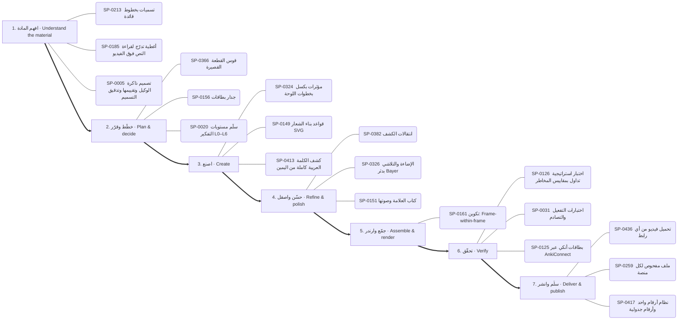

1. **افهم المادة:** SP-0213 🟢 تسميات بخطوط قائدة · SP-0185 🟢 أغطية تدرّج لقراءة النص فوق الفيديو · SP-0005 📄 تصميم ذاكرة الوكيل وتقييمها وتدقيق التسميم
2. **خطّط وقرّر:** SP-0366 ✅ قوس القطعة القصيرة · SP-0156 🟢 جدار بطاقات · SP-0020 ✅ سلّم مستويات التفكير L0–L6
3. **اصنع:** SP-0324 ✅ مؤثرات بكسل بخطوات اللوحة · SP-0149 ✅ قواعد بناء الشعار SVG · SP-0413 ✅ كشف الكلمة العربية كاملة من اليمين
4. **حسّن واصقل:** SP-0382 ✅ انتقالات الكشف · SP-0326 ✅ الإضاءة والتلاشي بدثر Bayer · SP-0151 🟢 كتاب العلامة وصوتها
5. **جمّع وارندر:** SP-0161 🟢 تكوين: Frame-within-frame
6. **تحقّق:** SP-0126 📄 اختبار استراتيجية تداول بمقاييس المخاطر · SP-0031 📄 اختبارات التفعيل والتصادم · SP-0125 📄 بطاقات أنكي عبر AnkiConnect
7. **سلّم وانشر:** SP-0436 ✅ تحميل فيديو من أي رابط · SP-0259 ✅ ملف مفحوص لكل منصة · SP-0417 ✅ نظام أرقام واحد وأرقام جدولية

### تحرير صور وتصميم — Photo editing & design (`photo`)

البوابات: `images` ← `software` ← `drawing`

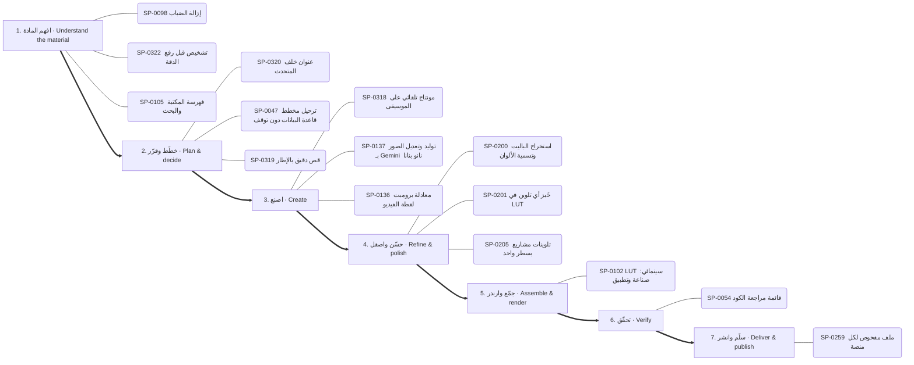

1. **افهم المادة:** SP-0098 ✅ إزالة الضباب · SP-0322 ✅ تشخيص قبل رفع الدقة · SP-0105 ✅ فهرسة المكتبة والبحث
2. **خطّط وقرّر:** SP-0320 ✅ عنوان خلف المتحدث · SP-0047 📄 ترحيل مخطط قاعدة البيانات دون توقف · SP-0319 ✅ قص دقيق بالإطار
3. **اصنع:** SP-0318 ✅ مونتاج تلقائي على الموسيقى · SP-0137 ✅ توليد وتعديل الصور بـ Gemini (نانو بنانا) · SP-0136 ✅ معادلة برومبت لقطة الفيديو
4. **حسّن واصقل:** SP-0200 ✅ استخراج الباليت وتسمية الألوان · SP-0201 ✅ خَبز أي تلوين في LUT · SP-0205 ✅ تلوينات مشاريع بسطر واحد
5. **جمّع وارندر:** SP-0102 ✅ LUT سينمائي: صناعة وتطبيق
6. **تحقّق:** SP-0054 ✅ قائمة مراجعة الكود
7. **سلّم وانشر:** SP-0259 ✅ ملف مفحوص لكل منصة

### مشهد ثلاثي الأبعاد — 3D scene (`3d-scene`)

البوابات: `3d` ← `motion` ← `quality`

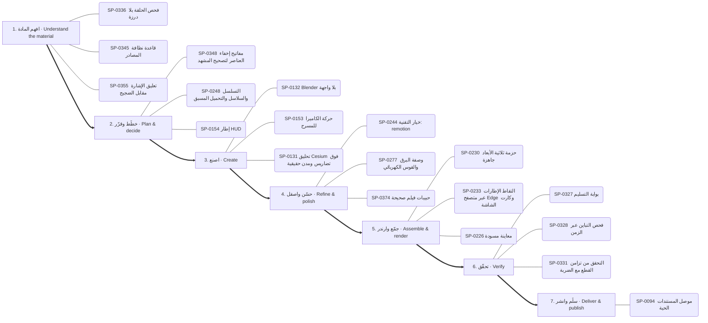

1. **افهم المادة:** SP-0336 ✅ فحص الحلقة بلا درزة · SP-0345 ✅ قاعدة نظافة المصادر · SP-0355 ✅ تعليق الإشارة مقابل الضجيج
2. **خطّط وقرّر:** SP-0348 ✅ مفاتيح إخفاء العناصر لتصحيح المشهد · SP-0248 ✅ التسلسل والسلاسل والتحميل المسبق · SP-0154 📦 إطار HUD
3. **اصنع:** SP-0132 ✅ Blender بلا واجهة · SP-0153 ✅ حركة الكاميرا للمسرح · SP-0131 🟢 تحليق Cesium فوق تضاريس ومدن حقيقية
4. **حسّن واصقل:** SP-0244 ✅ خيار التقنية: remotion · SP-0277 ✅ وصفة البرق والقوس الكهربائي · SP-0374 ✅ حبيبات فيلم صحيحة
5. **جمّع وارندر:** SP-0230 ✅ حزمة ثلاثية الأبعاد جاهزة · SP-0233 ✅ التقاط الإطارات عبر متصفح Edge وكارت الشاشة · SP-0226 ✅ معاينة مسودة
6. **تحقّق:** SP-0327 ✅ بوابة التسليم · SP-0328 ✅ فحص التباين عبر الزمن · SP-0331 ✅ التحقق من تزامن القطع مع الضربة
7. **سلّم وانشر:** SP-0094 🔑 موصل المستندات الحية

### بناء تطبيق أو موقع — Build an app or site (`app`)

البوابات: `thinking` ← `software` ← `documents` ← `quality`

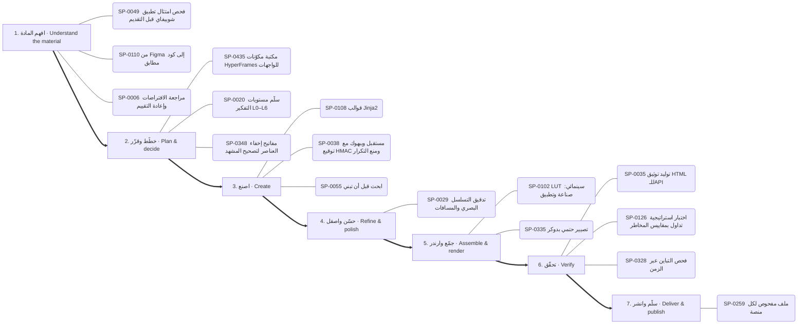

1. **افهم المادة:** SP-0049 📄 فحص امتثال تطبيق شوبيفاي قبل التقديم · SP-0110 📄 من Figma إلى كود مطابق · SP-0006 📄 مراجعة الافتراضات وإعادة التقييم
2. **خطّط وقرّر:** SP-0435 📦 مكتبة مكوّنات HyperFrames للواجهات · SP-0020 ✅ سلّم مستويات التفكير L0–L6 · SP-0348 ✅ مفاتيح إخفاء العناصر لتصحيح المشهد
3. **اصنع:** SP-0108 ✅ قوالب Jinja2 · SP-0038 📄 مستقبل ويبهوك مع توقيع HMAC ومنع التكرار · SP-0055 ✅ ابحث قبل أن تبني
4. **حسّن واصقل:** SP-0029 📄 تدقيق التسلسل البصري والمسافات
5. **جمّع وارندر:** SP-0102 ✅ LUT سينمائي: صناعة وتطبيق · SP-0335 ✅ تصيير حتمي بدوكر
6. **تحقّق:** SP-0035 ✅ توليد توثيق HTML للـAPI · SP-0126 📄 اختبار استراتيجية تداول بمقاييس المخاطر · SP-0328 ✅ فحص التباين عبر الزمن
7. **سلّم وانشر:** SP-0259 ✅ ملف مفحوص لكل منصة

### تعديل كود وإصلاح — Change or fix code (`code-change`)

البوابات: `thinking` ← `software` ← `quality`

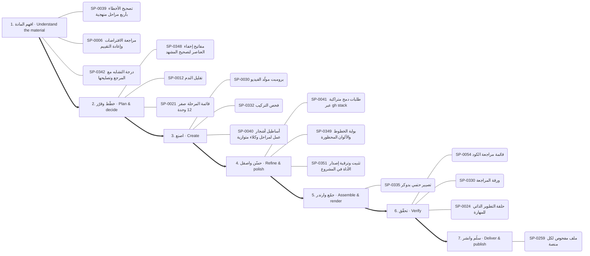

1. **افهم المادة:** SP-0039 📄 تصحيح الأخطاء بأربع مراحل منهجية · SP-0006 📄 مراجعة الافتراضات وإعادة التقييم · SP-0342 🟢 درجة التشابه مع المرجع وتصليحها
2. **خطّط وقرّر:** SP-0348 ✅ مفاتيح إخفاء العناصر لتصحيح المشهد · SP-0012 📄 تقليل الندم · SP-0021 📄 قائمة المرحلة صفر (12 وحدة)
3. **اصنع:** SP-0030 ✅ برومبت مولّد الفيديو · SP-0332 ✅ فحص التركيب · SP-0040 📄 أساطيل أشجار عمل لمراحل وكلاء متوازية
4. **حسّن واصقل:** SP-0041 📄 طلبات دمج متراكبة عبر gh stack · SP-0349 ✅ بوابة الخطوط والألوان المحظورة · SP-0351 ✅ تثبيت وترقية إصدار الأداة في المشروع
5. **جمّع وارندر:** SP-0335 ✅ تصيير حتمي بدوكر
6. **تحقّق:** SP-0054 ✅ قائمة مراجعة الكود · SP-0330 ✅ ورقة المراجعة · SP-0024 ✅ حلقة التطوير الذاتي للمهارة
7. **سلّم وانشر:** SP-0259 ✅ ملف مفحوص لكل منصة

### فحص تطبيق ونقل ميزة — Investigate an app and transfer a feature (`reverse`)

البوابات: `reverse` ← `software` ← `quality`

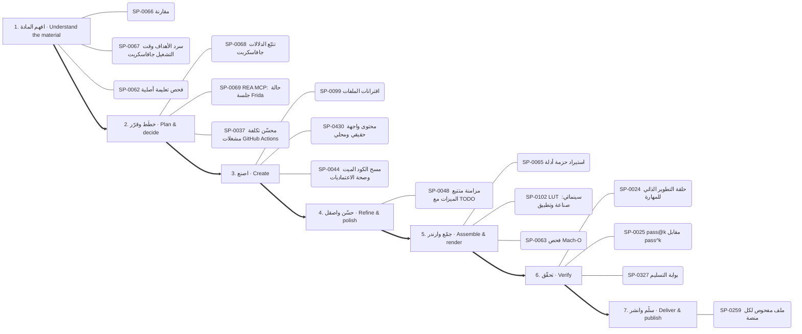

1. **افهم المادة:** SP-0066 ✅ مقارنة · SP-0067 ✅ سرد الأهداف وقت التشغيل جافاسكربت · SP-0062 ✅ فحص تعليمة أصلية
2. **خطّط وقرّر:** SP-0068 ✅ تتبّع الدلالات جافاسكربت · SP-0069 📄 REA MCP: حالة جلسة Frida · SP-0037 📄 محسّن تكلفة مشغلات GitHub Actions
3. **اصنع:** SP-0099 ✅ اقترانات الملفات · SP-0430 🟢 محتوى واجهة حقيقي ومحلي · SP-0044 📄 مسح الكود الميت وصحة الاعتماديات
4. **حسّن واصقل:** SP-0048 📄 مزامنة متتبع الميزات مع TODO
5. **جمّع وارندر:** SP-0065 ✅ استيراد حزمة أدلة · SP-0102 ✅ LUT سينمائي: صناعة وتطبيق · SP-0063 📦 فحص Mach-O
6. **تحقّق:** SP-0024 ✅ حلقة التطوير الذاتي للمهارة · SP-0025 📄 pass@k مقابل pass^k · SP-0327 ✅ بوابة التسليم
7. **سلّم وانشر:** SP-0259 ✅ ملف مفحوص لكل منصة

### تحليل بيانات وتقرير — Data analysis report (`data-report`)

البوابات: `data` ← `documents` ← `quality`

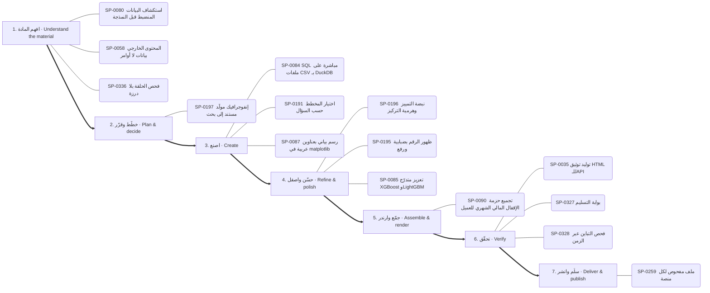

1. **افهم المادة:** SP-0080 📄 استكشاف البيانات المنضبط قبل النمذجة · SP-0058 ✅ المحتوى الخارجي بيانات لا أوامر · SP-0336 ✅ فحص الحلقة بلا درزة
2. **خطّط وقرّر:** SP-0197 🟢 إنفوجرافيك مولَّد مستند إلى بحث
3. **اصنع:** SP-0084 ✅ SQL مباشرة على ملفات CSV بـ DuckDB · SP-0191 ✅ اختيار المخطط حسب السؤال · SP-0087 ✅ رسم بياني بعناوين عربية في matplotlib
4. **حسّن واصقل:** SP-0196 🟢 نبضة التمييز وهرمية التركيز · SP-0195 ✅ ظهور الرقم بضبابية ورفع · SP-0085 ✅ تعزيز متدرّج XGBoost وLightGBM
5. **جمّع وارندر:** SP-0090 📄 تجميع حزمة الإقفال المالي الشهري للعميل
6. **تحقّق:** SP-0035 ✅ توليد توثيق HTML للـAPI · SP-0327 ✅ بوابة التسليم · SP-0328 ✅ فحص التباين عبر الزمن
7. **سلّم وانشر:** SP-0259 ✅ ملف مفحوص لكل منصة

### بحث وكتابة مقال — Research and write (`research-write`)

البوابات: `research` ← `thinking` ← `documents`

1. **افهم المادة:** SP-0097 ✅ بحث معمّق بوكلاء متوازيين · SP-0096 ✅ أدوات الويب في واجهة API · SP-0033 ✅ فحص علامات الكتابة الآلية في الفصحى والمصرية
2. **خطّط وقرّر:** SP-0020 ✅ سلّم مستويات التفكير L0–L6
3. **اصنع:** SP-0032 ✅ مطابقة صوت الكاتب من عينة · SP-0009 📄 توليفة: تحليل بيانات + قصة موشن · SP-0088 📄 تدقيق انحراف التوثيق عن الكود
4. **حسّن واصقل:** SP-0029 📄 تدقيق التسلسل البصري والمسافات
5. **جمّع وارندر:** SP-0240 ✅ عشوائية ببذرة ثابتة
6. **تحقّق:** SP-0340 ✅ فحص الطباعة العربية
7. **سلّم وانشر:** SP-0259 ✅ ملف مفحوص لكل منصة

## البوابات مرتبة بالمراحل / hubs by stage

### البحث والمعرفة — Research & knowledge

- **افهم المادة** (3): SP-0096 أدوات الويب في واجهة API · SP-0097 بحث معمّق بوكلاء متوازيين · SP-0095 استخراج وإثراء بيانات الأطباء
- **اصنع** (2): SP-0056 ربط Graphify المستضاف · SP-0057 الخريطة مادةً لفيلم موشن

### التفكير والتخطيط والاستراتيجية — Reasoning & strategy

- **افهم المادة** (5): SP-0005 تصميم ذاكرة الوكيل وتقييمها وتدقيق التسميم · SP-0128 تحليل الأسباب الجذرية والمخاطر · SP-0022 اعرف قبل أن تقول «لا» · SP-0014 شجرة المشكلة · SP-0006 مراجعة الافتراضات وإعادة التقييم
- **خطّط وقرّر** (9): SP-0020 سلّم مستويات التفكير L0–L6 · SP-0008 سكامبر (SCAMPER) · SP-0015 خطة تسليم بإيصال · SP-0130 ثلاثة خيارات حقيقية وعدم الفعل · SP-0124 تدقيق تكلفة LLM والتوجيه · SP-0021 قائمة المرحلة صفر (12 وحدة) …
- **اصنع** (6): SP-0129 السعر الأمثل ونقطة التعادل · SP-0030 برومبت مولّد الفيديو · SP-0011 خريطة أصحاب المصلحة · SP-0127 حلقة مستقلة لتصريف قائمة المهام · SP-0009 توليفة: تحليل بيانات + قصة موشن · SP-0023 سجل التغطية قبل الإرسال
- **تحقّق** (4): SP-0125 بطاقات أنكي عبر AnkiConnect · SP-0126 اختبار استراتيجية تداول بمقاييس المخاطر · SP-0031 اختبارات التفعيل والتصادم · SP-0010 مسح الكليشيهات

### الوكلاء والتوجيه الذكي — Agents & routing

- **افهم المادة** (3): SP-0115 أطلس القدرات للبحث والتخطيط · SP-0017 بطاقة القدرات بسكربت واحد · SP-0018 اقرأ قائمة أدواتك
- **خطّط وقرّر** (1): SP-0019 بطاقة القدرة والإيصال
- **اصنع** (5): SP-0116 محرك حركة SVG · SP-0119 مختبر الابتكار الهندسي · SP-0002 خوادم MCP: إضافة وتدقيق وميزانية · SP-0001 ملف تسليم الجلسة مع عتبات ضغط السياق · SP-0003 مصفوفة المسارات المتوازية
- **جمّع وارندر** (1): SP-0117 جسر Blender الآمن
- **تحقّق** (3): SP-0016 اعرف قبل أن تقول لا · SP-0118 مستكشف مصادر المجتمع · SP-0004 مراجعة سانتا المزدوجة

### البرمجة وبناء التطبيقات — Software & applications

- **افهم المادة** (5): SP-0098 إزالة الضباب · SP-0105 فهرسة المكتبة والبحث · SP-0110 من Figma إلى كود مطابق · SP-0039 تصحيح الأخطاء بأربع مراحل منهجية · SP-0049 فحص امتثال تطبيق شوبيفاي قبل التقديم
- **خطّط وقرّر** (5): SP-0037 محسّن تكلفة مشغلات GitHub Actions · SP-0045 أنماط معمارية لـ GDScript في Godot 4 · SP-0047 ترحيل مخطط قاعدة البيانات دون توقف · SP-0114 خط وكلاء بأدوار ومراحل وأقفال كتابة واستئناف · SP-0435 مكتبة مكوّنات HyperFrames للواجهات
- **اصنع** (25): SP-0101 نمو نباتي وزخرفي · SP-0100 رمز QR بشعار · SP-0428 المؤشر بطلًا · SP-0103 رسم زيتي وحبر ورصاص · SP-0108 قوالب Jinja2 · SP-0099 اقترانات الملفات …
- **حسّن واصقل** (2): SP-0041 طلبات دمج متراكبة عبر gh stack · SP-0048 مزامنة متتبع الميزات مع TODO
- **جمّع وارندر** (3): SP-0102 LUT سينمائي: صناعة وتطبيق · SP-0106 جرد قدرات Blender الحي · SP-0107 كاميرا افتراضية من فيديو
- **تحقّق** (4): SP-0054 قائمة مراجعة الكود · SP-0109 نشر صفحة تفاعلية خاصة · SP-0434 من التحميل إلى علامة صح · SP-0111 حلقة مراجع شجرة الوصولية لتحكم المتصفح
- **سلّم وانشر** (1): SP-0113 ضبط مجمع الاتصالات وموثوقية قاعدة البيانات

### الرسم والأشكال والتصميم — Drawing & visual composition

- **افهم المادة** (1): SP-0213 تسميات بخطوط قائدة
- **خطّط وقرّر** (1): SP-0211 شبكة مفاهيم بقوة الجذب
- **اصنع** (19): SP-0265 رسم المسار بإزاحة الشرطة · SP-0149 قواعد بناء الشعار SVG · SP-0358 تحويل SVG بإضافة MorphSVG · SP-0324 مؤثرات بكسل بخطوات اللوحة · SP-0359 انفجار خطوط شعاعي · SP-0209 خريطة الكيان في المنتصف …
- **حسّن واصقل** (6): SP-0360 حلقة صدمة أرضية ونبض قلب · SP-0361 دمج ونحت وتقاطع ناعم · SP-0326 الإضاءة والتلاشي بدثر Bayer · SP-0151 كتاب العلامة وصوتها · SP-0152 تشريح بطاقة الختام · SP-0364 تجمع الصلصال بالكرات

### الصور والتحرير والتوليد — Images & photo editing

- **افهم المادة** (4): SP-0121 صوت PipeWire داخل الحاويات · SP-0322 تشخيص قبل رفع الدقة · SP-0321 مجمع لقطات بأسئلة بحث ثنائية اللغة · SP-0142 مقدمات الأسلوب المتطابقة بايتًا
- **خطّط وقرّر** (2): SP-0319 قص دقيق بالإطار · SP-0320 عنوان خلف المتحدث
- **اصنع** (11): SP-0318 مونتاج تلقائي على الموسيقى · SP-0136 معادلة برومبت لقطة الفيديو · SP-0122 التعرف على العربية والإنجليزية بـ tesseract · SP-0123 ضغط الصور ومقارنة الجودة · SP-0137 توليد وتعديل الصور بـ Gemini (نانو بنانا) · SP-0140 حلقات فيديو Kling للهوية وواجهة Kling …
- **حسّن واصقل** (8): SP-0200 استخراج الباليت وتسمية الألوان · SP-0201 خَبز أي تلوين في LUT · SP-0202 التعريض حسب وقت اليوم · SP-0203 خلفية بقع ضبابية متحركة · SP-0204 توازن الأبيض بالبكسلات المحايدة · SP-0205 تلوينات مشاريع بسطر واحد …
- **جمّع وارندر** (1): SP-0323 تايملاين زمني متعدد الكاميرات

### الثري دي والمحاكاة والرندر — 3D & rendering

- **افهم المادة** (1): SP-0251 أمر: الكتالوج والإضافة
- **خطّط وقرّر** (7): SP-0247 محول إطارات CSS · SP-0134 حقول المكعبات المتموجة · SP-0242 تكامل: Lottie Creator MCP · SP-0248 التسلسل والسلاسل والتحميل المسبق · SP-0249 كود Python إنتاجي · SP-0236 قائمة قواعد Remotion …
- **اصنع** (25): SP-0131 تحليق Cesium فوق تضاريس ومدن حقيقية · SP-0227 مشروع أنيميشن جديد · SP-0228 استوديو KOSIF Motion Web المحلي · SP-0132 Blender بلا واجهة · SP-0313 مطر وضباب ومطر الغيمة · SP-0315 حقل curl تحليلي خالٍ من التباعد …
- **حسّن واصقل** (15): SP-0271 توهج النص النيوني بثلاثة ظلال لكل كلمة · SP-0374 حبيبات فيلم صحيحة · SP-0272 قراءة إضاءة صورة مرجعية · SP-0312 انفجار ببذرة وجاذبية · SP-0375 تظليل كرة بالهالفتون · SP-0273 مرور العدسة «مصوَّر لا مرسوم» …
- **جمّع وارندر** (14): SP-0226 معاينة مسودة · SP-0234 خط زمني JSON · SP-0224 رندر HTML حتمي · SP-0229 تصدير MP4 دقيق · SP-0240 عشوائية ببذرة ثابتة · SP-0230 حزمة ثلاثية الأبعاد جاهزة …

### الموشن والمونتاج والسينما — Motion & video editing

- **افهم المادة** (1): SP-0185 أغطية تدرّج لقراءة النص فوق الفيديو
- **خطّط وقرّر** (21): SP-0366 قوس القطعة القصيرة · SP-0215 تمويه السرعة الاتجاهي · SP-0261 صيغ الصوت للحلقات وتراخيص الموسيقى · SP-0262 بريف الصورة المصغرة: 3 أفكار واختبار A/B · SP-0158 تخطيط نص وواجهة · SP-0219 أربع تسارعات مسماة فقط …
- **اصنع** (41): SP-0186 شخصيات حية ببصمات حركة · SP-0153 حركة الكاميرا للمسرح · SP-0367 مولّد طلب Claude من الأسلوب · SP-0216 ميزانيات التتابع · SP-0187 ورقة تصميم الشخصية واختبار الظل · SP-0160 اختلاف المنظر …
- **حسّن واصقل** (28): SP-0382 انتقالات الكشف · SP-0214 منحنى النابض المحسوب مسبقًا · SP-0217 رموز التسارع حسب الدور (17 منحنى) · SP-0159 عمق الميدان وسحب التركيز · SP-0403 اختيار الانتقال حسب الطاقة · SP-0384 تبادل بالتحول …
- **جمّع وارندر** (1): SP-0161 تكوين: Frame-within-frame
- **سلّم وانشر** (2): SP-0259 ملف مفحوص لكل منصة · SP-0436 تحميل فيديو من أي رابط

### الصوت والموسيقى والتعليق — Audio & voice

- **افهم المادة** (1): SP-0146 تفريغ HyperFrames
- **خطّط وقرّر** (9): SP-0286 شبكة الإيقاع · SP-0290 مونتاج على الإيقاع · SP-0298 وصفة التصاعد والذروة · SP-0294 موجز الأغنية ومدد الإيقاع · SP-0293 أعمدة طيف وموجة صوتية في ريموشن · SP-0304 أرض من طيف الصوت …
- **اصنع** (17): SP-0287 مكتبة المؤثرات · SP-0288 قنوات الصوت كمحرك للحركة · SP-0437 أزياء صوتية للشخصيات · SP-0289 مقام lydian · SP-0297 أجواء صوتية مولدة · SP-0147 فيلم كلمات من صوت (أغنية، شعر، دعاء) …
- **حسّن واصقل** (6): SP-0285 خفض الموسيقى تحت الصوت · SP-0144 توقيت الكلمات حسب الطول · SP-0145 الصوت هو الساعة الرئيسية · SP-0308 حافلة المزج الفرعي · SP-0299 سلسلة المكساج والماستر · SP-0148 الأشرطة السفلية
- **تحقّق** (1): SP-0292 تطبيع الجهارة -14 LUFS

### الخطوط والنصوص العربية واللاتينية — Typography & localization

- **اصنع** (14): SP-0413 كشف الكلمة العربية كاملة من اليمين · SP-0027 CAMeL Tools: تقطيع النص العربي واستخراج الجذور والتشكيل وتحديد · SP-0415 مطابقة الخط بالحبر · SP-0414 التقاط ستايل النص وإعادة تركيبه · SP-0420 أنظمة الأصوات الطباعية · SP-0416 سطور تتكدس وتخفت …
- **حسّن واصقل** (1): SP-0422 عنوان بلونين وكلمة لون
- **تحقّق** (1): SP-0028 تحقق من أرقام OCR ببوابة المراسي
- **سلّم وانشر** (1): SP-0417 نظام أرقام واحد وأرقام جدولية

### البيانات والرسوم والمواقع — Data & visual analytics

- **افهم المادة** (2): SP-0080 استكشاف البيانات المنضبط قبل النمذجة · SP-0082 من اللغة الطبيعية إلى استعلام MongoDB
- **خطّط وقرّر** (1): SP-0197 إنفوجرافيك مولَّد مستند إلى بحث
- **اصنع** (15): SP-0084 SQL مباشرة على ملفات CSV بـ DuckDB · SP-0191 اختيار المخطط حسب السؤال · SP-0086 حل رياضي دقيق بـ sympy · SP-0192 حلقة التقدم المخروطية · SP-0087 رسم بياني بعناوين عربية في matplotlib · SP-0279 هل نحتاج خريطة أصلًا …
- **حسّن واصقل** (4): SP-0085 تعزيز متدرّج XGBoost وLightGBM · SP-0195 ظهور الرقم بضبابية ورفع · SP-0196 نبضة التمييز وهرمية التركيز · SP-0283 كرة أرضية بأقواس اتصال
- **جمّع وارندر** (1): SP-0081 عقد خط بيانات: الحبيبية والتكرار الآمن

### المستندات والكتابة — Documents & writing

- **افهم المادة** (2): SP-0033 فحص علامات الكتابة الآلية في الفصحى والمصرية · SP-0091 جاهزية الموقع لـ llms.txt وزواحف AI
- **اصنع** (6): SP-0092 تحويل Office إلى PDF دفعة واحدة · SP-0093 PlantUML: توليد مخططات UML من نص · SP-0034 قفل الاقتباس المباشر · SP-0032 مطابقة صوت الكاتب من عينة · SP-0088 تدقيق انحراف التوثيق عن الكود · SP-0089 مراجعة مخاطر العقود واتفاقيات السرية
- **حسّن واصقل** (1): SP-0029 تدقيق التسلسل البصري والمسافات
- **جمّع وارندر** (1): SP-0090 تجميع حزمة الإقفال المالي الشهري للعميل
- **سلّم وانشر** (1): SP-0094 موصل المستندات الحية

### الاختبارات والجودة والأمان — QA & security

- **افهم المادة** (11): SP-0329 قائمة جودة الحركة · SP-0336 فحص الحلقة بلا درزة · SP-0350 فحص المقروئية · SP-0344 دراسة فيلم مرجعي · SP-0345 قاعدة نظافة المصادر · SP-0341 قياس الجهارة والذروة …
- **خطّط وقرّر** (1): SP-0348 مفاتيح إخفاء العناصر لتصحيح المشهد
- **اصنع** (6): SP-0339 قياسات الصورة · SP-0332 فحص التركيب · SP-0343 عرض المرجع والأصل والمنتج · SP-0059 نظافة الأسرار · SP-0354 حد الوميض الآمن · SP-0357 فخ إعادة الإسناد في TSL
- **حسّن واصقل** (2): SP-0351 تثبيت وترقية إصدار الأداة في المشروع · SP-0349 بوابة الخطوط والألوان المحظورة
- **جمّع وارندر** (1): SP-0335 تصيير حتمي بدوكر
- **تحقّق** (16): SP-0327 بوابة التسليم · SP-0035 توليد توثيق HTML للـAPI · SP-0328 فحص التباين عبر الزمن · SP-0331 التحقق من تزامن القطع مع الضربة · SP-0333 إطار مرجعي للمقارنة · SP-0337 فحص الإطارات الآلي …

### التحليل العكسي وفحص البرامج — Reverse engineering

- **افهم المادة** (10): SP-0072 فرز المثبّت قبل REA · SP-0071 فحص صفحة ويب · SP-0064 فحص قطعة مُدار (.NET) · SP-0066 مقارنة · SP-0067 سرد الأهداف وقت التشغيل جافاسكربت · SP-0075 فحص عميل pcap …
- **خطّط وقرّر** (2): SP-0068 تتبّع الدلالات جافاسكربت · SP-0069 REA MCP: حالة جلسة Frida
- **اصنع** (2): SP-0078 فك ترميز تسجيل إشارة · SP-0076 فتح مشروع JEB
- **جمّع وارندر** (6): SP-0065 استيراد حزمة أدلة · SP-0079 سرد المعماريات objdump · SP-0061 إيقاف تطبيق ADB · SP-0063 فحص Mach-O · SP-0070 REA MCP: أمر تصحيح Rizin · SP-0073 REA MCP: حالة جلسة GDB

### قدرات مساندة غير مصنفة — Other supporting capabilities

- **افهم المادة** (1): SP-0309 مكتبة KOSIF Atlas
- **خطّط وقرّر** (1): SP-0311 ملف المشروع المحمول وإعادة الربط
- **اصنع** (1): SP-0310 خادم MCP للاستوديو (22 أداة)

---
_مولَّد آليًا من data/superpowers.json وdata/hubs_index.json وdata/task_maps.json._
