# الخريطة الذهنية للقدرات — Capability mind map

<!-- generated by scripts/capability_mindmap.py build -->

كل قدرة مرتبة بحسب **مرحلة المهمة** التي تخدمها، ثم كل بوابة مقسمة بالمراحل، ثم خرائط جاهزة لمهام شائعة. اتبع المراحل بالترتيب: افهم ← خطّط ← اصنع ← حسّن ← جمّع وارندر ← تحقّق ← سلّم.

    python3 scripts/capability_mindmap.py task "<المهمة>"     # خريطة مرحلية لأي مهمة
    python3 scripts/capability_mindmap.py task reels-edit      # خريطة جاهزة

## الفهرس / contents

- المراحل السبع / the seven stages
- الخريطة الكبرى / the big map
- خرائط المهام الجاهزة / ready task maps
- البوابات مرتبة بالمراحل / hubs by stage

## المراحل السبع / the seven stages

1. **افهم المادة — Understand the material** · 831 قدرة ذرية
2. **خطّط وقرّر — Plan & decide** · 956 قدرة ذرية
3. **اصنع — Create** · 1941 قدرة ذرية
4. **حسّن واصقل — Refine & polish** · 896 قدرة ذرية
5. **جمّع وارندر — Assemble & render** · 492 قدرة ذرية
6. **تحقّق — Verify** · 543 قدرة ذرية
7. **سلّم وانشر — Deliver & publish** · 188 قدرة ذرية

## الخريطة الكبرى / the big map

```mermaid
mindmap
  root((KOSIF Superpowers))
    البحث والمعرفة
      افهم المادة (4)
      اصنع (2)
    التفكير والتخطيط والاستراتيجية
      افهم المادة (5)
      خطّط وقرّر (10)
      اصنع (10)
      حسّن واصقل (1)
      جمّع وارندر (1)
      تحقّق (7)
    الوكلاء والتوجيه الذكي
      افهم المادة (6)
      خطّط وقرّر (2)
      اصنع (10)
      جمّع وارندر (3)
      تحقّق (1)
    البرمجة وبناء التطبيقات
      افهم المادة (11)
      خطّط وقرّر (4)
      اصنع (25)
      حسّن واصقل (1)
      جمّع وارندر (4)
      تحقّق (10)
      سلّم وانشر (2)
    الرسم والأشكال والتصميم
      خطّط وقرّر (1)
      اصنع (21)
      حسّن واصقل (6)
    الصور والتحرير والتوليد
      افهم المادة (4)
      خطّط وقرّر (2)
      اصنع (12)
      حسّن واصقل (8)
      جمّع وارندر (2)
      سلّم وانشر (1)
    الثري دي والمحاكاة والرندر
      افهم المادة (1)
      خطّط وقرّر (7)
      اصنع (26)
      حسّن واصقل (14)
      جمّع وارندر (15)
    الموشن والمونتاج والسينما
      افهم المادة (1)
      خطّط وقرّر (20)
      اصنع (40)
      حسّن واصقل (25)
      جمّع وارندر (2)
      تحقّق (1)
      سلّم وانشر (2)
    الصوت والموسيقى والتعليق
      افهم المادة (3)
      خطّط وقرّر (8)
      اصنع (16)
      حسّن واصقل (5)
      تحقّق (2)
    الخطوط والنصوص العربية واللاتينية
      خطّط وقرّر (1)
      اصنع (13)
      حسّن واصقل (1)
      جمّع وارندر (1)
      تحقّق (1)
      سلّم وانشر (1)
    البيانات والرسوم والمواقع
      افهم المادة (3)
      خطّط وقرّر (1)
      اصنع (15)
      حسّن واصقل (4)
      جمّع وارندر (1)
    المستندات والكتابة
      افهم المادة (2)
      خطّط وقرّر (1)
      اصنع (9)
      سلّم وانشر (1)
    الاختبارات والجودة والأمان
      افهم المادة (12)
      خطّط وقرّر (2)
      اصنع (6)
      حسّن واصقل (3)
      جمّع وارندر (2)
      تحقّق (13)
    التحليل العكسي وفحص البرامج
      افهم المادة (9)
      خطّط وقرّر (3)
      اصنع (2)
      جمّع وارندر (6)
    قدرات مساندة غير مصنفة
      افهم المادة (1)
      خطّط وقرّر (1)
      اصنع (1)
```

## خرائط المهام الجاهزة / ready task maps

### فيديو موشن جرافيك بصوت — Motion-graphics film with voice (`motion-film`)

البوابات: `thinking` ← `audio` ← `type` ← `motion` ← `drawing` ← `3d` ← `quality`

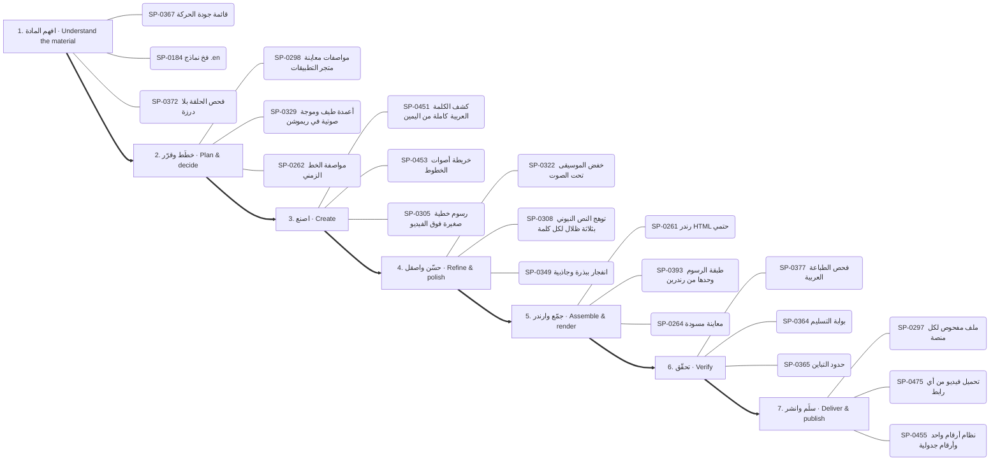

1. **افهم المادة:** SP-0367 ✅ قائمة جودة الحركة · SP-0184 ✅ فخ نماذج .en · SP-0372 ✅ فحص الحلقة بلا درزة
2. **خطّط وقرّر:** SP-0298 ✅ مواصفات معاينة متجر التطبيقات · SP-0329 🟢 أعمدة طيف وموجة صوتية في ريموشن · SP-0262 ✅ مواصفة الخط الزمني
3. **اصنع:** SP-0451 ✅ كشف الكلمة العربية كاملة من اليمين · SP-0453 ✅ خريطة أصوات الخطوط · SP-0305 ✅ رسوم خطية صغيرة فوق الفيديو
4. **حسّن واصقل:** SP-0322 ✅ خفض الموسيقى تحت الصوت · SP-0308 ✅ توهج النص النيوني بثلاثة ظلال لكل كلمة · SP-0349 ✅ انفجار ببذرة وجاذبية
5. **جمّع وارندر:** SP-0261 ✅ رندر HTML حتمي · SP-0393 ✅ طبقة الرسوم وحدها من رندرين · SP-0264 ✅ معاينة مسودة
6. **تحقّق:** SP-0377 ✅ فحص الطباعة العربية · SP-0364 ✅ بوابة التسليم · SP-0365 ✅ حدود التباين
7. **سلّم وانشر:** SP-0297 ✅ ملف مفحوص لكل منصة · SP-0475 ✅ تحميل فيديو من أي رابط · SP-0455 ✅ نظام أرقام واحد وأرقام جدولية

### مونتاج ريلز على الإيقاع — Beat-synced reels edit (`reels-edit`)

البوابات: `motion` ← `audio` ← `images` ← `quality`

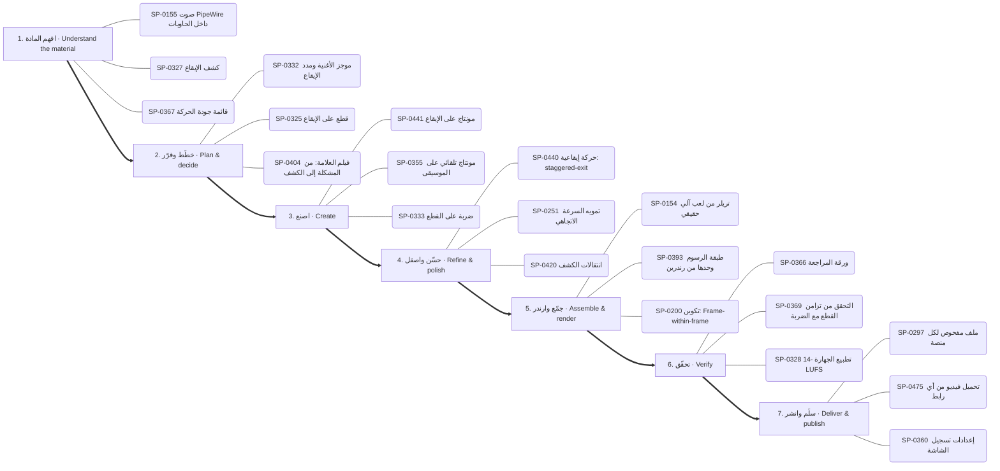

1. **افهم المادة:** SP-0155 ✅ صوت PipeWire داخل الحاويات · SP-0327 ✅ كشف الإيقاع · SP-0367 ✅ قائمة جودة الحركة
2. **خطّط وقرّر:** SP-0332 ✅ موجز الأغنية ومدد الإيقاع · SP-0325 🟢 قطع على الإيقاع · SP-0404 ✅ فيلم العلامة: من المشكلة إلى الكشف
3. **اصنع:** SP-0441 ✅ مونتاج على الإيقاع · SP-0355 ✅ مونتاج تلقائي على الموسيقى · SP-0333 📦 ضربة على القطع
4. **حسّن واصقل:** SP-0440 🟢 حركة إيقاعية: staggered-exit · SP-0251 ✅ تمويه السرعة الاتجاهي · SP-0420 ✅ انتقالات الكشف
5. **جمّع وارندر:** SP-0154 📄 تريلر من لعب آلي حقيقي · SP-0393 ✅ طبقة الرسوم وحدها من رندرين · SP-0200 🟢 تكوين: Frame-within-frame
6. **تحقّق:** SP-0366 ✅ ورقة المراجعة · SP-0369 ✅ التحقق من تزامن القطع مع الضربة · SP-0328 ✅ تطبيع الجهارة -14 LUFS
7. **سلّم وانشر:** SP-0297 ✅ ملف مفحوص لكل منصة · SP-0475 ✅ تحميل فيديو من أي رابط · SP-0360 ✅ إعدادات تسجيل الشاشة

### رسم شخصية وتحريكها — Draw and animate a character (`character`)

البوابات: `drawing` ← `motion` ← `audio` ← `3d`

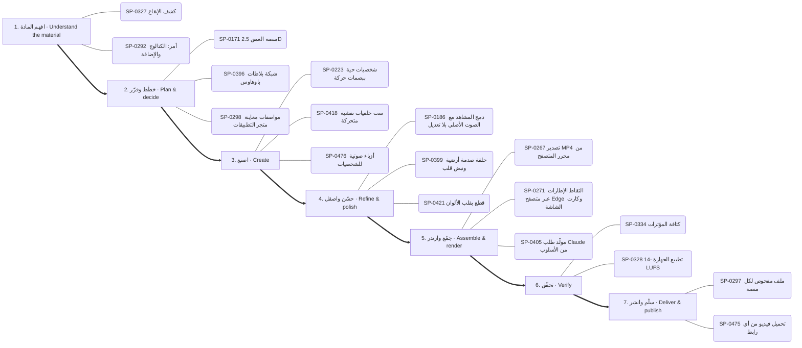

1. **افهم المادة:** SP-0327 ✅ كشف الإيقاع · SP-0292 📦 أمر: الكتالوج والإضافة
2. **خطّط وقرّر:** SP-0171 🟢 منصة العمق 2.5D · SP-0396 ✅ شبكة بلاطات باوهاوس · SP-0298 ✅ مواصفات معاينة متجر التطبيقات
3. **اصنع:** SP-0223 ✅ شخصيات حية ببصمات حركة · SP-0418 ✅ ست خلفيات نقشية متحركة · SP-0476 ✅ أزياء صوتية للشخصيات
4. **حسّن واصقل:** SP-0186 ✅ دمج المشاهد مع الصوت الأصلي بلا تعديل · SP-0399 ✅ حلقة صدمة أرضية ونبض قلب · SP-0421 🟢 قطع بقلب الألوان
5. **جمّع وارندر:** SP-0267 ✅ تصدير MP4 من محرر المتصفح · SP-0271 ✅ التقاط الإطارات عبر متصفح Edge وكارت الشاشة · SP-0405 ✅ مولّد طلب Claude من الأسلوب
6. **تحقّق:** SP-0334 🟢 كثافة المؤثرات · SP-0328 ✅ تطبيع الجهارة -14 LUFS
7. **سلّم وانشر:** SP-0297 ✅ ملف مفحوص لكل منصة · SP-0475 ✅ تحميل فيديو من أي رابط

### فيديو شرح بالمخططات والبيانات — Data/diagram explainer (`explainer`)

البوابات: `data` ← `drawing` ← `motion` ← `thinking`

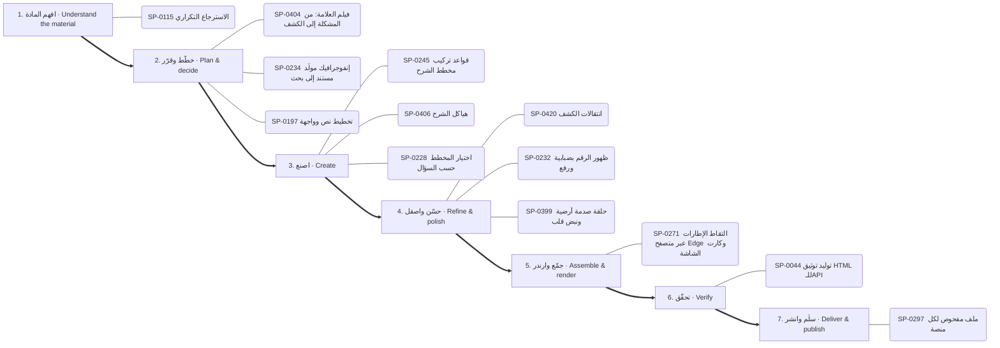

1. **افهم المادة:** SP-0115 ✅ الاسترجاع التكراري
2. **خطّط وقرّر:** SP-0404 ✅ فيلم العلامة: من المشكلة إلى الكشف · SP-0234 🟢 إنفوجرافيك مولَّد مستند إلى بحث · SP-0197 ✅ تخطيط نص وواجهة
3. **اصنع:** SP-0245 ✅ قواعد تركيب مخطط الشرح · SP-0406 ✅ هياكل الشرح · SP-0228 ✅ اختيار المخطط حسب السؤال
4. **حسّن واصقل:** SP-0420 ✅ انتقالات الكشف · SP-0232 ✅ ظهور الرقم بضبابية ورفع · SP-0399 ✅ حلقة صدمة أرضية ونبض قلب
5. **جمّع وارندر:** SP-0271 ✅ التقاط الإطارات عبر متصفح Edge وكارت الشاشة
6. **تحقّق:** SP-0044 ✅ توليد توثيق HTML للـAPI
7. **سلّم وانشر:** SP-0297 ✅ ملف مفحوص لكل منصة

### هوية وشعار وإعلان — Brand, logo & ad (`brand`)

البوابات: `drawing` ← `type` ← `motion` ← `thinking`

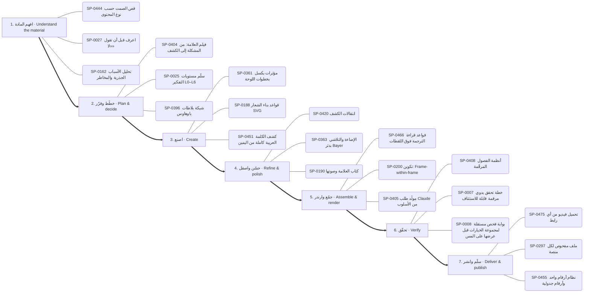

1. **افهم المادة:** SP-0444 ✅ قص الصمت حسب نوع المحتوى · SP-0027 📄 اعرف قبل أن تقول «لا» · SP-0162 📄 تحليل الأسباب الجذرية والمخاطر
2. **خطّط وقرّر:** SP-0404 ✅ فيلم العلامة: من المشكلة إلى الكشف · SP-0025 ✅ سلّم مستويات التفكير L0–L6 · SP-0396 ✅ شبكة بلاطات باوهاوس
3. **اصنع:** SP-0361 ✅ مؤثرات بكسل بخطوات اللوحة · SP-0188 ✅ قواعد بناء الشعار SVG · SP-0451 ✅ كشف الكلمة العربية كاملة من اليمين
4. **حسّن واصقل:** SP-0420 ✅ انتقالات الكشف · SP-0363 ✅ الإضاءة والتلاشي بدثر Bayer · SP-0190 🟢 كتاب العلامة وصوتها
5. **جمّع وارندر:** SP-0466 ✅ قواعد قراءة الترجمة فوق اللقطات · SP-0200 🟢 تكوين: Frame-within-frame · SP-0405 ✅ مولّد طلب Claude من الأسلوب
6. **تحقّق:** SP-0408 ✅ أنظمة الفصول المرقّمة · SP-0007 📄 خطة تحقق يدوي مرقمة قابلة للاستئناف · SP-0008 📄 بوابة فحص مستقلة لمجموعة الخيارات قبل عرضها على المستخدم
7. **سلّم وانشر:** SP-0475 ✅ تحميل فيديو من أي رابط · SP-0297 ✅ ملف مفحوص لكل منصة · SP-0455 ✅ نظام أرقام واحد وأرقام جدولية

### تحرير صور وتصميم — Photo editing & design (`photo`)

البوابات: `images` ← `software` ← `drawing`

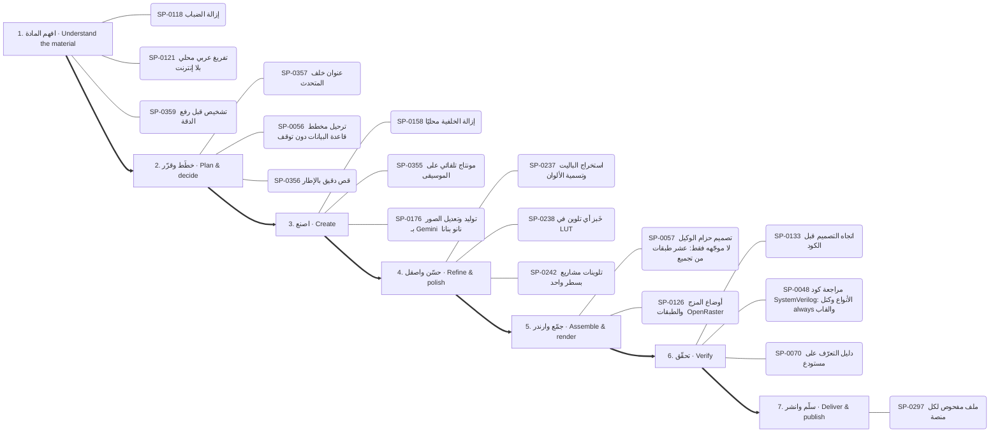

1. **افهم المادة:** SP-0118 ✅ إزالة الضباب · SP-0121 ✅ تفريغ عربي محلي بلا إنترنت · SP-0359 ✅ تشخيص قبل رفع الدقة
2. **خطّط وقرّر:** SP-0357 ✅ عنوان خلف المتحدث · SP-0056 📄 ترحيل مخطط قاعدة البيانات دون توقف · SP-0356 ✅ قص دقيق بالإطار
3. **اصنع:** SP-0158 🟢 إزالة الخلفية محليًا · SP-0355 ✅ مونتاج تلقائي على الموسيقى · SP-0176 ✅ توليد وتعديل الصور بـ Gemini (نانو بنانا)
4. **حسّن واصقل:** SP-0237 ✅ استخراج الباليت وتسمية الألوان · SP-0238 ✅ خَبز أي تلوين في LUT · SP-0242 ✅ تلوينات مشاريع بسطر واحد
5. **جمّع وارندر:** SP-0057 📄 تصميم حزام الوكيل لا موجّهه فقط: عشر طبقات من تجميع الطلب إلى الاسترداد · SP-0126 ✅ أوضاع المزج والطبقات (OpenRaster)
6. **تحقّق:** SP-0133 📄 اتجاه التصميم قبل الكود · SP-0048 📄 مراجعة كود SystemVerilog: الأنواع وكتل always والقابلية للتوليف · SP-0070 ✅ دليل التعرّف على مستودع
7. **سلّم وانشر:** SP-0297 ✅ ملف مفحوص لكل منصة

### مشهد ثلاثي الأبعاد — 3D scene (`3d-scene`)

البوابات: `3d` ← `motion` ← `quality`

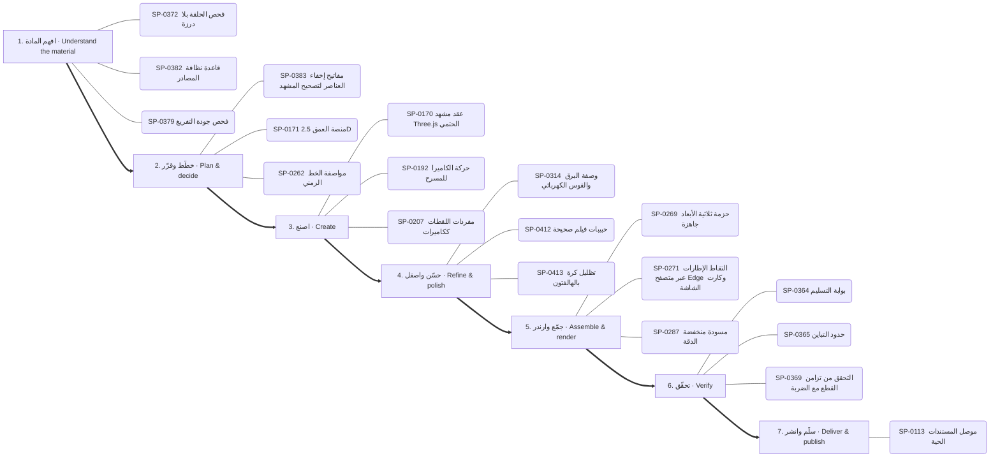

1. **افهم المادة:** SP-0372 ✅ فحص الحلقة بلا درزة · SP-0382 ✅ قاعدة نظافة المصادر · SP-0379 ✅ فحص جودة التفريغ
2. **خطّط وقرّر:** SP-0383 ✅ مفاتيح إخفاء العناصر لتصحيح المشهد · SP-0171 🟢 منصة العمق 2.5D · SP-0262 ✅ مواصفة الخط الزمني
3. **اصنع:** SP-0170 ✅ عقد مشهد Three.js الحتمي · SP-0192 ✅ حركة الكاميرا للمسرح · SP-0207 🟢 مفردات اللقطات ككاميرات
4. **حسّن واصقل:** SP-0314 ✅ وصفة البرق والقوس الكهربائي · SP-0412 ✅ حبيبات فيلم صحيحة · SP-0413 ✅ تظليل كرة بالهالفتون
5. **جمّع وارندر:** SP-0269 ✅ حزمة ثلاثية الأبعاد جاهزة · SP-0271 ✅ التقاط الإطارات عبر متصفح Edge وكارت الشاشة · SP-0287 🟢 مسودة منخفضة الدقة
6. **تحقّق:** SP-0364 ✅ بوابة التسليم · SP-0365 ✅ حدود التباين · SP-0369 ✅ التحقق من تزامن القطع مع الضربة
7. **سلّم وانشر:** SP-0113 🔑 موصل المستندات الحية

### بناء تطبيق أو موقع — Build an app or site (`app`)

البوابات: `thinking` ← `software` ← `documents` ← `quality`

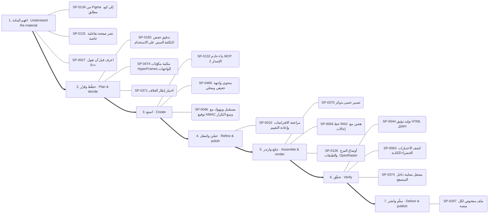

1. **افهم المادة:** SP-0134 📄 من Figma إلى كود مطابق · SP-0131 ✅ نشر صفحة تفاعلية خاصة · SP-0027 📄 اعرف قبل أن تقول «لا»
2. **خطّط وقرّر:** SP-0165 📄 تدقيق خفض التكلفة المبني على الاستخدام · SP-0474 📦 مكتبة مكوّنات HyperFrames للواجهات · SP-0371 ✅ اختيار إطار الغلاف
3. **اصنع:** SP-0132 ✅ بناء خادم MCP (الإصدار 2) · SP-0469 🟢 محتوى واجهة حقيقي ومحلي · SP-0046 📄 مستقبل ويبهوك مع توقيع HMAC ومنع التكرار
4. **حسّن واصقل:** SP-0010 📄 مراجعة الافتراضات وإعادة التقييم
5. **جمّع وارندر:** SP-0370 ✅ تصيير حتمي بدوكر · SP-0064 📄 خط RAG هجين مع إحالات · SP-0126 ✅ أوضاع المزج والطبقات (OpenRaster)
6. **تحقّق:** SP-0044 ✅ توليد توثيق HTML للـAPI · SP-0063 📄 كشف الاختبارات الخضراء الكاذبة · SP-0374 ✅ مشغل معاينة داخل المتصفح
7. **سلّم وانشر:** SP-0297 ✅ ملف مفحوص لكل منصة

### تعديل كود وإصلاح — Change or fix code (`code-change`)

البوابات: `thinking` ← `software` ← `quality`

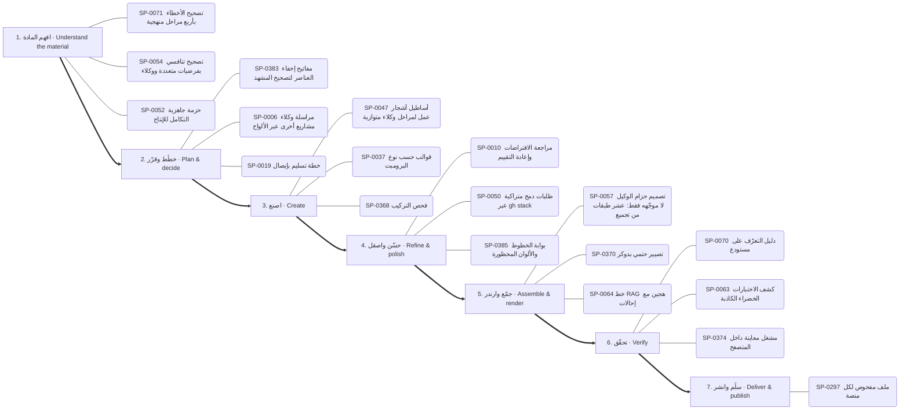

1. **افهم المادة:** SP-0071 📄 تصحيح الأخطاء بأربع مراحل منهجية · SP-0054 📄 تصحيح تنافسي بفرضيات متعددة ووكلاء · SP-0052 📄 حزمة جاهزية التكامل للإنتاج
2. **خطّط وقرّر:** SP-0383 ✅ مفاتيح إخفاء العناصر لتصحيح المشهد · SP-0006 📄 مراسلة وكلاء مشاريع أخرى عبر الألواح · SP-0019 ✅ خطة تسليم بإيصال
3. **اصنع:** SP-0047 📄 أساطيل أشجار عمل لمراحل وكلاء متوازية · SP-0037 ✅ قوالب حسب نوع البرومبت · SP-0368 ✅ فحص التركيب
4. **حسّن واصقل:** SP-0010 📄 مراجعة الافتراضات وإعادة التقييم · SP-0050 📄 طلبات دمج متراكبة عبر gh stack · SP-0385 ✅ بوابة الخطوط والألوان المحظورة
5. **جمّع وارندر:** SP-0057 📄 تصميم حزام الوكيل لا موجّهه فقط: عشر طبقات من تجميع الطلب إلى الاسترداد · SP-0370 ✅ تصيير حتمي بدوكر · SP-0064 📄 خط RAG هجين مع إحالات
6. **تحقّق:** SP-0070 ✅ دليل التعرّف على مستودع · SP-0063 📄 كشف الاختبارات الخضراء الكاذبة · SP-0374 ✅ مشغل معاينة داخل المتصفح
7. **سلّم وانشر:** SP-0297 ✅ ملف مفحوص لكل منصة

### فحص تطبيق ونقل ميزة — Investigate an app and transfer a feature (`reverse`)

البوابات: `reverse` ← `software` ← `quality`

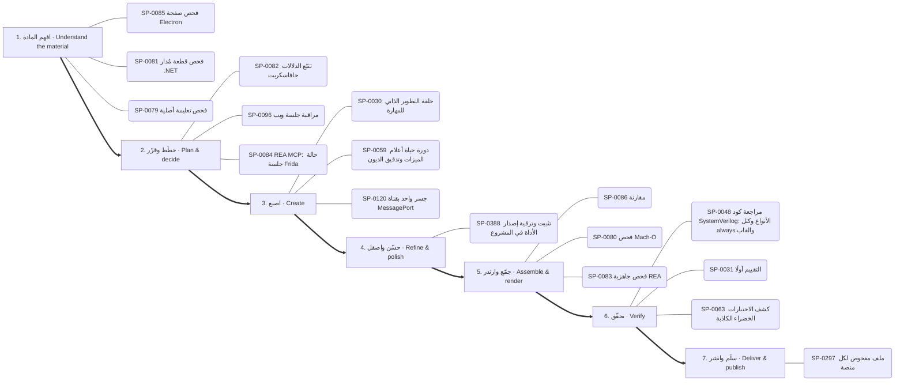

1. **افهم المادة:** SP-0085 ✅ فحص صفحة Electron · SP-0081 ✅ فحص قطعة مُدار (.NET) · SP-0079 ✅ فحص تعليمة أصلية
2. **خطّط وقرّر:** SP-0082 ✅ تتبّع الدلالات جافاسكربت · SP-0096 📦 مراقبة جلسة ويب · SP-0084 📄 REA MCP: حالة جلسة Frida
3. **اصنع:** SP-0030 ✅ حلقة التطوير الذاتي للمهارة · SP-0059 📄 دورة حياة أعلام الميزات وتدقيق الديون · SP-0120 ✅ جسر واحد بقناة MessagePort
4. **حسّن واصقل:** SP-0388 ✅ تثبيت وترقية إصدار الأداة في المشروع
5. **جمّع وارندر:** SP-0086 📦 مقارنة · SP-0080 📦 فحص Mach-O · SP-0083 ✅ فحص جاهزية REA
6. **تحقّق:** SP-0048 📄 مراجعة كود SystemVerilog: الأنواع وكتل always والقابلية للتوليف · SP-0031 📄 التقييم أولًا · SP-0063 📄 كشف الاختبارات الخضراء الكاذبة
7. **سلّم وانشر:** SP-0297 ✅ ملف مفحوص لكل منصة

### تحليل بيانات وتقرير — Data analysis report (`data-report`)

البوابات: `data` ← `documents` ← `quality`

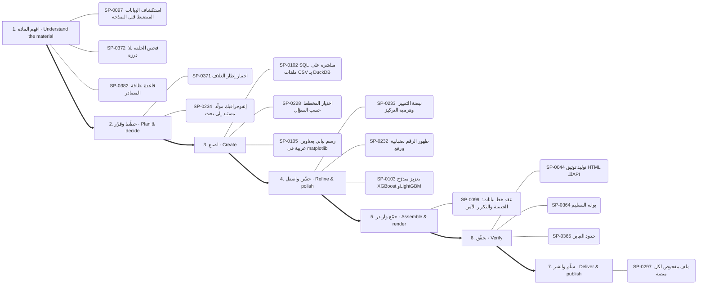

1. **افهم المادة:** SP-0097 📄 استكشاف البيانات المنضبط قبل النمذجة · SP-0372 ✅ فحص الحلقة بلا درزة · SP-0382 ✅ قاعدة نظافة المصادر
2. **خطّط وقرّر:** SP-0371 ✅ اختيار إطار الغلاف · SP-0234 🟢 إنفوجرافيك مولَّد مستند إلى بحث
3. **اصنع:** SP-0102 ✅ SQL مباشرة على ملفات CSV بـ DuckDB · SP-0228 ✅ اختيار المخطط حسب السؤال · SP-0105 ✅ رسم بياني بعناوين عربية في matplotlib
4. **حسّن واصقل:** SP-0233 🟢 نبضة التمييز وهرمية التركيز · SP-0232 ✅ ظهور الرقم بضبابية ورفع · SP-0103 ✅ تعزيز متدرّج XGBoost وLightGBM
5. **جمّع وارندر:** SP-0099 📄 عقد خط بيانات: الحبيبية والتكرار الآمن
6. **تحقّق:** SP-0044 ✅ توليد توثيق HTML للـAPI · SP-0364 ✅ بوابة التسليم · SP-0365 ✅ حدود التباين
7. **سلّم وانشر:** SP-0297 ✅ ملف مفحوص لكل منصة

### بحث وكتابة مقال — Research and write (`research-write`)

البوابات: `research` ← `thinking` ← `documents`

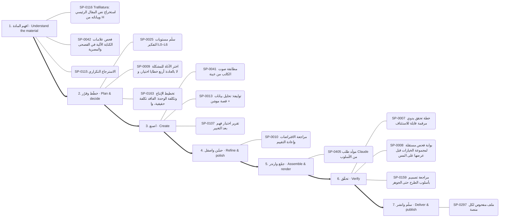

1. **افهم المادة:** SP-0116 ✅ Trafilatura: استخراج نص المقال الرئيسي وبياناته من HTML · SP-0042 ✅ فحص علامات الكتابة الآلية في الفصحى والمصرية · SP-0115 ✅ الاسترجاع التكراري
2. **خطّط وقرّر:** SP-0025 ✅ سلّم مستويات التفكير L0–L6 · SP-0009 📄 اختر الأداة للمشكلة لا بالعادة: أربع خطايا اختيار، وسلم أصلي ثم رسمي ثم طرف ثالث موثوق · SP-0163 📄 تخطيط الإنتاج وتكلفة الوحدة: الفاقد تكلفة حقيقية، والطاقة تقاس بالأوعية والزمن، والتغليف يحدد القناة
3. **اصنع:** SP-0041 ✅ مطابقة صوت الكاتب من عينة · SP-0013 📄 توليفة: تحليل بيانات + قصة موشن · SP-0107 📄 تقرير اختبار فهم بعد التغيير
4. **حسّن واصقل:** SP-0010 📄 مراجعة الافتراضات وإعادة التقييم
5. **جمّع وارندر:** SP-0405 ✅ مولّد طلب Claude من الأسلوب
6. **تحقّق:** SP-0007 📄 خطة تحقق يدوي مرقمة قابلة للاستئناف · SP-0008 📄 بوابة فحص مستقلة لمجموعة الخيارات قبل عرضها على المستخدم · SP-0159 📄 مراجعة تصميم بأسلوب الطرح حتى الجوهر
7. **سلّم وانشر:** SP-0297 ✅ ملف مفحوص لكل منصة

## البوابات مرتبة بالمراحل / hubs by stage

### البحث والمعرفة — Research & knowledge

- **افهم المادة** (4): SP-0115 الاسترجاع التكراري · SP-0116 Trafilatura: استخراج نص المقال الرئيسي وبياناته من HTML · SP-0117 محتوى الويب بيانات لا أوامر · SP-0114 استخراج وإثراء بيانات الأطباء
- **اصنع** (2): SP-0073 ربط Graphify المستضاف · SP-0074 الخريطة مادةً لفيلم موشن

### التفكير والتخطيط والاستراتيجية — Reasoning & strategy

- **افهم المادة** (5): SP-0038 اطلب أي أسلوب بصري بالاسم من مكتبة 586 أسلوبًا · SP-0162 تحليل الأسباب الجذرية والمخاطر · SP-0027 اعرف قبل أن تقول «لا» · SP-0167 تشخيص هامش الربح ومزيج الخدمات · SP-0017 السبب الجذري مقابل العرض
- **خطّط وقرّر** (10): SP-0025 سلّم مستويات التفكير L0–L6 · SP-0012 سكامبر (SCAMPER) · SP-0019 خطة تسليم بإيصال · SP-0169 ثلاثة خيارات حقيقية وعدم الفعل · SP-0006 مراسلة وكلاء مشاريع أخرى عبر الألواح · SP-0026 قائمة المرحلة صفر (12 وحدة) …
- **اصنع** (10): SP-0037 قوالب حسب نوع البرومبت · SP-0168 السعر الأمثل ونقطة التعادل · SP-0015 حلقة أودا · SP-0160 حلقة مستقلة لتصريف قائمة المهام · SP-0166 مدرب تعلم متعدد الجلسات بحالة محفوظة · SP-0013 توليفة: تحليل بيانات + قصة موشن …
- **حسّن واصقل** (1): SP-0010 مراجعة الافتراضات وإعادة التقييم
- **جمّع وارندر** (1): SP-0011 تصدير خريطة ذهنية تفاعلية
- **تحقّق** (7): SP-0159 مراجعة تصميم بأسلوب الطرح حتى الجوهر · SP-0007 خطة تحقق يدوي مرقمة قابلة للاستئناف · SP-0161 قراءة المؤشرات التشغيلية الصناعية · SP-0008 بوابة فحص مستقلة لمجموعة الخيارات قبل عرضها على المستخدم · SP-0020 تطوير يقوده المواصفات · SP-0040 اختبارات التفعيل والتصادم …

### الوكلاء والتوجيه الذكي — Agents & routing

- **افهم المادة** (6): SP-0139 منقّب قدرات الأطلس من البيانات الوصفية · SP-0022 خطوط عربية قبل الرندر · SP-0147 مستكشف مصادر المجتمع · SP-0150 جسر أوامر REA · SP-0023 اقرأ قائمة أدواتك · SP-0151 فرز المثبّتات
- **خطّط وقرّر** (2): SP-0143 مختبر البرومبت · SP-0024 بطاقة القدرة والإيصال
- **اصنع** (10): SP-0140 أكاديمية الرسم والدروس المبنية على مصادر · SP-0144 خريطة ترتيب المهارة · SP-0021 اعرف قبل أن تقول لا · SP-0145 تدقيق أدلة الكتالوج · SP-0148 محوّل الترجمات إلى توقيت الكلمات · SP-0149 مختبر مطابقة الخطوط العربية …
- **جمّع وارندر** (3): SP-0142 محرك إعادة بناء المونتاج المرجعي · SP-0141 مُصرِّف حركة SVG المتزامنة مع الصوت · SP-0146 جسر Blender الآمن
- **تحقّق** (1): SP-0002 تأليف مهارة

### البرمجة وبناء التطبيقات — Software & applications

- **افهم المادة** (11): SP-0118 إزالة الضباب · SP-0121 تفريغ عربي محلي بلا إنترنت · SP-0128 فهرسة المكتبة والبحث · SP-0131 نشر صفحة تفاعلية خاصة · SP-0134 من Figma إلى كود مطابق · SP-0049 إدارة مشاريع بايثون والسكربتات ببرنامج uv …
- **خطّط وقرّر** (4): SP-0056 ترحيل مخطط قاعدة البيانات دون توقف · SP-0058 أنماط معمارية لـ GDScript في Godot 4 · SP-0137 خط وكلاء بأدوار ومراحل وأقفال كتابة واستئناف · SP-0474 مكتبة مكوّنات HyperFrames للواجهات
- **اصنع** (25): SP-0122 علامات الإيقاع · SP-0124 نمو نباتي وزخرفي · SP-0123 رمز QR بشعار · SP-0467 المؤشر بطلًا · SP-0125 رسم زيتي وحبر ورصاص · SP-0120 جسر واحد بقناة MessagePort …
- **حسّن واصقل** (1): SP-0050 طلبات دمج متراكبة عبر gh stack
- **جمّع وارندر** (4): SP-0126 أوضاع المزج والطبقات (OpenRaster) · SP-0129 جرد قدرات Blender الحي · SP-0057 تصميم حزام الوكيل لا موجّهه فقط: عشر طبقات من تجميع الطلب إلى الاسترداد · SP-0064 خط RAG هجين مع إحالات
- **تحقّق** (10): SP-0070 دليل التعرّف على مستودع · SP-0473 من التحميل إلى علامة صح · SP-0045 تشخيص فشل GitHub Actions عبر gh · SP-0048 مراجعة كود SystemVerilog: الأنواع وكتل always والقابلية للتوليف · SP-0136 جلسات Playwright مسماة بمخرجات على القرص · SP-0063 كشف الاختبارات الخضراء الكاذبة …
- **سلّم وانشر** (2): SP-0138 ضبط مجمع الاتصالات وموثوقية قاعدة البيانات · SP-0130 مشغل فيديو عمودي بالسحب

### الرسم والأشكال والتصميم — Drawing & visual composition

- **خطّط وقرّر** (1): SP-0396 شبكة بلاطات باوهاوس
- **اصنع** (21): SP-0302 فيلم يد مرسومة حتمي بـmake_frame(t) · SP-0188 قواعد بناء الشعار SVG · SP-0395 تحويل SVG بإضافة MorphSVG · SP-0245 قواعد تركيب مخطط الشرح · SP-0361 مؤثرات بكسل بخطوات اللوحة · SP-0397 انفجار خطوط شعاعي …
- **حسّن واصقل** (6): SP-0398 دمج ونحت وتقاطع ناعم · SP-0363 الإضاءة والتلاشي بدثر Bayer · SP-0399 حلقة صدمة أرضية ونبض قلب · SP-0190 كتاب العلامة وصوتها · SP-0191 تشريح بطاقة الختام · SP-0402 تجمع الصلصال بالكرات

### الصور والتحرير والتوليد — Images & photo editing

- **افهم المادة** (4): SP-0155 صوت PipeWire داخل الحاويات · SP-0359 تشخيص قبل رفع الدقة · SP-0358 مجمع لقطات بأسئلة بحث ثنائية اللغة · SP-0180 مقدمات الأسلوب المتطابقة بايتًا
- **خطّط وقرّر** (2): SP-0356 قص دقيق بالإطار · SP-0357 عنوان خلف المتحدث
- **اصنع** (12): SP-0175 مصنع البرومبت: مواصفة واحدة ← تسع منصات · SP-0355 مونتاج تلقائي على الموسيقى · SP-0157 ضغط الصور ومقارنة الجودة · SP-0156 التعرف على العربية والإنجليزية بـ tesseract · SP-0176 توليد وتعديل الصور بـ Gemini (نانو بنانا) · SP-0158 إزالة الخلفية محليًا …
- **حسّن واصقل** (8): SP-0237 استخراج الباليت وتسمية الألوان · SP-0238 خَبز أي تلوين في LUT · SP-0239 التعريض حسب وقت اليوم · SP-0240 خلفية بقع ضبابية متحركة · SP-0241 توازن الأبيض بالبكسلات المحايدة · SP-0242 تلوينات مشاريع بسطر واحد …
- **جمّع وارندر** (2): SP-0154 تريلر من لعب آلي حقيقي · SP-0182 خط إنتاج من موضوع إلى فيديو قصير
- **سلّم وانشر** (1): SP-0360 إعدادات تسجيل الشاشة

### الثري دي والمحاكاة والرندر — 3D & rendering

- **افهم المادة** (1): SP-0292 أمر: الكتالوج والإضافة
- **خطّط وقرّر** (7): SP-0262 مواصفة الخط الزمني · SP-0171 منصة العمق 2.5D · SP-0284 محول إطارات CSS · SP-0285 التسلسل والسلاسل والتحميل المسبق · SP-0288 حلقة الإنتاج كمخطط اعتمادات · SP-0273 قائمة قواعد Remotion …
- **اصنع** (26): SP-0170 عقد مشهد Three.js الحتمي · SP-0265 استوديو KOSIF Motion Web المحلي · SP-0266 مشروع أنيميشن جديد · SP-0275 خيار التقنية: canvas · SP-0350 مطر وضباب ومطر الغيمة · SP-0351 حقل curl تحليلي خالٍ من التباعد …
- **حسّن واصقل** (14): SP-0308 توهج النص النيوني بثلاثة ظلال لكل كلمة · SP-0309 قراءة إضاءة صورة مرجعية · SP-0412 حبيبات فيلم صحيحة · SP-0349 انفجار ببذرة وجاذبية · SP-0413 تظليل كرة بالهالفتون · SP-0310 مرور العدسة «مصوَّر لا مرسوم» …
- **جمّع وارندر** (15): SP-0264 معاينة مسودة · SP-0261 رندر HTML حتمي · SP-0267 تصدير MP4 من محرر المتصفح · SP-0268 ترميز GPU بـ NVENC · SP-0279 عشوائية ببذرة · SP-0282 التصيير بمحركين …

### الموشن والمونتاج والسينما — Motion & video editing

- **افهم المادة** (1): SP-0444 قص الصمت حسب نوع المحتوى
- **خطّط وقرّر** (20): SP-0252 إعادة الاستهداف بالنابض · SP-0404 فيلم العلامة: من المشكلة إلى الكشف · SP-0299 صيغ الصوت للحلقات وتراخيص الموسيقى · SP-0300 بريف الصورة المصغرة: 3 أفكار واختبار A/B · SP-0197 تخطيط نص وواجهة · SP-0256 أربع تسارعات مسماة فقط …
- **اصنع** (40): SP-0223 شخصيات حية ببصمات حركة · SP-0192 حركة الكاميرا للمسرح · SP-0253 ميزانيات التتابع · SP-0224 ورقة تصميم الشخصية واختبار الظل · SP-0406 هياكل الشرح · SP-0193 دفع الكاميرا …
- **حسّن واصقل** (25): SP-0420 انتقالات الكشف · SP-0251 تمويه السرعة الاتجاهي · SP-0254 رموز التسارع حسب الدور (17 منحنى) · SP-0198 عمق الميدان وسحب التركيز · SP-0439 اختيار الانتقال حسب الطاقة · SP-0423 انتقال CSS: حرق الفيلم …
- **جمّع وارندر** (2): SP-0405 مولّد طلب Claude من الأسلوب · SP-0200 تكوين: Frame-within-frame
- **تحقّق** (1): SP-0408 أنظمة الفصول المرقّمة
- **سلّم وانشر** (2): SP-0297 ملف مفحوص لكل منصة · SP-0475 تحميل فيديو من أي رابط

### الصوت والموسيقى والتعليق — Audio & voice

- **افهم المادة** (3): SP-0327 كشف الإيقاع · SP-0184 فخ نماذج .en · SP-0337 توقف الشريط ووقت الرصاصة ولمسات الخلل
- **خطّط وقرّر** (8): SP-0326 شبكة الإيقاع · SP-0325 قطع على الإيقاع · SP-0329 أعمدة طيف وموجة صوتية في ريموشن · SP-0332 موجز الأغنية ومدد الإيقاع · SP-0343 وادٍ من المخطط الطيفي · SP-0341 واجهة عداد البارات الإيقاعية …
- **اصنع** (16): SP-0324 قنوات الصوت كمحرك للحركة · SP-0323 مكتبة المؤثرات · SP-0476 أزياء صوتية للشخصيات · SP-0339 أجواء صوتية مولدة · SP-0340 مقام lydian · SP-0185 فيلم كلمات من صوت (أغنية، شعر، دعاء) …
- **حسّن واصقل** (5): SP-0322 خفض الموسيقى تحت الصوت · SP-0183 توقيت الكلمات حسب الطول · SP-0186 دمج المشاهد مع الصوت الأصلي بلا تعديل · SP-0335 قناة المزج · SP-0187 الأشرطة السفلية
- **تحقّق** (2): SP-0328 تطبيع الجهارة -14 LUFS · SP-0334 كثافة المؤثرات

### الخطوط والنصوص العربية واللاتينية — Typography & localization

- **خطّط وقرّر** (1): SP-0456 علامة استفهام عملاقة مفرّغة
- **اصنع** (13): SP-0451 كشف الكلمة العربية كاملة من اليمين · SP-0033 CAMeL Tools: تقطيع النص العربي واستخراج الجذور والتشكيل وتحديد · SP-0453 خريطة أصوات الخطوط · SP-0452 أغطية تدرّج لقراءة النص فوق الفيديو · SP-0459 أنظمة الأصوات الطباعية · SP-0454 سطور تتكدس وتخفت …
- **حسّن واصقل** (1): SP-0462 عنوان بلونين وكلمة لون
- **جمّع وارندر** (1): SP-0466 قواعد قراءة الترجمة فوق اللقطات
- **تحقّق** (1): SP-0034 مراجعة المطابقة النحوية بعد التعديل
- **سلّم وانشر** (1): SP-0455 نظام أرقام واحد وأرقام جدولية

### البيانات والرسوم والمواقع — Data & visual analytics

- **افهم المادة** (3): SP-0097 استكشاف البيانات المنضبط قبل النمذجة · SP-0098 من اللغة الطبيعية إلى استعلام MongoDB · SP-0100 تحليل النسب والانحرافات والتوقع المتجدد
- **خطّط وقرّر** (1): SP-0234 إنفوجرافيك مولَّد مستند إلى بحث
- **اصنع** (15): SP-0102 SQL مباشرة على ملفات CSV بـ DuckDB · SP-0228 اختيار المخطط حسب السؤال · SP-0104 حل رياضي دقيق بـ sympy · SP-0229 حلقة التقدم المخروطية · SP-0105 رسم بياني بعناوين عربية في matplotlib · SP-0316 هل نحتاج خريطة أصلًا …
- **حسّن واصقل** (4): SP-0103 تعزيز متدرّج XGBoost وLightGBM · SP-0232 ظهور الرقم بضبابية ورفع · SP-0233 نبضة التمييز وهرمية التركيز · SP-0320 كرة أرضية بأقواس اتصال
- **جمّع وارندر** (1): SP-0099 عقد خط بيانات: الحبيبية والتكرار الآمن

### المستندات والكتابة — Documents & writing

- **افهم المادة** (2): SP-0042 فحص علامات الكتابة الآلية في الفصحى والمصرية · SP-0110 جاهزية الموقع لـ llms.txt وزواحف AI
- **خطّط وقرّر** (1): SP-0108 حزمة تشخيص مُنقّحة وآمنة للدعم
- **اصنع** (9): SP-0111 تحويل Office إلى PDF دفعة واحدة · SP-0112 PlantUML: توليد مخططات UML من نص · SP-0043 قفل الاقتباس المباشر · SP-0041 مطابقة صوت الكاتب من عينة · SP-0106 تدقيق انحراف التوثيق عن الكود لكل بُعد · SP-0035 تصميم الأيقونات بالتشابه والإغلاق البصري …
- **سلّم وانشر** (1): SP-0113 موصل المستندات الحية

### الاختبارات والجودة والأمان — QA & security

- **افهم المادة** (12): SP-0367 قائمة جودة الحركة · SP-0372 فحص الحلقة بلا درزة · SP-0386 فحص المقروئية · SP-0378 دراسة فيلم مرجعي · SP-0382 قاعدة نظافة المصادر · SP-0376 قياس الجهارة والذروة …
- **خطّط وقرّر** (2): SP-0371 اختيار إطار الغلاف · SP-0383 مفاتيح إخفاء العناصر لتصحيح المشهد
- **اصنع** (6): SP-0368 فحص التركيب · SP-0030 حلقة التطوير الذاتي للمهارة · SP-0075 سلّم الموافقة وأقل تصعيد · SP-0375 الحكم جيف · SP-0391 حد الوميض الآمن · SP-0394 فخ إعادة الإسناد في TSL
- **حسّن واصقل** (3): SP-0388 تثبيت وترقية إصدار الأداة في المشروع · SP-0385 بوابة الخطوط والألوان المحظورة · SP-0389 أمر: مقارنة
- **جمّع وارندر** (2): SP-0370 تصيير حتمي بدوكر · SP-0393 طبقة الرسوم وحدها من رندرين
- **تحقّق** (13): SP-0364 بوابة التسليم · SP-0044 توليد توثيق HTML للـAPI · SP-0365 حدود التباين · SP-0374 مشغل معاينة داخل المتصفح · SP-0366 ورقة المراجعة · SP-0369 التحقق من تزامن القطع مع الضربة …

### التحليل العكسي وفحص البرامج — Reverse engineering

- **افهم المادة** (9): SP-0081 فحص قطعة مُدار (.NET) · SP-0090 فرز المثبّت قبل REA · SP-0089 تحليل حزمة ويب · SP-0092 فحص عميل pcap · SP-0079 فحص تعليمة أصلية · SP-0085 فحص صفحة Electron …
- **خطّط وقرّر** (3): SP-0082 تتبّع الدلالات جافاسكربت · SP-0084 REA MCP: حالة جلسة Frida · SP-0096 مراقبة جلسة ويب
- **اصنع** (2): SP-0094 فك ترميز تسجيل إشارة · SP-0093 فتح مشروع JEB
- **جمّع وارندر** (6): SP-0083 فحص جاهزية REA · SP-0078 فحص عميل ADB · SP-0080 فحص Mach-O · SP-0086 مقارنة · SP-0087 REA MCP: أمر تصحيح Rizin · SP-0091 REA MCP: حالة جلسة GDB

### قدرات مساندة غير مصنفة — Other supporting capabilities

- **افهم المادة** (1): SP-0346 مكتبة KOSIF Atlas
- **خطّط وقرّر** (1): SP-0348 ملف المشروع المحمول وإعادة الربط
- **اصنع** (1): SP-0347 خادم MCP للاستوديو (22 أداة)

---
_مولَّد آليًا من data/superpowers.json وdata/hubs_index.json وdata/task_maps.json._
