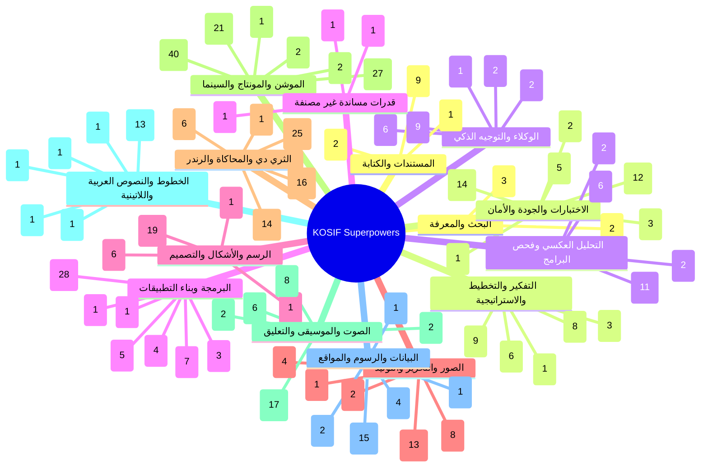
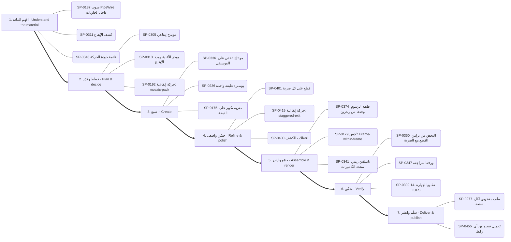
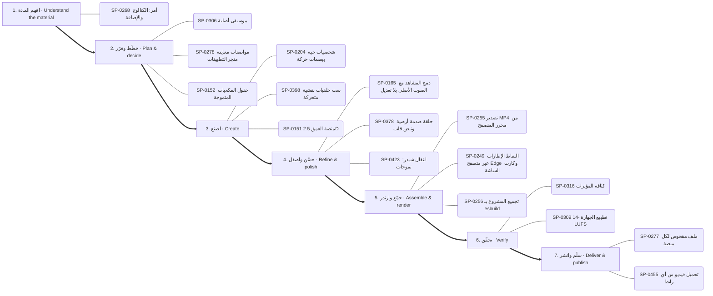
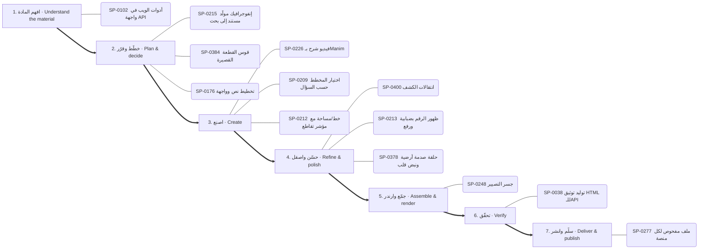
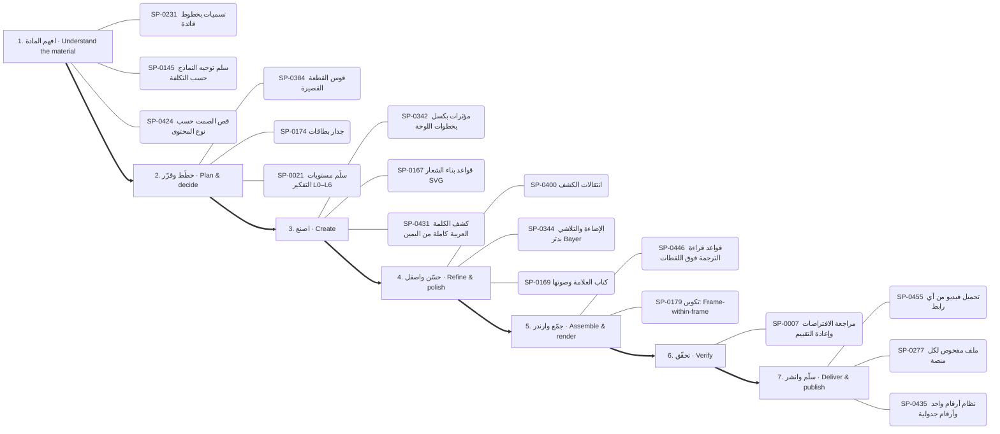
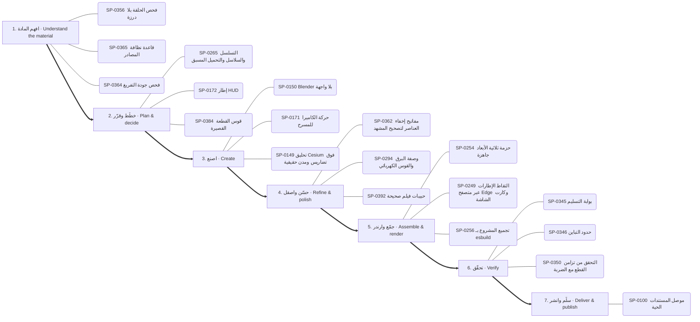
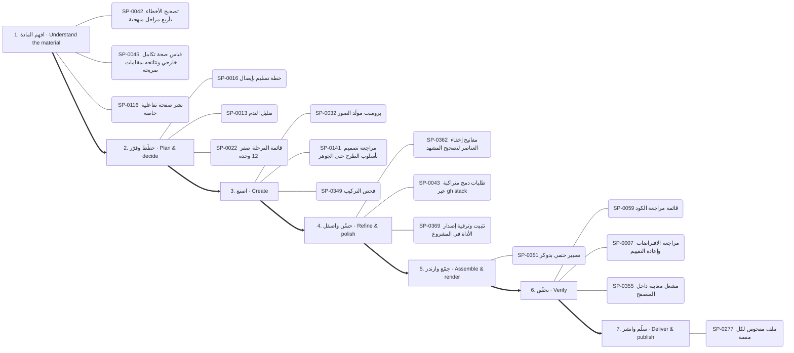
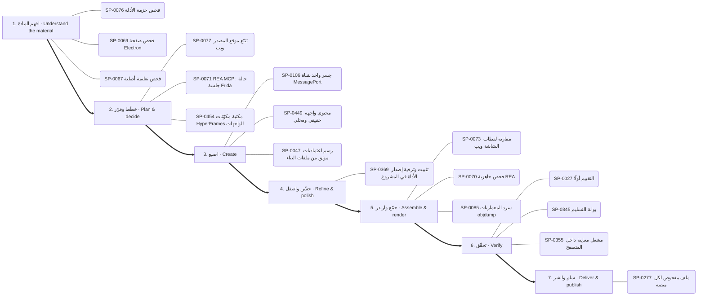
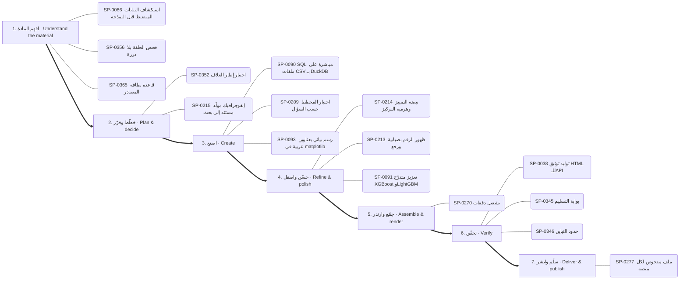
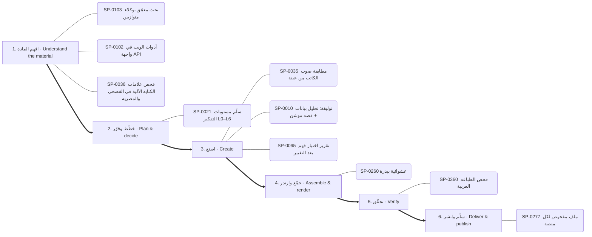

# الخريطة الذهنية للقدرات — Capability mind map

<!-- generated by scripts/capability_mindmap.py build -->

كل قدرة مرتبة بحسب **مرحلة المهمة** التي تخدمها، ثم كل بوابة مقسمة بالمراحل، ثم خرائط جاهزة لمهام شائعة. اتبع المراحل بالترتيب: افهم ← خطّط ← اصنع ← حسّن ← جمّع وارندر ← تحقّق ← سلّم.

    python3 scripts/capability_mindmap.py task "<المهمة>"     # خريطة مرحلية لأي مهمة
    python3 scripts/capability_mindmap.py task reels-edit      # خريطة جاهزة

## الفهرس / contents

- المراحل السبع / the seven stages
- الخريطة الكبرى / the big map
- خرائط المهام الجاهزة / ready task maps
- البوابات مرتبة بالمراحل / hubs by stage

## المراحل السبع / the seven stages

1. **افهم المادة — Understand the material** · 784 قدرة ذرية
2. **خطّط وقرّر — Plan & decide** · 906 قدرة ذرية
3. **اصنع — Create** · 1891 قدرة ذرية
4. **حسّن واصقل — Refine & polish** · 882 قدرة ذرية
5. **جمّع وارندر — Assemble & render** · 476 قدرة ذرية
6. **تحقّق — Verify** · 464 قدرة ذرية
7. **سلّم وانشر — Deliver & publish** · 178 قدرة ذرية

## الخريطة الكبرى / the big map

## خرائط المهام الجاهزة / ready task maps

### فيديو موشن جرافيك بصوت — Motion-graphics film with voice (`motion-film`)

البوابات: `thinking` ← `audio` ← `type` ← `motion` ← `drawing` ← `3d` ← `quality`

1. **افهم المادة:** SP-0348 ✅ قائمة جودة الحركة · SP-0163 ✅ تفريغ HyperFrames · SP-0026 ✅ حلقة التطوير الذاتي للمهارة
2. **خطّط وقرّر:** SP-0278 ✅ مواصفات معاينة متجر التطبيقات · SP-0310 🟢 أعمدة طيف وموجة صوتية في ريموشن · SP-0279 ✅ صيغ الصوت للحلقات وتراخيص الموسيقى
3. **اصنع:** SP-0431 ✅ كشف الكلمة العربية كاملة من اليمين · SP-0433 ✅ خريطة أصوات الخطوط · SP-0284 ✅ رسوم خطية صغيرة فوق الفيديو
4. **حسّن واصقل:** SP-0302 ✅ خفض الموسيقى تحت الصوت · SP-0288 ✅ توهج النص النيوني بثلاثة ظلال لكل كلمة · SP-0330 ✅ انفجار ببذرة وجاذبية
5. **جمّع وارندر:** SP-0242 ✅ هايبر فريمز: HTML كمصدر للفيديو · SP-0374 ✅ طبقة الرسوم وحدها من رندرين · SP-0244 ✅ معاينة مسودة
6. **تحقّق:** SP-0360 ✅ فحص الطباعة العربية · SP-0345 ✅ بوابة التسليم · SP-0346 ✅ حدود التباين
7. **سلّم وانشر:** SP-0277 ✅ ملف مفحوص لكل منصة · SP-0455 ✅ تحميل فيديو من أي رابط · SP-0435 ✅ نظام أرقام واحد وأرقام جدولية

### مونتاج ريلز على الإيقاع — Beat-synced reels edit (`reels-edit`)

البوابات: `motion` ← `audio` ← `images` ← `quality`

1. **افهم المادة:** SP-0137 ✅ صوت PipeWire داخل الحاويات · SP-0311 ✅ كشف الإيقاع · SP-0348 ✅ قائمة جودة الحركة
2. **خطّط وقرّر:** SP-0305 🟢 مونتاج إيقاعي · SP-0313 ✅ موجز الأغنية ومدد الإيقاع · SP-0192 🟢 حركة إيقاعية: mosaic-pack
3. **اصنع:** SP-0336 ✅ مونتاج تلقائي على الموسيقى · SP-0236 ✅ بوسترة طبقة واحدة · SP-0175 ✅ ضربة تكبير على النبضة
4. **حسّن واصقل:** SP-0401 ✅ قطع على كل ضربة · SP-0419 🟢 حركة إيقاعية: staggered-exit · SP-0400 ✅ انتقالات الكشف
5. **جمّع وارندر:** SP-0374 ✅ طبقة الرسوم وحدها من رندرين · SP-0179 🟢 تكوين: Frame-within-frame · SP-0341 🟢 تايملاين زمني متعدد الكاميرات
6. **تحقّق:** SP-0350 ✅ التحقق من تزامن القطع مع الضربة · SP-0347 ✅ ورقة المراجعة · SP-0309 ✅ تطبيع الجهارة -14 LUFS
7. **سلّم وانشر:** SP-0277 ✅ ملف مفحوص لكل منصة · SP-0455 ✅ تحميل فيديو من أي رابط

### رسم شخصية وتحريكها — Draw and animate a character (`character`)

البوابات: `drawing` ← `motion` ← `audio` ← `3d`

1. **افهم المادة:** SP-0268 📦 أمر: الكتالوج والإضافة
2. **خطّط وقرّر:** SP-0306 ✅ موسيقى أصلية · SP-0278 ✅ مواصفات معاينة متجر التطبيقات · SP-0152 ✅ حقول المكعبات المتموجة
3. **اصنع:** SP-0204 ✅ شخصيات حية ببصمات حركة · SP-0398 ✅ ست خلفيات نقشية متحركة · SP-0151 🟢 منصة العمق 2.5D
4. **حسّن واصقل:** SP-0165 ✅ دمج المشاهد مع الصوت الأصلي بلا تعديل · SP-0378 ✅ حلقة صدمة أرضية ونبض قلب · SP-0423 🟢 انتقال شيدر: تموجات
5. **جمّع وارندر:** SP-0255 ✅ تصدير MP4 من محرر المتصفح · SP-0249 ✅ التقاط الإطارات عبر متصفح Edge وكارت الشاشة · SP-0256 ✅ تجميع المشروع بـ esbuild
6. **تحقّق:** SP-0316 🟢 كثافة المؤثرات · SP-0309 ✅ تطبيع الجهارة -14 LUFS
7. **سلّم وانشر:** SP-0277 ✅ ملف مفحوص لكل منصة · SP-0455 ✅ تحميل فيديو من أي رابط

### فيديو شرح بالمخططات والبيانات — Data/diagram explainer (`explainer`)

البوابات: `data` ← `drawing` ← `motion` ← `thinking`

1. **افهم المادة:** SP-0102 ✅ أدوات الويب في واجهة API
2. **خطّط وقرّر:** SP-0215 🟢 إنفوجرافيك مولَّد مستند إلى بحث · SP-0384 ✅ قوس القطعة القصيرة · SP-0176 ✅ تخطيط نص وواجهة
3. **اصنع:** SP-0226 ✅ فيديو شرح بـManim · SP-0209 ✅ اختيار المخطط حسب السؤال · SP-0212 ✅ خط/مساحة مع مؤشر تقاطع
4. **حسّن واصقل:** SP-0400 ✅ انتقالات الكشف · SP-0213 ✅ ظهور الرقم بضبابية ورفع · SP-0378 ✅ حلقة صدمة أرضية ونبض قلب
5. **جمّع وارندر:** SP-0248 ✅ جسر التصيير
6. **تحقّق:** SP-0038 ✅ توليد توثيق HTML للـAPI
7. **سلّم وانشر:** SP-0277 ✅ ملف مفحوص لكل منصة

### هوية وشعار وإعلان — Brand, logo & ad (`brand`)

البوابات: `drawing` ← `type` ← `motion` ← `thinking`

1. **افهم المادة:** SP-0231 🟢 تسميات بخطوط قائدة · SP-0145 📄 سلم توجيه النماذج حسب التكلفة · SP-0424 ✅ قص الصمت حسب نوع المحتوى
2. **خطّط وقرّر:** SP-0384 ✅ قوس القطعة القصيرة · SP-0174 🟢 جدار بطاقات · SP-0021 ✅ سلّم مستويات التفكير L0–L6
3. **اصنع:** SP-0342 ✅ مؤثرات بكسل بخطوات اللوحة · SP-0167 ✅ قواعد بناء الشعار SVG · SP-0431 ✅ كشف الكلمة العربية كاملة من اليمين
4. **حسّن واصقل:** SP-0400 ✅ انتقالات الكشف · SP-0344 ✅ الإضاءة والتلاشي بدثر Bayer · SP-0169 🟢 كتاب العلامة وصوتها
5. **جمّع وارندر:** SP-0446 ✅ قواعد قراءة الترجمة فوق اللقطات · SP-0179 🟢 تكوين: Frame-within-frame
6. **تحقّق:** SP-0007 📄 مراجعة الافتراضات وإعادة التقييم
7. **سلّم وانشر:** SP-0455 ✅ تحميل فيديو من أي رابط · SP-0277 ✅ ملف مفحوص لكل منصة · SP-0435 ✅ نظام أرقام واحد وأرقام جدولية

### تحرير صور وتصميم — Photo editing & design (`photo`)

البوابات: `images` ← `software` ← `drawing`

1. **افهم المادة:** SP-0104 ✅ إزالة الضباب · SP-0340 ✅ تشخيص قبل رفع الدقة · SP-0113 ✅ فهرسة المكتبة والبحث
2. **خطّط وقرّر:** SP-0338 ✅ عنوان خلف المتحدث · SP-0051 📄 ترحيل مخطط قاعدة البيانات دون توقف · SP-0337 ✅ قص دقيق بالإطار
3. **اصنع:** SP-0140 🟢 إزالة الخلفية محليًا · SP-0336 ✅ مونتاج تلقائي على الموسيقى · SP-0155 ✅ توليد وتعديل الصور بـ Gemini (نانو بنانا)
4. **حسّن واصقل:** SP-0218 ✅ استخراج الباليت وتسمية الألوان · SP-0219 ✅ خَبز أي تلوين في LUT · SP-0223 ✅ تلوينات مشاريع بسطر واحد
5. **جمّع وارندر:** SP-0111 ✅ أوضاع المزج والطبقات (OpenRaster)
6. **تحقّق:** SP-0059 ✅ قائمة مراجعة الكود · SP-0040 📄 محسّن تكلفة مشغلات GitHub Actions · SP-0055 📄 اختبار العقود الذكية بهاردهات وفاوندري
7. **سلّم وانشر:** SP-0277 ✅ ملف مفحوص لكل منصة

### مشهد ثلاثي الأبعاد — 3D scene (`3d-scene`)

البوابات: `3d` ← `motion` ← `quality`

1. **افهم المادة:** SP-0356 ✅ فحص الحلقة بلا درزة · SP-0365 ✅ قاعدة نظافة المصادر · SP-0364 ✅ فحص جودة التفريغ
2. **خطّط وقرّر:** SP-0265 ✅ التسلسل والسلاسل والتحميل المسبق · SP-0172 📦 إطار HUD · SP-0384 ✅ قوس القطعة القصيرة
3. **اصنع:** SP-0150 ✅ Blender بلا واجهة · SP-0171 ✅ حركة الكاميرا للمسرح · SP-0149 🟢 تحليق Cesium فوق تضاريس ومدن حقيقية
4. **حسّن واصقل:** SP-0362 ✅ مفاتيح إخفاء العناصر لتصحيح المشهد · SP-0294 ✅ وصفة البرق والقوس الكهربائي · SP-0392 ✅ حبيبات فيلم صحيحة
5. **جمّع وارندر:** SP-0254 ✅ حزمة ثلاثية الأبعاد جاهزة · SP-0249 ✅ التقاط الإطارات عبر متصفح Edge وكارت الشاشة · SP-0256 ✅ تجميع المشروع بـ esbuild
6. **تحقّق:** SP-0345 ✅ بوابة التسليم · SP-0346 ✅ حدود التباين · SP-0350 ✅ التحقق من تزامن القطع مع الضربة
7. **سلّم وانشر:** SP-0100 🔑 موصل المستندات الحية

### بناء تطبيق أو موقع — Build an app or site (`app`)

البوابات: `thinking` ← `software` ← `documents` ← `quality`

1. **افهم المادة:** SP-0118 📄 من Figma إلى كود مطابق · SP-0063 ✅ سلّم الموافقة وأقل تصعيد · SP-0023 📄 اعرف قبل أن تقول «لا»
2. **خطّط وقرّر:** SP-0142 📄 تدقيق خفض التكلفة المبني على الاستخدام · SP-0454 📦 مكتبة مكوّنات HyperFrames للواجهات · SP-0352 ✅ اختيار إطار الغلاف
3. **اصنع:** SP-0117 ✅ بناء خادم MCP (الإصدار 2) · SP-0060 ✅ ابحث قبل أن تبني · SP-0449 🟢 محتوى واجهة حقيقي ومحلي
4. **حسّن واصقل:** SP-0362 ✅ مفاتيح إخفاء العناصر لتصحيح المشهد
5. **جمّع وارندر:** SP-0351 ✅ تصيير حتمي بدوكر · SP-0111 ✅ أوضاع المزج والطبقات (OpenRaster)
6. **تحقّق:** SP-0055 📄 اختبار العقود الذكية بهاردهات وفاوندري · SP-0038 ✅ توليد توثيق HTML للـAPI · SP-0355 ✅ مشغل معاينة داخل المتصفح
7. **سلّم وانشر:** SP-0277 ✅ ملف مفحوص لكل منصة

### تعديل كود وإصلاح — Change or fix code (`code-change`)

البوابات: `thinking` ← `software` ← `quality`

1. **افهم المادة:** SP-0042 📄 تصحيح الأخطاء بأربع مراحل منهجية · SP-0045 📄 قياس صحة تكامل خارجي ونتائجه بمقامات صريحة · SP-0116 ✅ نشر صفحة تفاعلية خاصة
2. **خطّط وقرّر:** SP-0016 ✅ خطة تسليم بإيصال · SP-0013 📄 تقليل الندم · SP-0022 📄 قائمة المرحلة صفر (12 وحدة)
3. **اصنع:** SP-0032 ✅ برومبت مولّد الصور · SP-0141 📄 مراجعة تصميم بأسلوب الطرح حتى الجوهر · SP-0349 ✅ فحص التركيب
4. **حسّن واصقل:** SP-0362 ✅ مفاتيح إخفاء العناصر لتصحيح المشهد · SP-0043 📄 طلبات دمج متراكبة عبر gh stack · SP-0369 ✅ تثبيت وترقية إصدار الأداة في المشروع
5. **جمّع وارندر:** SP-0351 ✅ تصيير حتمي بدوكر
6. **تحقّق:** SP-0059 ✅ قائمة مراجعة الكود · SP-0007 📄 مراجعة الافتراضات وإعادة التقييم · SP-0355 ✅ مشغل معاينة داخل المتصفح
7. **سلّم وانشر:** SP-0277 ✅ ملف مفحوص لكل منصة

### فحص تطبيق ونقل ميزة — Investigate an app and transfer a feature (`reverse`)

البوابات: `reverse` ← `software` ← `quality`

1. **افهم المادة:** SP-0076 ✅ فحص حزمة الأدلة · SP-0069 ✅ فحص صفحة Electron · SP-0067 ✅ فحص تعليمة أصلية
2. **خطّط وقرّر:** SP-0077 📦 تتبّع موقع المصدر ويب · SP-0071 📄 REA MCP: حالة جلسة Frida · SP-0454 📦 مكتبة مكوّنات HyperFrames للواجهات
3. **اصنع:** SP-0106 ✅ جسر واحد بقناة MessagePort · SP-0449 🟢 محتوى واجهة حقيقي ومحلي · SP-0047 📄 رسم اعتماديات موثق من ملفات البناء
4. **حسّن واصقل:** SP-0369 ✅ تثبيت وترقية إصدار الأداة في المشروع
5. **جمّع وارندر:** SP-0073 📦 مقارنة لقطات الشاشة ويب · SP-0070 ✅ فحص جاهزية REA · SP-0085 ✅ سرد المعماريات objdump
6. **تحقّق:** SP-0027 📄 التقييم أولًا · SP-0345 ✅ بوابة التسليم · SP-0355 ✅ مشغل معاينة داخل المتصفح
7. **سلّم وانشر:** SP-0277 ✅ ملف مفحوص لكل منصة

### تحليل بيانات وتقرير — Data analysis report (`data-report`)

البوابات: `data` ← `documents` ← `quality`

1. **افهم المادة:** SP-0086 📄 استكشاف البيانات المنضبط قبل النمذجة · SP-0356 ✅ فحص الحلقة بلا درزة · SP-0365 ✅ قاعدة نظافة المصادر
2. **خطّط وقرّر:** SP-0352 ✅ اختيار إطار الغلاف · SP-0215 🟢 إنفوجرافيك مولَّد مستند إلى بحث
3. **اصنع:** SP-0090 ✅ SQL مباشرة على ملفات CSV بـ DuckDB · SP-0209 ✅ اختيار المخطط حسب السؤال · SP-0093 ✅ رسم بياني بعناوين عربية في matplotlib
4. **حسّن واصقل:** SP-0214 🟢 نبضة التمييز وهرمية التركيز · SP-0213 ✅ ظهور الرقم بضبابية ورفع · SP-0091 ✅ تعزيز متدرّج XGBoost وLightGBM
5. **جمّع وارندر:** SP-0270 🟢 تشغيل دفعات
6. **تحقّق:** SP-0038 ✅ توليد توثيق HTML للـAPI · SP-0345 ✅ بوابة التسليم · SP-0346 ✅ حدود التباين
7. **سلّم وانشر:** SP-0277 ✅ ملف مفحوص لكل منصة

### بحث وكتابة مقال — Research and write (`research-write`)

البوابات: `research` ← `thinking` ← `documents`

1. **افهم المادة:** SP-0103 ✅ بحث معمّق بوكلاء متوازيين · SP-0102 ✅ أدوات الويب في واجهة API · SP-0036 ✅ فحص علامات الكتابة الآلية في الفصحى والمصرية
2. **خطّط وقرّر:** SP-0021 ✅ سلّم مستويات التفكير L0–L6
3. **اصنع:** SP-0035 ✅ مطابقة صوت الكاتب من عينة · SP-0010 📄 توليفة: تحليل بيانات + قصة موشن · SP-0095 📄 تقرير اختبار فهم بعد التغيير
4. **جمّع وارندر:** SP-0260 ✅ عشوائية ببذرة
5. **تحقّق:** SP-0360 ✅ فحص الطباعة العربية
6. **سلّم وانشر:** SP-0277 ✅ ملف مفحوص لكل منصة

## البوابات مرتبة بالمراحل / hubs by stage

### البحث والمعرفة — Research & knowledge

- **افهم المادة** (3): SP-0102 أدوات الويب في واجهة API · SP-0103 بحث معمّق بوكلاء متوازيين · SP-0101 استخراج وإثراء بيانات الأطباء
- **اصنع** (2): SP-0061 ربط Graphify المستضاف · SP-0062 فهم أي مستودع أو مجموعة مهارات بسرعة

### التفكير والتخطيط والاستراتيجية — Reasoning & strategy

- **افهم المادة** (6): SP-0033 اطلب أي أسلوب بصري بالاسم من مكتبة 586 أسلوبًا · SP-0005 استرجاع الذاكرة قبل التنفيذ وتسجيلها بعده · SP-0023 اعرف قبل أن تقول «لا» · SP-0145 سلم توجيه النماذج حسب التكلفة · SP-0146 فرز الحادث مقابل المشكلة وتحديد الخطورة · SP-0015 شجرة المشكلة
- **خطّط وقرّر** (8): SP-0021 سلّم مستويات التفكير L0–L6 · SP-0009 سكامبر (SCAMPER) · SP-0016 خطة تسليم بإيصال · SP-0148 ثلاثة خيارات حقيقية وعدم الفعل · SP-0022 قائمة المرحلة صفر (12 وحدة) · SP-0142 تدقيق خفض التكلفة المبني على الاستخدام …
- **اصنع** (9): SP-0147 السعر الأمثل ونقطة التعادل · SP-0032 برومبت مولّد الصور · SP-0012 خريطة أصحاب المصلحة · SP-0141 مراجعة تصميم بأسلوب الطرح حتى الجوهر · SP-0143 حلقة مستقلة لتصريف قائمة المهام · SP-0144 بطاقات أنكي عبر AnkiConnect …
- **جمّع وارندر** (1): SP-0008 تصدير خريطة ذهنية تفاعلية
- **تحقّق** (3): SP-0006 زرع العيب لإثبات أن الفحص يستطيع أن يفشل · SP-0007 مراجعة الافتراضات وإعادة التقييم · SP-0011 مسح الكليشيهات

### الوكلاء والتوجيه الذكي — Agents & routing

- **افهم المادة** (6): SP-0123 منقّب قدرات الأطلس من البيانات الوصفية · SP-0018 خطوط عربية قبل الرندر · SP-0130 بحث المصادر الإبداعية دون اتصال · SP-0133 جسر أوامر REA · SP-0019 اقرأ قائمة أدواتك · SP-0134 فرز المثبّتات
- **خطّط وقرّر** (2): SP-0129 محرك التفكير وقوالبه · SP-0020 بطاقة القدرة والإيصال
- **اصنع** (9): SP-0126 الرسم الموحد: خطوط وأشكال وطبقات وتصدير · SP-0127 خريطة ترتيب المهارة · SP-0124 محوّل HTML إلى فيديو MP4 · SP-0017 اعرف قبل أن تقول لا · SP-0131 مختبر مطابقة الخطوط العربية · SP-0132 جسر الصوت إلى لوحة القصة …
- **جمّع وارندر** (2): SP-0125 محرك إعادة بناء المونتاج المرجعي · SP-0128 إنشاء مشهد إنقاذ قطة ثلاثي الأبعاد داخل Blender
- **تحقّق** (1): SP-0004 مراجعة سانتا المزدوجة

### البرمجة وبناء التطبيقات — Software & applications

- **افهم المادة** (7): SP-0104 إزالة الضباب · SP-0113 فهرسة المكتبة والبحث · SP-0116 نشر صفحة تفاعلية خاصة · SP-0118 من Figma إلى كود مطابق · SP-0042 تصحيح الأخطاء بأربع مراحل منهجية · SP-0045 قياس صحة تكامل خارجي ونتائجه بمقامات صريحة …
- **خطّط وقرّر** (4): SP-0051 ترحيل مخطط قاعدة البيانات دون توقف · SP-0052 أنماط معمارية لـ GDScript في Godot 4 · SP-0122 تفكيك المواصفة إلى مهام صغيرة لوكلاء البرمجة · SP-0454 مكتبة مكوّنات HyperFrames للواجهات
- **اصنع** (28): SP-0107 علامات الإيقاع · SP-0109 نمو نباتي وزخرفي · SP-0108 رمز QR بشعار · SP-0447 المؤشر بطلًا · SP-0110 رسم زيتي وحبر ورصاص · SP-0106 جسر واحد بقناة MessagePort …
- **حسّن واصقل** (1): SP-0043 طلبات دمج متراكبة عبر gh stack
- **جمّع وارندر** (3): SP-0111 أوضاع المزج والطبقات (OpenRaster) · SP-0114 جرد قدرات Blender الحي · SP-0115 كاميرا افتراضية من فيديو
- **تحقّق** (5): SP-0059 قائمة مراجعة الكود · SP-0453 من التحميل إلى علامة صح · SP-0040 محسّن تكلفة مشغلات GitHub Actions · SP-0120 حلقة مراجع شجرة الوصولية لتحكم المتصفح · SP-0055 اختبار العقود الذكية بهاردهات وفاوندري
- **سلّم وانشر** (1): SP-0121 ضبط مجمع الاتصالات وموثوقية قاعدة البيانات

### الرسم والأشكال والتصميم — Drawing & visual composition

- **افهم المادة** (1): SP-0231 تسميات بخطوط قائدة
- **خطّط وقرّر** (1): SP-0229 شبكة مفاهيم بقوة الجذب
- **اصنع** (19): SP-0282 فيلم يد مرسومة حتمي بـmake_frame(t) · SP-0167 قواعد بناء الشعار SVG · SP-0376 تحويل SVG بإضافة MorphSVG · SP-0342 مؤثرات بكسل بخطوات اللوحة · SP-0377 انفجار خطوط شعاعي · SP-0227 خريطة الكيان في المنتصف …
- **حسّن واصقل** (6): SP-0378 حلقة صدمة أرضية ونبض قلب · SP-0380 دمج ونحت وتقاطع ناعم · SP-0344 الإضاءة والتلاشي بدثر Bayer · SP-0169 كتاب العلامة وصوتها · SP-0170 تشريح بطاقة الختام · SP-0382 تجمع الصلصال بالكرات

### الصور والتحرير والتوليد — Images & photo editing

- **افهم المادة** (4): SP-0137 صوت PipeWire داخل الحاويات · SP-0340 تشخيص قبل رفع الدقة · SP-0339 مجمع لقطات بأسئلة بحث ثنائية اللغة · SP-0160 مقدمات الأسلوب المتطابقة بايتًا
- **خطّط وقرّر** (2): SP-0337 قص دقيق بالإطار · SP-0338 عنوان خلف المتحدث
- **اصنع** (13): SP-0336 مونتاج تلقائي على الموسيقى · SP-0154 معادلة برومبت لقطة الفيديو · SP-0139 ضغط الصور ومقارنة الجودة · SP-0138 التعرف على العربية والإنجليزية بـ tesseract · SP-0155 توليد وتعديل الصور بـ Gemini (نانو بنانا) · SP-0140 إزالة الخلفية محليًا …
- **حسّن واصقل** (8): SP-0218 استخراج الباليت وتسمية الألوان · SP-0219 خَبز أي تلوين في LUT · SP-0220 التعريض حسب وقت اليوم · SP-0221 خلفية بقع ضبابية متحركة · SP-0222 توازن الأبيض بالبكسلات المحايدة · SP-0223 تلوينات مشاريع بسطر واحد …
- **جمّع وارندر** (1): SP-0341 تايملاين زمني متعدد الكاميرات

### الثري دي والمحاكاة والرندر — 3D & rendering

- **افهم المادة** (1): SP-0268 أمر: الكتالوج والإضافة
- **خطّط وقرّر** (6): SP-0263 تحويل دالة زمنية إلى مفاتيح · SP-0152 حقول المكعبات المتموجة · SP-0265 التسلسل والسلاسل والتحميل المسبق · SP-0253 قائمة قواعد Remotion · SP-0266 اصطلاح المسارات والعلامات في المونتاج · SP-0275 كود Python إنتاجي
- **اصنع** (25): SP-0149 تحليق Cesium فوق تضاريس ومدن حقيقية · SP-0245 مشروع أنيميشن جديد · SP-0247 استوديو KOSIF Motion Web المحلي · SP-0150 Blender بلا واجهة · SP-0259 خيار التقنية: canvas · SP-0331 مطر وضباب ومطر الغيمة …
- **حسّن واصقل** (14): SP-0288 توهج النص النيوني بثلاثة ظلال لكل كلمة · SP-0289 قراءة إضاءة صورة مرجعية · SP-0392 حبيبات فيلم صحيحة · SP-0330 انفجار ببذرة وجاذبية · SP-0393 تظليل كرة بالهالفتون · SP-0290 مرور العدسة «مصوَّر لا مرسوم» …
- **جمّع وارندر** (16): SP-0244 معاينة مسودة · SP-0248 جسر التصيير · SP-0242 هايبر فريمز: HTML كمصدر للفيديو · SP-0246 مواصفة الخط الزمني · SP-0250 ترميز GPU بـ NVENC · SP-0260 عشوائية ببذرة …

### الموشن والمونتاج والسينما — Motion & video editing

- **افهم المادة** (2): SP-0424 قص الصمت حسب نوع المحتوى · SP-0203 أغطية تدرّج لقراءة النص فوق الفيديو
- **خطّط وقرّر** (21): SP-0384 قوس القطعة القصيرة · SP-0233 تمويه السرعة الاتجاهي · SP-0279 صيغ الصوت للحلقات وتراخيص الموسيقى · SP-0280 بريف الصورة المصغرة: 3 أفكار واختبار A/B · SP-0176 تخطيط نص وواجهة · SP-0237 أربع تسارعات مسماة فقط …
- **اصنع** (40): SP-0204 شخصيات حية ببصمات حركة · SP-0171 حركة الكاميرا للمسرح · SP-0385 مولّد طلب Claude من الأسلوب · SP-0234 ميزانيات التتابع · SP-0205 ورقة تصميم الشخصية واختبار الظل · SP-0178 اختلاف المنظر …
- **حسّن واصقل** (27): SP-0400 انتقالات الكشف · SP-0232 منحنى النابض المحسوب مسبقًا · SP-0401 قطع على كل ضربة · SP-0235 رموز التسارع حسب الدور (17 منحنى) · SP-0177 عمق الميدان وسحب التركيز · SP-0420 اختيار الانتقال حسب الطاقة …
- **جمّع وارندر** (1): SP-0179 تكوين: Frame-within-frame
- **سلّم وانشر** (2): SP-0277 ملف مفحوص لكل منصة · SP-0455 تحميل فيديو من أي رابط

### الصوت والموسيقى والتعليق — Audio & voice

- **افهم المادة** (2): SP-0311 كشف الإيقاع · SP-0163 تفريغ HyperFrames
- **خطّط وقرّر** (8): SP-0306 موسيقى أصلية · SP-0305 مونتاج إيقاعي · SP-0308 شبكة الإيقاع · SP-0310 أعمدة طيف وموجة صوتية في ريموشن · SP-0313 موجز الأغنية ومدد الإيقاع · SP-0318 أرض من طيف الصوت …
- **اصنع** (17): SP-0304 قنوات الصوت كمحرك للحركة · SP-0303 مكتبة المؤثرات · SP-0456 أزياء صوتية للشخصيات · SP-0307 مقام lydian · SP-0319 أجواء صوتية مولدة · SP-0164 فيلم كلمات من صوت (أغنية، شعر، دعاء) …
- **حسّن واصقل** (6): SP-0162 توقيت الكلمات حسب الطول · SP-0302 خفض الموسيقى تحت الصوت · SP-0165 دمج المشاهد مع الصوت الأصلي بلا تعديل · SP-0315 قناة المزج · SP-0166 الأشرطة السفلية · SP-0326 أصوات مولدة
- **تحقّق** (2): SP-0309 تطبيع الجهارة -14 LUFS · SP-0316 كثافة المؤثرات

### الخطوط والنصوص العربية واللاتينية — Typography & localization

- **خطّط وقرّر** (1): SP-0436 علامة استفهام عملاقة مفرّغة
- **اصنع** (13): SP-0431 كشف الكلمة العربية كاملة من اليمين · SP-0028 CAMeL Tools: تقطيع النص العربي واستخراج الجذور والتشكيل وتحديد · SP-0433 خريطة أصوات الخطوط · SP-0432 سلّم أحجام الفيديو · SP-0439 أنظمة الأصوات الطباعية · SP-0434 سطور تتكدس وتخفت …
- **حسّن واصقل** (1): SP-0442 عنوان بلونين وكلمة لون
- **جمّع وارندر** (1): SP-0446 قواعد قراءة الترجمة فوق اللقطات
- **تحقّق** (1): SP-0029 تحقق من أرقام OCR ببوابة المراسي
- **سلّم وانشر** (1): SP-0435 نظام أرقام واحد وأرقام جدولية

### البيانات والرسوم والمواقع — Data & visual analytics

- **افهم المادة** (2): SP-0086 استكشاف البيانات المنضبط قبل النمذجة · SP-0089 مراجعة مخطط واستعلامات ClickHouse
- **خطّط وقرّر** (1): SP-0215 إنفوجرافيك مولَّد مستند إلى بحث
- **اصنع** (15): SP-0090 SQL مباشرة على ملفات CSV بـ DuckDB · SP-0209 اختيار المخطط حسب السؤال · SP-0092 حل رياضي دقيق بـ sympy · SP-0210 حلقة التقدم المخروطية · SP-0093 رسم بياني بعناوين عربية في matplotlib · SP-0296 هل نحتاج خريطة أصلًا …
- **حسّن واصقل** (4): SP-0091 تعزيز متدرّج XGBoost وLightGBM · SP-0213 ظهور الرقم بضبابية ورفع · SP-0214 نبضة التمييز وهرمية التركيز · SP-0300 كرة أرضية بأقواس اتصال
- **جمّع وارندر** (1): SP-0087 عقد خط بيانات: الحبيبية والتكرار الآمن

### المستندات والكتابة — Documents & writing

- **افهم المادة** (2): SP-0036 فحص علامات الكتابة الآلية في الفصحى والمصرية · SP-0097 حزمة تشخيص مُنقّحة وآمنة للدعم
- **اصنع** (9): SP-0098 تحويل Office إلى PDF دفعة واحدة · SP-0099 PlantUML: توليد مخططات UML من نص · SP-0037 قفل الاقتباس المباشر · SP-0035 مطابقة صوت الكاتب من عينة · SP-0094 تدقيق انحراف التوثيق عن الكود لكل بُعد · SP-0030 تصميم الأيقونات بالتشابه والإغلاق البصري …
- **سلّم وانشر** (1): SP-0100 موصل المستندات الحية

### الاختبارات والجودة والأمان — QA & security

- **افهم المادة** (12): SP-0348 قائمة جودة الحركة · SP-0356 فحص الحلقة بلا درزة · SP-0368 فحص المقروئية · SP-0361 دراسة فيلم مرجعي · SP-0365 قاعدة نظافة المصادر · SP-0357 قياس مستوى الكلام والضوضاء …
- **خطّط وقرّر** (1): SP-0352 اختيار إطار الغلاف
- **اصنع** (5): SP-0349 فحص التركيب · SP-0359 مقارنة النسخ ودرجات اللون · SP-0064 نظافة الأسرار · SP-0371 حد الوميض الآمن · SP-0375 فخ إعادة الإسناد في TSL
- **حسّن واصقل** (3): SP-0369 تثبيت وترقية إصدار الأداة في المشروع · SP-0362 مفاتيح إخفاء العناصر لتصحيح المشهد · SP-0367 بوابة الخطوط والألوان المحظورة
- **جمّع وارندر** (2): SP-0351 تصيير حتمي بدوكر · SP-0374 طبقة الرسوم وحدها من رندرين
- **تحقّق** (14): SP-0345 بوابة التسليم · SP-0038 توليد توثيق HTML للـAPI · SP-0346 حدود التباين · SP-0355 مشغل معاينة داخل المتصفح · SP-0350 التحقق من تزامن القطع مع الضربة · SP-0347 ورقة المراجعة …

### التحليل العكسي وفحص البرامج — Reverse engineering

- **افهم المادة** (11): SP-0079 فرز المثبّت قبل REA · SP-0076 فحص حزمة الأدلة · SP-0069 فحص صفحة Electron · SP-0072 مراقبة جلسة ويب · SP-0081 فحص عميل pcap · SP-0067 فحص تعليمة أصلية …
- **خطّط وقرّر** (2): SP-0071 REA MCP: حالة جلسة Frida · SP-0077 تتبّع موقع المصدر ويب
- **اصنع** (2): SP-0083 فك ترميز تسجيل إشارة · SP-0082 فتح مشروع JEB
- **جمّع وارندر** (6): SP-0070 فحص جاهزية REA · SP-0085 سرد المعماريات objdump · SP-0066 فحص عميل ADB · SP-0073 مقارنة لقطات الشاشة ويب · SP-0074 REA MCP: أمر تصحيح Rizin · SP-0080 REA MCP: حالة جلسة GDB

### قدرات مساندة غير مصنفة — Other supporting capabilities

- **افهم المادة** (1): SP-0327 مكتبة KOSIF Atlas
- **خطّط وقرّر** (1): SP-0329 ملف المشروع المحمول وإعادة الربط
- **اصنع** (1): SP-0328 خادم MCP للاستوديو (22 أداة)

---
_مولَّد آليًا من data/superpowers.json وdata/hubs_index.json وdata/task_maps.json._
