# الخريطة الذهنية للقدرات — Capability mind map

<!-- generated by scripts/capability_mindmap.py build -->

كل قدرة مرتبة بحسب **مرحلة المهمة** التي تخدمها، ثم كل بوابة مقسمة بالمراحل، ثم خرائط جاهزة لمهام شائعة. اتبع المراحل بالترتيب: افهم ← خطّط ← اصنع ← حسّن ← جمّع وارندر ← تحقّق ← سلّم.

    python3 scripts/capability_mindmap.py task "<المهمة>"     # خريطة مرحلية لأي مهمة
    python3 scripts/capability_mindmap.py task reels-edit      # خريطة جاهزة

## الفهرس / contents

- المراحل السبع / the seven stages
- الخريطة الكبرى / the big map
- خرائط المهام الجاهزة / ready task maps
- البوابات مرتبة بالمراحل / hubs by stage

## المراحل السبع / the seven stages

1. **افهم المادة — Understand the material** · 768 قدرة ذرية
2. **خطّط وقرّر — Plan & decide** · 907 قدرة ذرية
3. **اصنع — Create** · 1878 قدرة ذرية
4. **حسّن واصقل — Refine & polish** · 883 قدرة ذرية
5. **جمّع وارندر — Assemble & render** · 471 قدرة ذرية
6. **تحقّق — Verify** · 458 قدرة ذرية
7. **سلّم وانشر — Deliver & publish** · 180 قدرة ذرية

## الخريطة الكبرى / the big map

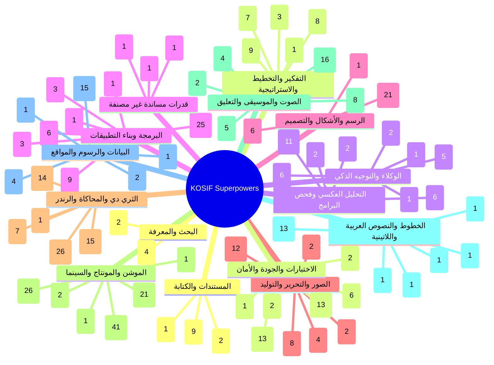

## خرائط المهام الجاهزة / ready task maps

### فيديو موشن جرافيك بصوت — Motion-graphics film with voice (`motion-film`)

البوابات: `thinking` ← `audio` ← `type` ← `motion` ← `drawing` ← `3d` ← `quality`

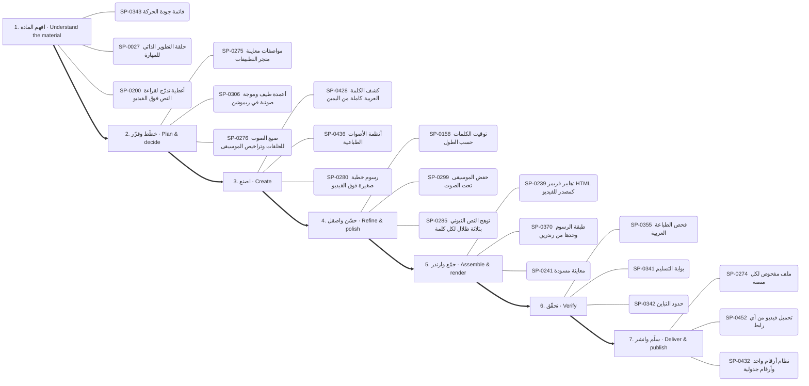

1. **افهم المادة:** SP-0343 ✅ قائمة جودة الحركة · SP-0027 ✅ حلقة التطوير الذاتي للمهارة · SP-0200 🟢 أغطية تدرّج لقراءة النص فوق الفيديو
2. **خطّط وقرّر:** SP-0275 ✅ مواصفات معاينة متجر التطبيقات · SP-0306 🟢 أعمدة طيف وموجة صوتية في ريموشن · SP-0276 ✅ صيغ الصوت للحلقات وتراخيص الموسيقى
3. **اصنع:** SP-0428 ✅ كشف الكلمة العربية كاملة من اليمين · SP-0436 ✅ أنظمة الأصوات الطباعية · SP-0280 ✅ رسوم خطية صغيرة فوق الفيديو
4. **حسّن واصقل:** SP-0158 ✅ توقيت الكلمات حسب الطول · SP-0299 ✅ خفض الموسيقى تحت الصوت · SP-0285 ✅ توهج النص النيوني بثلاثة ظلال لكل كلمة
5. **جمّع وارندر:** SP-0239 ✅ هايبر فريمز: HTML كمصدر للفيديو · SP-0370 ✅ طبقة الرسوم وحدها من رندرين · SP-0241 ✅ معاينة مسودة
6. **تحقّق:** SP-0355 ✅ فحص الطباعة العربية · SP-0341 ✅ بوابة التسليم · SP-0342 ✅ حدود التباين
7. **سلّم وانشر:** SP-0274 ✅ ملف مفحوص لكل منصة · SP-0452 ✅ تحميل فيديو من أي رابط · SP-0432 ✅ نظام أرقام واحد وأرقام جدولية

### مونتاج ريلز على الإيقاع — Beat-synced reels edit (`reels-edit`)

البوابات: `motion` ← `audio` ← `images` ← `quality`

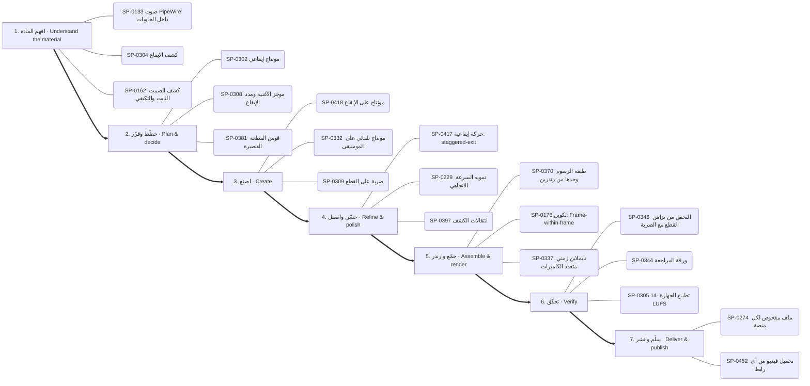

1. **افهم المادة:** SP-0133 ✅ صوت PipeWire داخل الحاويات · SP-0304 ✅ كشف الإيقاع · SP-0162 ✅ كشف الصمت الثابت والتكيفي
2. **خطّط وقرّر:** SP-0302 🟢 مونتاج إيقاعي · SP-0308 ✅ موجز الأغنية ومدد الإيقاع · SP-0381 ✅ قوس القطعة القصيرة
3. **اصنع:** SP-0418 ✅ مونتاج على الإيقاع · SP-0332 ✅ مونتاج تلقائي على الموسيقى · SP-0309 📦 ضربة على القطع
4. **حسّن واصقل:** SP-0417 🟢 حركة إيقاعية: staggered-exit · SP-0229 ✅ تمويه السرعة الاتجاهي · SP-0397 ✅ انتقالات الكشف
5. **جمّع وارندر:** SP-0370 ✅ طبقة الرسوم وحدها من رندرين · SP-0176 🟢 تكوين: Frame-within-frame · SP-0337 🟢 تايملاين زمني متعدد الكاميرات
6. **تحقّق:** SP-0346 ✅ التحقق من تزامن القطع مع الضربة · SP-0344 ✅ ورقة المراجعة · SP-0305 ✅ تطبيع الجهارة -14 LUFS
7. **سلّم وانشر:** SP-0274 ✅ ملف مفحوص لكل منصة · SP-0452 ✅ تحميل فيديو من أي رابط

### رسم شخصية وتحريكها — Draw and animate a character (`character`)

البوابات: `drawing` ← `motion` ← `audio` ← `3d`

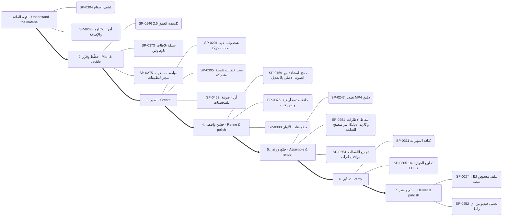

1. **افهم المادة:** SP-0304 ✅ كشف الإيقاع · SP-0266 📦 أمر: الكتالوج والإضافة
2. **خطّط وقرّر:** SP-0146 🟢 منصة العمق 2.5D · SP-0373 ✅ شبكة بلاطات باوهاوس · SP-0275 ✅ مواصفات معاينة متجر التطبيقات
3. **اصنع:** SP-0201 ✅ شخصيات حية ببصمات حركة · SP-0395 ✅ ست خلفيات نقشية متحركة · SP-0453 ✅ أزياء صوتية للشخصيات
4. **حسّن واصقل:** SP-0159 ✅ دمج المشاهد مع الصوت الأصلي بلا تعديل · SP-0376 ✅ حلقة صدمة أرضية ونبض قلب · SP-0398 🟢 قطع بقلب الألوان
5. **جمّع وارندر:** SP-0247 ✅ تصدير MP4 دقيق · SP-0251 🟢 التقاط الإطارات عبر متصفح Edge وكارت الشاشة · SP-0254 ✅ تجميع اللقطات بنوافذ إطارات
6. **تحقّق:** SP-0311 🟢 كثافة المؤثرات · SP-0305 ✅ تطبيع الجهارة -14 LUFS
7. **سلّم وانشر:** SP-0274 ✅ ملف مفحوص لكل منصة · SP-0452 ✅ تحميل فيديو من أي رابط

### فيديو شرح بالمخططات والبيانات — Data/diagram explainer (`explainer`)

البوابات: `data` ← `drawing` ← `motion` ← `thinking`

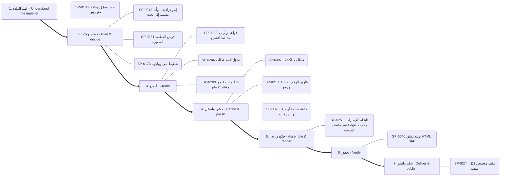

1. **افهم المادة:** SP-0103 ✅ بحث معمّق بوكلاء متوازيين
2. **خطّط وقرّر:** SP-0212 🟢 إنفوجرافيك مولَّد مستند إلى بحث · SP-0381 ✅ قوس القطعة القصيرة · SP-0173 ✅ تخطيط نص وواجهة
3. **اصنع:** SP-0223 ✅ قواعد تركيب مخطط الشرح · SP-0206 ✅ تحوّل المخططات · SP-0209 ✅ خط/مساحة مع مؤشر تقاطع
4. **حسّن واصقل:** SP-0397 ✅ انتقالات الكشف · SP-0210 ✅ ظهور الرقم بضبابية ورفع · SP-0376 ✅ حلقة صدمة أرضية ونبض قلب
5. **جمّع وارندر:** SP-0251 🟢 التقاط الإطارات عبر متصفح Edge وكارت الشاشة
6. **تحقّق:** SP-0040 ✅ توليد توثيق HTML للـAPI
7. **سلّم وانشر:** SP-0274 ✅ ملف مفحوص لكل منصة

### هوية وشعار وإعلان — Brand, logo & ad (`brand`)

البوابات: `drawing` ← `type` ← `motion` ← `thinking`

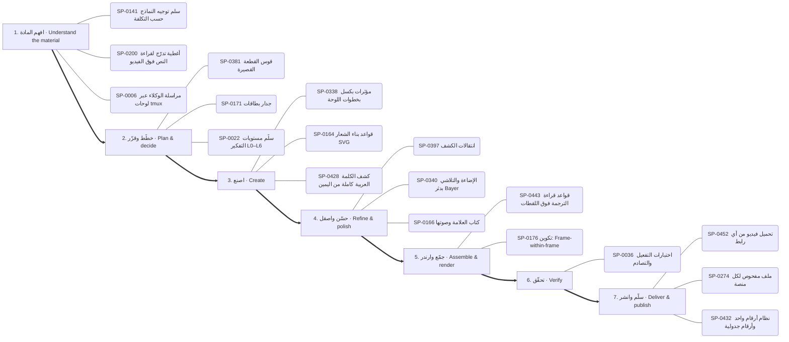

1. **افهم المادة:** SP-0141 📄 سلم توجيه النماذج حسب التكلفة · SP-0200 🟢 أغطية تدرّج لقراءة النص فوق الفيديو · SP-0006 📄 مراسلة الوكلاء عبر لوحات tmux
2. **خطّط وقرّر:** SP-0381 ✅ قوس القطعة القصيرة · SP-0171 🟢 جدار بطاقات · SP-0022 ✅ سلّم مستويات التفكير L0–L6
3. **اصنع:** SP-0338 ✅ مؤثرات بكسل بخطوات اللوحة · SP-0164 ✅ قواعد بناء الشعار SVG · SP-0428 ✅ كشف الكلمة العربية كاملة من اليمين
4. **حسّن واصقل:** SP-0397 ✅ انتقالات الكشف · SP-0340 ✅ الإضاءة والتلاشي بدثر Bayer · SP-0166 🟢 كتاب العلامة وصوتها
5. **جمّع وارندر:** SP-0443 ✅ قواعد قراءة الترجمة فوق اللقطات · SP-0176 🟢 تكوين: Frame-within-frame
6. **تحقّق:** SP-0036 📄 اختبارات التفعيل والتصادم
7. **سلّم وانشر:** SP-0452 ✅ تحميل فيديو من أي رابط · SP-0274 ✅ ملف مفحوص لكل منصة · SP-0432 ✅ نظام أرقام واحد وأرقام جدولية

### تحرير صور وتصميم — Photo editing & design (`photo`)

البوابات: `images` ← `software` ← `drawing`

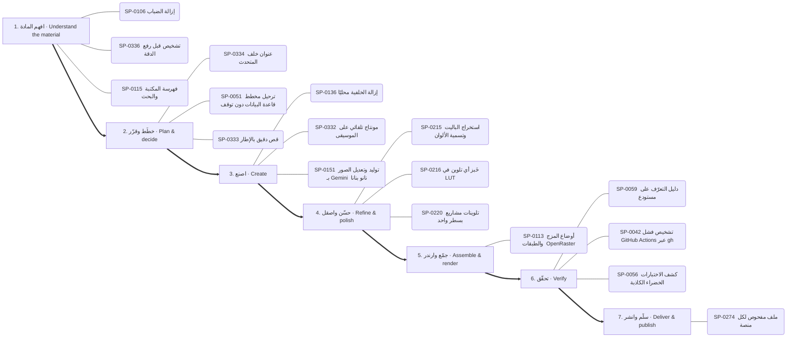

1. **افهم المادة:** SP-0106 ✅ إزالة الضباب · SP-0336 ✅ تشخيص قبل رفع الدقة · SP-0115 ✅ فهرسة المكتبة والبحث
2. **خطّط وقرّر:** SP-0334 ✅ عنوان خلف المتحدث · SP-0051 📄 ترحيل مخطط قاعدة البيانات دون توقف · SP-0333 ✅ قص دقيق بالإطار
3. **اصنع:** SP-0136 🟢 إزالة الخلفية محليًا · SP-0332 ✅ مونتاج تلقائي على الموسيقى · SP-0151 ✅ توليد وتعديل الصور بـ Gemini (نانو بنانا)
4. **حسّن واصقل:** SP-0215 ✅ استخراج الباليت وتسمية الألوان · SP-0216 ✅ خَبز أي تلوين في LUT · SP-0220 ✅ تلوينات مشاريع بسطر واحد
5. **جمّع وارندر:** SP-0113 ✅ أوضاع المزج والطبقات (OpenRaster)
6. **تحقّق:** SP-0059 ✅ دليل التعرّف على مستودع · SP-0042 📄 تشخيص فشل GitHub Actions عبر gh · SP-0056 📄 كشف الاختبارات الخضراء الكاذبة
7. **سلّم وانشر:** SP-0274 ✅ ملف مفحوص لكل منصة

### مشهد ثلاثي الأبعاد — 3D scene (`3d-scene`)

البوابات: `3d` ← `motion` ← `quality`

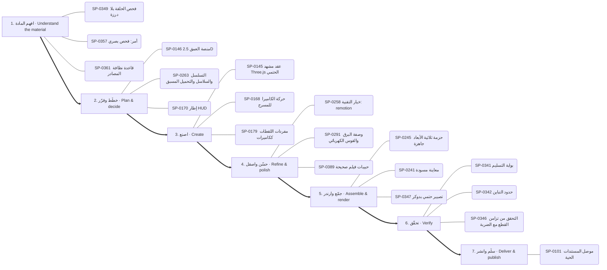

1. **افهم المادة:** SP-0349 ✅ فحص الحلقة بلا درزة · SP-0357 ✅ أمر: فحص بصري · SP-0361 ✅ قاعدة نظافة المصادر
2. **خطّط وقرّر:** SP-0146 🟢 منصة العمق 2.5D · SP-0263 ✅ التسلسل والسلاسل والتحميل المسبق · SP-0170 📦 إطار HUD
3. **اصنع:** SP-0145 ✅ عقد مشهد Three.js الحتمي · SP-0168 ✅ حركة الكاميرا للمسرح · SP-0179 🟢 مفردات اللقطات ككاميرات
4. **حسّن واصقل:** SP-0258 ✅ خيار التقنية: remotion · SP-0291 ✅ وصفة البرق والقوس الكهربائي · SP-0389 ✅ حبيبات فيلم صحيحة
5. **جمّع وارندر:** SP-0245 ✅ حزمة ثلاثية الأبعاد جاهزة · SP-0241 ✅ معاينة مسودة · SP-0347 ✅ تصيير حتمي بدوكر
6. **تحقّق:** SP-0341 ✅ بوابة التسليم · SP-0342 ✅ حدود التباين · SP-0346 ✅ التحقق من تزامن القطع مع الضربة
7. **سلّم وانشر:** SP-0101 🔑 موصل المستندات الحية

### بناء تطبيق أو موقع — Build an app or site (`app`)

البوابات: `thinking` ← `software` ← `documents` ← `quality`

1. **افهم المادة:** SP-0120 📄 من Figma إلى كود مطابق · SP-0064 ✅ سلّم الموافقة وأقل تصعيد · SP-0007 📄 مراجعة الافتراضات وإعادة التقييم
2. **خطّط وقرّر:** SP-0138 📄 تدقيق خفض التكلفة المبني على الاستخدام · SP-0451 📦 مكتبة مكوّنات HyperFrames للواجهات · SP-0348 ✅ اختيار إطار الغلاف
3. **اصنع:** SP-0119 ✅ بناء خادم MCP (الإصدار 2) · SP-0061 ✅ ابحث قبل أن تبني · SP-0446 🟢 محتوى واجهة حقيقي ومحلي
4. **حسّن واصقل:** SP-0045 📄 طلبات دمج متراكبة عبر gh stack
5. **جمّع وارندر:** SP-0347 ✅ تصيير حتمي بدوكر · SP-0113 ✅ أوضاع المزج والطبقات (OpenRaster)
6. **تحقّق:** SP-0056 📄 كشف الاختبارات الخضراء الكاذبة · SP-0040 ✅ توليد توثيق HTML للـAPI · SP-0350 ✅ مشغل معاينة داخل المتصفح
7. **سلّم وانشر:** SP-0274 ✅ ملف مفحوص لكل منصة

### تعديل كود وإصلاح — Change or fix code (`code-change`)

البوابات: `thinking` ← `software` ← `quality`

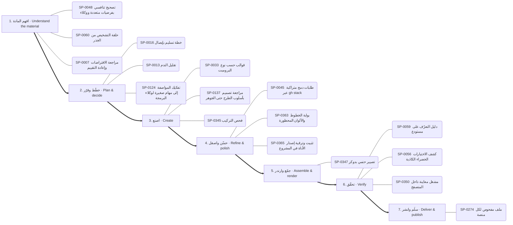

1. **افهم المادة:** SP-0048 📄 تصحيح تنافسي بفرضيات متعددة ووكلاء · SP-0060 📄 حلقة التشخيص من الجذر · SP-0007 📄 مراجعة الافتراضات وإعادة التقييم
2. **خطّط وقرّر:** SP-0016 ✅ خطة تسليم بإيصال · SP-0013 📄 تقليل الندم · SP-0124 📄 تفكيك المواصفة إلى مهام صغيرة لوكلاء البرمجة
3. **اصنع:** SP-0033 ✅ قوالب حسب نوع البرومبت · SP-0137 📄 مراجعة تصميم بأسلوب الطرح حتى الجوهر · SP-0345 ✅ فحص التركيب
4. **حسّن واصقل:** SP-0045 📄 طلبات دمج متراكبة عبر gh stack · SP-0363 ✅ بوابة الخطوط والألوان المحظورة · SP-0365 ✅ تثبيت وترقية إصدار الأداة في المشروع
5. **جمّع وارندر:** SP-0347 ✅ تصيير حتمي بدوكر
6. **تحقّق:** SP-0059 ✅ دليل التعرّف على مستودع · SP-0056 📄 كشف الاختبارات الخضراء الكاذبة · SP-0350 ✅ مشغل معاينة داخل المتصفح
7. **سلّم وانشر:** SP-0274 ✅ ملف مفحوص لكل منصة

### فحص تطبيق ونقل ميزة — Investigate an app and transfer a feature (`reverse`)

البوابات: `reverse` ← `software` ← `quality`

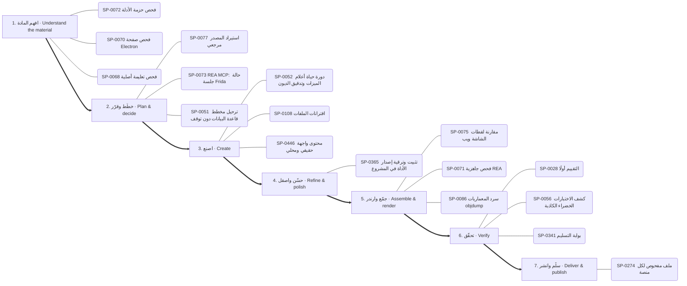

1. **افهم المادة:** SP-0072 ✅ فحص حزمة الأدلة · SP-0070 ✅ فحص صفحة Electron · SP-0068 ✅ فحص تعليمة أصلية
2. **خطّط وقرّر:** SP-0077 📦 استيراد المصدر مرجعي · SP-0073 📄 REA MCP: حالة جلسة Frida · SP-0051 📄 ترحيل مخطط قاعدة البيانات دون توقف
3. **اصنع:** SP-0052 📄 دورة حياة أعلام الميزات وتدقيق الديون · SP-0108 ✅ اقترانات الملفات · SP-0446 🟢 محتوى واجهة حقيقي ومحلي
4. **حسّن واصقل:** SP-0365 ✅ تثبيت وترقية إصدار الأداة في المشروع
5. **جمّع وارندر:** SP-0075 📦 مقارنة لقطات الشاشة ويب · SP-0071 ✅ فحص جاهزية REA · SP-0086 ✅ سرد المعماريات objdump
6. **تحقّق:** SP-0028 📄 التقييم أولًا · SP-0056 📄 كشف الاختبارات الخضراء الكاذبة · SP-0341 ✅ بوابة التسليم
7. **سلّم وانشر:** SP-0274 ✅ ملف مفحوص لكل منصة

### تحليل بيانات وتقرير — Data analysis report (`data-report`)

البوابات: `data` ← `documents` ← `quality`

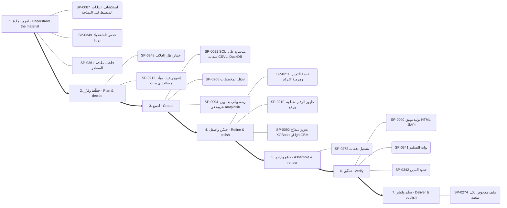

1. **افهم المادة:** SP-0087 📄 استكشاف البيانات المنضبط قبل النمذجة · SP-0349 ✅ فحص الحلقة بلا درزة · SP-0361 ✅ قاعدة نظافة المصادر
2. **خطّط وقرّر:** SP-0348 ✅ اختيار إطار الغلاف · SP-0212 🟢 إنفوجرافيك مولَّد مستند إلى بحث
3. **اصنع:** SP-0091 ✅ SQL مباشرة على ملفات CSV بـ DuckDB · SP-0206 ✅ تحوّل المخططات · SP-0094 ✅ رسم بياني بعناوين عربية في matplotlib
4. **حسّن واصقل:** SP-0211 🟢 نبضة التمييز وهرمية التركيز · SP-0210 ✅ ظهور الرقم بضبابية ورفع · SP-0092 ✅ تعزيز متدرّج XGBoost وLightGBM
5. **جمّع وارندر:** SP-0272 🟢 تشغيل دفعات
6. **تحقّق:** SP-0040 ✅ توليد توثيق HTML للـAPI · SP-0341 ✅ بوابة التسليم · SP-0342 ✅ حدود التباين
7. **سلّم وانشر:** SP-0274 ✅ ملف مفحوص لكل منصة

### بحث وكتابة مقال — Research and write (`research-write`)

البوابات: `research` ← `thinking` ← `documents`

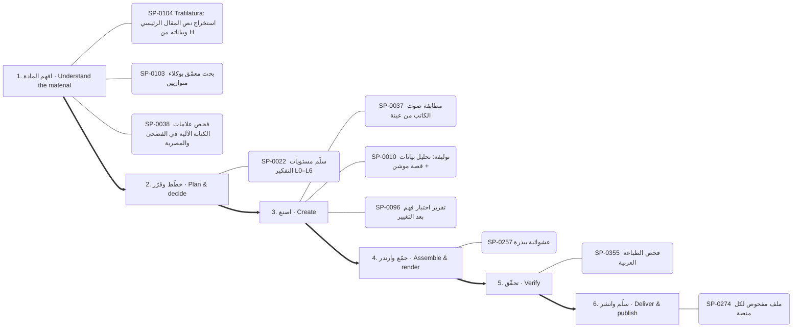

1. **افهم المادة:** SP-0104 ✅ Trafilatura: استخراج نص المقال الرئيسي وبياناته من HTML · SP-0103 ✅ بحث معمّق بوكلاء متوازيين · SP-0038 ✅ فحص علامات الكتابة الآلية في الفصحى والمصرية
2. **خطّط وقرّر:** SP-0022 ✅ سلّم مستويات التفكير L0–L6
3. **اصنع:** SP-0037 ✅ مطابقة صوت الكاتب من عينة · SP-0010 📄 توليفة: تحليل بيانات + قصة موشن · SP-0096 📄 تقرير اختبار فهم بعد التغيير
4. **جمّع وارندر:** SP-0257 ✅ عشوائية ببذرة
5. **تحقّق:** SP-0355 ✅ فحص الطباعة العربية
6. **سلّم وانشر:** SP-0274 ✅ ملف مفحوص لكل منصة

## البوابات مرتبة بالمراحل / hubs by stage

### البحث والمعرفة — Research & knowledge

- **افهم المادة** (4): SP-0103 بحث معمّق بوكلاء متوازيين · SP-0104 Trafilatura: استخراج نص المقال الرئيسي وبياناته من HTML · SP-0105 محتوى الويب بيانات لا أوامر · SP-0102 استخراج وإثراء بيانات الأطباء
- **اصنع** (2): SP-0062 ربط Graphify المستضاف · SP-0063 الخريطة مادةً لفيلم موشن

### التفكير والتخطيط والاستراتيجية — Reasoning & strategy

- **افهم المادة** (7): SP-0034 اطلب أي أسلوب بصري بالاسم من مكتبة 586 أسلوبًا · SP-0006 مراسلة الوكلاء عبر لوحات tmux · SP-0024 اعرف قبل أن تقول «لا» · SP-0141 سلم توجيه النماذج حسب التكلفة · SP-0142 فرز الحادث مقابل المشكلة وتحديد الخطورة · SP-0015 شجرة المشكلة …
- **خطّط وقرّر** (8): SP-0022 سلّم مستويات التفكير L0–L6 · SP-0009 سكامبر (SCAMPER) · SP-0016 خطة تسليم بإيصال · SP-0144 ثلاثة خيارات حقيقية وعدم الفعل · SP-0023 قائمة المرحلة صفر (12 وحدة) · SP-0138 تدقيق خفض التكلفة المبني على الاستخدام …
- **اصنع** (9): SP-0033 قوالب حسب نوع البرومبت · SP-0143 السعر الأمثل ونقطة التعادل · SP-0012 خريطة أصحاب المصلحة · SP-0137 مراجعة تصميم بأسلوب الطرح حتى الجوهر · SP-0139 حلقة مستقلة لتصريف قائمة المهام · SP-0140 بطاقات أنكي عبر AnkiConnect …
- **جمّع وارندر** (1): SP-0008 تصدير خريطة ذهنية تفاعلية
- **تحقّق** (3): SP-0017 تطوير يقوده المواصفات · SP-0036 اختبارات التفعيل والتصادم · SP-0011 مسح الكليشيهات

### الوكلاء والتوجيه الذكي — Agents & routing

- **افهم المادة** (5): SP-0125 أطلس القدرات للبحث والتخطيط · SP-0019 خطوط عربية قبل الرندر · SP-0127 فاحص توقيت الفيديو المرجعي · SP-0129 تحليل REA لمستودعات المالك دفعةً واحدة · SP-0020 اقرأ قائمة أدواتك
- **خطّط وقرّر** (2): SP-0128 مقدّر سعة الأنظمة · SP-0021 بطاقة القدرة والإيصال
- **اصنع** (6): SP-0126 مُصرِّف حركة SVG المتزامنة مع الصوت · SP-0018 اعرف قبل أن تقول لا · SP-0001 نقطة حفظ وتسليم بين الجلسات عبر مجلد .context · SP-0002 قرار التفويض للوكلاء أو التنفيذ المباشر · SP-0004 تشخيص الوكيل لنفسه · SP-0005 أشجار عمل للكتّاب المتوازيين
- **جمّع وارندر** (1): SP-0130 تحزيم المهارة للرفع إلى claude.ai
- **تحقّق** (1): SP-0003 تأليف مهارة

### البرمجة وبناء التطبيقات — Software & applications

- **افهم المادة** (9): SP-0106 إزالة الضباب · SP-0115 فهرسة المكتبة والبحث · SP-0118 نشر صفحة تفاعلية خاصة · SP-0120 من Figma إلى كود مطابق · SP-0047 قياس صحة تكامل خارجي ونتائجه بمقامات صريحة · SP-0048 تصحيح تنافسي بفرضيات متعددة ووكلاء …
- **خطّط وقرّر** (3): SP-0051 ترحيل مخطط قاعدة البيانات دون توقف · SP-0124 تفكيك المواصفة إلى مهام صغيرة لوكلاء البرمجة · SP-0451 مكتبة مكوّنات HyperFrames للواجهات
- **اصنع** (25): SP-0109 علامات الإيقاع · SP-0111 نمو نباتي وزخرفي · SP-0110 رمز QR بشعار · SP-0444 المؤشر بطلًا · SP-0112 رسم زيتي وحبر ورصاص · SP-0108 اقترانات الملفات …
- **حسّن واصقل** (1): SP-0045 طلبات دمج متراكبة عبر gh stack
- **جمّع وارندر** (3): SP-0113 أوضاع المزج والطبقات (OpenRaster) · SP-0116 جرد قدرات Blender الحي · SP-0117 كاميرا افتراضية من فيديو
- **تحقّق** (6): SP-0059 دليل التعرّف على مستودع · SP-0450 من التحميل إلى علامة صح · SP-0042 تشخيص فشل GitHub Actions عبر gh · SP-0122 حلقة مراجع شجرة الوصولية لتحكم المتصفح · SP-0054 تدقيق الامتثال لـ GDPR انطلاقًا من جرد البيانات الشخصية · SP-0056 كشف الاختبارات الخضراء الكاذبة
- **سلّم وانشر** (1): SP-0123 ضبط مجمع الاتصالات وموثوقية قاعدة البيانات

### الرسم والأشكال والتصميم — Drawing & visual composition

- **خطّط وقرّر** (1): SP-0373 شبكة بلاطات باوهاوس
- **اصنع** (21): SP-0279 فيلم يد مرسومة حتمي بـmake_frame(t) · SP-0164 قواعد بناء الشعار SVG · SP-0372 تحويل SVG بإضافة MorphSVG · SP-0223 قواعد تركيب مخطط الشرح · SP-0338 مؤثرات بكسل بخطوات اللوحة · SP-0374 انفجار خطوط شعاعي …
- **حسّن واصقل** (6): SP-0375 دمج ونحت وتقاطع ناعم · SP-0340 الإضاءة والتلاشي بدثر Bayer · SP-0376 حلقة صدمة أرضية ونبض قلب · SP-0166 كتاب العلامة وصوتها · SP-0167 تشريح بطاقة الختام · SP-0379 تجمع الصلصال بالكرات

### الصور والتحرير والتوليد — Images & photo editing

- **افهم المادة** (4): SP-0133 صوت PipeWire داخل الحاويات · SP-0336 تشخيص قبل رفع الدقة · SP-0335 مجمع لقطات بأسئلة بحث ثنائية اللغة · SP-0155 مقدمات الأسلوب المتطابقة بايتًا
- **خطّط وقرّر** (2): SP-0333 قص دقيق بالإطار · SP-0334 عنوان خلف المتحدث
- **اصنع** (12): SP-0150 مصنع البرومبت: مواصفة واحدة ← تسع منصات · SP-0332 مونتاج تلقائي على الموسيقى · SP-0135 ضغط الصور ومقارنة الجودة · SP-0134 التعرف على العربية والإنجليزية بـ tesseract · SP-0151 توليد وتعديل الصور بـ Gemini (نانو بنانا) · SP-0136 إزالة الخلفية محليًا …
- **حسّن واصقل** (8): SP-0215 استخراج الباليت وتسمية الألوان · SP-0216 خَبز أي تلوين في LUT · SP-0217 التعريض حسب وقت اليوم · SP-0218 خلفية بقع ضبابية متحركة · SP-0219 توازن الأبيض بالبكسلات المحايدة · SP-0220 تلوينات مشاريع بسطر واحد …
- **جمّع وارندر** (2): SP-0337 تايملاين زمني متعدد الكاميرات · SP-0157 خط إنتاج من موضوع إلى فيديو قصير

### الثري دي والمحاكاة والرندر — 3D & rendering

- **افهم المادة** (1): SP-0266 أمر: الكتالوج والإضافة
- **خطّط وقرّر** (7): SP-0146 منصة العمق 2.5D · SP-0264 محول إطارات CSS · SP-0263 التسلسل والسلاسل والتحميل المسبق · SP-0249 قائمة قواعد Remotion · SP-0260 تضمين لوتي · SP-0265 اصطلاح المسارات والعلامات في المونتاج …
- **اصنع** (26): SP-0145 عقد مشهد Three.js الحتمي · SP-0242 مشروع أنيميشن جديد · SP-0244 استوديو KOSIF Motion Web المحلي · SP-0327 مطر وضباب ومطر الغيمة · SP-0328 حقل curl تحليلي خالٍ من التباعد · SP-0393 سماء متدرجة بتنقيط Bayer …
- **حسّن واصقل** (15): SP-0285 توهج النص النيوني بثلاثة ظلال لكل كلمة · SP-0286 قراءة إضاءة صورة مرجعية · SP-0389 حبيبات فيلم صحيحة · SP-0326 انفجار ببذرة وجاذبية · SP-0390 تظليل كرة بالهالفتون · SP-0287 مرور العدسة «مصوَّر لا مرسوم» …
- **جمّع وارندر** (14): SP-0239 هايبر فريمز: HTML كمصدر للفيديو · SP-0241 معاينة مسودة · SP-0250 تجميع الإطارات إلى فيديو MP4 · SP-0247 تصدير MP4 دقيق · SP-0243 مواصفة الخط الزمني · SP-0257 عشوائية ببذرة …

### الموشن والمونتاج والسينما — Motion & video editing

- **افهم المادة** (1): SP-0200 أغطية تدرّج لقراءة النص فوق الفيديو
- **خطّط وقرّر** (21): SP-0381 قوس القطعة القصيرة · SP-0230 إعادة الاستهداف بالنابض · SP-0276 صيغ الصوت للحلقات وتراخيص الموسيقى · SP-0277 بريف الصورة المصغرة: 3 أفكار واختبار A/B · SP-0173 تخطيط نص وواجهة · SP-0234 أربع تسارعات مسماة فقط …
- **اصنع** (41): SP-0201 شخصيات حية ببصمات حركة · SP-0168 حركة الكاميرا للمسرح · SP-0231 ميزانيات التتابع · SP-0382 مولّد طلب Claude من الأسلوب · SP-0202 ورقة تصميم الشخصية واختبار الظل · SP-0169 دفع الكاميرا …
- **حسّن واصقل** (26): SP-0397 انتقالات الكشف · SP-0229 تمويه السرعة الاتجاهي · SP-0232 رموز التسارع حسب الدور (17 منحنى) · SP-0174 عمق الميدان وسحب التركيز · SP-0416 اختيار الانتقال حسب الطاقة · SP-0400 انتقال CSS: حرق الفيلم …
- **جمّع وارندر** (1): SP-0176 تكوين: Frame-within-frame
- **سلّم وانشر** (2): SP-0274 ملف مفحوص لكل منصة · SP-0452 تحميل فيديو من أي رابط

### الصوت والموسيقى والتعليق — Audio & voice

- **افهم المادة** (4): SP-0304 كشف الإيقاع · SP-0160 تفريغ HyperFrames · SP-0314 توقف الشريط ووقت الرصاصة ولمسات الخلل · SP-0162 كشف الصمت الثابت والتكيفي
- **خطّط وقرّر** (8): SP-0303 شبكة الإيقاع · SP-0302 مونتاج إيقاعي · SP-0306 أعمدة طيف وموجة صوتية في ريموشن · SP-0308 موجز الأغنية ومدد الإيقاع · SP-0320 وادٍ من المخطط الطيفي · SP-0318 واجهة عداد البارات الإيقاعية …
- **اصنع** (16): SP-0301 قنوات الصوت كمحرك للحركة · SP-0300 مكتبة المؤثرات · SP-0453 أزياء صوتية للشخصيات · SP-0316 أجواء صوتية مولدة · SP-0317 مقام lydian · SP-0307 عزل الصوت وتنظيفه …
- **حسّن واصقل** (5): SP-0299 خفض الموسيقى تحت الصوت · SP-0158 توقيت الكلمات حسب الطول · SP-0159 دمج المشاهد مع الصوت الأصلي بلا تعديل · SP-0312 قناة المزج · SP-0163 الأشرطة السفلية
- **تحقّق** (2): SP-0305 تطبيع الجهارة -14 LUFS · SP-0311 كثافة المؤثرات

### الخطوط والنصوص العربية واللاتينية — Typography & localization

- **خطّط وقرّر** (1): SP-0433 علامة استفهام عملاقة مفرّغة
- **اصنع** (13): SP-0428 كشف الكلمة العربية كاملة من اليمين · SP-0029 CAMeL Tools: تقطيع النص العربي واستخراج الجذور والتشكيل وتحديد · SP-0429 مطابقة الخط بالحبر · SP-0430 طبقات نص الخط الزمني JSON · SP-0436 أنظمة الأصوات الطباعية · SP-0431 سطور تتكدس وتخفت …
- **حسّن واصقل** (1): SP-0439 عنوان بلونين وكلمة لون
- **جمّع وارندر** (1): SP-0443 قواعد قراءة الترجمة فوق اللقطات
- **تحقّق** (1): SP-0030 مراجعة المطابقة النحوية بعد التعديل
- **سلّم وانشر** (1): SP-0432 نظام أرقام واحد وأرقام جدولية

### البيانات والرسوم والمواقع — Data & visual analytics

- **افهم المادة** (2): SP-0087 استكشاف البيانات المنضبط قبل النمذجة · SP-0090 مراجعة مخطط واستعلامات ClickHouse
- **خطّط وقرّر** (1): SP-0212 إنفوجرافيك مولَّد مستند إلى بحث
- **اصنع** (15): SP-0091 SQL مباشرة على ملفات CSV بـ DuckDB · SP-0206 تحوّل المخططات · SP-0093 حل رياضي دقيق بـ sympy · SP-0207 حلقة التقدم المخروطية · SP-0094 رسم بياني بعناوين عربية في matplotlib · SP-0293 هل نحتاج خريطة أصلًا …
- **حسّن واصقل** (4): SP-0092 تعزيز متدرّج XGBoost وLightGBM · SP-0210 ظهور الرقم بضبابية ورفع · SP-0211 نبضة التمييز وهرمية التركيز · SP-0297 كرة أرضية بأقواس اتصال
- **جمّع وارندر** (1): SP-0088 عقد خط بيانات: الحبيبية والتكرار الآمن

### المستندات والكتابة — Documents & writing

- **افهم المادة** (2): SP-0038 فحص علامات الكتابة الآلية في الفصحى والمصرية · SP-0098 حزمة تشخيص مُنقّحة وآمنة للدعم
- **اصنع** (9): SP-0099 تحويل Office إلى PDF دفعة واحدة · SP-0100 PlantUML: توليد مخططات UML من نص · SP-0039 قفل الاقتباس المباشر · SP-0037 مطابقة صوت الكاتب من عينة · SP-0095 تدقيق انحراف التوثيق عن الكود لكل بُعد · SP-0031 تصميم الأيقونات بالتشابه والإغلاق البصري …
- **سلّم وانشر** (1): SP-0101 موصل المستندات الحية

### الاختبارات والجودة والأمان — QA & security

- **افهم المادة** (13): SP-0343 قائمة جودة الحركة · SP-0349 فحص الحلقة بلا درزة · SP-0364 فحص المقروئية · SP-0356 دراسة فيلم مرجعي · SP-0361 قاعدة نظافة المصادر · SP-0354 قياس الجهارة والذروة …
- **خطّط وقرّر** (1): SP-0348 اختيار إطار الغلاف
- **اصنع** (6): SP-0345 فحص التركيب · SP-0351 أمر: مقارنة · SP-0352 الحكم جيف · SP-0065 المحتوى الخارجي بيانات لا أوامر · SP-0368 حد الوميض الآمن · SP-0371 فخ إعادة الإسناد في TSL
- **حسّن واصقل** (2): SP-0365 تثبيت وترقية إصدار الأداة في المشروع · SP-0363 بوابة الخطوط والألوان المحظورة
- **جمّع وارندر** (2): SP-0347 تصيير حتمي بدوكر · SP-0370 طبقة الرسوم وحدها من رندرين
- **تحقّق** (13): SP-0341 بوابة التسليم · SP-0040 توليد توثيق HTML للـAPI · SP-0342 حدود التباين · SP-0350 مشغل معاينة داخل المتصفح · SP-0346 التحقق من تزامن القطع مع الضربة · SP-0344 ورقة المراجعة …

### التحليل العكسي وفحص البرامج — Reverse engineering

- **افهم المادة** (11): SP-0080 فرز المثبّت قبل REA · SP-0072 فحص حزمة الأدلة · SP-0070 فحص صفحة Electron · SP-0074 مراقبة جلسة ويب · SP-0082 فحص عميل pcap · SP-0068 فحص تعليمة أصلية …
- **خطّط وقرّر** (2): SP-0073 REA MCP: حالة جلسة Frida · SP-0077 استيراد المصدر مرجعي
- **اصنع** (2): SP-0084 فك ترميز تسجيل إشارة · SP-0083 فتح مشروع JEB
- **جمّع وارندر** (6): SP-0071 فحص جاهزية REA · SP-0086 سرد المعماريات objdump · SP-0067 سرد الخدمات ADB · SP-0075 مقارنة لقطات الشاشة ويب · SP-0076 REA MCP: أمر تصحيح Rizin · SP-0081 REA MCP: حالة جلسة GDB

### قدرات مساندة غير مصنفة — Other supporting capabilities

- **افهم المادة** (1): SP-0323 مكتبة KOSIF Atlas
- **خطّط وقرّر** (1): SP-0325 ملف المشروع المحمول وإعادة الربط
- **اصنع** (1): SP-0324 خادم MCP للاستوديو (22 أداة)

---
_مولَّد آليًا من data/superpowers.json وdata/hubs_index.json وdata/task_maps.json._
