# الخريطة الذهنية للقدرات — Capability mind map

<!-- generated by scripts/capability_mindmap.py build -->

كل قدرة مرتبة بحسب **مرحلة المهمة** التي تخدمها، ثم كل بوابة مقسمة بالمراحل، ثم خرائط جاهزة لمهام شائعة. اتبع المراحل بالترتيب: افهم ← خطّط ← اصنع ← حسّن ← جمّع وارندر ← تحقّق ← سلّم.

    python3 scripts/capability_mindmap.py task "<المهمة>"     # خريطة مرحلية لأي مهمة
    python3 scripts/capability_mindmap.py task reels-edit      # خريطة جاهزة

## الفهرس / contents

- المراحل السبع / the seven stages
- الخريطة الكبرى / the big map
- خرائط المهام الجاهزة / ready task maps
- البوابات مرتبة بالمراحل / hubs by stage

## المراحل السبع / the seven stages

1. **افهم المادة — Understand the material** · 695 قدرة ذرية
2. **خطّط وقرّر — Plan & decide** · 888 قدرة ذرية
3. **اصنع — Create** · 1834 قدرة ذرية
4. **حسّن واصقل — Refine & polish** · 820 قدرة ذرية
5. **جمّع وارندر — Assemble & render** · 432 قدرة ذرية
6. **تحقّق — Verify** · 408 قدرة ذرية
7. **سلّم وانشر — Deliver & publish** · 159 قدرة ذرية

## الخريطة الكبرى / the big map

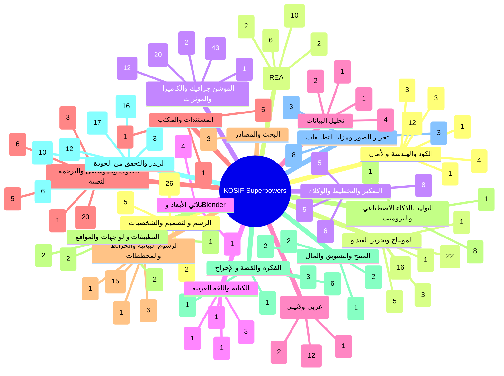

## خرائط المهام الجاهزة / ready task maps

### فيديو موشن جرافيك بصوت — Motion-graphics film with voice (`motion-film`)

البوابات: `story` ← `audio` ← `type` ← `motion` ← `draw` ← `render`

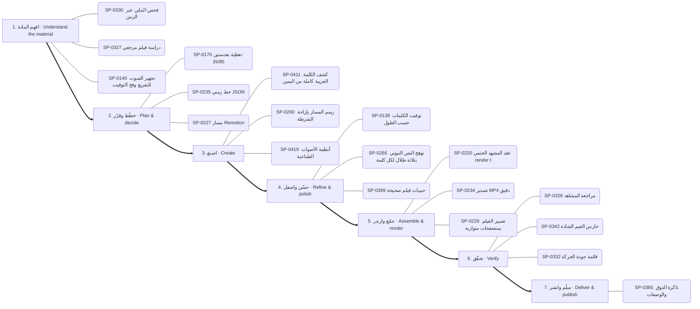

1. **افهم المادة:** SP-0330 ✅ فحص التباين عبر الزمن · SP-0327 ✅ دراسة فيلم مرجعي · SP-0140 ✅ تجهيز الصوت للتفريغ وفخ التوقيت
2. **خطّط وقرّر:** SP-0170 ✅ تغطية بعدستين 35/85 · SP-0235 ✅ خط زمني JSON · SP-0227 📦 مسار Remotion
3. **اصنع:** SP-0411 ✅ كشف الكلمة العربية كاملة من اليمين · SP-0260 ✅ رسم المسار بإزاحة الشرطة · SP-0419 ✅ أنظمة الأصوات الطباعية
4. **حسّن واصقل:** SP-0139 ✅ توقيت الكلمات حسب الطول · SP-0266 ✅ توهج النص النيوني بثلاثة ظلال لكل كلمة · SP-0369 ✅ حبيبات فيلم صحيحة
5. **جمّع وارندر:** SP-0220 ✅ عقد المشهد الحتمي render(t) · SP-0234 ✅ تصدير MP4 دقيق · SP-0229 📦 تصيير الفيلم بمتصفحات متوازية
6. **تحقّق:** SP-0326 ✅ مراجعة المشاهد · SP-0342 ✅ حارس القيم الشاذة · SP-0332 ✅ قائمة جودة الحركة
7. **سلّم وانشر:** SP-0365 ✅ ذاكرة الذوق والوصفات

### مونتاج ريلز على الإيقاع — Beat-synced reels edit (`reels-edit`)

البوابات: `montage` ← `audio` ← `motion` ← `render`

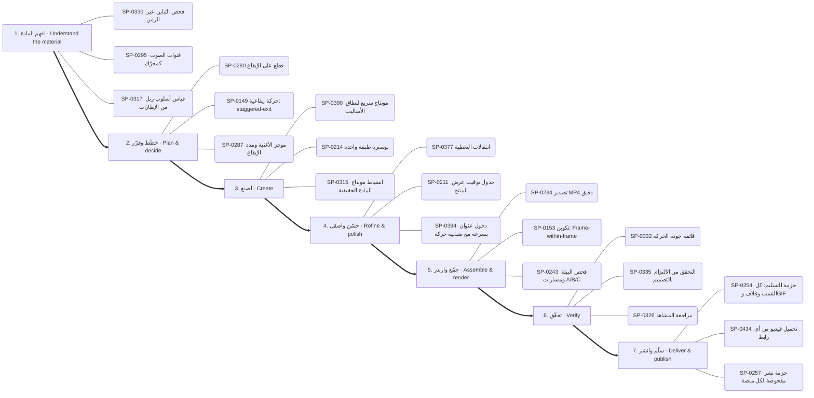

1. **افهم المادة:** SP-0330 ✅ فحص التباين عبر الزمن · SP-0295 🟢 قنوات الصوت كمحرّك · SP-0317 ✅ قياس أسلوب ريل من الإطارات
2. **خطّط وقرّر:** SP-0280 ✅ قطع على الإيقاع · SP-0149 🟢 حركة إيقاعية: staggered-exit · SP-0287 ✅ موجز الأغنية ومدد الإيقاع
3. **اصنع:** SP-0390 ✅ مونتاج سريع لنطاق الأساليب · SP-0214 ✅ بوسترة طبقة واحدة · SP-0315 ✅ انضباط مونتاج المادة الحقيقية
4. **حسّن واصقل:** SP-0377 ✅ انتقالات التغطية · SP-0211 ✅ جدول توقيت عرض المنتج · SP-0394 🟢 دخول عنوان بسرعة مع ضبابية حركة
5. **جمّع وارندر:** SP-0234 ✅ تصدير MP4 دقيق · SP-0153 🟢 تكوين: Frame-within-frame · SP-0243 🟢 فحص البيئة ومسارات A/B/C
6. **تحقّق:** SP-0332 ✅ قائمة جودة الحركة · SP-0335 ✅ التحقق من الالتزام بالتصميم · SP-0326 ✅ مراجعة المشاهد
7. **سلّم وانشر:** SP-0254 ✅ حزمة التسليم: كل النسب وغلاف وGIF · SP-0434 ✅ تحميل فيديو من أي رابط · SP-0257 ✅ حزمة نشر مفحوصة لكل منصة

### رسم شخصية وتحريكها — Draw and animate a character (`character`)

البوابات: `draw` ← `motion` ← `audio` ← `render`

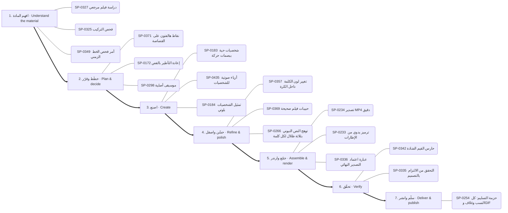

1. **افهم المادة:** SP-0327 ✅ دراسة فيلم مرجعي · SP-0325 ✅ فحص التركيب · SP-0349 🟢 أمر فحص الخط الزمني
2. **خطّط وقرّر:** SP-0371 ✅ نقاط هالفتون على القصاصة · SP-0172 🟢 إعادة التأطير بالقص · SP-0298 🟢 موسيقى أصلية
3. **اصنع:** SP-0183 ✅ شخصيات حية ببصمات حركة · SP-0435 ✅ أزياء صوتية للشخصيات · SP-0184 ✅ تمثيل الشخصيات بلوتي
4. **حسّن واصقل:** SP-0357 ✅ تغيير لون الكلمة داخل الكرة · SP-0369 ✅ حبيبات فيلم صحيحة · SP-0266 ✅ توهج النص النيوني بثلاثة ظلال لكل كلمة
5. **جمّع وارندر:** SP-0234 ✅ تصدير MP4 دقيق · SP-0233 ✅ ترميز يدوي من الإطارات · SP-0336 ✅ عبارة اعتماد التصدير النهائي
6. **تحقّق:** SP-0342 ✅ حارس القيم الشاذة · SP-0335 ✅ التحقق من الالتزام بالتصميم
7. **سلّم وانشر:** SP-0254 ✅ حزمة التسليم: كل النسب وغلاف وGIF

### فيديو شرح بالمخططات والبيانات — Data/diagram explainer (`explainer`)

البوابات: `dataviz` ← `story` ← `motion` ← `render`

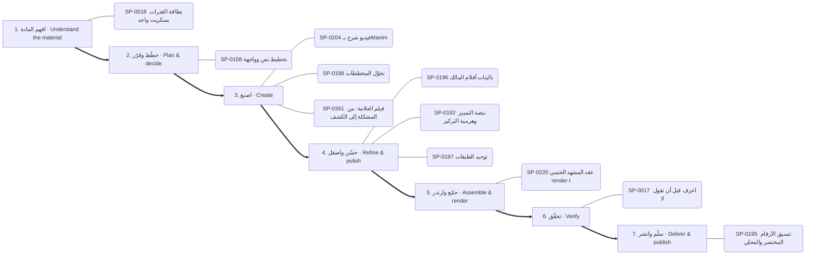

1. **افهم المادة:** SP-0018 ✅ بطاقة القدرات بسكربت واحد
2. **خطّط وقرّر:** SP-0158 ✅ تخطيط نص وواجهة
3. **اصنع:** SP-0204 ✅ فيديو شرح بـManim · SP-0188 ✅ تحوّل المخططات · SP-0361 ✅ فيلم العلامة: من المشكلة إلى الكشف
4. **حسّن واصقل:** SP-0196 ✅ باليتات أفلام المالك · SP-0192 🟢 نبضة التمييز وهرمية التركيز · SP-0197 ✅ توحيد الطبقات
5. **جمّع وارندر:** SP-0220 ✅ عقد المشهد الحتمي render(t)
6. **تحقّق:** SP-0017 ✅ اعرف قبل أن تقول لا
7. **سلّم وانشر:** SP-0195 🟢 تنسيق الأرقام المختصر والمحلي

### هوية وشعار وإعلان — Brand, logo & ad (`brand`)

البوابات: `draw` ← `type` ← `motion` ← `business`

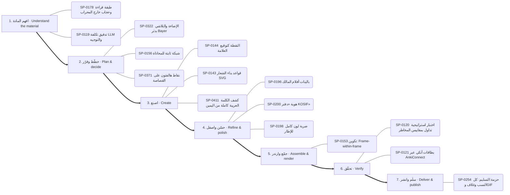

1. **افهم المادة:** SP-0178 🟢 طبقة قراءة وحجاب خارج المحراب · SP-0119 📄 تدقيق تكلفة LLM والتوجيه
2. **خطّط وقرّر:** SP-0322 ✅ الإضاءة والتلاشي بدثر Bayer · SP-0156 📦 شبكة ثابتة للمحاذاة · SP-0371 ✅ نقاط هالفتون على القصاصة
3. **اصنع:** SP-0144 📦 النقطة كتوقيع العلامة · SP-0143 ✅ قواعد بناء الشعار SVG · SP-0411 ✅ كشف الكلمة العربية كاملة من اليمين
4. **حسّن واصقل:** SP-0196 ✅ باليتات أفلام المالك · SP-0200 ✅ هوية «دفتر KOSIF» · SP-0198 ✅ ضربة لون كامل للإطار
5. **جمّع وارندر:** SP-0153 🟢 تكوين: Frame-within-frame
6. **تحقّق:** SP-0120 📄 اختبار استراتيجية تداول بمقاييس المخاطر · SP-0121 📄 بطاقات أنكي عبر AnkiConnect
7. **سلّم وانشر:** SP-0254 ✅ حزمة التسليم: كل النسب وغلاف وGIF

### تحرير صور وتصميم — Photo editing & design (`photo`)

البوابات: `image-apps` ← `draw` ← `genai`

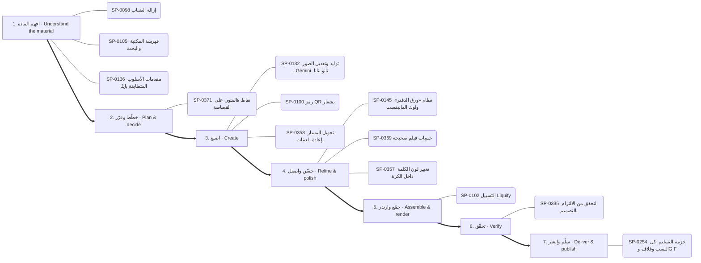

1. **افهم المادة:** SP-0098 ✅ إزالة الضباب · SP-0105 ✅ فهرسة المكتبة والبحث · SP-0136 📄 مقدمات الأسلوب المتطابقة بايتًا
2. **خطّط وقرّر:** SP-0371 ✅ نقاط هالفتون على القصاصة
3. **اصنع:** SP-0132 ✅ توليد وتعديل الصور بـ Gemini (نانو بنانا) · SP-0100 ✅ رمز QR بشعار · SP-0353 ✅ تحويل المسار بإعادة العينات
4. **حسّن واصقل:** SP-0145 🟢 نظام «ورق الدفتر» ولوك المانيفست · SP-0369 ✅ حبيبات فيلم صحيحة · SP-0357 ✅ تغيير لون الكلمة داخل الكرة
5. **جمّع وارندر:** SP-0102 ✅ التسييل (Liquify)
6. **تحقّق:** SP-0335 ✅ التحقق من الالتزام بالتصميم
7. **سلّم وانشر:** SP-0254 ✅ حزمة التسليم: كل النسب وغلاف وGIF

### مشهد ثلاثي الأبعاد — 3D scene (`3d-scene`)

البوابات: `3d` ← `motion` ← `render`

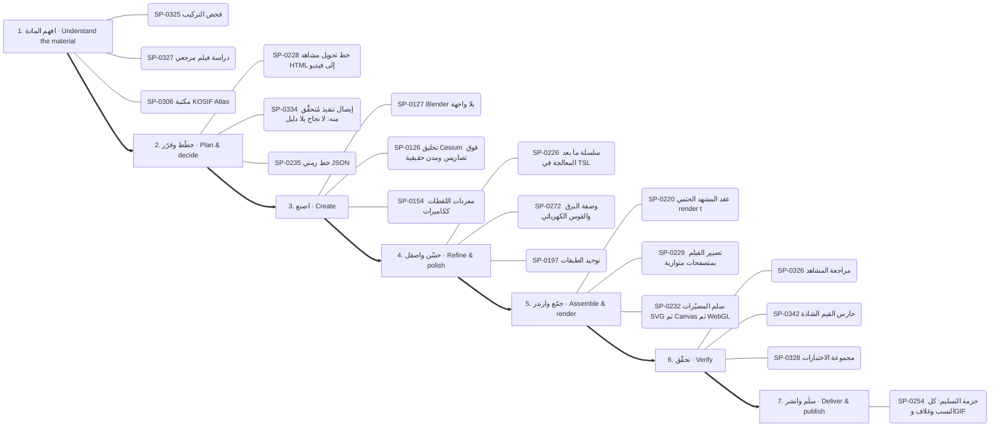

1. **افهم المادة:** SP-0325 ✅ فحص التركيب · SP-0327 ✅ دراسة فيلم مرجعي · SP-0306 ✅ مكتبة KOSIF Atlas
2. **خطّط وقرّر:** SP-0228 ✅ خط تحويل مشاهد HTML إلى فيديو · SP-0334 ✅ إيصال تنفيذ مُتحقَّق منه: لا نجاح بلا دليل · SP-0235 ✅ خط زمني JSON
3. **اصنع:** SP-0127 ✅ Blender بلا واجهة · SP-0126 🟢 تحليق Cesium فوق تضاريس ومدن حقيقية · SP-0154 ✅ مفردات اللقطات ككاميرات
4. **حسّن واصقل:** SP-0226 ✅ سلسلة ما بعد المعالجة في TSL · SP-0272 ✅ وصفة البرق والقوس الكهربائي · SP-0197 ✅ توحيد الطبقات
5. **جمّع وارندر:** SP-0220 ✅ عقد المشهد الحتمي render(t) · SP-0229 📦 تصيير الفيلم بمتصفحات متوازية · SP-0232 ✅ سلم المصيّرات SVG ثم Canvas ثم WebGL
6. **تحقّق:** SP-0326 ✅ مراجعة المشاهد · SP-0342 ✅ حارس القيم الشاذة · SP-0328 ✅ مجموعة الاختبارات
7. **سلّم وانشر:** SP-0254 ✅ حزمة التسليم: كل النسب وغلاف وGIF

### بناء تطبيق أو موقع — Build an app or site (`app`)

البوابات: `think` ← `apps` ← `code` ← `docs`

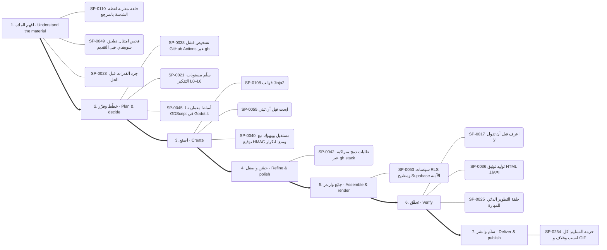

1. **افهم المادة:** SP-0110 📄 حلقة مقارنة لقطة الشاشة بالمرجع · SP-0049 📄 فحص امتثال تطبيق شوبيفاي قبل التقديم · SP-0023 📄 جرد القدرات قبل الحل
2. **خطّط وقرّر:** SP-0038 📄 تشخيص فشل GitHub Actions عبر gh · SP-0021 ✅ سلّم مستويات التفكير L0–L6 · SP-0045 📄 أنماط معمارية لـ GDScript في Godot 4
3. **اصنع:** SP-0108 ✅ قوالب Jinja2 · SP-0055 ✅ ابحث قبل أن تبني · SP-0040 📄 مستقبل ويبهوك مع توقيع HMAC ومنع التكرار
4. **حسّن واصقل:** SP-0042 📄 طلبات دمج متراكبة عبر gh stack
5. **جمّع وارندر:** SP-0053 📄 سياسات RLS ومفاتيح Supabase الآمنة
6. **تحقّق:** SP-0017 ✅ اعرف قبل أن تقول لا · SP-0036 ✅ توليد توثيق HTML للـAPI · SP-0025 ✅ حلقة التطوير الذاتي للمهارة
7. **سلّم وانشر:** SP-0254 ✅ حزمة التسليم: كل النسب وغلاف وGIF

### تعديل كود وإصلاح — Change or fix code (`code-change`)

البوابات: `think` ← `code`

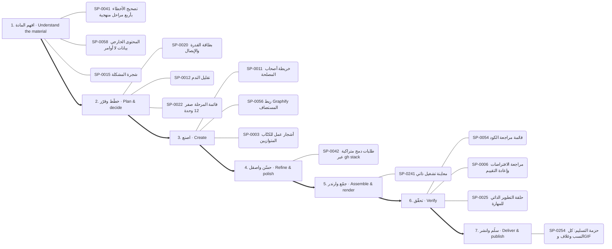

1. **افهم المادة:** SP-0041 📄 تصحيح الأخطاء بأربع مراحل منهجية · SP-0058 ✅ المحتوى الخارجي بيانات لا أوامر · SP-0015 📄 شجرة المشكلة
2. **خطّط وقرّر:** SP-0020 📄 بطاقة القدرة والإيصال · SP-0012 📄 تقليل الندم · SP-0022 📄 قائمة المرحلة صفر (12 وحدة)
3. **اصنع:** SP-0011 📄 خريطة أصحاب المصلحة · SP-0056 ✅ ربط Graphify المستضاف · SP-0003 🔑 أشجار عمل للكتّاب المتوازيين
4. **حسّن واصقل:** SP-0042 📄 طلبات دمج متراكبة عبر gh stack
5. **جمّع وارندر:** SP-0241 ✅ معاينة تشغيل ذاتي
6. **تحقّق:** SP-0054 ✅ قائمة مراجعة الكود · SP-0006 📄 مراجعة الافتراضات وإعادة التقييم · SP-0025 ✅ حلقة التطوير الذاتي للمهارة
7. **سلّم وانشر:** SP-0254 ✅ حزمة التسليم: كل النسب وغلاف وGIF

### فحص تطبيق ونقل ميزة — Investigate an app and transfer a feature (`reverse`)

البوابات: `reverse` ← `code` ← `image-apps`

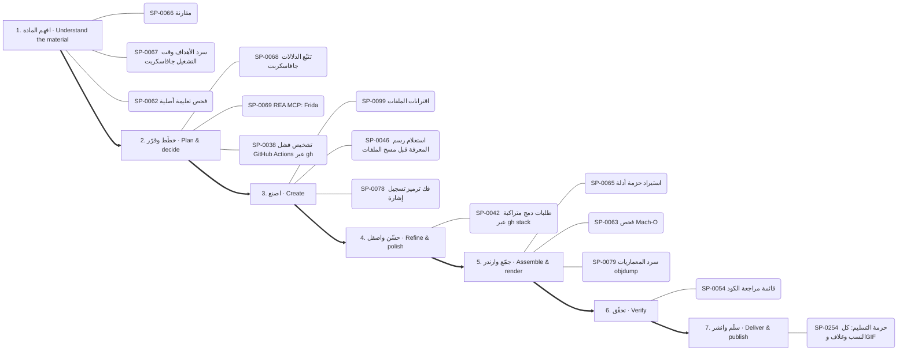

1. **افهم المادة:** SP-0066 ✅ مقارنة · SP-0067 ✅ سرد الأهداف وقت التشغيل جافاسكربت · SP-0062 ✅ فحص تعليمة أصلية
2. **خطّط وقرّر:** SP-0068 ✅ تتبّع الدلالات جافاسكربت · SP-0069 📄 REA MCP: Frida · SP-0038 📄 تشخيص فشل GitHub Actions عبر gh
3. **اصنع:** SP-0099 ✅ اقترانات الملفات · SP-0046 📄 استعلام رسم المعرفة قبل مسح الملفات · SP-0078 ✅ فك ترميز تسجيل إشارة
4. **حسّن واصقل:** SP-0042 📄 طلبات دمج متراكبة عبر gh stack
5. **جمّع وارندر:** SP-0065 ✅ استيراد حزمة أدلة · SP-0063 📦 فحص Mach-O · SP-0079 ✅ سرد المعماريات objdump
6. **تحقّق:** SP-0054 ✅ قائمة مراجعة الكود
7. **سلّم وانشر:** SP-0254 ✅ حزمة التسليم: كل النسب وغلاف وGIF

### تحليل بيانات وتقرير — Data analysis report (`data-report`)

البوابات: `data` ← `dataviz` ← `docs` ← `write`

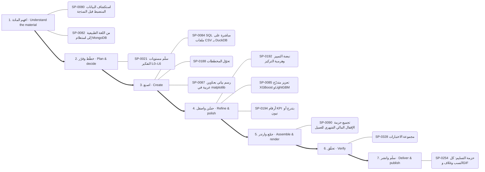

1. **افهم المادة:** SP-0080 📄 استكشاف البيانات المنضبط قبل النمذجة · SP-0082 📄 من اللغة الطبيعية إلى استعلام MongoDB
2. **خطّط وقرّر:** SP-0021 ✅ سلّم مستويات التفكير L0–L6
3. **اصنع:** SP-0084 ✅ SQL مباشرة على ملفات CSV بـ DuckDB · SP-0188 ✅ تحوّل المخططات · SP-0087 ✅ رسم بياني بعناوين عربية في matplotlib
4. **حسّن واصقل:** SP-0192 🟢 نبضة التمييز وهرمية التركيز · SP-0085 ✅ تعزيز متدرّج XGBoost وLightGBM · SP-0194 ✅ أرقام KPI بتدرج أو نيون
5. **جمّع وارندر:** SP-0090 📄 تجميع حزمة الإقفال المالي الشهري للعميل
6. **تحقّق:** SP-0328 ✅ مجموعة الاختبارات
7. **سلّم وانشر:** SP-0254 ✅ حزمة التسليم: كل النسب وغلاف وGIF

### بحث وكتابة مقال — Research and write (`research-write`)

البوابات: `research` ← `think` ← `write` ← `docs`

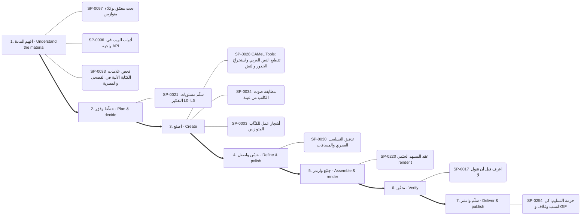

1. **افهم المادة:** SP-0097 ✅ بحث معمّق بوكلاء متوازيين · SP-0096 ✅ أدوات الويب في واجهة API · SP-0033 ✅ فحص علامات الكتابة الآلية في الفصحى والمصرية
2. **خطّط وقرّر:** SP-0021 ✅ سلّم مستويات التفكير L0–L6
3. **اصنع:** SP-0028 ✅ CAMeL Tools: تقطيع النص العربي واستخراج الجذور والتشكيل وتحديد · SP-0034 ✅ مطابقة صوت الكاتب من عينة · SP-0003 🔑 أشجار عمل للكتّاب المتوازيين
4. **حسّن واصقل:** SP-0030 📄 تدقيق التسلسل البصري والمسافات
5. **جمّع وارندر:** SP-0220 ✅ عقد المشهد الحتمي render(t)
6. **تحقّق:** SP-0017 ✅ اعرف قبل أن تقول لا
7. **سلّم وانشر:** SP-0254 ✅ حزمة التسليم: كل النسب وغلاف وGIF

## البوابات مرتبة بالمراحل / hubs by stage

### الرسم والتصميم والشخصيات — Drawing, design & characters

- **خطّط وقرّر** (2): SP-0371 نقاط هالفتون على القصاصة · SP-0322 الإضاءة والتلاشي بدثر Bayer
- **اصنع** (26): SP-0260 رسم المسار بإزاحة الشرطة · SP-0183 شخصيات حية ببصمات حركة · SP-0143 قواعد بناء الشعار SVG · SP-0353 تحويل المسار بإعادة العينات · SP-0321 شاشة LED نقطية وكلمات بكسل حقيقية · SP-0354 شريط ينثني فيصير حلقة …
- **حسّن واصقل** (5): SP-0369 حبيبات فيلم صحيحة · SP-0145 نظام «ورق الدفتر» ولوك المانيفست · SP-0187 أدوات تفاصيل المخلوقات · SP-0357 تغيير لون الكلمة داخل الكرة · SP-0359 تجمع الصلصال بالكرات

### المونتاج وتحرير الفيديو — Montage & video editing

- **افهم المادة** (1): SP-0317 قياس أسلوب ريل من الإطارات
- **خطّط وقرّر** (5): SP-0316 قص دقيق بالإطار · SP-0255 نسختان A/B · SP-0389 قلب بطاقة ثلاثي الأبعاد · SP-0398 قطع عبر بوابة الجسم · SP-0401 ومضة ضوء بيضاء بإضاءة بقعية
- **اصنع** (22): SP-0315 انضباط مونتاج المادة الحقيقية · SP-0382 قطع بقلب الألوان · SP-0390 مونتاج سريع لنطاق الأساليب · SP-0258 قواعد المقروئية على الهاتف · SP-0319 إعدادات تسجيل الشاشة · SP-0379 قطع بالكتل اللونية …
- **حسّن واصقل** (16): SP-0377 انتقالات التغطية · SP-0376 انتقال CSS: تبعيد · SP-0381 انتقال جليتش شرائحي · SP-0384 انتقال: تحول · SP-0386 كشف دائري وفيضان لوني · SP-0378 انتقال: مسح …
- **جمّع وارندر** (1): SP-0256 الإطار السينمائي العريض والأشرطة
- **سلّم وانشر** (3): SP-0254 حزمة التسليم: كل النسب وغلاف وGIF · SP-0434 تحميل فيديو من أي رابط · SP-0257 حزمة نشر مفحوصة لكل منصة

### الموشن جرافيك والكاميرا والمؤثرات — Motion graphics, camera & effects

- **افهم المادة** (2): SP-0306 مكتبة KOSIF Atlas · SP-0178 طبقة قراءة وحجاب خارج المحراب
- **خطّط وقرّر** (12): SP-0149 حركة إيقاعية: staggered-exit · SP-0158 تخطيط نص وواجهة · SP-0215 أربع تسارعات مسماة فقط · SP-0271 الانحراف اللوني للعدسة · SP-0430 لوحة البيانات داخل الإطار · SP-0170 تغطية بعدستين 35/85 …
- **اصنع** (43): SP-0309 مطر motion-kit · SP-0147 حركة الكاميرا للمسرح · SP-0310 حلقة جسيمات وكوكبة · SP-0212 ميزانيات التتابع · SP-0426 المؤشر بطلًا · SP-0151 دفع الكاميرا …
- **حسّن واصقل** (20): SP-0210 منحنى النابض المحسوب مسبقًا · SP-0196 باليتات أفلام المالك · SP-0266 توهج النص النيوني بثلاثة ظلال لكل كلمة · SP-0267 إضاءة الحافة في الرسم · SP-0197 توحيد الطبقات · SP-0211 جدول توقيت عرض المنتج …
- **جمّع وارندر** (1): SP-0153 تكوين: Frame-within-frame

### ثلاثي الأبعاد وBlender — 3D & Blender

- **خطّط وقرّر** (1): SP-0129 حقول المكعبات المتموجة
- **اصنع** (4): SP-0126 تحليق Cesium فوق تضاريس ومدن حقيقية · SP-0127 Blender بلا واجهة · SP-0128 منصة العمق 2.5D · SP-0130 الأنفاق

### الخطوط والطباعة المتحركة (عربي ولاتيني) — Typography & kinetic type

- **خطّط وقرّر** (2): SP-0417 مكدّس عربي/إنجليزي · SP-0418 الزخرفة والكشيدة للنبذة فقط
- **اصنع** (12): SP-0411 كشف الكلمة العربية كاملة من اليمين · SP-0412 ترشيح الخط لا الجزم به · SP-0419 أنظمة الأصوات الطباعية · SP-0414 كلمة ترتطم وتستقر · SP-0413 نظام أرقام واحد وأرقام جدولية · SP-0415 سلّم القراءة للشاشات …
- **حسّن واصقل** (1): SP-0422 عنوان بلونين وكلمة لون

### الصوت والموسيقى والترجمة النصية — Audio, music, voice & captions

- **افهم المادة** (3): SP-0140 تجهيز الصوت للتفريغ وفخ التوقيت · SP-0299 مقياس مستوى الميكروفون · SP-0295 قنوات الصوت كمحرّك
- **خطّط وقرّر** (5): SP-0280 قطع على الإيقاع · SP-0290 قنوات تحليل الصوت لكل إطار · SP-0287 موجز الأغنية ومدد الإيقاع · SP-0298 موسيقى أصلية · SP-0303 MG-094/098 مسار الكرة وخطوط السرعة
- **اصنع** (20): SP-0281 خفض الموسيقى تحت الصوت · SP-0435 أزياء صوتية للشخصيات · SP-0284 مقام lydian · SP-0286 أجواء مولدة · SP-0282 مكتبة مؤثرات Kenney · SP-0283 موجة صوتية …
- **حسّن واصقل** (6): SP-0139 توقيت الكلمات حسب الطول · SP-0285 تطبيع الجهارة -14 LUFS · SP-0292 سلسلة ماسترينج · SP-0297 التلاشي وخفض الموسيقى عبر مسار الأتمتة · SP-0301 الآلات العربية · SP-0305 أصوات مولدة
- **جمّع وارندر** (1): SP-0302 بوابة ضوضاء بين الكلمات

### الرسوم البيانية والخرائط والمخططات — Charts, maps & explainer diagrams

- **افهم المادة** (1): SP-0209 تسميات بخطوط قائدة
- **اصنع** (15): SP-0188 تحوّل المخططات · SP-0205 خريطة الكيان في المنتصف · SP-0191 أمانة المقاييس: المساحة واللوغاريتم والتطبيع · SP-0204 فيديو شرح بـManim · SP-0274 هل نحتاج خريطة أصلًا · SP-0189 حلقة قياس مع عدّاد متزامن …
- **حسّن واصقل** (3): SP-0192 نبضة التمييز وهرمية التركيز · SP-0194 أرقام KPI بتدرج أو نيون · SP-0193 مسح الدائرة بزاوية واحدة
- **سلّم وانشر** (1): SP-0195 تنسيق الأرقام المختصر والمحلي

### التوليد بالذكاء الاصطناعي والبرومبت — AI generation & prompts

- **افهم المادة** (1): SP-0136 مقدمات الأسلوب المتطابقة بايتًا
- **اصنع** (8): SP-0131 مصنع البرومبت: مواصفة واحدة ← تسع منصات · SP-0132 توليد وتعديل الصور بـ Gemini (نانو بنانا) · SP-0031 برومبت مولّد الصور · SP-0133 خدمة الصور المصغرة المدفوعة · SP-0138 جسر الذكاء في الاستوديو (Claude CLI / API / يدوي) · SP-0134 توليد ثم تتبّع …
- **تحقّق** (1): SP-0032 اختبارات التفعيل والتصادم

### الفكرة والقصة والإخراج — Ideas, story & direction

- **خطّط وقرّر** (3): SP-0363 نوتة الحركة · SP-0008 سكامبر (SCAMPER) · SP-0364 قانون الثانية الأولى
- **اصنع** (6): SP-0361 فيلم العلامة: من المشكلة إلى الكشف · SP-0362 مولّد طلب Claude من الأسلوب · SP-0366 مونتاج مُخرَج لمقطع كلام · SP-0367 حزمة المخرج السينمائي ومواصفة المشهد بسبع طبقات · SP-0368 أنظمة جمالية جاهزة ولا تخلطها · SP-0009 توليفة: تحليل بيانات + قصة موشن
- **تحقّق** (1): SP-0010 مسح الكليشيهات
- **سلّم وانشر** (1): SP-0365 ذاكرة الذوق والوصفات

### الرندر والتحقق من الجودة — Render pipeline & QA

- **افهم المادة** (10): SP-0325 فحص التركيب · SP-0327 دراسة فيلم مرجعي · SP-0329 تحليل صورة مقاس · SP-0330 فحص التباين عبر الزمن · SP-0340 كشف اللقطات الرديئة · SP-0339 حد أدنى للقراءة …
- **خطّط وقرّر** (12): SP-0324 بوابة التسليم · SP-0334 إيصال تنفيذ مُتحقَّق منه: لا نجاح بلا دليل · SP-0331 لوحات النقد · SP-0235 خط زمني JSON · SP-0239 فيلم بدون متصفح · SP-0228 خط تحويل مشاهد HTML إلى فيديو …
- **اصنع** (16): SP-0224 مشروع موشن جديد · SP-0225 تجهيز بيئة claude.ai · SP-0223 استوديو الويب المحلي · SP-0238 وضع الزمن الافتراضي لأي صفحة متحركة · SP-0337 إصلاح انزياح التوقيت عند الدمج · SP-0230 كود Python إنتاجي …
- **حسّن واصقل** (3): SP-0226 سلسلة ما بعد المعالجة في TSL · SP-0231 ضبابية حركة حقيقية · SP-0351 منظف مشروع Studio
- **جمّع وارندر** (17): SP-0220 عقد المشهد الحتمي render(t) · SP-0232 سلم المصيّرات SVG ثم Canvas ثم WebGL · SP-0241 معاينة تشغيل ذاتي · SP-0233 ترميز يدوي من الإطارات · SP-0247 عشوائية ببذرة · SP-0234 تصدير MP4 دقيق …
- **تحقّق** (6): SP-0328 مجموعة الاختبارات · SP-0326 مراجعة المشاهد · SP-0342 حارس القيم الشاذة · SP-0346 مشغل المعاينة · SP-0335 التحقق من الالتزام بالتصميم · SP-0332 قائمة جودة الحركة

### تحرير الصور ومزايا التطبيقات — Photo editing & app features

- **افهم المادة** (3): SP-0098 إزالة الضباب · SP-0116 صوت PipeWire داخل الحاويات · SP-0105 فهرسة المكتبة والبحث
- **اصنع** (8): SP-0101 نمو نباتي وزخرفي · SP-0100 رمز QR بشعار · SP-0117 التعرف الضوئي على العربية (tesseract) · SP-0118 ضغط الصور ومقارنة الجودة · SP-0103 رسم زيتي وحبر ورصاص · SP-0099 اقترانات الملفات …
- **جمّع وارندر** (3): SP-0102 التسييل (Liquify) · SP-0106 جرد قدرات Blender الحي · SP-0107 كاميرا افتراضية من فيديو

### الكود والهندسة والأمان — Code, engineering & security

- **افهم المادة** (3): SP-0058 المحتوى الخارجي بيانات لا أوامر · SP-0041 تصحيح الأخطاء بأربع مراحل منهجية · SP-0049 فحص امتثال تطبيق شوبيفاي قبل التقديم
- **خطّط وقرّر** (3): SP-0038 تشخيص فشل GitHub Actions عبر gh · SP-0045 أنماط معمارية لـ GDScript في Godot 4 · SP-0048 ترحيل مخطط قاعدة البيانات دون توقف
- **اصنع** (12): SP-0056 ربط Graphify المستضاف · SP-0055 ابحث قبل أن تبني · SP-0057 الخريطة مادةً لفيلم موشن · SP-0039 أساطيل أشجار عمل لمراحل وكلاء متوازية · SP-0040 مستقبل ويبهوك مع توقيع HMAC ومنع التكرار · SP-0046 استعلام رسم المعرفة قبل مسح الملفات …
- **حسّن واصقل** (1): SP-0042 طلبات دمج متراكبة عبر gh stack
- **جمّع وارندر** (1): SP-0053 سياسات RLS ومفاتيح Supabase الآمنة
- **تحقّق** (4): SP-0036 توليد توثيق HTML للـAPI · SP-0054 قائمة مراجعة الكود · SP-0043 إعداد shadcn وUnoCSS لتنسيق المكونات · SP-0044 اختبار تكامل يعدّ عدد إصدارات التوكن

### فحص البرامج والهندسة العكسية (REA) — Software investigation (REA)

- **افهم المادة** (10): SP-0072 فرز المثبّت قبل REA · SP-0071 فحص صفحة ويب · SP-0064 فحص قطعة مُدار (.NET) · SP-0066 مقارنة · SP-0067 سرد الأهداف وقت التشغيل جافاسكربت · SP-0075 فحص عميل pcap …
- **خطّط وقرّر** (2): SP-0068 تتبّع الدلالات جافاسكربت · SP-0069 REA MCP: Frida
- **اصنع** (2): SP-0078 فك ترميز تسجيل إشارة · SP-0076 فتح مشروع JEB
- **جمّع وارندر** (6): SP-0065 استيراد حزمة أدلة · SP-0079 سرد المعماريات objdump · SP-0061 فحص عميل ADB · SP-0063 فحص Mach-O · SP-0070 REA MCP: Rizin · SP-0073 REA MCP: GDB

### التفكير والتخطيط والوكلاء — Thinking, planning & agents

- **افهم المادة** (5): SP-0018 بطاقة القدرات بسكربت واحد · SP-0019 اقرأ قائمة أدواتك · SP-0005 تصميم ذاكرة الوكيل وتقييمها وتدقيق التسميم · SP-0023 جرد القدرات قبل الحل · SP-0015 شجرة المشكلة
- **خطّط وقرّر** (8): SP-0021 سلّم مستويات التفكير L0–L6 · SP-0016 خطة تسليم بإيصال · SP-0022 قائمة المرحلة صفر (12 وحدة) · SP-0012 تقليل الندم · SP-0013 الإبداع التركيبي · SP-0014 تخطيط السيناريوهات …
- **اصنع** (5): SP-0002 خوادم MCP: إضافة وتدقيق وميزانية · SP-0011 خريطة أصحاب المصلحة · SP-0001 ملف تسليم الجلسة مع عتبات ضغط السياق · SP-0003 أشجار عمل للكتّاب المتوازيين · SP-0024 سجل التغطية قبل الإرسال
- **تحقّق** (6): SP-0017 اعرف قبل أن تقول لا · SP-0025 حلقة التطوير الذاتي للمهارة · SP-0026 pass@k مقابل pass^k · SP-0004 مراجعة سانتا المزدوجة · SP-0027 طريقة سانتا: مراجعان معزولان · SP-0006 مراجعة الافتراضات وإعادة التقييم

### الكتابة واللغة العربية — Writing & Arabic

- **افهم المادة** (1): SP-0033 فحص علامات الكتابة الآلية في الفصحى والمصرية
- **اصنع** (3): SP-0028 CAMeL Tools: تقطيع النص العربي واستخراج الجذور والتشكيل وتحديد · SP-0035 قفل الاقتباس المباشر · SP-0034 مطابقة صوت الكاتب من عينة
- **حسّن واصقل** (1): SP-0030 تدقيق التسلسل البصري والمسافات
- **تحقّق** (1): SP-0029 تحقق من أرقام OCR ببوابة المراسي

### تحليل البيانات — Data analysis

- **افهم المادة** (2): SP-0080 استكشاف البيانات المنضبط قبل النمذجة · SP-0082 من اللغة الطبيعية إلى استعلام MongoDB
- **اصنع** (4): SP-0084 SQL مباشرة على ملفات CSV بـ DuckDB · SP-0086 حل رياضي دقيق بـ sympy · SP-0087 رسم بياني بعناوين عربية في matplotlib · SP-0083 محاسبة الأعمال الصغيرة: رواتب وضرائب وتحصيل
- **حسّن واصقل** (1): SP-0085 تعزيز متدرّج XGBoost وLightGBM
- **جمّع وارندر** (1): SP-0081 عقد خط بيانات: الحبيبية والتكرار الآمن

### المستندات والمكتب — Documents & office

- **اصنع** (5): SP-0092 تحويل Office إلى PDF دفعة واحدة · SP-0093 PlantUML: توليد مخططات UML من نص · SP-0088 تدقيق انحراف التوثيق عن الكود · SP-0089 مراجعة مخاطر العقود واتفاقيات السرية · SP-0091 كتابة سرد الألعاب المتفرع
- **جمّع وارندر** (1): SP-0090 تجميع حزمة الإقفال المالي الشهري للعميل
- **سلّم وانشر** (1): SP-0094 موصل المستندات الحية

### البحث والمصادر — Research & sources

- **افهم المادة** (3): SP-0096 أدوات الويب في واجهة API · SP-0097 بحث معمّق بوكلاء متوازيين · SP-0095 استخراج وإثراء بيانات الأطباء

### التطبيقات والواجهات والمواقع — Apps, UI & web

- **افهم المادة** (2): SP-0110 حلقة مقارنة لقطة الشاشة بالمرجع · SP-0113 مسجل قياس تشغيل بالملاحظة فقط
- **اصنع** (2): SP-0108 قوالب Jinja2 · SP-0112 نموذج أولي مؤقت للإجابة عن سؤال
- **تحقّق** (2): SP-0109 نشر صفحة تفاعلية خاصة · SP-0111 حلقة مراجع شجرة الوصولية لتحكم المتصفح
- **سلّم وانشر** (1): SP-0114 ضبط مجمع الاتصالات وموثوقية قاعدة البيانات

### المنتج والتسويق والمال — Product, marketing & finance

- **افهم المادة** (2): SP-0119 تدقيق تكلفة LLM والتوجيه · SP-0122 تحليل الأسباب الجذرية والمخاطر
- **خطّط وقرّر** (1): SP-0125 ثلاثة خيارات حقيقية وعدم الفعل
- **اصنع** (2): SP-0124 السعر الأمثل ونقطة التعادل · SP-0123 حلقة مستقلة لتصريف قائمة المهام
- **تحقّق** (2): SP-0120 اختبار استراتيجية تداول بمقاييس المخاطر · SP-0121 بطاقات أنكي عبر AnkiConnect

---
_مولَّد آليًا من data/superpowers.json وdata/hubs_index.json وdata/task_maps.json._
