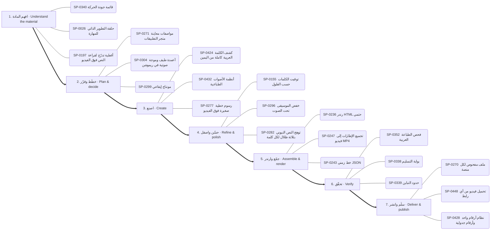
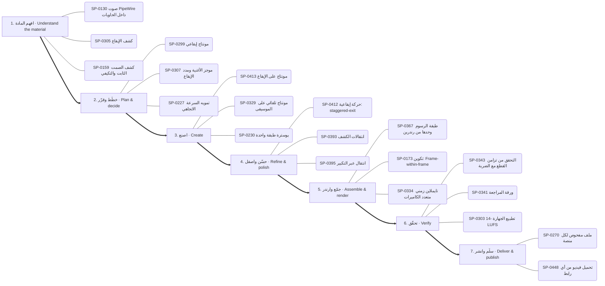
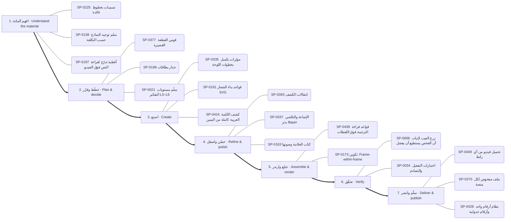
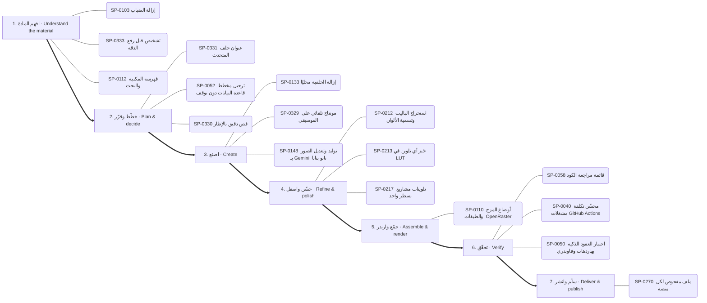
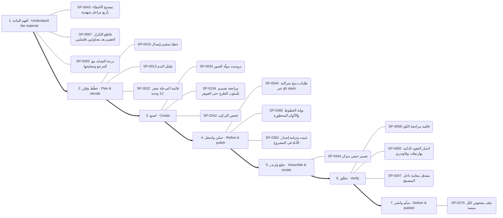
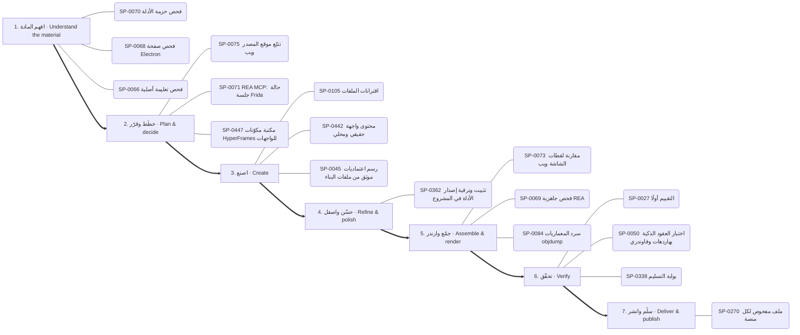

# الخريطة الذهنية للقدرات — Capability mind map

<!-- generated by scripts/capability_mindmap.py build -->

كل قدرة مرتبة بحسب **مرحلة المهمة** التي تخدمها، ثم كل بوابة مقسمة بالمراحل، ثم خرائط جاهزة لمهام شائعة. اتبع المراحل بالترتيب: افهم ← خطّط ← اصنع ← حسّن ← جمّع وارندر ← تحقّق ← سلّم.

    python3 scripts/capability_mindmap.py task "<المهمة>"     # خريطة مرحلية لأي مهمة
    python3 scripts/capability_mindmap.py task reels-edit      # خريطة جاهزة

## الفهرس / contents

- المراحل السبع / the seven stages
- الخريطة الكبرى / the big map
- خرائط المهام الجاهزة / ready task maps
- البوابات مرتبة بالمراحل / hubs by stage

## المراحل السبع / the seven stages

1. **افهم المادة — Understand the material** · 758 قدرة ذرية
2. **خطّط وقرّر — Plan & decide** · 897 قدرة ذرية
3. **اصنع — Create** · 1855 قدرة ذرية
4. **حسّن واصقل — Refine & polish** · 879 قدرة ذرية
5. **جمّع وارندر — Assemble & render** · 467 قدرة ذرية
6. **تحقّق — Verify** · 449 قدرة ذرية
7. **سلّم وانشر — Deliver & publish** · 175 قدرة ذرية

## الخريطة الكبرى / the big map

## خرائط المهام الجاهزة / ready task maps

### فيديو موشن جرافيك بصوت — Motion-graphics film with voice (`motion-film`)

البوابات: `thinking` ← `audio` ← `type` ← `motion` ← `drawing` ← `3d` ← `quality`

1. **افهم المادة:** SP-0340 ✅ قائمة جودة الحركة · SP-0026 ✅ حلقة التطوير الذاتي للمهارة · SP-0197 🟢 أغطية تدرّج لقراءة النص فوق الفيديو
2. **خطّط وقرّر:** SP-0271 ✅ مواصفات معاينة متجر التطبيقات · SP-0304 🟢 أعمدة طيف وموجة صوتية في ريموشن · SP-0299 🟢 مونتاج إيقاعي
3. **اصنع:** SP-0424 ✅ كشف الكلمة العربية كاملة من اليمين · SP-0432 ✅ أنظمة الأصوات الطباعية · SP-0277 ✅ رسوم خطية صغيرة فوق الفيديو
4. **حسّن واصقل:** SP-0155 ✅ توقيت الكلمات حسب الطول · SP-0296 ✅ خفض الموسيقى تحت الصوت · SP-0282 ✅ توهج النص النيوني بثلاثة ظلال لكل كلمة
5. **جمّع وارندر:** SP-0236 ✅ رندر HTML حتمي · SP-0247 ✅ تجميع الإطارات إلى فيديو MP4 · SP-0243 ✅ خط زمني JSON
6. **تحقّق:** SP-0352 ✅ فحص الطباعة العربية · SP-0338 ✅ بوابة التسليم · SP-0339 ✅ حدود التباين
7. **سلّم وانشر:** SP-0270 ✅ ملف مفحوص لكل منصة · SP-0448 ✅ تحميل فيديو من أي رابط · SP-0428 ✅ نظام أرقام واحد وأرقام جدولية

### مونتاج ريلز على الإيقاع — Beat-synced reels edit (`reels-edit`)

البوابات: `motion` ← `audio` ← `images` ← `quality`

1. **افهم المادة:** SP-0130 ✅ صوت PipeWire داخل الحاويات · SP-0305 ✅ كشف الإيقاع · SP-0159 ✅ كشف الصمت الثابت والتكيفي
2. **خطّط وقرّر:** SP-0299 🟢 مونتاج إيقاعي · SP-0307 ✅ موجز الأغنية ومدد الإيقاع · SP-0227 ✅ تمويه السرعة الاتجاهي
3. **اصنع:** SP-0413 ✅ مونتاج على الإيقاع · SP-0329 ✅ مونتاج تلقائي على الموسيقى · SP-0230 ✅ بوسترة طبقة واحدة
4. **حسّن واصقل:** SP-0412 🟢 حركة إيقاعية: staggered-exit · SP-0393 ✅ انتقالات الكشف · SP-0395 ✅ انتقال عبر التكبير
5. **جمّع وارندر:** SP-0367 ✅ طبقة الرسوم وحدها من رندرين · SP-0173 🟢 تكوين: Frame-within-frame · SP-0334 🟢 تايملاين زمني متعدد الكاميرات
6. **تحقّق:** SP-0343 ✅ التحقق من تزامن القطع مع الضربة · SP-0341 ✅ ورقة المراجعة · SP-0303 ✅ تطبيع الجهارة -14 LUFS
7. **سلّم وانشر:** SP-0270 ✅ ملف مفحوص لكل منصة · SP-0448 ✅ تحميل فيديو من أي رابط

### رسم شخصية وتحريكها — Draw and animate a character (`character`)

البوابات: `drawing` ← `motion` ← `audio` ← `3d`

1. **افهم المادة:** SP-0262 📦 أمر: الكتالوج والإضافة
2. **خطّط وقرّر:** SP-0300 ✅ موسيقى أصلية · SP-0271 ✅ مواصفات معاينة متجر التطبيقات · SP-0145 ✅ حقول المكعبات المتموجة
3. **اصنع:** SP-0198 ✅ شخصيات حية ببصمات حركة · SP-0391 ✅ ست خلفيات نقشية متحركة · SP-0144 🟢 منصة العمق 2.5D
4. **حسّن واصقل:** SP-0156 ✅ دمج المشاهد مع الصوت الأصلي بلا تعديل · SP-0371 ✅ حلقة صدمة أرضية ونبض قلب · SP-0394 🟢 قطع بقلب الألوان
5. **جمّع وارندر:** SP-0241 ✅ تصدير MP4 دقيق · SP-0246 ✅ التقاط الإطارات عبر متصفح Edge وكارت الشاشة · SP-0251 ✅ تجميع اللقطات بنوافذ إطارات
6. **تحقّق:** SP-0310 🟢 كثافة المؤثرات · SP-0303 ✅ تطبيع الجهارة -14 LUFS
7. **سلّم وانشر:** SP-0270 ✅ ملف مفحوص لكل منصة · SP-0448 ✅ تحميل فيديو من أي رابط

### فيديو شرح بالمخططات والبيانات — Data/diagram explainer (`explainer`)

البوابات: `data` ← `drawing` ← `motion` ← `thinking`

1. **افهم المادة:** SP-0101 ✅ استخراج النص الرئيسي من صفحة
2. **خطّط وقرّر:** SP-0209 🟢 إنفوجرافيك مولَّد مستند إلى بحث · SP-0377 ✅ قوس القطعة القصيرة · SP-0170 ✅ تخطيط نص وواجهة
3. **اصنع:** SP-0220 ✅ فيديو شرح بـManim · SP-0203 ✅ تحوّل المخططات · SP-0206 ✅ خط/مساحة مع مؤشر تقاطع
4. **حسّن واصقل:** SP-0393 ✅ انتقالات الكشف · SP-0207 ✅ ظهور الرقم بضبابية ورفع · SP-0371 ✅ حلقة صدمة أرضية ونبض قلب
5. **جمّع وارندر:** SP-0246 ✅ التقاط الإطارات عبر متصفح Edge وكارت الشاشة
6. **تحقّق:** SP-0038 ✅ توليد توثيق HTML للـAPI
7. **سلّم وانشر:** SP-0270 ✅ ملف مفحوص لكل منصة

### هوية وشعار وإعلان — Brand, logo & ad (`brand`)

البوابات: `drawing` ← `type` ← `motion` ← `thinking`

1. **افهم المادة:** SP-0225 🟢 تسميات بخطوط قائدة · SP-0138 📄 سلم توجيه النماذج حسب التكلفة · SP-0197 🟢 أغطية تدرّج لقراءة النص فوق الفيديو
2. **خطّط وقرّر:** SP-0377 ✅ قوس القطعة القصيرة · SP-0168 🟢 جدار بطاقات · SP-0021 ✅ سلّم مستويات التفكير L0–L6
3. **اصنع:** SP-0335 ✅ مؤثرات بكسل بخطوات اللوحة · SP-0161 ✅ قواعد بناء الشعار SVG · SP-0424 ✅ كشف الكلمة العربية كاملة من اليمين
4. **حسّن واصقل:** SP-0393 ✅ انتقالات الكشف · SP-0337 ✅ الإضاءة والتلاشي بدثر Bayer · SP-0163 🟢 كتاب العلامة وصوتها
5. **جمّع وارندر:** SP-0439 ✅ قواعد قراءة الترجمة فوق اللقطات · SP-0173 🟢 تكوين: Frame-within-frame
6. **تحقّق:** SP-0006 📄 زرع العيب لإثبات أن الفحص يستطيع أن يفشل · SP-0034 📄 اختبارات التفعيل والتصادم
7. **سلّم وانشر:** SP-0448 ✅ تحميل فيديو من أي رابط · SP-0270 ✅ ملف مفحوص لكل منصة · SP-0428 ✅ نظام أرقام واحد وأرقام جدولية

### تحرير صور وتصميم — Photo editing & design (`photo`)

البوابات: `images` ← `software` ← `drawing`

1. **افهم المادة:** SP-0103 ✅ إزالة الضباب · SP-0333 ✅ تشخيص قبل رفع الدقة · SP-0112 ✅ فهرسة المكتبة والبحث
2. **خطّط وقرّر:** SP-0331 ✅ عنوان خلف المتحدث · SP-0052 📄 ترحيل مخطط قاعدة البيانات دون توقف · SP-0330 ✅ قص دقيق بالإطار
3. **اصنع:** SP-0133 🟢 إزالة الخلفية محليًا · SP-0329 ✅ مونتاج تلقائي على الموسيقى · SP-0148 ✅ توليد وتعديل الصور بـ Gemini (نانو بنانا)
4. **حسّن واصقل:** SP-0212 ✅ استخراج الباليت وتسمية الألوان · SP-0213 ✅ خَبز أي تلوين في LUT · SP-0217 ✅ تلوينات مشاريع بسطر واحد
5. **جمّع وارندر:** SP-0110 ✅ أوضاع المزج والطبقات (OpenRaster)
6. **تحقّق:** SP-0058 ✅ قائمة مراجعة الكود · SP-0040 📄 محسّن تكلفة مشغلات GitHub Actions · SP-0050 📄 اختبار العقود الذكية بهاردهات وفاوندري
7. **سلّم وانشر:** SP-0270 ✅ ملف مفحوص لكل منصة

### مشهد ثلاثي الأبعاد — 3D scene (`3d-scene`)

البوابات: `3d` ← `motion` ← `quality`

1. **افهم المادة:** SP-0346 ✅ فحص الحلقة بلا درزة · SP-0354 ✅ أمر: فحص بصري · SP-0358 ✅ قاعدة نظافة المصادر
2. **خطّط وقرّر:** SP-0260 ✅ التسلسل والسلاسل والتحميل المسبق · SP-0167 📦 إطار HUD · SP-0377 ✅ قوس القطعة القصيرة
3. **اصنع:** SP-0143 ✅ Blender بلا واجهة · SP-0165 ✅ حركة الكاميرا للمسرح · SP-0142 🟢 تحليق Cesium فوق تضاريس ومدن حقيقية
4. **حسّن واصقل:** SP-0255 ✅ خيار التقنية: remotion · SP-0288 ✅ وصفة البرق والقوس الكهربائي · SP-0385 ✅ حبيبات فيلم صحيحة
5. **جمّع وارندر:** SP-0242 ✅ حزمة ثلاثية الأبعاد جاهزة · SP-0246 ✅ التقاط الإطارات عبر متصفح Edge وكارت الشاشة · SP-0238 ✅ معاينة مسودة
6. **تحقّق:** SP-0338 ✅ بوابة التسليم · SP-0339 ✅ حدود التباين · SP-0343 ✅ التحقق من تزامن القطع مع الضربة
7. **سلّم وانشر:** SP-0099 🔑 موصل المستندات الحية

### بناء تطبيق أو موقع — Build an app or site (`app`)

البوابات: `thinking` ← `software` ← `documents` ← `quality`

1. **افهم المادة:** SP-0117 📄 من Figma إلى كود مطابق · SP-0062 ✅ سلّم الموافقة وأقل تصعيد · SP-0023 📄 اعرف قبل أن تقول «لا»
2. **خطّط وقرّر:** SP-0135 📄 تدقيق خفض التكلفة المبني على الاستخدام · SP-0447 📦 مكتبة مكوّنات HyperFrames للواجهات · SP-0345 ✅ اختيار إطار الغلاف
3. **اصنع:** SP-0116 ✅ بناء خادم MCP (الإصدار 2) · SP-0059 ✅ ابحث قبل أن تبني · SP-0442 🟢 محتوى واجهة حقيقي ومحلي
4. **حسّن واصقل:** SP-0362 ✅ تثبيت وترقية إصدار الأداة في المشروع
5. **جمّع وارندر:** SP-0344 ✅ تصيير حتمي بدوكر · SP-0110 ✅ أوضاع المزج والطبقات (OpenRaster)
6. **تحقّق:** SP-0050 📄 اختبار العقود الذكية بهاردهات وفاوندري · SP-0038 ✅ توليد توثيق HTML للـAPI · SP-0347 ✅ مشغل معاينة داخل المتصفح
7. **سلّم وانشر:** SP-0270 ✅ ملف مفحوص لكل منصة

### تعديل كود وإصلاح — Change or fix code (`code-change`)

البوابات: `thinking` ← `software` ← `quality`

1. **افهم المادة:** SP-0043 📄 تصحيح الأخطاء بأربع مراحل منهجية · SP-0007 📄 قاطع التكرار العقيم بعد محاولتين فاشلتين · SP-0355 🟢 درجة التشابه مع المرجع وتصليحها
2. **خطّط وقرّر:** SP-0016 ✅ خطة تسليم بإيصال · SP-0013 📄 تقليل الندم · SP-0022 📄 قائمة المرحلة صفر (12 وحدة)
3. **اصنع:** SP-0033 ✅ برومبت مولّد الصور · SP-0134 📄 مراجعة تصميم بأسلوب الطرح حتى الجوهر · SP-0342 ✅ فحص التركيب
4. **حسّن واصقل:** SP-0044 📄 طلبات دمج متراكبة عبر gh stack · SP-0360 ✅ بوابة الخطوط والألوان المحظورة · SP-0362 ✅ تثبيت وترقية إصدار الأداة في المشروع
5. **جمّع وارندر:** SP-0344 ✅ تصيير حتمي بدوكر
6. **تحقّق:** SP-0058 ✅ قائمة مراجعة الكود · SP-0050 📄 اختبار العقود الذكية بهاردهات وفاوندري · SP-0347 ✅ مشغل معاينة داخل المتصفح
7. **سلّم وانشر:** SP-0270 ✅ ملف مفحوص لكل منصة

### فحص تطبيق ونقل ميزة — Investigate an app and transfer a feature (`reverse`)

البوابات: `reverse` ← `software` ← `quality`

1. **افهم المادة:** SP-0070 ✅ فحص حزمة الأدلة · SP-0068 ✅ فحص صفحة Electron · SP-0066 ✅ فحص تعليمة أصلية
2. **خطّط وقرّر:** SP-0075 📦 تتبّع موقع المصدر ويب · SP-0071 📄 REA MCP: حالة جلسة Frida · SP-0447 📦 مكتبة مكوّنات HyperFrames للواجهات
3. **اصنع:** SP-0105 ✅ اقترانات الملفات · SP-0442 🟢 محتوى واجهة حقيقي ومحلي · SP-0045 📄 رسم اعتماديات موثق من ملفات البناء
4. **حسّن واصقل:** SP-0362 ✅ تثبيت وترقية إصدار الأداة في المشروع
5. **جمّع وارندر:** SP-0073 📦 مقارنة لقطات الشاشة ويب · SP-0069 ✅ فحص جاهزية REA · SP-0084 ✅ سرد المعماريات objdump
6. **تحقّق:** SP-0027 📄 التقييم أولًا · SP-0050 📄 اختبار العقود الذكية بهاردهات وفاوندري · SP-0338 ✅ بوابة التسليم
7. **سلّم وانشر:** SP-0270 ✅ ملف مفحوص لكل منصة

### تحليل بيانات وتقرير — Data analysis report (`data-report`)

البوابات: `data` ← `documents` ← `quality`

1. **افهم المادة:** SP-0085 📄 استكشاف البيانات المنضبط قبل النمذجة · SP-0346 ✅ فحص الحلقة بلا درزة · SP-0358 ✅ قاعدة نظافة المصادر
2. **خطّط وقرّر:** SP-0345 ✅ اختيار إطار الغلاف · SP-0209 🟢 إنفوجرافيك مولَّد مستند إلى بحث
3. **اصنع:** SP-0089 ✅ SQL مباشرة على ملفات CSV بـ DuckDB · SP-0203 ✅ تحوّل المخططات · SP-0092 ✅ رسم بياني بعناوين عربية في matplotlib
4. **حسّن واصقل:** SP-0208 🟢 نبضة التمييز وهرمية التركيز · SP-0207 ✅ ظهور الرقم بضبابية ورفع · SP-0090 ✅ تعزيز متدرّج XGBoost وLightGBM
5. **جمّع وارندر:** SP-0264 🟢 تشغيل دفعات
6. **تحقّق:** SP-0038 ✅ توليد توثيق HTML للـAPI · SP-0338 ✅ بوابة التسليم · SP-0339 ✅ حدود التباين
7. **سلّم وانشر:** SP-0270 ✅ ملف مفحوص لكل منصة

### بحث وكتابة مقال — Research and write (`research-write`)

البوابات: `research` ← `thinking` ← `documents`

1. **افهم المادة:** SP-0102 ✅ بحث معمّق بوكلاء متوازيين · SP-0101 ✅ استخراج النص الرئيسي من صفحة · SP-0036 ✅ فحص علامات الكتابة الآلية في الفصحى والمصرية
2. **خطّط وقرّر:** SP-0021 ✅ سلّم مستويات التفكير L0–L6
3. **اصنع:** SP-0035 ✅ مطابقة صوت الكاتب من عينة · SP-0010 📄 توليفة: تحليل بيانات + قصة موشن · SP-0094 📄 تقرير اختبار فهم بعد التغيير
4. **جمّع وارندر:** SP-0252 ✅ عشوائية ببذرة
5. **تحقّق:** SP-0352 ✅ فحص الطباعة العربية
6. **سلّم وانشر:** SP-0270 ✅ ملف مفحوص لكل منصة

## البوابات مرتبة بالمراحل / hubs by stage

### البحث والمعرفة — Research & knowledge

- **افهم المادة** (3): SP-0101 استخراج النص الرئيسي من صفحة · SP-0102 بحث معمّق بوكلاء متوازيين · SP-0100 استخراج وإثراء بيانات الأطباء
- **اصنع** (2): SP-0060 ربط Graphify المستضاف · SP-0061 فهم أي مستودع أو مجموعة مهارات بسرعة

### التفكير والتخطيط والاستراتيجية — Reasoning & strategy

- **افهم المادة** (6): SP-0005 تسليم الجلسة وإعادة التثبيت والمطابقة · SP-0023 اعرف قبل أن تقول «لا» · SP-0138 سلم توجيه النماذج حسب التكلفة · SP-0139 فرز الحادث مقابل المشكلة وتحديد الخطورة · SP-0014 السبب الجذري مقابل العرض · SP-0007 قاطع التكرار العقيم بعد محاولتين فاشلتين
- **خطّط وقرّر** (8): SP-0021 سلّم مستويات التفكير L0–L6 · SP-0009 سكامبر (SCAMPER) · SP-0016 خطة تسليم بإيصال · SP-0141 ثلاثة خيارات حقيقية وعدم الفعل · SP-0022 قائمة المرحلة صفر (12 وحدة) · SP-0135 تدقيق خفض التكلفة المبني على الاستخدام …
- **اصنع** (8): SP-0140 السعر الأمثل ونقطة التعادل · SP-0033 برومبت مولّد الصور · SP-0012 خريطة أصحاب المصلحة · SP-0134 مراجعة تصميم بأسلوب الطرح حتى الجوهر · SP-0136 حلقة مستقلة لتصريف قائمة المهام · SP-0137 بطاقات أنكي عبر AnkiConnect …
- **جمّع وارندر** (1): SP-0008 تصدير خريطة ذهنية تفاعلية
- **تحقّق** (3): SP-0034 اختبارات التفعيل والتصادم · SP-0006 زرع العيب لإثبات أن الفحص يستطيع أن يفشل · SP-0011 مسح الكليشيهات

### الوكلاء والتوجيه الذكي — Agents & routing

- **افهم المادة** (5): SP-0122 أطلس القدرات للبحث والتخطيط · SP-0018 خطوط عربية قبل الرندر · SP-0124 فاحص توقيت الفيديو المرجعي · SP-0125 تحليل REA لمستودعات المالك دفعةً واحدة · SP-0019 اقرأ قائمة أدواتك
- **خطّط وقرّر** (2): SP-0126 مختبر الابتكار الهندسي · SP-0020 بطاقة القدرة والإيصال
- **اصنع** (5): SP-0123 مُصرِّف حركة SVG المتزامنة مع الصوت · SP-0017 اعرف قبل أن تقول لا · SP-0001 ضغط السياق بملخص تسليم · SP-0002 قرار التفويض للوكلاء أو التنفيذ المباشر · SP-0003 أشجار عمل للكتّاب المتوازيين
- **جمّع وارندر** (1): SP-0127 تحزيم المهارة للرفع إلى claude.ai
- **تحقّق** (1): SP-0004 مراجعة سانتا المزدوجة

### البرمجة وبناء التطبيقات — Software & applications

- **افهم المادة** (7): SP-0103 إزالة الضباب · SP-0112 فهرسة المكتبة والبحث · SP-0115 نشر صفحة تفاعلية خاصة · SP-0117 من Figma إلى كود مطابق · SP-0043 تصحيح الأخطاء بأربع مراحل منهجية · SP-0051 إدارة مشاريع بايثون والسكربتات ببرنامج uv …
- **خطّط وقرّر** (4): SP-0049 أنماط معمارية لـ GDScript في Godot 4 · SP-0052 ترحيل مخطط قاعدة البيانات دون توقف · SP-0121 خط وكلاء بأدوار ومراحل وأقفال كتابة واستئناف · SP-0447 مكتبة مكوّنات HyperFrames للواجهات
- **اصنع** (27): SP-0106 علامات الإيقاع · SP-0108 نمو نباتي وزخرفي · SP-0107 رمز QR بشعار · SP-0440 المؤشر بطلًا · SP-0109 رسم زيتي وحبر ورصاص · SP-0105 اقترانات الملفات …
- **حسّن واصقل** (1): SP-0044 طلبات دمج متراكبة عبر gh stack
- **جمّع وارندر** (3): SP-0110 أوضاع المزج والطبقات (OpenRaster) · SP-0113 جرد قدرات Blender الحي · SP-0114 كاميرا افتراضية من فيديو
- **تحقّق** (5): SP-0058 قائمة مراجعة الكود · SP-0446 من التحميل إلى علامة صح · SP-0040 محسّن تكلفة مشغلات GitHub Actions · SP-0119 حلقة مراجع شجرة الوصولية لتحكم المتصفح · SP-0050 اختبار العقود الذكية بهاردهات وفاوندري
- **سلّم وانشر** (1): SP-0120 ضبط مجمع الاتصالات وموثوقية قاعدة البيانات

### الرسم والأشكال والتصميم — Drawing & visual composition

- **افهم المادة** (1): SP-0225 تسميات بخطوط قائدة
- **خطّط وقرّر** (1): SP-0223 شبكة مفاهيم بقوة الجذب
- **اصنع** (19): SP-0276 فيلم يد مرسومة حتمي بـmake_frame(t) · SP-0161 قواعد بناء الشعار SVG · SP-0369 تحويل SVG بإضافة MorphSVG · SP-0335 مؤثرات بكسل بخطوات اللوحة · SP-0370 انفجار خطوط شعاعي · SP-0221 خريطة الكيان في المنتصف …
- **حسّن واصقل** (6): SP-0371 حلقة صدمة أرضية ونبض قلب · SP-0373 دمج ونحت وتقاطع ناعم · SP-0337 الإضاءة والتلاشي بدثر Bayer · SP-0163 كتاب العلامة وصوتها · SP-0164 تشريح بطاقة الختام · SP-0375 تجمع الصلصال بالكرات

### الصور والتحرير والتوليد — Images & photo editing

- **افهم المادة** (4): SP-0130 صوت PipeWire داخل الحاويات · SP-0333 تشخيص قبل رفع الدقة · SP-0332 مجمع لقطات بأسئلة بحث ثنائية اللغة · SP-0153 مقدمات الأسلوب المتطابقة بايتًا
- **خطّط وقرّر** (2): SP-0330 قص دقيق بالإطار · SP-0331 عنوان خلف المتحدث
- **اصنع** (13): SP-0329 مونتاج تلقائي على الموسيقى · SP-0147 معادلة برومبت لقطة الفيديو · SP-0132 ضغط الصور ومقارنة الجودة · SP-0131 التعرف على العربية والإنجليزية بـ tesseract · SP-0148 توليد وتعديل الصور بـ Gemini (نانو بنانا) · SP-0133 إزالة الخلفية محليًا …
- **حسّن واصقل** (8): SP-0212 استخراج الباليت وتسمية الألوان · SP-0213 خَبز أي تلوين في LUT · SP-0214 التعريض حسب وقت اليوم · SP-0215 خلفية بقع ضبابية متحركة · SP-0216 توازن الأبيض بالبكسلات المحايدة · SP-0217 تلوينات مشاريع بسطر واحد …
- **جمّع وارندر** (1): SP-0334 تايملاين زمني متعدد الكاميرات

### الثري دي والمحاكاة والرندر — 3D & rendering

- **افهم المادة** (1): SP-0262 أمر: الكتالوج والإضافة
- **خطّط وقرّر** (7): SP-0259 محول إطارات CSS · SP-0145 حقول المكعبات المتموجة · SP-0253 تكامل: Lottie Creator MCP · SP-0260 التسلسل والسلاسل والتحميل المسبق · SP-0263 كود Python إنتاجي · SP-0248 قائمة قواعد Remotion …
- **اصنع** (25): SP-0142 تحليق Cesium فوق تضاريس ومدن حقيقية · SP-0239 مشروع أنيميشن جديد · SP-0240 استوديو KOSIF Motion Web المحلي · SP-0143 Blender بلا واجهة · SP-0324 مطر وضباب ومطر الغيمة · SP-0325 حقل curl تحليلي خالٍ من التباعد …
- **حسّن واصقل** (15): SP-0282 توهج النص النيوني بثلاثة ظلال لكل كلمة · SP-0283 قراءة إضاءة صورة مرجعية · SP-0385 حبيبات فيلم صحيحة · SP-0323 انفجار ببذرة وجاذبية · SP-0386 تظليل كرة بالهالفتون · SP-0284 مرور العدسة «مصوَّر لا مرسوم» …
- **جمّع وارندر** (14): SP-0243 خط زمني JSON · SP-0238 معاينة مسودة · SP-0236 رندر HTML حتمي · SP-0241 تصدير MP4 دقيق · SP-0252 عشوائية ببذرة · SP-0242 حزمة ثلاثية الأبعاد جاهزة …

### الموشن والمونتاج والسينما — Motion & video editing

- **افهم المادة** (1): SP-0197 أغطية تدرّج لقراءة النص فوق الفيديو
- **خطّط وقرّر** (21): SP-0377 قوس القطعة القصيرة · SP-0227 تمويه السرعة الاتجاهي · SP-0272 صيغ الصوت للحلقات وتراخيص الموسيقى · SP-0273 بريف الصورة المصغرة: 3 أفكار واختبار A/B · SP-0170 تخطيط نص وواجهة · SP-0231 أربع تسارعات مسماة فقط …
- **اصنع** (41): SP-0198 شخصيات حية ببصمات حركة · SP-0165 حركة الكاميرا للمسرح · SP-0378 مولّد طلب Claude من الأسلوب · SP-0228 ميزانيات التتابع · SP-0199 ورقة تصميم الشخصية واختبار الظل · SP-0166 دفع الكاميرا …
- **حسّن واصقل** (27): SP-0393 انتقالات الكشف · SP-0226 منحنى النابض المحسوب مسبقًا · SP-0229 رموز التسارع حسب الدور (17 منحنى) · SP-0171 عمق الميدان وسحب التركيز · SP-0414 اختيار الانتقال حسب الطاقة · SP-0396 انتقال CSS: حرق الفيلم …
- **جمّع وارندر** (1): SP-0173 تكوين: Frame-within-frame
- **سلّم وانشر** (2): SP-0270 ملف مفحوص لكل منصة · SP-0448 تحميل فيديو من أي رابط

### الصوت والموسيقى والتعليق — Audio & voice

- **افهم المادة** (3): SP-0305 كشف الإيقاع · SP-0157 تفريغ HyperFrames · SP-0159 كشف الصمت الثابت والتكيفي
- **خطّط وقرّر** (8): SP-0300 موسيقى أصلية · SP-0299 مونتاج إيقاعي · SP-0302 شبكة الإيقاع · SP-0304 أعمدة طيف وموجة صوتية في ريموشن · SP-0307 موجز الأغنية ومدد الإيقاع · SP-0312 أرض من طيف الصوت …
- **اصنع** (17): SP-0298 قنوات الصوت كمحرك للحركة · SP-0297 مكتبة المؤثرات · SP-0449 أزياء صوتية للشخصيات · SP-0301 مقام lydian · SP-0313 أجواء صوتية مولدة · SP-0158 تحليل أغنية لفيلم كلمات …
- **حسّن واصقل** (5): SP-0155 توقيت الكلمات حسب الطول · SP-0296 خفض الموسيقى تحت الصوت · SP-0156 دمج المشاهد مع الصوت الأصلي بلا تعديل · SP-0309 قناة المزج · SP-0160 الأشرطة السفلية
- **تحقّق** (2): SP-0303 تطبيع الجهارة -14 LUFS · SP-0310 كثافة المؤثرات

### الخطوط والنصوص العربية واللاتينية — Typography & localization

- **خطّط وقرّر** (1): SP-0429 علامة استفهام عملاقة مفرّغة
- **اصنع** (13): SP-0424 كشف الكلمة العربية كاملة من اليمين · SP-0028 CAMeL Tools: تقطيع النص العربي واستخراج الجذور والتشكيل وتحديد · SP-0425 مطابقة الخط بالحبر · SP-0426 طبقات نص الخط الزمني JSON · SP-0432 أنظمة الأصوات الطباعية · SP-0427 سطور تتكدس وتخفت …
- **حسّن واصقل** (1): SP-0435 عنوان بلونين وكلمة لون
- **جمّع وارندر** (1): SP-0439 قواعد قراءة الترجمة فوق اللقطات
- **تحقّق** (1): SP-0029 مراجعة المطابقة النحوية بعد التعديل
- **سلّم وانشر** (1): SP-0428 نظام أرقام واحد وأرقام جدولية

### البيانات والرسوم والمواقع — Data & visual analytics

- **افهم المادة** (2): SP-0085 استكشاف البيانات المنضبط قبل النمذجة · SP-0088 مراجعة مخطط واستعلامات ClickHouse
- **خطّط وقرّر** (1): SP-0209 إنفوجرافيك مولَّد مستند إلى بحث
- **اصنع** (15): SP-0089 SQL مباشرة على ملفات CSV بـ DuckDB · SP-0203 تحوّل المخططات · SP-0091 حل رياضي دقيق بـ sympy · SP-0204 حلقة التقدم المخروطية · SP-0092 رسم بياني بعناوين عربية في matplotlib · SP-0290 هل نحتاج خريطة أصلًا …
- **حسّن واصقل** (4): SP-0090 تعزيز متدرّج XGBoost وLightGBM · SP-0207 ظهور الرقم بضبابية ورفع · SP-0208 نبضة التمييز وهرمية التركيز · SP-0294 كرة أرضية بأقواس اتصال
- **جمّع وارندر** (1): SP-0086 عقد خط بيانات: الحبيبية والتكرار الآمن

### المستندات والكتابة — Documents & writing

- **افهم المادة** (3): SP-0036 فحص علامات الكتابة الآلية في الفصحى والمصرية · SP-0096 حزمة تشخيص مُنقّحة وآمنة للدعم · SP-0032 استخراج أسلوب كاتب إلى دليل أسلوب قابل للتطبيق
- **اصنع** (9): SP-0097 تحويل Office إلى PDF دفعة واحدة · SP-0098 PlantUML: توليد مخططات UML من نص · SP-0037 قفل الاقتباس المباشر · SP-0035 مطابقة صوت الكاتب من عينة · SP-0093 تدقيق انحراف التوثيق عن الكود لكل بُعد · SP-0030 تصميم الأيقونات بالتشابه والإغلاق البصري …
- **سلّم وانشر** (1): SP-0099 موصل المستندات الحية

### الاختبارات والجودة والأمان — QA & security

- **افهم المادة** (13): SP-0340 قائمة جودة الحركة · SP-0346 فحص الحلقة بلا درزة · SP-0361 فحص المقروئية · SP-0353 دراسة فيلم مرجعي · SP-0358 قاعدة نظافة المصادر · SP-0351 قياس الجهارة والذروة …
- **خطّط وقرّر** (1): SP-0345 اختيار إطار الغلاف
- **اصنع** (6): SP-0342 فحص التركيب · SP-0348 أمر: مقارنة · SP-0063 نظافة الأسرار · SP-0349 الحكم جيف · SP-0365 حد الوميض الآمن · SP-0368 فخ إعادة الإسناد في TSL
- **حسّن واصقل** (2): SP-0362 تثبيت وترقية إصدار الأداة في المشروع · SP-0360 بوابة الخطوط والألوان المحظورة
- **جمّع وارندر** (2): SP-0344 تصيير حتمي بدوكر · SP-0367 طبقة الرسوم وحدها من رندرين
- **تحقّق** (13): SP-0338 بوابة التسليم · SP-0038 توليد توثيق HTML للـAPI · SP-0339 حدود التباين · SP-0347 مشغل معاينة داخل المتصفح · SP-0343 التحقق من تزامن القطع مع الضربة · SP-0341 ورقة المراجعة …

### التحليل العكسي وفحص البرامج — Reverse engineering

- **افهم المادة** (11): SP-0078 فرز المثبّت قبل REA · SP-0070 فحص حزمة الأدلة · SP-0068 فحص صفحة Electron · SP-0072 مراقبة جلسة ويب · SP-0080 فحص عميل pcap · SP-0066 فحص تعليمة أصلية …
- **خطّط وقرّر** (2): SP-0071 REA MCP: حالة جلسة Frida · SP-0075 تتبّع موقع المصدر ويب
- **اصنع** (2): SP-0082 فك ترميز تسجيل إشارة · SP-0081 فتح مشروع JEB
- **جمّع وارندر** (6): SP-0069 فحص جاهزية REA · SP-0084 سرد المعماريات objdump · SP-0065 سرد الخدمات ADB · SP-0073 مقارنة لقطات الشاشة ويب · SP-0074 REA MCP: أمر تصحيح Rizin · SP-0079 REA MCP: حالة جلسة GDB

### قدرات مساندة غير مصنفة — Other supporting capabilities

- **افهم المادة** (1): SP-0320 مكتبة KOSIF Atlas
- **خطّط وقرّر** (1): SP-0322 ملف المشروع المحمول وإعادة الربط
- **اصنع** (1): SP-0321 خادم MCP للاستوديو (22 أداة)

---
_مولَّد آليًا من data/superpowers.json وdata/hubs_index.json وdata/task_maps.json._
